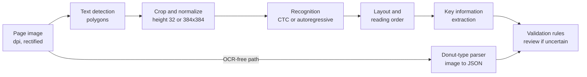

# OCR and document understanding

This comparison note locates the stages of a text-reading system and the families
that implement them: segmentation-based text detection (DBNet), line recognition
with CTC (CRNN) or with an autoregressive Transformer (TrOCR), layout-aware language
models fed by an OCR engine (LayoutLM) and OCR-free document parsers (Donut). Its
depth is *reperage*: enough mechanism to choose, evaluate and diagnose, not a
reimplementation guide.

## Problem and data contract

**Task.** Turn a page or scene image into the information a downstream process uses.
The stages produce different outputs and fail differently:

| Stage | Input | Output | Typical frame and type |
| --- | --- | --- | --- |
| Text detection | Page or scene image, $H\times W\times3$, 8-bit | Word or line regions | Polygons or rotated boxes in image pixels, origin top-left |
| Recognition | One cropped, rectified line or word | A string over an alphabet | Unicode code points, normalized (OCR-D recommends NFC) |
| Layout and reading order | Regions and their text | Region types, a reading order, tables | Region graph; order as a sequence or a partial order |
| Key information extraction (KIE) | Text, boxes, sometimes pixels | Typed fields, key–value pairs, nested records | Strings and normalized values (amounts, dates) |

**Units and conventions.** Resolution is set by the scan (dots per inch, dpi) and the
print size: a line's pixel height is its size in points times $\text{dpi}/72$. CRNN
trains on $100\times32$ images and, at test time, scales each word image to a height of
32 px with proportional width, at least 100 px [CRNN, §3.2]; TrOCR resizes a line image to $384\times384$ [TrOCR, Introduction];
LayoutLM rescales every box coordinate to a "virtual" range 0–1,000 so that page sizes
do not matter [LayoutLM, §3.4]; Donut reads whole pages at
$2560\times1920$ during pre-training [Donut, §3.2]. OCR-D defines a character as a
grapheme cluster in NFC, counts white space as characters and concatenates page text
"in reading order" before scoring [OCR-D, Text Evaluation].

**Role in a pipeline.** Archive digitization, invoice and form processing, logistics
labels, serial numbers on parts, meter reading. Upstream must deliver legible pixels
(focus, exposure, resolution, flatness; perspective correction for photographed pages,
[CV-HOMOGRAPHIE](../../50-calibration-geometrie/references/51-ransac-homographie.md)).
Downstream rarely needs "the text": it needs fields with values, positions as evidence
and a confidence that can route uncertain documents to a person. A perfect
transcription in the wrong order can be useless [OCR-D, Layout Evaluation].

## Intuition

- **Detection by segmentation (DBNet).** Predict, for every pixel, the probability of
  being in the *core* of a text instance; shrinking the targets keeps adjacent words
  apart, and the cores are grown back to full boxes afterwards [DBNet, Label
  generation]. A learned threshold map, sharp at text borders, makes binarization
  part of training [DBNet, Differentiable binarization].
- **CTC recognition (CRNN).** A CNN turns the line into a left-to-right sequence of
  feature columns; a recurrent layer predicts one label distribution per column; CTC
  sums over every way of spreading the target string over the columns, with a *blank*
  label for "nothing new here" [CRNN, §2.1–§2.3; Graves et al., §3.1]. No character
  positions are annotated.
- **Autoregressive recognition (TrOCR).** A Vision Transformer encodes image patches;
  a text decoder generates wordpieces one at a time, conditioned on the image and on
  what it already wrote, with beam search [TrOCR, Model Architecture, Decoder]. It carries a
  language prior, which helps on degraded text and can also produce fluent text that
  is not in the image.
- **Layout-aware language model (LayoutLM).** Take an OCR engine's words and boxes, add
  2-D position embeddings to BERT, and learn which token is a total, a date or a header
  [LayoutLM, §2.2]. It inherits every OCR error.
- **OCR-free parsing (Donut).** A Swin encoder reads the page and a BART decoder emits a
  token sequence that converts one-to-one into JSON [Donut, §2.2]; pre-training is a
  "pseudo-OCR" task of reading all text in reading order [§2.3]. It avoids OCR error
  propagation but makes position evidence implicit.

*Illustration (constructed).* An invoice in two columns, scanned at 150 dpi: DBNet finds
every line; a CTC recognizer reads "1000" as "100" because the digits are narrow; the
lines are concatenated by vertical position, so left and right columns interleave;
LayoutLM then labels the wrong number as the total. Each stage has a different fix,
and a single page-level CER would show only a small error.



*Diagram: a project synthesis of the stages named by OCR-D (text, layout and reading
order evaluation), DBNet, CRNN, TrOCR, LayoutLM and Donut (§2.2). Each arrow is a
contract that can be evaluated separately.*

## Prerequisites and competencies

**Required prerequisites**: [vault conventions](../../01-Parcours/Pre-requis.md).
Useful background, by mechanism:

- sampling, resolution and noise of the scan: [CV-ACQUISITION](../../20-acquisition-images/references/21-exposition-bruit-echantillonnage.md);
- binarization, connected components and contours used by DB post-processing: [CV-MORPHO](../../30-traitement-image/references/33-morphologie-composantes.md);
- page rectification from four corners: [CV-HOMOGRAPHIE](../../50-calibration-geometrie/references/51-ransac-homographie.md);
- box matching with IoU: [CV-IOU-AP](../../130-evaluation-fiabilite/references/131-iou-ap-coco.md);
- Vision Transformers behind TrOCR and Donut: [CV-REPRESENTATIONS](71-representations-transfert.md);
- generative vision–language models as a further alternative: [CV-VLM](../../120-generatif-multimodal/references/121-vlm-grounding.md);
- metric families across applications: [CV-METRIQUES-APPLIQUEES](../../130-evaluation-fiabilite/references/134-metriques-applications.md).

**Target competencies**: explain each stage's mechanism and contract, compare the
families under data, language and latency constraints, compute and interpret CER and
WER under a stated convention, and localize a failure to the stage that causes it.

## Assumptions, observability and degenerate cases

- **Legibility at the working resolution.** Every recognizer sees a resampled crop; detail
  lost by the scan or by normalization is not recoverable (example C).
- **Approximately linear text.** CRNN reads columns left to right [§2.1]; curved, vertical
  or strongly rotated text needs rectification or a detector that outputs polygons.
- **Alphabet coverage.** A CTC model can only emit symbols of its output layer (in OpenCV,
  vocabulary size plus one blank). TrOCR's wordpiece vocabulary covers more strings but
  scene-text benchmarks filter outputs to 36 lowercase alphanumerics for comparison
  [TrOCR, evaluation metrics].
- **Enough frames for CTC.** A path must emit every label and put a blank between equal
  neighbors, so a label of length $|l|$ with $r$ adjacent repeats needs
  $T\ge|l|+r$ frames (derived from the recursion of Graves et al., §4.1; example A).
- **Conditional independence.** CTC assumes outputs at different frames are independent
  given the network's internal state [Graves et al., §3.1]; there is no explicit
  language model unless one is added at decoding (a lexicon in CRNN [§2.3.3]).
- **A defined reading order.** For multi-column pages, tables and inserts, the order is a
  layout decision; OCR-D notes that two columns detected as one interleave the lines and
  "all downstream processes to measure text accuracy will be defeated" [Layout
  Evaluation].

Degenerate cases: an empty reference ($N=0$) makes the classic CER undefined; a
reference shorter than the number of insertions gives CER above 100%; a label longer
than the available frames gives an infinite CTC loss [PyTorch `CTCLoss`]; a detector
kernel that vanishes after shrinking (very thin text) produces no box; an OCR-free
model can return a well-formed JSON whose values are not on the page.

## Procedure

```text
pipeline(page):
    page <- rectify(page)                        # perspective, deskew; keep the transform
    P <- text_probability_map(page)              # DBNet head, at 1/4 or full resolution
    regions <- contours(P > t_bin)               # t_bin = 0.2 (paper) or 0.3 (OpenCV)
    keep regions with mean score >= t_poly       # OpenCV polygonThreshold
    boxes <- unclip(regions, D' = A' * r' / L')  # grow cores back to full extent
    for box in boxes:
        crop <- rectify_and_resize(box, height=32)   # or 384 x 384 for TrOCR
        y <- recognizer(crop)                    # T x (|alphabet| + 1) for CTC
        text[box] <- decode(y)                   # best path, prefix beam or lexicon
    order <- reading_order(boxes, layout_rules)  # columns, tables, inserts
    fields <- extract(text, boxes, order)        # rules, LayoutLM-type tagger
    return fields with boxes and scores          # evidence for review
```

Purpose of the steps. *Rectification* makes text horizontal and keeps the transform
so that evidence can be shown on the original page. *Binarization and contours* turn a
dense map into instances; DBNet uses the probability map at inference because the
approximate binary map "produces almost the same results" [Label generation].
*Unclipping* restores the extent lost by training on shrunk targets. *Height
normalization* gives the recognizer a fixed scale; widths vary. *Decoding* turns frame
or token probabilities into a string. *Reading order* decides what "the text" is before
any field is extracted. *Extraction* maps text to the downstream schema and keeps the
boxes as evidence.

| | CRNN + CTC | TrOCR | LayoutLM | Donut |
| --- | --- | --- | --- | --- |
| Input | Line crop, height 32 | Line crop, $384\times384$, $16\times16$ patches | OCR tokens and boxes (0–1,000), optional image regions | Whole page |
| Output | String via CTC decoding | Wordpieces, beam search (beam 10) | Token labels, classes | JSON-convertible tokens |
| Needs OCR | Is the OCR | Is the OCR | Yes (e.g. Tesseract) | No |
| Language prior | None unless lexicon | Decoder initialized from RoBERTa or MiniLM | BERT-type | BART decoder |
| Size and speed (reported) | 8.3 M parameters, 33 MB; 0.16 s per word image on a K40 workstation [§3.2–§3.3] | 62 M to 558 M parameters; 8.37 to 4.37 sentences/s on IAM [Table 5] | BASE and LARGE BERT sizes | 0.7 s per image on CORD at $1280\times960$ [§3.3] |

## Mathematics, conventions and units

**CTC** [Graves et al., §3.1, §4.1; CRNN, §2.3]. A recognizer outputs, for each frame
$t=1..T$, a distribution $y^t$ over $L'=L\cup\{\text{blank}\}$. A path $\pi\in L'^T$ has
probability $p(\pi|x)=\prod_{t=1}^T y^t_{\pi_t}$. The map $\mathcal B$ removes repeated
labels, then blanks ($\mathcal B(\text{-aa--abb})=\text{aab}$); a labeling's probability
sums over its paths:

$$p(l\mid x)=\sum_{\pi:\,\mathcal B(\pi)=l}p(\pi\mid x).$$

The sum is computed by a forward recursion over the blank-augmented label $l'$ of length
$2|l|+1$: $\alpha_t(s)=(\alpha_{t-1}(s)+\alpha_{t-1}(s-1))\,y^t_{l'_s}$, plus
$\alpha_{t-1}(s-2)\,y^t_{l'_s}$ when $l'_s$ is not blank and $l'_s\ne l'_{s-2}$ (eqs. 6–7).
The forbidden skip between equal labels is why repeats need a blank and extra frames.
Training minimizes $-\ln p(l|x)$. Decoding has no exact tractable algorithm: best-path
decoding $\mathcal B(\arg\max_\pi p(\pi|x))$ takes the most active output per frame and
"is not guaranteed to find the most probable labelling"; prefix search is better but
slower [Graves et al., §3.2]. CRNN's lexicon mode restricts the search to lexicon words
within edit distance $\delta$ of the best-path result, found with a BK-tree [§2.3.3].

**DB binarization** [DBNet, eqs. 1–2, 6, 10]. Standard binarization $B=\mathbf 1[P\ge t]$
has no gradient; DB replaces it by
$\hat B_{i,j}=1/(1+e^{-k(P_{i,j}-T_{i,j})})$ with a learned threshold map $T$ and $k=50$.
Training targets shrink each polygon by $D=A(1-r^2)/L$ ($A$ area in px², $L$ perimeter in
px, $r=0.4$); inference grows each binarized region by $D'=A'r'/L'$ with $r'=1.5$. The two
offsets coincide only for some shapes (example D).

**Edit distance and error rates** [OCR-D, Text Evaluation]. With $i$, $s$, $d$ the
insertions, substitutions and deletions of an optimal alignment, $c$ the correct
characters and $n$ the reference length,

$$\text{CER}=\frac{i+s+d}{n},\qquad \text{CER}_n=\frac{i+s+d}{i+s+d+c}.$$

The classic CER can exceed 100% "when the output contains a lot of insertions"; capping
it or dividing by the longer length are mitigations that OCR-D calls biased, and its
benchmarks use the normalized $\text{CER}_n\in[0,1]$. OCR-D defines WER with the normalized
denominator on words, delimited by Unicode TR29 word boundaries with leading and trailing
punctuation removed. The alignment uses the dynamic program
$D_{i,j}=\min(D_{i-1,j}+1,\,D_{i,j-1}+1,\,D_{i-1,j-1}+\mathbf 1[a_i\ne b_j])$ with
$D_{i,0}=i$, $D_{0,j}=j$.

**Structure metrics.** Donut's tree-edit-distance accuracy is
$\max(0,1-\text{TED}(pr,gt)/\text{TED}(\phi,gt))$, with $\phi$ the empty tree; its field-level
F1 counts a field as failed "even if a single character is missed" [Donut, §3.1].

### Worked example A: frames, blanks and decoding

*Constructed example, recomputed by checks/74-ocr-documents.py.* "hello" needs at least
6 frames (5 labels plus one blank between the two l's); "1000" also needs 6. CRNN turns a
$100\times32$ input into 25 frames [§3.2], 4 input pixels per frame. If the four digits of
"1000" are printed 4 px wide after height normalization, they span 4 frames: the string
cannot be emitted, and the typical output collapses a repeat ("100"), one deletion,
CER 1/4 on that word, an amount off by a factor of 10. At 10 px per digit the same
string spans 10 frames, enough. Decoding: with two frames whose blank probability is
0.6 each, best path returns the empty string (path probability 0.36) although the
labeling "a" has probability $0.24+0.24+0.16=0.64$.

### Worked example B: classic versus normalized CER

*Constructed example, recomputed by checks/74-ocr-documents.py.* A 5-character reference
read correctly and followed by 10 inserted characters gives classic CER $10/5=2.0$
(200%) and normalized CER $10/15\approx0.67$. One substitution in the total of a
2,000-character invoice gives 0.05% under both conventions, while the document is
unusable for accounting (appendix CV-OCR-001). The convention changes the magnitude and
the ranking of tools; neither sees field association.

### Worked example C: print size, scan resolution and height normalization

*Constructed example, recomputed by checks/74-ocr-documents.py.* A 10 pt line (em height)
scanned at 300 dpi is 41.7 px high and is downscaled by 0.768 to CRNN's 32 px; at 150 dpi
it is 20.8 px and is upsampled 1.54 times. A 6 pt footnote at 150 dpi is 12.5 px,
upsampled 2.56 times: the recognizer receives interpolated blur, and no recognizer
parameter restores the strokes. Measure errors by text height in pixels, not by dpi alone.

### Worked example D: shrink and unclip are not inverse

*Constructed example under the assumption that the binarized region equals the training
kernel; recomputed by checks/74-ocr-documents.py.* With $r=0.4$ and $r'=1.5$, a
$40\times40$ px square shrinks by 8.4 px to 23.2 px and grows back to 40.6 px. A
$120\times40$ word box comes back at about $114\times34$ px (85% of its height). A
$400\times40$ text line shrinks to a kernel 9.5 px high and comes back only 23.3 px high,
58% of its height; OpenCV's default ratio 2.0 gives 27.9 px, 70%. Since
$A/L\approx h/2$ for long boxes, the offset depends on the aspect ratio. A lenient
binarization threshold enlarges the predicted kernel and partly compensates; tune
$r'$ and the threshold on the aspect-ratio distribution of the target documents and
check that crops contain ascenders and descenders.

## Parameters and tuning

| Parameter | Values in the sources | Effect | Interactions and what to watch |
| --- | --- | --- | --- |
| Scan resolution and text height | CRNN normalizes height to 32 px [§3.2] | Legibility of strokes (example C) | Measure error per text-height bin |
| DB amplifying factor $k$ | 50 [DBNet, eq. 2] | Sharpness of the differentiable step during training | Training only |
| Shrink ratio $r$ | 0.4 [DBNet, eq. 6] | Separates adjacent instances | Thin text may vanish |
| Binarization threshold | 0.2 in the paper; OpenCV 4.13 default 0.3 | Size of predicted cores | Couples with the unclip ratio |
| Unclip ratio $r'$ | 1.5 in the paper; OpenCV default 2.0 | Box extent | Aspect-ratio dependent (example D) |
| Polygon score threshold | OpenCV default 0.5 | Drops weak instances | Recall of faint text |
| Recognizer input size | CRNN $100\times32$ in training, height 32 at test; TrOCR $384\times384$ | Frames per character; patch resolution | Long lines lose resolution in a fixed square input |
| Decoding | CRNN best path or lexicon with $\delta=3$ (0.16 s versus 0.53 s per sample) [§3.2]; TrOCR beam 10 [Settings] | Accuracy versus time | A lexicon cannot read out-of-vocabulary strings (serial numbers) |
| Alphabet and normalization | NFC, white space counted, PUA characters normalized [OCR-D] | What counts as an error | Fix before comparing tools |
| Document input resolution | Donut $2560\times1920$; $960\times1280$ on some tasks [§3.2] | Accuracy versus speed; accuracy "grows rapidly" with input size on DocVQA [§3.4] | Memory and latency |

Tuning approach (project method), on documents disjoint from the final test:

1. Fix normalization (Unicode form, case, white space, number formats) and the CER
   convention before any comparison.
2. Measure detection alone (region IoU or character coverage of the crops), then
   recognition alone on ground-truth crops, then the full pipeline: oracle
   substitution separates the stages.
3. Sweep the binarization threshold and unclip ratio jointly per text aspect ratio;
   watch truncated characters and merged neighbors.
4. Choose decoding (best path, beam, lexicon, constrained character set per field) from
   the field types: a lexicon helps words and hurts serial numbers.

## Properties and limits of guarantees

- **Alignment-free training.** CTC needs only the label sequence, "avoiding the labor of
  labeling positions of individual characters" [CRNN, §2.3.1]; frame alignments are
  not identifiable from its output (peaks are not character boxes).
- **Translation invariance of features.** CRNN's convolutional columns correspond to
  receptive fields in left-to-right order [§2.1]; recognition is not invariant to
  rotation or to large scale changes, which normalization handles.
- **No calibrated confidence.** CTC path probabilities and beam scores rank hypotheses;
  thresholds for review must be validated on held-out documents.
- **Language priors.** TrOCR and Donut decoders can output plausible tokens absent from
  the image; Donut's authors present OCR-free parsing as avoiding "OCR error propagation"
  [Donut, abstract], not as guaranteeing faithfulness.
- **Layout models inherit OCR.** LayoutLM's input is OCR words and boxes [§2.2]; its
  labels cannot fix a misread value.
- **Metrics measure what they align.** CER on concatenated page text depends heavily on
  the detected reading order; OCR-D describes Flexible Character Accuracy, which matches
  lines before computing CER, for that reason [Text Evaluation].

## Cost and implementation

Cost drivers: detection scales with page pixels; CTC recognition with the number of
lines times the frames per line; autoregressive decoders add one decoder pass per
output token times the beam size; OCR-free parsers process the whole page at high
resolution and decode up to a maximum length (1,536 tokens in Donut [§3.2]).

Reported speeds, with their setting: DB-ResNet-18 at an input size of 736 runs at 62
frames/s on MSRA-TD500 with a single 1080 Ti GPU, batch 1 [DBNet, experiments]; CRNN takes
0.16 s per IC03 sample without a lexicon and 0.53 s with the 50k lexicon and $\delta=3$ on a
Xeon workstation with a K40 GPU [§3.2]; TrOCR-Small, Base and Large process 8.37, 4.60 and
4.37 IAM sentences (text lines) per second, hardware not stated in the table [Table 5]; Donut takes 0.7 s per CORD image at $1280\times960$ on
a P40 GPU [§3.2–§3.3]. These numbers are not comparable across papers.

### Implementation contracts

Code and documentation were read, not executed.

- **OpenCV 4.13 `dnn::TextRecognitionModel`** supports CRNN-CTC models; `setDecodeType`
  accepts `"CTC-greedy"` and `"CTC-prefix-beam-search"`, and `setVocabulary` must be
  called before use. The network output must have vocabulary size plus one classes,
  index 0 being the CTC blank; greedy decoding emits a symbol when the arg-max changes or
  follows a blank.
- **OpenCV 4.13 `dnn::TextDetectionModel_DB`** binarizes the probability map at
  `binaryThreshold` (default 0.3), drops contours whose mean score is below
  `polygonThreshold` (default 0.5), and unclips by `area * unclipRatio / length`
  (default 2.0), which is DBNet's eq. 10 with different defaults. Quadrangles are
  returned as bottom-left, top-left, top-right, bottom-right points.
- **PyTorch 2.9 `torch.nn.CTCLoss(blank=0, reduction='mean', zero_infinity=False)`**
  takes log-probabilities of shape $(T,N,C)$ with $C$ including the blank, targets that
  never contain the blank, and per-sample input and target lengths. `'mean'` divides each
  loss by its target length before averaging; infinite losses "mainly occur when the
  inputs are too short to be aligned to the targets".

## Evaluation and controlled variation

### Protocols and metrics

| Output | Metric | Source and convention | What it hides |
| --- | --- | --- | --- |
| Transcription | CER, WER (classic or normalized), per page or aggregated | OCR-D; IAM uses case-sensitive CER [TrOCR] | Order of fields, critical characters |
| Transcription without order | Bag-of-words error; Flexible Character Accuracy | OCR-D | Layout errors by design |
| Regions | IoU of detected and reference regions | OCR-D Layout Evaluation; matching as in [CV-IOU-AP](../../130-evaluation-fiabilite/references/131-iou-ap-coco.md) | Whether the crop is legible |
| Reading order | Penalties over pairwise region relations, normalized by the error at 50% agreement | OCR-D, after Clausner et al. 2013 | Text content |
| Words on receipts | Word-level precision, recall, F1 | SROIE in [TrOCR] | Field identity |
| Fields and structure | Field-level F1; TED-based accuracy | [Donut, §3.1]; FUNSD word-level F1 in [LayoutLM] | Business cost of each field |

Published results, with their setting: TrOCR reaches case-sensitive CER 3.42 (Base) and
2.89 (Large) on IAM handwriting [Table 4]; LayoutLM-BASE pre-trained on 11 M documents
reaches F1 0.7866 on FUNSD, 0.7927 for its best setting [§3.6]; Donut at $1280\times960$ reaches
91.1 accuracy on CORD at 0.7 s per image [§3.3].

### Proposed baseline and controlled variation (not executed)

- **Question**: which stage limits accuracy when scan resolution drops?
- **Data**: held-out invoices with transcriptions, line boxes, reading order and
  normalized field values, split by supplier template.
- **Baseline**: DB detector and CRNN-CTC recognizer with fixed thresholds, greedy decoding,
  rule-based reading order and field extraction; 300 dpi scans.
- **Controlled variation**: resample the same scans to 150 dpi; everything else identical.
- **Measurements**: normalized CER on ground-truth crops (recognition only), detection
  coverage, end-to-end CER, field accuracy for amounts and dates, fully correct documents,
  review rate at a fixed confidence threshold.
- **Expected effect (hypothesis)**: small print and narrow digits degrade first
  (examples A and C); detection changes little.
- **Confound**: resampling also changes the detector's input scale and the effective
  unclip offset. Run a third configuration with ground-truth boxes to isolate recognition.

**Measurement limits.** Scores depend on normalization, case policy and character-set
filtering; benchmark lines are cleaner than production crops; per-page CER over
heterogeneous pages hides difficult layouts, which is why OCR-D reports CER per page
[CER Granularity].

## Failure modes and diagnosis

| Symptom | Possible causes | Discriminating check | Conditional remedy |
| --- | --- | --- | --- |
| Lines read correctly, columns interleaved | Layout or reading-order rule (sort by vertical position) | Replace only the order by the reference (CV-OCR-003) | Column or table segmentation, order rules or a layout model |
| Characters cut at line ends, missing ascenders or descenders | Unclip offset or threshold too small for long boxes | Overlay boxes; coverage of reference characters by crops (example D) | Tune `unclipRatio` and threshold per aspect ratio; pad crops |
| "1000" read as "100", doubled letters lost | Too few CTC frames between repeats | Compare $T$ with $\lvert l\rvert+r$ for failing strings (example A) | Keep more width, reduce horizontal stride, avoid downscaling narrow fonts |
| Infinite or NaN CTC loss in training | Targets longer than inputs | Log input and target lengths | Fix resizing; `zero_infinity` only as a guard |
| Fluent words that are not on the image | Language prior of an autoregressive decoder | Re-read the crop; compare with a CTC model on the same crop | Constrained decoding for numeric fields; keep box evidence; review band |
| Two tools disagree on CER for the same output | Normalization, convention or aggregation | Recompute both with one script and one normalization | Publish the protocol |
| Errors concentrated on small print | Pixel height too small after scanning (example C) | Error rate by text-height bin | Rescan at higher dpi; tile; avoid lossy compression |
| Right value, wrong field | Association or extraction | Field-level evaluation with row association | Layout model, table structure, arithmetic consistency checks |
| Skewed or photographed pages fail | Detector or recognizer assumes horizontal text | Angle histogram of detected boxes | Deskew or homography rectification |

## Alternatives and applications

Conditional choices:

- Prefer **CRNN-type CTC recognizers** when lines are clean, alphabets are fixed (serial
  numbers, meters, plates), latency and memory are tight, and no language prior is
  wanted.
- Prefer **TrOCR-type autoregressive recognizers** for handwriting and degraded print
  where context helps, with constrained decoding or validation for numbers.
- Prefer **OCR plus a layout model** when boxes are needed as evidence and an OCR engine
  is already validated.
- Prefer **OCR-free parsers** when the schema is stable, OCR errors dominate, many
  languages must be supported, and position evidence is not required.
- Prefer **rules on an OCR output** (regular expressions, checksums, sums of line items)
  when fields have a strong format; they also check any model's output.
- General vision–language models are a further option for open questions about a page
  ([CV-VLM](../../120-generatif-multimodal/references/121-vlm-grounding.md)); they need the
  same field-level validation.

Industrial uses (project reasoning): invoice and delivery-note capture with human review
of uncertain fields, reading serial numbers and date codes on parts (often a CTC
recognizer on a fixed region), meter and label reading, and archive digitization where
CER per page and reading order matter more than fields.

## Guided reasoning and proposed checks

These constructed cases develop the OCR chain, normalization and a metric adapted to
the document. They are used to explain or test reasoning; their image, video or
hardware results are not claimed as measured. The method properties remain attached to
the sources below.

### Case linked to CV-OCR-001

**Working question**: Why is a good CER insufficient to validate invoice extraction?

**Reference answer**: CER counts character edit operations under a stated protocol; reading order, field association and the correctness of amounts are other outputs.

**Example of a business-relevant difference**: An invoice can contain almost all the correct characters while associating the amount of a row with the wrong reference, or by reversing two columns. A small error on a critical figure can also count little in the overall CER of a long document.

**Proposed contract**: set separately transcription, reading order, boxes, keys and expected values, with a reference suitable for each. Fix the normalization rules for spaces, case and numbers in the evaluation. Measure accuracy of critical fields, fully correct documents, and human verification rate at the selected threshold. A linguistically plausible generation must still match the source image. The validation of the product therefore concerns the information actually used by the downstream process; it is not deduced from the character recognition score alone or from the legible appearance of the reconstructed text.

### Case linked to CV-OCR-003

**Working question**: Individual lines are recognized correctly, but the output interleaves columns. Which component should be examined?

**Reference answer**: Detection/layout and assembly of the reading order, before the character recognizer.

**Breakdown of the pipeline**: Boxes or regions determine which lines are sent for recognition; their structure then determines how texts are assembled. A recognizer can be exact on each crop and the final document can be wrong because these crops are traversed in the wrong order.

**Constructed test**: Retain line transcripts and replace only the order or assembly with a reference annotation. If the document becomes correct again, the diagnosis is about layout or reading rather than characters. Test columns, tables, inserts and inclined lines with the same normalization rules. Check the links between fields and values, because a plausible order is not always enough to extract the business structure. This approach locates responsibility before choosing additional annotations or training for a component that does not address the cause.

**Documentary reference for this pass**: [OCR-D, Evaluation](https://ocr-d.de/en/spec/ocrd_eval.html), definitions, alignment and normalization of errors. The other developments are in the [flashcards](../74-ocr-documents.md).

## Additional technical explanations — 2026-10-30

These explanations complement the mechanism associated with each question. Calculations are cases constructed under assumptions; protocols remain proposed until a test is recorded.

### CV-OCR-001

**Situation**: Why is a good CER insufficient to validate invoice extraction?

**Example of weighting**: A 2,000-character document with one substitution in the total amount has a CER of 0.05% and can remain unusable for accounting. A field metric can compare the numerical value after a predefined normalization of separators, currencies and decimals; a document metric can require all critical fields to be correct. Keeping the raw string and the image region also makes it possible to distinguish recognition error, field association and normalization. Arithmetic checks between lines, taxes and totals provide additional consistency, without proving that a plausible value actually corresponds to the printed one.

### CV-OCR-002

**Situation**: Can CER exceed 100%, and under which conditions?

**Calculation of distance**: Dynamic programming uses $D_{i,j}=\min(D_{i-1,j}+1,D_{i,j-1}+1,D_{i-1,j-1}+\mathbf1[a_i\ne b_j])$, with boundary conditions $D_{i,0}=i$ and $D_{0,j}=j$. It looks for the minimum editing cost, not a simple count of different fixed-position characters. To aggregate several pages, the ratio $\sum_k(S_k+D_k+I_k)/\sum_kN_k$ weights by reference length, while the average of per-page CERs weights every page equally. Both answer different questions. Defining Unicode units and processing empty references before this calculation avoids incompatible score comparisons.

### CV-OCR-003

**Situation**: Individual lines are recognized correctly, but the output interleaves columns. Which component should be examined?

**Model of order**: Representing regions as nodes and "must be read before" relations as edges makes a partial order explicit. Topological sorting produces a compatible order if these constraints are cycle-free; column rules, tables and inserts determine the edges, not the confidence of the recognizer. A simple global sort by vertical position can interleave two well-detected columns. To locate the fault, successively substitute reference regions, reference transcriptions and the reference order, replacing only one output at a time. This ablation identifies what each component contributes to the final document error.

**Passages consulted for these developments**: [OCR-D](https://ocr-d.de/en/spec/ocrd_eval.html), Text Evaluation, Levenshtein distance, CER/WER; examples and order model constructed by the project.

## Worked reasoning and boundary cases — 2026-11-08

The following are constructed project deductions and proposed checks, not
new empirical results. Each extends an existing recall objective; the concise
expected answer on its card remains the grading target.

### CV-OCR-001 — Field association can fail with perfect characters

A two-column invoice can contain every digit correctly yet assign a unit price from one row to the quantity of another. Character accuracy alone then misses the extraction failure. A project evaluation can score field identity, normalized numeric value, row association and document-level acceptance separately. Define normalization for decimal separators and currency before testing, so a harmless formatting difference and a financially different amount do not receive the same interpretation.

### CV-OCR-002 — Micro and macro CER answer different questions

Constructed example: one 100-character document has zero edits and one one-character document has one edit. Micro CER is $1/101\approx0.99\%$, while the mean of document CERs is 50%. Both are well-defined but weight documents differently. Report the aggregation rule, empty-reference policy and text normalization. A CER above 100% is possible when insertions dominate; clipping it to 100% would erase real error magnitude.

Consulted foundations: [OCR-D evaluation](https://ocr-d.de/en/spec/ocrd_eval.html): Text Evaluation, Levenshtein alignment, normalization and CER/WER.

## Sources and flashcards

### Scientific sources

- [Graves et al., ICML 2006, Connectionist Temporal Classification](https://www.cs.toronto.edu/~graves/icml_2006.pdf): §3.1 (paths, map $\mathcal B$, conditional independence, eq. 3), §3.2 (best-path and prefix-search decoding), §4.1 (forward recursion, eqs. 5–8).
- [Shi, Bai and Yao, CRNN](https://arxiv.org/abs/1507.05717): §2.1 feature sequence, §2.3 transcription (eqs. 1–2, lexicon-free and lexicon-based modes), §3.2 implementation details ($100\times32$, 25 frames, test height 32, timings), §3.3 model size.
- [Liao et al., DBNet](https://arxiv.org/abs/1911.08947): sections "Differentiable binarization" (eqs. 1–2, $k=50$) and "Label generation" (eqs. 5–6 and 10, $r=0.4$, $r'=1.5$, threshold 0.2); experiments (1080 Ti, batch 1; MSRA-TD500 speed).
- [Li et al., TrOCR](https://arxiv.org/abs/2109.10282): Introduction ($384\times384$, $16\times16$ patches), Model Architecture (encoder, decoder, beam search), Model Initialization, Settings (beam 10), Evaluation Metrics (SROIE, case-sensitive IAM CER, 36-character filter), Tables 4–5.
- [Xu et al., LayoutLM](https://arxiv.org/abs/1912.13318): §2.2 2-D position and image embeddings; §3.4 model pre-training (coordinates scaled to 0–1,000); §3.6 FUNSD results; use of Tesseract for OCR (§3.3).
- [Kim et al., Donut](https://arxiv.org/abs/2111.15664): abstract; §2.2 encoder, decoder and output conversion; §2.3 pre-training and SynthDoG; §3.1 field-level F1 and TED accuracy; §3.2 setups ($2560\times1920$, max length 1,536, P40); §3.3 CORD timing; §3.4 resolution study.
- [OCR-D, Quality Assurance specification](https://ocr-d.de/en/spec/ocrd_eval.html): Text Evaluation (characters, Levenshtein distance, CER, normalized CER, CER granularity, WER, bag of words), Layout Evaluation, Reading Order, IoU, Unicode Normalization, Flexible Character Accuracy, Reading Order Evaluation.

### Implementation sources

- [OpenCV 4.13.0 `modules/dnn/include/opencv2/dnn/dnn.hpp`](https://github.com/opencv/opencv/blob/4.13.0/modules/dnn/include/opencv2/dnn/dnn.hpp#L1676-L1760): `TextRecognitionModel` (L1676–L1760), quadrangle point order (L1778–L1782), `TextDetectionModel_DB` parameters (L1890–L1932).
- [OpenCV 4.13.0 `modules/dnn/src/model.cpp`](https://github.com/opencv/opencv/blob/4.13.0/modules/dnn/src/model.cpp#L700-L760): decode-type dispatch and greedy CTC decoding (L700–L757), prefix beam search with blank index 0 (L840–L880), DB defaults (L1326–L1335), thresholds (L1398–L1470), unclip offset (L1500–L1508).
- [PyTorch 2.9 `torch.nn.CTCLoss`](https://docs.pytorch.org/docs/2.9/generated/torch.nn.CTCLoss.html): signature, reduction, `zero_infinity`, shapes and length constraints.

### Related flashcards and references

- [Flashcards](../74-ocr-documents.md): CV-OCR-001 (CER versus extraction), CV-OCR-002 (CER above 100%), CV-OCR-003 (reading-order diagnosis).
- Metrics across applications: [CV-METRIQUES-APPLIQUEES](../../130-evaluation-fiabilite/references/134-metriques-applications.md); box matching: [CV-IOU-AP](../../130-evaluation-fiabilite/references/131-iou-ap-coco.md).

Drafted by agent, 2026-10-18. Revision 8, 2026-11-14: body deepened and language corrected by Agent Claude Code (`revue-cartes`, self-review); see the [subject report](https://github.com/speillet/Knowledge_Computer_Vision/blob/main/docs/revues/2026-11-14-reference-depth/74-ocr-documents.md).
