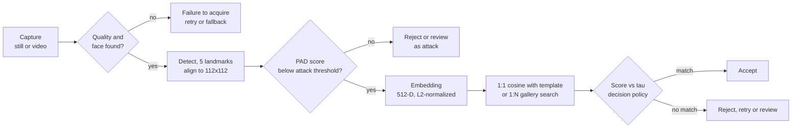

# Biometric recognition, ArcFace and PAD

This comparison note separates three questions a face system can be asked: is this
the claimed person (1:1 verification), who among the enrolled is this (1:N
identification), and is this a live, bona fide presentation rather than an artefact
(presentation attack detection, PAD). It uses ArcFace as the reference embedding
method and NIST and best-practice documents for the error definitions. It establishes
no regulatory compliance and no certification of any product.

## Problem and data contract

**Tasks and outputs.**

| Task | Input | Output | Error rates (definition) |
| --- | --- | --- | --- |
| 1:1 verification | Probe sample and one enrolled template | Similarity score; accept or reject at threshold $\tau$ | FMR: proportion of impostor (nonmated) comparisons at or above $\tau$; FNMR: proportion of mated comparisons below $\tau$ [NIST FRTE 1:1] |
| 1:N identification | Probe and a gallery of $N$ enrolled identities | Candidate list, with or without threshold | FPIR: proportion of nonmated searches returning one or more candidates above threshold; FNIR: proportion of mated searches not returning the mate above threshold [NIST FRTE 1:N] |
| PAD | One capture (still or video) | Attack or bona fide, with a score | APCER: attacks classified as bona fide; BPCER: bona fide classified as attacks [NISTIR 8491, §3] |

FMR and FNMR count *comparisons* of one sample against one template; false accept and
false reject rates (FAR, FRR) count *transactions* under a decision policy and include
failures to acquire [Mansfield and Wayman, §2.4.2.1]. The convention "similarity at or
above $\tau$ means match" is NIST's; distance scores reverse the inequality.

**Data contract of an ArcFace-type matcher.** A face detector returns a box and five
landmarks; a similarity transform maps the face to a $112\times112$ crop
[ArcFace, §IV-A]. The network outputs a 512-dimensional embedding [§III-A]; after $\ell_2$
normalization, comparison is a cosine similarity in $[-1,1]$ (or the equivalent
Euclidean distance on the unit sphere). Templates built from several images or video
frames are averaged feature centers [§IV-A]. Scores are not probabilities; their
meaning is fixed only by the thresholds measured on a stated dataset.

**Role in a pipeline.** Capture → quality check → detection and alignment → PAD →
embedding → comparison (1:1) or search (1:N) → decision policy (attempts, fallback,
human review). Upstream determines pose, illumination, resolution and compression;
downstream needs an operating point stated in FMR or FPIR, with FNMR or FNIR at that
point, and a defined action on capture failures.

## Intuition

- **Angular embedding.** ArcFace normalizes both features and class weights, so a
  training logit depends only on the angle between a face's embedding and its
  identity's weight vector; it then *adds* an angle $m$ to the target angle, which forces
  every face to sit closer to its own identity than to any other by a geodesic margin on
  the hypersphere [ArcFace, §III-A, Fig. 3]. At test time the classifier is discarded and
  two embeddings are compared directly.
- **Thresholding is the product.** The same embeddings give very different systems
  depending on $\tau$: a phone unlock, a border gate and a watch-list search sit at
  different points of the same error curve.
- **1:N multiplies opportunities.** Each nonmated search makes $N$ comparisons, so a
  per-comparison false-match rate that is harmless in 1:1 produces a false candidate
  in most searches of a large gallery (example D).
- **PAD asks another question.** A high-quality print or screen replay of an enrolled
  person preserves identity cues; a good identity embedding *should* match it. Whether
  the capture is an artefact is a separate classification with its own data and
  errors [NISTIR 8491, §1.1].

*Illustration (constructed).* A door-access tablet compares visitors with 200 enrolled
employees. A visitor holds up a phone showing an employee's photo: the matcher returns a
high similarity, correctly for identity and wrongly for access. NIST observed that print
and replay attacks are well detected when the frame of the photo or tablet and the
attacker's hands are visible, and that errors increase for all algorithms when the view
is zoomed so they are not [NISTIR 8491, executive summary].



*Diagram: a project synthesis of the error definitions above (NIST FRTE, NISTIR 8491,
Mansfield and Wayman) and of ArcFace's preprocessing. The order of PAD and matching,
retries and review are design choices.*

## Prerequisites and competencies

**Required prerequisites**: [vault conventions](../../01-Parcours/Pre-requis.md).
Useful background, by mechanism:

- embeddings, transfer and their training domains: [CV-REPRESENTATIONS](71-representations-transfert.md), [CV-CLIP](72-clip-siglip.md);
- face detection boxes and suppression before alignment: [CV-DETECTEURS](../../80-detection-pose/references/82-detection-fasterrcnn-yolo-detr.md), [CV-NMS](../../80-detection-pose/references/81-nms.md);
- exposure, noise and resolution of the capture: [CV-ACQUISITION](../../20-acquisition-images/references/21-exposition-bruit-echantillonnage.md);
- nearest-neighbor search for large galleries: [CV-FLANN](../../40-features-matching/references/48-flann.md);
- splits, subgroup evaluation, calibration and drift: [CV-FIABILITE](../../130-evaluation-fiabilite/references/133-donnees-generalisation.md);
- metric families across applications: [CV-METRIQUES-APPLIQUEES](../../130-evaluation-fiabilite/references/134-metriques-applications.md).

**Target competencies**: explain the angular-margin mechanism and the separation of
identity and PAD, compare 1:1, 1:N and PAD evaluations, set and justify an operating
point with enough evidence, and diagnose a failure by condition and subgroup.

## Assumptions, observability and degenerate cases

- **Alignment.** The embedding expects the crop geometry of training (five-point
  similarity alignment to $112\times112$). Landmark errors on profile or occluded faces
  change the crop and the score.
- **Domain.** ArcFace models are trained on web-collected celebrity images
  (MS1MV3, IBUG-500K) [§IV-A]; capture conditions of a deployment (near-infrared, low
  resolution, masks, children) may lie outside that domain.
- **Separability is relative.** Pose and age gaps "significantly increase the angles
  between positive pairs", which moves the best verification threshold [ArcFace, §IV-D,
  Fig. 10].
- **Independence of trials.** Error-rate confidence statements assume independent
  comparisons; comparisons sharing a person are correlated, so the Rule of 3 is
  "over-optimistic" [Mansfield and Wayman, §3.4].
- **Attacks are open-ended.** The set of presentation attack instruments is determined by
  "the effort and ingenuity of the attacker" [NISTIR 8491, §1.1]; PAD error rates are
  measured per attack type and do not extend to untested types.

Observability limits and degenerate cases: identical twins are excluded from FMR by
definition because "genetically similar comparisons" have different score
distributions [Mansfield and Wayman, §2.4.2]; an FMR below about $3/n$ cannot be
demonstrated with $n$ nonmated comparisons (example C); a failure to acquire produces no
score at all, which a score-level evaluation silently drops unless counted; a matcher
returns a score for any pair of crops, including non-faces passed by a faulty detector.

## Procedure

```text
enrol(person, images):
    for each image: box, landmarks <- detect(image); crop <- align(image, landmarks, 112)
        reject if quality(crop) < q_min or pad(crop) says attack     # count failures to enrol
    template <- normalize(mean(normalize(embed(crop)) for each crop))
verify(probe, template, tau):
    crop <- align(detect(probe)); if capture fails: return FAILURE_TO_ACQUIRE
    if pad_score(probe) >= tau_pad: return ATTACK
    s <- cos(normalize(embed(crop)), template)                       # in [-1, 1]
    return MATCH if s >= tau else NO_MATCH
identify(probe, gallery, tau, R):
    s_k <- cos(probe_embedding, template_k) for every k              # exact or ANN search
    return the top R candidates with s_k >= tau                      # tau = 0 for investigation
```

Purpose of the steps. *Alignment* removes in-plane rotation, scale and translation so
that the embedding compares identity rather than geometry. *Quality and PAD gates*
decide what the matcher is allowed to see; their rejections become failures to acquire
or attack decisions, not matcher errors. *Normalization* makes cosine and Euclidean
comparisons equivalent and template averaging well defined. *The threshold* turns a
continuous score into the decision whose errors are reported. *Candidate lists* in 1:N
serve either automated decisions (threshold) or investigation, where a human reviews a
fixed number of candidates and NIST then reports FNIR as rank-1 misses [NIST FRTE 1:N].

| | 1:1 verification | 1:N identification | PAD |
| --- | --- | --- | --- |
| Question | Same person as the claim? | Who, if anyone, in the gallery? | Artefact or bona fide? |
| Errors | FMR, FNMR | FPIR, FNIR; rank-based miss rate for investigation | APCER (per attack type), BPCER |
| Typical summary | FNMR at FMR $=10^{-6}$ (NIST ranking column) | FNIR at FPIR $=0.003$ | APCER at BPCER $=0.01$; BPCER at APCER $=0.01$ |
| Scales with | Number of attempts | Gallery size $N$ | Diversity of attack instruments |

## Mathematics, conventions and units

**ArcFace** [§III-A, eqs. 1–4]. With bias 0, $\|W_j\|=1$ and the feature $x_i$
normalized and rescaled to $s$, the logit of class $j$ is $s\cos\theta_j$, where $\theta_j$ is
the angle (radians) between $x_i$ and $W_j$. ArcFace adds an angular margin $m$ to the
target class:

$$L_3=-\log\frac{e^{s\cos(\theta_{y_i}+m)}}{e^{s\cos(\theta_{y_i}+m)}+\sum_{j\ne y_i}e^{s\cos\theta_j}},$$

with $s=64$ and $m=0.5$ in the experiments [§IV-A]. SphereFace (multiplicative angle
margin $m_1$) and CosFace (cosine margin $m_3$) are special cases of the combined target
logit $s(\cos(m_1\theta_{y_i}+m_2)-m_3)$ (eq. 4). For angles in $[0,\pi]$, class $y$
outscores class $j$ under the margin only if $\theta_j>\theta_{y_i}+m$: the margin is a
constant geodesic gap, whereas SphereFace and CosFace give a non-linear angular margin
[§III-A, Fig. 5].

**Comparison scores.** For unit vectors $a$ and $b$, $\|a-b\|^2=2-2\cos(a,b)$, so a cosine
threshold and a Euclidean threshold define the same decision (example B).

**Error rates at threshold $\tau$** (similarity convention) [NIST FRTE 1:1 and 1:N]:

$$\text{FMR}(\tau)=\frac{\#\{\text{nonmated comparisons with } s\ge\tau\}}{\#\text{nonmated comparisons}},\qquad \text{FNMR}(\tau)=\frac{\#\{\text{mated comparisons with } s<\tau\}}{\#\text{mated comparisons}}.$$

The equal error rate (EER) is the common value where the two curves cross; it is one
point of the error tradeoff and says nothing about FNMR at FMR $=10^{-6}$. Mansfield and
Wayman (§5.2) give, for a single attempt with failure-to-acquire rate FTA, penetration
rate PR and binning error rate BER:

$$\text{FAR}=\text{PR}\cdot\text{FMR}\cdot(1-\text{FTA}),\qquad \text{FRR}=\text{FTA}+(1-\text{FTA})\,\text{BER}+(1-\text{FTA})(1-\text{BER})\,\text{FNMR}.$$

**Evidence for a small rate.** With zero errors in $n$ independent trials, the one-sided
95% upper bound $p$ solves $(1-p)^n=0.05$, so $p\approx3/n$ (Rule of 3); "to be 90% confident
that the true error rate is within ±30% of the observed error rate, there must be at
least 30 errors" (Rule of 30) [Mansfield and Wayman, §3.4].

**From 1:1 to 1:N (constructed approximation).** If the $N$ comparisons of a nonmated
search were independent with per-comparison rate $f$, then
$\text{FPIR}\approx1-(1-f)^N\approx Nf$ for small $Nf$. Real galleries violate
independence; NIST measures FPIR directly.

### Worked example A: what the margin demands

*Constructed example, recomputed by checks/75-embeddings-biometrie.py.* ArcFace reports
target angles starting near $90^\circ$ and ending near $30^\circ$ during training [§III-A,
Fig. 4a]. At $\theta_{y}=30^\circ$ the target logit is $64\cos30^\circ=55.4$ without margin and
$64\cos(58.65^\circ)=33.3$ with $m=0.5$ rad ($28.65^\circ$): the sample still pays a loss
unless every competing class is farther than $58.65^\circ$.

### Worked example B: the same threshold in two units

*Constructed example, recomputed by checks/75-embeddings-biometrie.py.* OpenCV's face
sample accepts a pair at cosine similarity $\ge0.363$ or at $\ell_2$ distance $\le1.128$.
Since $\sqrt{2-2\times0.363}=1.1287$, both tests are the same decision for normalized
features. Those numbers belong to one model (SFace) and one evaluation; they are not
thresholds for another network.

### Worked example C: how many comparisons a target FMR needs

*Constructed example, recomputed by checks/75-embeddings-biometrie.py.* Zero false matches
in 29,956 independent nonmated comparisons bounds FMR below $10^{-4}$ (95%); for
$10^{-6}$ the count is 2,995,731, and the Rule of 30 asks for 30 million to estimate it
within ±30%. ArcFace's IJB-C protocol has 15,639 K impostor comparisons [§IV-D]: a
threshold at FMR $10^{-5}$ rests on about 156 false matches, at $10^{-6}$ on about 16, and
FMR $10^{-8}$ cannot be measured on it (0.16 expected events). One image from each of
2,449 people gives about 3.0 M nonmated pairs, but each person appears in 2,448 of them.

### Worked example D: a gallery multiplies false candidates

*Constructed example under the independence approximation, recomputed by
checks/75-embeddings-biometrie.py.* With $N=10^6$ enrolled identities and $f=10^{-6}$,
$1-(1-10^{-6})^{10^6}=0.632$: most nonmated searches would return a false candidate. Keeping
FPIR at 0.003, NIST's summary operating point, would need $f\approx3.0\times10^{-9}$, a much
stricter threshold than a 1:1 system with the same matcher.

### Worked example E: matcher errors are not decision errors

*Constructed example, recomputed by checks/75-embeddings-biometrie.py.* With FMR $10^{-4}$,
FNMR 0.02, FTA 0.03, a single attempt and no binning, FAR $=9.7\times10^{-5}$ and
FRR $=0.03+0.97\times0.02=0.0494$: acquisition failures cause more rejections than the
matcher does.

## Parameters and tuning

| Parameter | Values in the sources | Effect | Interactions and what to watch |
| --- | --- | --- | --- |
| Scale $s$ and margin $m$ | $s=64$, $m=0.5$ [ArcFace, §IV-A]; SphereFace-type $m=1.35$ in ArcFace's re-implementation | Compactness and separation during training | Training-time only; they do not set the test threshold |
| Embedding dimension | 512 [§III-A] | Template size, search cost | 2,048 bytes per float32 template (example F) |
| Alignment and crop | Five landmarks, $112\times112$ [§IV-A]; OpenCV `alignCrop` uses the detector's five points | Geometric normalization | Landmark errors on profiles |
| Decision threshold $\tau$ | Set per algorithm for a target FMR or FPIR (NIST) | Operating point | Re-measure after any model, camera or population change |
| Template construction | Mean of image or frame features [§IV-A] | Robustness to single bad frames | Averaging a PAD-failed frame contaminates the template |
| Attempts per transaction | Decision policy [Mansfield and Wayman, §2.4.1] | FRR down, FAR up | Report transaction-level rates |
| PAD threshold | APCER at BPCER $=0.01$ or BPCER at APCER $=0.01$ [NISTIR 8491, §3.4] | Convenience versus security | Per attack type |
| Gallery size $N$ | Varies by NIST column | FPIR at fixed $\tau$ (example D) | Threshold must move with $N$ |

Tuning approach (project method), on data disjoint from the final test:

1. Fix the capture recipe and count failures to acquire and to enrol.
2. Collect mated and nonmated comparisons from people not used in training, with enough
   nonmated comparisons for the target FMR (example C); group comparisons by person.
3. Set $\tau$ for the target FMR (1:1) or FPIR at the deployed gallery size (1:N); report
   FNMR or FNIR there with confidence intervals by person-level resampling.
4. Repeat per subgroup and capture condition at the *same* $\tau$; then tune the PAD
   threshold per attack type and evaluate the combined decision.

## Properties and limits of guarantees

- **Invariances.** Alignment removes similarity transforms; the embedding is trained to
  tolerate pose, illumination and age within its training domain, and the tolerance
  degrades with pose and age gaps [§IV-D, Fig. 10].
- **Geometry.** ArcFace's margin corresponds exactly to a geodesic distance on the
  normalized hypersphere [§III-A]; this is a training-loss property, not a test-time
  guarantee of separation for unseen identities.
- **Calibration.** Cosine scores are not probabilities, and a threshold transfers neither
  across models nor across capture conditions (example B).
- **Demographic differentials.** NIST summarizes 1:1 false-match differentials by
  comparing same-sex, same-age-group, same-region impostor pairs at a threshold fixed
  for an overall FMR of 0.0003 [NIST FRTE 1:1, demographics page]; differentials exist
  per algorithm and must be measured, not assumed absent.
- **PAD coverage.** In NIST's PAD evaluation, some attack types were detected with low
  errors by several developers, others by one or none; sum-rule fusion of four accurate
  algorithms beat the best single algorithm in all impersonation categories
  [NISTIR 8491, executive summary, §5.4].
- **No compliance by construction.** None of these properties certifies a product
  against a standard; this note claims no such result.

## Cost and implementation

Cost drivers: one detection, alignment and embedding per capture (ArcFace reports
8.9 ms per face for ResNet50 and 15.4 ms for ResNet100 [§IV-A], hardware not stated in
that passage); 1:1 comparison is one dot product of length $d$; exact 1:N search costs
$N\cdot d$ multiply-accumulates per probe and $N\cdot d\cdot4$ bytes of float32 templates
(example F: 2.048 GB and 512 M multiply-accumulates for $N=10^6$, $d=512$), which motivates
approximate search ([CV-FLANN](../../40-features-matching/references/48-flann.md)) and its
own recall loss. PAD adds a model per capture, more for video.

### Implementation contracts

Code was read, not executed.

- **OpenCV 4.13 `cv::FaceRecognizerSF`** (objdetect, SFace model): `alignCrop` warps the
  face to $112\times112$ with a similarity transform estimated from the five landmarks that
  `FaceDetectorYN` returns; `feature` runs the network; `match` $\ell_2$-normalizes both
  features and returns their dot product (`FR_COSINE`, default) or their Euclidean
  distance (`FR_NORM_L2`). The official sample uses thresholds 0.363 (cosine, higher is
  more similar) and 1.128 ($\ell_2$, lower is more similar).
- The sample's thresholds are tied to that model; any other network needs its own
  threshold measured on its own nonmated comparisons.

## Evaluation and controlled variation

### Protocols and metrics

| Protocol | Metric and operating point | Source | What it hides |
| --- | --- | --- | --- |
| NIST FRTE 1:1 | FNMR at FMR $=10^{-6}$ (VISABORDER ranking) and other columns | NIST FRTE 1:1 page | Transaction-level errors, capture failures |
| NIST FRTE 1:N | FNIR at FPIR $=0.003$; investigation mode with 50 candidates, FNIR as rank-1 miss | NIST FRTE 1:N page | Gallery composition effects outside the tested sizes |
| NIST FATE PAD | APCER at BPCER $=0.01$, BPCER at APCER $=0.01$, per attack type; failures to process counted as attacks | NISTIR 8491, §3 | Untested attack instruments |
| IJB-B, IJB-C | TPR at FPR $=10^{-4}$ or $10^{-5}$ (1:1), rank-1 (1:N) | ArcFace §IV-D | Very low FMR (example C) |
| LFW, YTF | Verification accuracy, saturated near 99.8% and 98.0% | ArcFace §IV-D | Operating points of deployed systems |

NIST's FATE PAD evaluation covered 82 algorithms from 45 developers, about 20,000 attack
attempts and 21,000 bona fide presentations in 9 attack categories [NISTIR 8491,
executive summary]. Failures to process are scored as detected attacks, a
"failure-is-considered-suspicious" policy [§3.3].

### Proposed baseline and controlled variation (not executed)

- **Question**: how much does capture pose change FNMR at a fixed operating point?
- **Data**: an internal set of consenting people, disjoint from training, with frontal
  enrolment images and probes at controlled yaw angles; mated and nonmated comparisons
  grouped by person.
- **Baseline**: one embedding model, five-point alignment, $\tau$ set on frontal probes for
  FMR $=10^{-4}$ (at least 30,000 nonmated comparisons, example C).
- **Controlled variation**: probes at 30° yaw; same people, same enrolment, same $\tau$.
- **Measurements**: FNMR and FMR at the fixed $\tau$, failures to acquire, FNMR per subgroup,
  person-level bootstrap intervals.
- **Expected effect (hypothesis)**: FNMR rises, consistent with larger positive-pair angles
  under pose [ArcFace, Fig. 10]; FMR at fixed $\tau$ may also change.
- **Confound**: landmark detection degrades with yaw; repeat the variation with manually
  verified landmarks to separate alignment from the embedding.

**Measurement limits.** Benchmarks with web images saturate (LFW) and say little about
very low FMR; NIST results depend on dataset and image type per column; correlated
comparisons widen intervals; a test without attacks says nothing about APCER.

## Failure modes and diagnosis

| Symptom | Possible causes | Discriminating check | Conditional remedy |
| --- | --- | --- | --- |
| Good average accuracy, many rejections in one condition | Pose, illumination or capture shift; subgroup differential | FNMR per condition and subgroup at the same $\tau$ | Capture guidance, condition-specific enrolment, model change; never a silent per-group threshold without policy review |
| False matches between relatives or look-alikes | Genuinely similar faces; threshold too permissive | Inspect top impostor pairs; twins are outside FMR by definition | Stricter $\tau$, second factor, human review |
| 1:N returns false candidates far more often than 1:1 FMR suggests | Gallery size multiplies opportunities (example D) | FPIR measured at the deployed $N$ | Threshold set for FPIR at $N$; candidate review |
| Photo or screen accepted as the person | No PAD, or PAD not trained on that attack type | APCER per attack type; zoomed versus framed attacks [NISTIR 8491] | PAD per attack type, video input, fusion, challenge procedures |
| Many legitimate users flagged as attacks | PAD threshold or capture conditions | BPCER on bona fide captures from the deployment camera | Re-tune at the target BPCER; capture guidance |
| Scores shift after a camera or model update | Threshold tied to the old model and domain | Re-measure FMR on held nonmated pairs | Re-set $\tau$; version thresholds with models |
| High FRR though matcher FNMR is low | Failures to acquire or enrol | Transaction-level FRR versus FNMR (example E) | Fix capture and quality gates |
| Verification degrades on profile captures | Landmark-based alignment fails | Score versus landmark error on annotated images | Better detector or landmarks; multi-image templates |

## Alternatives and applications

Conditional choices:

- Prefer **1:1 verification** when a claim exists (badge, document, account); it scales with
  attempts, not with the gallery.
- Use **1:N with a threshold** for automated decisions only when FPIR at the deployed $N$ is
  measured; use **investigation mode** (candidate lists without threshold) only with trained
  human reviewers.
- Add **PAD** whenever an attacker can present an artefact; choose its operating point by the
  cost of fraud versus inconvenience (APCER versus BPCER).
- Consider **other modalities or a second factor** when the required FMR cannot be
  demonstrated with the available data (example C).

Applications (project reasoning): device unlock and access control (1:1 with PAD),
deduplication of enrolments (1:N, evasion risk), and photo search for investigation
(1:N without threshold, human review). Legal, consent and data-protection requirements
are outside this note.

## Guided reasoning and proposed checks

These constructed cases develop verification, identification and the operating point.
They are used to explain or test reasoning; their image, video or hardware results are
not claimed as measured. The method properties remain attached to the sources below.

### Case linked to CV-BIOMETRIE-001

**Working question**: Does an ArcFace embedding that separates identities well prove that a presentation is genuine?

**Reference answer**: No: the identity comparison and PAD have separate targets and evaluation data.

**Different targets**: Recognition compares an acquisition to a reference identity. Presentation detection seeks to distinguish certain types of acquisition or attack according to another protocol. A reproduction can retain a very close appearance of identity without being an authentic presentation.

**Constructed example**: A sharp photo can produce an embedding close to that of the person; this proximity answers a question of appearance, not the physical presence of that person at the time of acquisition. Define and evaluate the two outputs with adapted data, and then integrate them into the system. A correct face detection also does not resolve identity verification. The subject remains a technical contract of perception and evaluation; no conformity, certification or guarantee of resistance to any presentation is deduced from the embedding model alone.

### Case linked to CV-BIOMETRIE-002

**Working question**: Why is EER insufficient for a system operating at a threshold with very low FMR?

**Reference answer**: It describes a balance point that may differ significantly from the target threshold; measure FNMR and other errors at the required point.

**Reading the curve**: Moving the threshold simultaneously changes wrongly accepted nonmated comparisons and wrongly rejected mated comparisons. The EER refers to an equality of these rates in a given protocol; a product aimed at a very low false-match rate generally works elsewhere on the curve.

**Proposed evaluation**: set the threshold on tuning data, then measure the false non-match rate at the target FMR on an independent test. Record acquisition quality, population, enrollment and set size; examine subgroups and statistical uncertainty when relevant. Capture failures still add events at the system level. A good average value does not predict all operating conditions. The operating point and the comparison units must remain visible for two recognition results to be interpretable.

**Documentary reference for this pass**: [NIST, FRTE 1:1 Verification](https://pages.nist.gov/frvt/html/frvt11.html), presentation of the evaluation and its error rates. The other developments are in the [flashcards](../75-embeddings-biometrie.md).

## Additional technical explanations — 2026-10-30

These explanations complement the mechanism associated with each question. Calculations are cases constructed under assumptions; protocols remain proposed until a test is recorded.

### CV-BIOMETRIE-001

**Situation**: Does an ArcFace embedding that separates identities well prove that a presentation is genuine?

**What the margin learns**: In ArcFace, class weights and normalized features give logits proportional to $\cos\theta_j$; for the target class during learning, an angular margin uses $\cos(\theta_y+m)$. This constraint pushes the separation of identities in the learned space. It provides no label on whether the presentation is physically a photograph or a screen. At inference, the score between two embeddings and the PAD decision therefore remain different outputs. If combined, evaluate their dependence and acquisition failures on common trials: naively multiplying two scores does not give a validated system probability.

### CV-BIOMETRIE-002

**Situation**: Why is EER insufficient for a system operating at a threshold with very low FMR?

**Amount of evidence**: Under a simplified model of $n$ independent nonmated comparisons with false-match probability $p$, observing zero errors has probability $(1-p)^n$. The one-sided 95% upper bound is then $1-0.05^{1/n}$, approximately $3/n$ for large $n$. Zero errors on 1,000 comparisons thus remain compatible with a rate of about 0.003, and do not demonstrate a target of $10^{-6}$. Comparisons sharing the same identities are not necessarily independent; the uncertainty must respect the protocol. This constructed analysis explains why an excellent EER and a small test do not characterize the distribution tails at the target threshold.

**Passages consulted for these developments**: [Deng et al., ArcFace](https://arxiv.org/html/1801.07698v4), §III-A, angular margin; binomial bound and system reasoning constructed by the project.

## Worked reasoning and boundary cases — 2026-11-08

The following are constructed project deductions and proposed checks, not
new empirical results. Each extends an existing recall objective; the concise
expected answer on its card remains the grading target.

### CV-BIOMETRIE-001 — Identity similarity and presentation validity can disagree

A high-quality photograph of an enrolled person can preserve identity cues while being an attack presentation. An identity embedding may correctly recognize those cues without solving the distinct presentation-validity task. A proposed system evaluation therefore separates bona fide matches, impostor matches and the defined attack types, then assesses the combined decision policy. A low identity error rate alone supplies no measured error rate for attacks absent from that benchmark.

### CV-BIOMETRIE-002 — Low prevalence changes the fraction of accepted errors

For genuine-attempt prevalence $\pi$, the fraction of accepted attempts that are false matches is $(1-\pi)FMR/[\pi(1-FNMR)+(1-\pi)FMR]$ under this constructed binary decision model. It differs from FMR, whose denominator is nonmate attempts. Thus the same matcher operating point can produce different accepted-error composition under a different traffic mix. Report the deployment scenario and uncertainty at the required threshold instead of relying on EER alone.

Consulted foundations: [ArcFace](https://arxiv.org/html/1801.07698v4): §III-A normalized identity embeddings and angular margin; [NIST FRTE 1:1](https://pages.nist.gov/frvt/html/frvt11.html): verification operating points, FMR and FNMR.

## Sources and flashcards

### Scientific sources

- [Deng et al., ArcFace, arXiv HTML v4](https://arxiv.org/html/1801.07698v4): §III-A (eqs. 1–4, 512-D embedding, margin geometry, Figs. 3–5), §IV-A (112 × 112 five-point crops, $s=64$, $m=0.5$, templates as feature centers, 8.9 and 15.4 ms per face), §IV-D (Fig. 10 angle distributions, LFW/YTF saturation, IJB-B/IJB-C protocol sizes and metrics).
- [Mansfield and Wayman, Best Practices in Testing and Reporting Performance of Biometric Devices, v2.01, NPL report CMSC 14/02, 2002](https://www.face-rec.org/databases/Mansfield02.pdf): §2.4.1–§2.4.2.1 (FAR, FRR, FMR, FNMR, non-self, difference between decision and matching errors), §3.4 (Rule of 3, Rule of 30, dependence caveat), §5.2 (FAR and FRR formulas).
- [NIST FRTE 1:1 Verification](https://pages.nist.gov/frvt/html/frvt11.html): definitions of FNMR and FMR, FNMR at FMR $=10^{-6}$ ranking, demographic FMR summary (threshold for overall FMR 0.0003).
- [NIST FRTE 1:N Identification](https://pages.nist.gov/frvt/html/frvt1N.html): FNIR, FPIR, FPIR $=0.003$ operating point, investigation mode with 50 candidates.
- [Ngan, Grother and Hom, NISTIR 8491, FATE Part 10: passive software-based PAD, 2023](https://doi.org/10.6028/NIST.IR.8491): executive summary, §1.1 (presentation attack, impersonation and evasion), §3.1–§3.4 (APCER, BPCER, failure to process, reported operating points), §5.4 (fusion).

### Implementation sources

- [OpenCV 4.13.0 `modules/objdetect/include/opencv2/objdetect/face.hpp`](https://github.com/opencv/opencv/blob/4.13.0/modules/objdetect/include/opencv2/objdetect/face.hpp#L122-L160): `FaceRecognizerSF`, `DisType`, `alignCrop`, `feature`, `match` (L122–L160).
- [OpenCV 4.13.0 `modules/objdetect/src/face_recognize.cpp`](https://github.com/opencv/opencv/blob/4.13.0/modules/objdetect/src/face_recognize.cpp#L40-L76): five-point similarity alignment to $112\times112$ (L45–L58), normalization and cosine or $\ell_2$ match (L62–L76).
- [OpenCV 4.13.0 `samples/dnn/face_detect.py`](https://github.com/opencv/opencv/blob/4.13.0/samples/dnn/face_detect.py#L110-L130): sample thresholds 0.363 and 1.128 (L113–L128).

### Related flashcards and references

- [Flashcards](../75-embeddings-biometrie.md): CV-BIOMETRIE-001 (identity versus presentation), CV-BIOMETRIE-002 (operating point versus EER).
- Embeddings: [CV-REPRESENTATIONS](71-representations-transfert.md); evaluation hygiene: [CV-FIABILITE](../../130-evaluation-fiabilite/references/133-donnees-generalisation.md).

Drafted by agent, 2026-10-18. Revision 8, 2026-11-14: body deepened and language corrected by Agent Claude Code (`revue-cartes`, self-review); see the [subject report](https://github.com/speillet/Knowledge_Computer_Vision/blob/main/docs/revues/2026-11-14-reference-depth/75-embeddings-biometrie.md).
