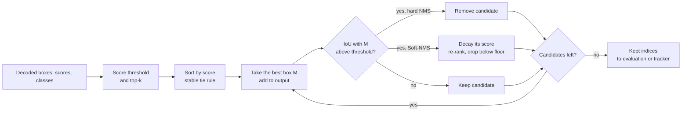

# NMS — suppressing redundant detections

Non-maximum suppression (NMS) turns a detector's many overlapping hypotheses into a
short list of boxes. This note covers greedy hard NMS, per-class and global scopes,
Soft-NMS, the conventions that change results between implementations, and the
evaluation that decides whether a threshold is right for a task.

## Problem and data contract

Several hypotheses of a detector can designate the same object: proposals regressed to
the same region produce duplicates, and "other than the first correct bounding-box, all
other boxes on the same object would generate false positives" [Soft-NMS, §3][paper].
Greedy hard NMS keeps the highest-scoring box, removes the candidates that overlap it
beyond a threshold, and repeats on what remains. It assumes that score and overlap
separate duplicates from true neighbors; that assumption fails in crowds [Soft-NMS,
§1, §4][paper].

**Inputs.** Boxes as an $N\times4$ tensor in `xyxy` format, all in one coordinate frame
(image or network-input pixels); torchvision 0.29 expects $0\le x_1<x_2$ and
$0\le y_1<y_2$ [Torchvision `nms`][api]. One score per box, used only for ranking:
probabilistic calibration is not required by the algorithm. For per-class NMS, one class
index per box [Torchvision `batched_nms`][batched].

**Outputs.** The indices of the kept boxes, sorted by decreasing score, as an `int64`
tensor [Torchvision `nms`][api]. Boxes are not merged or averaged.

**Role in a pipeline.** Inside two-stage detectors, NMS first prunes region proposals
(Soft-NMS describes ranking about 6,000 anchors before NMS [§3][paper]); after the
classification head, it removes duplicates per class [§3][paper]. Its output feeds AP
evaluation ([CV-IOU-AP](../../130-evaluation-fiabilite/references/131-iou-ap-coco.md)) and
trackers, where a wrongly suppressed box becomes a missed observation
([CV-SORT](../../110-tracking-association/references/111-sort.md)). Upstream must deliver
decoded boxes in a common frame; downstream must know which scope (per class or global),
threshold and tie rule were applied.

## Intuition

A detector's score map has a peak around each object, and its box regressor makes many
neighboring anchors converge on the same box. NMS keeps each peak and erases its
immediate neighborhood, much like non-maximum suppression thins edges or selects
corner responses; Soft-NMS traces the idea back to edge detection and feature-point
detection [§2][paper]. The neighborhood is measured by IoU, not by distance between
centers, so the same rule applies to boxes of every size.

*Illustration (constructed).* Three pedestrians walk side by side, each about 40 px wide.
Two of them are 10 px apart, centre to centre. Their boxes overlap with IoU
$(40-10)/(40+10)=0.6$: hard NMS at 0.5 deletes the less confident one, at 0.7 keeps both,
and a duplicate box shifted by 10 px on a single pedestrian would survive at 0.7 too
(example C).



*Diagram: the greedy loop of Soft-NMS Fig. 2 and torchvision `nms`, with the score
threshold and top-k of torchvision's Faster R-CNN post-processing; a project synthesis.*

## Prerequisites and competencies

**Required prerequisites**: [IoU](../../130-evaluation-fiabilite/references/131-iou-ap-coco.md).
**Connections**: detector outputs and box parameterizations in
[CV-DETECTEURS](82-detection-fasterrcnn-yolo-detr.md); tracking consumers in
[CV-SORT](../../110-tracking-association/references/111-sort.md) and
[CV-ASSOCIATION](../../110-tracking-association/references/112-deepsort-bytetrack.md);
the same suppression idea for edges and corners in
[CV-CANNY-HOUGH](../../30-traitement-image/references/32-canny-hough.md) and
[CV-CORNERS](../../40-features-matching/references/46-harris-shi-tomasi.md).
**Competencies**: run the algorithm by hand, set the three thresholds without confusing
them, choose the scope of suppression, and diagnose a missing object.

## Assumptions, observability and degenerate cases

- **Duplicates overlap more than distinct objects.** Hard NMS works when the IoU between
  two hypotheses of one object exceeds the threshold and the IoU between two objects stays
  below it. Crowds, herds and stacked parts violate this; Soft-NMS's largest per-class
  gains were on animals "found in a herd" [§6.1][paper].
- **Scores are comparable within a pool.** Global NMS ranks candidates of different classes
  against each other, which assumes their scores share a meaning.
- **Common frame and valid boxes.** All boxes use the same coordinates and convention, with
  positive width and height; a box with $x_2\le x_1$ has no meaningful IoU.
- **A deterministic order.** Equal scores need a tie rule; torchvision does not guarantee
  the same selected box on CPU and GPU in that case [Torchvision `nms`][api].

Observability limit: NMS sees only boxes and scores. Whether two overlapping boxes are one
object or two cannot be decided from geometry; it requires the annotations or another
signal. Degenerate cases: an IoU exactly equal to the threshold (implementation-dependent,
see Procedure); an empty input (the batched coordinate-trick path returns an empty index tensor); a box nested in
a much larger one (IoU small, see the inclusion section); boxes with negative coordinates in
the batched coordinate trick (example H).

## Procedure

Teaching pseudocode, implemented by the repository's Python example
(`examples/pilot_math.py`, `hard_nms`):

```text
order <- indices sorted by decreasing score, then increasing index   # deterministic ties
kept <- []
while order is not empty:
    best <- first element of order; append best to kept
    order <- [i in order if IoU(box[best], box[i]) <= tau]           # suppress if IoU > tau
return kept
```

The pilot variant suppresses when $\operatorname{IoU}>\tau_{nms}$; a candidate exactly at the
threshold is kept. With equal scores, it uses the input index as a deterministic tie rule.
Another implementation may not guarantee the same choice on CPU and GPU; record the
backend [Torchvision `nms`][api].

The sources do not treat equality the same way. The Soft-NMS paper writes the pruning
step as $s_i=0$ for $\operatorname{IoU}(M,b_i)\ge N_t$ [§4][paper], while its introduction says
"overlap greater than a threshold" [§1][paper]. Torchvision deletes for a strictly greater
IoU [Torchvision `nms`][api]. The original Soft-NMS repository contains both conventions:
`cpu_soft_nms` in hard or linear mode tests `ov > Nt`, while the classic `cpu_nms` in the
same file suppresses at `ovr >= thresh` [original code][softcode]. The case of an IoU exactly
equal to the threshold therefore depends on the implementation: specify it in a boundary
test.

Purpose of the steps. *Sorting* makes the most confident hypothesis the representative of
its neighborhood. *Selecting* is irrevocable: a kept box is never removed later.
*Suppressing* compares candidates only with selected boxes, never with each other, which
makes the result order-dependent and non-transitive (appendix CV-NMS-001). *Per-class
scope* runs the same loop independently for each class index; torchvision implements it
either by a per-class loop or by offsetting each class's boxes so that classes cannot
overlap [torchvision `boxes.py`][tvboxes].

## Parameters and tuning

- **Score threshold**: filters candidates by confidence before or after the chosen
  post-processing.
- **NMS threshold**: decides redundancy between two predictions.
- **Evaluation IoU threshold**: compares a prediction with the ground truth.

These three thresholds compare different pairs of objects and play different roles. A
class-separated NMS avoids inter-class deletion but can leave several incompatible labels
on the same object; global NMS has the opposite tradeoff. Choose according to the
semantics of the annotations [Torchvision `batched_nms`][batched].

| Parameter | Values in the sources | Effect | Interactions and what to watch |
| --- | --- | --- | --- |
| NMS IoU threshold $N_t$ | 0.3 default for the detectors in Soft-NMS [§5][paper]; 0.5 for torchvision Faster R-CNN's box head and 0.7 for its RPN [tvfrcnn] | Low: fewer duplicates, more merged neighbors; high: the opposite | AP "stable between 0.3 to 0.6" for R-FCN on COCO minival [§6.2][paper]; evaluation at high IoU favors higher $N_t$ [§4][paper] |
| Soft-NMS $\sigma$ | 0.5 in all experiments; 0.6 slightly better on minival; stable 0.4–0.7 [§6.2][paper] | Strength of the score decay | Larger $\sigma$ helps at high evaluation IoU [§6.3][paper] |
| Linear Soft-NMS $N_t$ | 0.3 [§6.1][paper] | Overlap above which scores decay | Discontinuous at $N_t$ [§4][paper] |
| Score floor after rescoring | $10^{-3}$ default in the original code [softcode]; $10^{-4}$ and $10^{-2}$ in the timing study [§5][paper] | Removes boxes whose score fell too low | Sets run time and the recall ceiling |
| Pre-NMS top-k and score threshold | RPN: 1,000 before and after NMS at test; box head: score $>0.05$ [tvfrcnn] | Cost and recall ceiling | A box lost here cannot be restored by NMS |
| Detections per image | 100 in torchvision [tvfrcnn]; 400 per image in the Soft-NMS COCO runs, where capping at 100 cost 0.1 AP [§5][paper] | Cut after NMS | Must match the evaluator's limit |
| Scope | Per class (`batched_nms`) or global (`nms`) | Inter-class suppression | Taxonomy and score comparability |

Tuning approach (project method), on validation data disjoint from the test set:

1. Freeze the detector and save raw decoded boxes, scores and classes, so that only the
   post-processing varies.
2. Sweep $N_t$ (or $\sigma$) on a grid; for each value report AP at the target evaluation IoU,
   recall of crowded objects, duplicates per object and downstream tracker misses.
3. Analyse by class, box size and local density; a single global value may hide a class
   that needs another scope or threshold.
4. Freeze the setting before the test; record the scope, tie rule, coordinate convention
   and backend with the result.

## Mathematics, conventions and units

**IoU** for axis-aligned boxes $a=(x_1,y_1,x_2,y_2)$ in continuous coordinates:

$$\operatorname{IoU}(a,b)=\frac{|a\cap b|}{|a|+|b|-|a\cap b|},\qquad |a|=(x_2-x_1)(y_2-y_1),$$

with areas in px² and IoU dimensionless in $[0,1]$
[GIoU, §3, equation 1][giou]. The inclusive pixel convention of older code adds 1 to every
width and height [original code][softcode]; the two conventions give different IoUs for the
same numbers (example B). IoU is unchanged by a common translation and by scaling the $x$
and $y$ axes by positive factors (areas scale by the same product), but not by clipping.

**Two equal boxes side by side.** For two $w\times h$ boxes shifted by $d$ along $x$
($0\le d\le w$), $\operatorname{IoU}=(w-d)/(w+d)$, so hard NMS at $\tau$ suppresses the second box
when $d<w(1-\tau)/(1+\tau)$: closer than $w/3$ at $\tau=0.5$, closer than $0.18w$ at $\tau=0.7$.

**Soft-NMS rescoring** [§4][paper]. With $M$ the selected box and $b_i$ a remaining
candidate of score $s_i$:

$$s_i\leftarrow\begin{cases}s_i,&\operatorname{IoU}(M,b_i)<N_t\\ s_i\,(1-\operatorname{IoU}(M,b_i)),&\operatorname{IoU}(M,b_i)\ge N_t\end{cases}\quad\text{(linear)},\qquad s_i\leftarrow s_i\,e^{-\operatorname{IoU}(M,b_i)^2/\sigma}\quad\text{(Gaussian)}.$$

Hard NMS is the special case with weight 0 above $N_t$ and 1 below: "traditional NMS is a
special case of it with a discontinuous binary weighting function" [§4][paper].

**Per-class offset.** Torchvision's coordinate trick adds $c\,(m+1)$ to all four coordinates
of a box of class $c$, where $m$ is the largest coordinate in the batch [torchvision
`boxes.py`][tvboxes]. With non-negative coordinates, boxes of different classes then lie in
disjoint ranges along both axes, so a single `nms` call never compares them; the
precondition $0\le x_1$, $0\le y_1$ is what makes this true (example H).

### Worked examples

*Constructed examples, recomputed by checks/81-nms.py; example A is also executed by
`examples/pilot_math.py`.*

- **A (pilot).** Continuous boxes $A=(0,0,10,10)$, $B=(2,0,12,10)$, $C=(20,0,30,10)$ with scores
  0.9, 0.8 and 0.7: $|A\cap B|=80$ px², union 120 px², IoU $=2/3$. At $\tau_{nms}=0.5$ NMS keeps
  $A,C$; at 0.7 it keeps $A,B,C$. Running `python3 examples/pilot_math.py` prints these
  results; no detector is reproduced.
- **B (pixel convention).** With the inclusive "+1" convention the same numbers give
  $99/143=0.692$ instead of $0.667$. At $\tau=0.68$ the continuous convention keeps $B$ and the
  inclusive one suppresses it.
- **C (side-by-side objects).** For 40 px wide pedestrians, hard NMS at 0.5 merges two people
  whose centers are closer than 13.3 px; at 0.7, closer than 7.1 px.
- **E (soft decay).** A box of score 0.8 at IoU 0.8 with the selected box drops to
  $0.8e^{-0.64/0.5}=0.222$ (Gaussian, $\sigma=0.5$) or to $0.8\times0.2=0.16$ (linear, $N_t=0.3$); a
  disjoint box keeps its score.
- **H (coordinate trick).** Classes 0 and 1 with boxes $(0,0,100,10)$ and $(20,0,60,10)$ become
  disjoint after the offset. A class-1 box $(-100,-101,-1,-91)$, possible before clipping, lands
  on $(1,0,100,10)$ and is suppressed by the class-0 box (IoU 0.99): clip first, as torchvision's
  Faster R-CNN does [tvroi].

**Interpretation of the controlled variation in A**: increasing the threshold keeps more
boxes; this can save a real neighbor or keep a duplicate. The boxes alone do not say which:
it takes the annotations of the task. An AP measured on a real dataset remains necessary to
settle the tradeoff.

## Multiple detections, classes and sizes of boxes

An image can contain multiple instances of the same class. Their detections must be kept
separate; NMS does not select "only one object per class". Conversely, several candidates may
designate a single instance. Suppression uses overlap as an indication of redundancy, without
knowing the real identity of the objects. A crowd is precisely where this assumption fails
[Soft-NMS, §§1 and 3–4][paper].

### Same geometry, different semantic decisions

The following scenarios are constructed for reasoning; the correct business output depends on
the annotations and is not deduced from the IoU alone.

| Situation | Possible effect of NMS | Required check |
| --- | --- | --- |
| Several candidates of the same class around a single object | Duplicates removed if the overlap exceeds the threshold | Check the matched ground truth and the localization of the kept box |
| Two distinct people whose boxes overlap strongly | Possible deletion of a real neighbor, even with per-class NMS | Coverage of each of the two ground-truth boxes before and after NMS |
| Two objects of different classes, for example person and bicycle | Global NMS can remove one if the IoU exceeds the threshold | Output contract: which objects must be detected; per-class NMS if both are to be kept |
| One instance receives two exclusive classes, for example two part types | Per-class NMS can keep both hypotheses | Resolve the class decision according to the contract; the maximum score is not proof of correctness |
| A small box lies entirely inside a large one | Inclusion is not enough to cause deletion | Compute the IoU, then distinguish object and part, two instances, or a wrong localization |

For two candidates of different classes with IoU 0.8 and scores 0.9 and 0.8, global hard NMS at
0.5 keeps only the first; per-class NMS keeps both. If they have the same class, class separation
does not protect them from each other. Nor does it merge their labels or impose their
exclusivity [Batched NMS, description and parameters][batched]. Torchvision's Faster R-CNN
treats "every class prediction" of a proposal as a separate instance before per-class NMS
[tvroi], so one region can legitimately leave boxes under several labels.

### Inclusion and boxes of very different sizes

For valid continuous rectangles, if $B\subset A$, the intersection is $B$ and the union is $A$:
$\operatorname{IoU}(A,B)=|B|/|A|$. Thus $A=(0,0,100,100)$ and $B=(40,40,60,60)$ give $400/10000=0.04$.
With scores 0.9 and 0.8, the same class and hard NMS at 0.5, both remain; a contained box is
suppressed by a selected container only if $|B|>\tau|A|$. A large box does not automatically
delete all the small boxes it contains. Project analytical calculation, derived from the
definition of IoU [GIoU, §3, equation 1][giou].

The condition depends on the area ratio only, not on where $B$ sits inside $A$. For the same
aspect ratio and a side ratio $k$, $\operatorname{IoU}=k^2$, so the nested box is suppressed when
$k>\sqrt\tau$: 0.707 at $\tau=0.5$, 0.837 at $\tau=0.7$. A box spanning 80% of each side of $A$
(IoU 0.64) is removed at 0.5 and kept at 0.7, while a shrunk duplicate with $k=0.9$ (IoU 0.81)
is removed at both: raising $\tau$ protects large nested boxes and keeps more near-duplicates
(constructed, recomputed by checks/81-nms.py of the 2026-11-16 pass; CV-NMS-006).

The ratio "intersection / area of the small box" here is 1: it is not the IoU. Using it in place
of the IoU would change the deletion rule and could eliminate legitimate detections of nested
objects or parts. Constructed counterexample (same check script): an adult $(0,0,100,250)$ at
0.9 and a child in front of them, $(30,130,80,250)$ at 0.8, both of class person, have IoU
$6000/25000=0.24$ and survive hard NMS at 0.5; a rule on the intersection over the smaller box
at 0.5 deletes the child, as it deletes every nested box. Conversely, a large mislocalized box and a small box on the same object can
both remain; their survival does not prove two instances. See also [size cases and aspect
ratios](82-detection-fasterrcnn-yolo-detr.md#box-sizes-aspect-ratios-and-accuracy).

## Soft-NMS: alternative and limits

Soft-NMS lowers scores instead of immediately eliminating every strongly overlapping candidate.
The Gaussian variant uses

$$
s_i\leftarrow s_i\exp\left(-\frac{\operatorname{IoU}(M,b_i)^2}{\sigma}\right).
$$

$M$ is the selected box, $b_i$ a candidate, $s_i$ its score and $\sigma>0$ a dimensionless parameter.
The Gaussian penalty applies to all remaining candidates, with no $N_t$ threshold
[Article, §4][paper]. The maximum is then searched again among the penalized scores, as the
original code does. After each iteration, detections that fall below a score threshold are
discarded, so "Soft-NMS never deletes" is false despite the abstract's "no object is eliminated
in this process" [Article, abstract and §5][paper]; [original code][softcode].

The original code uses inclusive coordinates with `+1`, while the pilot example uses continuous
coordinates. A numerical comparison requires the same convention (example B). The score of a box
does not become a calibrated probability through this post-processing. Soft-NMS is still greedy
and "does not find the globally optimal re-scoring" [§4][paper].

## Properties and limits of guarantees

- **Output guarantee of hard NMS.** Every kept box was compared with every box kept before it and
  survived, so kept boxes of one pool have pairwise IoU at most $\tau$ (strict convention). A
  second pass at the same threshold is therefore a no-op (checked on random configurations in
  example G of the checks script). Soft-NMS gives no such bound: a decayed box can survive next
  to its suppressor.
- **Order dependence.** IoU is symmetric but the algorithm is not: swapping scores changes which
  box is kept, and with more boxes the whole sequence (appendix CV-NMS-006).
- **No optimality.** Greedy NMS does not maximize any global objective, such as the score sum of a
  non-overlapping subset; Hosang et al. describe it as "greedy clustering with a fixed distance
  threshold" that "forces a trade-off between recall and precision" [hosang].
- **Invariances.** Decisions are invariant to a common translation and axis scaling of all boxes,
  with scores and ties fixed (appendix CV-NMS-001); clipping, rounding and the "+1" convention
  are not.
- **Scope.** Per-class NMS never suppresses across classes; global NMS may. Neither resolves
  whether two labels describe one physical object.
- **Implementation determinism.** In torchvision v0.29.2, both the CPU and CUDA kernels call a
  stable descending sort [tvcpu]; [tvcuda]. The documentation nevertheless makes no CPU/GPU
  guarantee for equal scores [Torchvision `nms`][api]; rely on the documented contract.

## Cost and implementation

Sorting costs $O(n\log n)$ and the suppression loop up to $n(n-1)/2$ IoU evaluations, about
$5\times10^7$ for $n=10{,}000$. Soft-NMS has the same $O(N^2)$ complexity [§4][paper]; with a score
floor of $10^{-4}$ it took 0.01 s per image for 80 classes on 4 CPU threads, and 0.005 s on one core
with a floor of $10^{-2}$ [§5][paper]. Torchvision's CUDA kernel computes a suppression bit mask of
$n\times\lceil n/64\rceil$ 64-bit words, 12.56 MB for 10,000 boxes, then gathers the kept indices
[tvcuda]. An upstream top-k reduces the cost but can lose objects; log this filtering in the AP
protocol. No torchvision call was executed for this note.

### Implementation contracts

- **torchvision 0.29 `nms(boxes, scores, iou_threshold)`** "discards all overlapping boxes with
  IoU > iou_threshold", expects `xyxy` with $0\le x_1<x_2$, $0\le y_1<y_2$, and returns kept indices
  in decreasing score order [api]. The v0.29.2 CPU kernel uses areas without "+1" and the test
  `ovr > iou_threshold` [tvcpu].
- **torchvision 0.29 `batched_nms(boxes, scores, idxs, iou_threshold)`** applies NMS
  independently per category [batched]. In v0.29.2 it uses the coordinate trick below 4,000
  tensor elements on CPU (1,000 boxes) and 100,000 on GPU (25,000 boxes), and a per-class loop
  above [tvboxes].
- **torchvision Faster R-CNN post-processing (v0.29.2)** clips boxes to the image, drops scores
  $\le0.05$, removes boxes smaller than $10^{-2}$, applies `batched_nms` at 0.5 and keeps the top 100
  [tvroi]; [tvfrcnn].
- **Original Soft-NMS code** (`cpu_soft_nms(boxes, sigma=0.5, Nt=0.3, threshold=0.001,
  method=0)`) uses inclusive coordinates, searches the maximum among remaining boxes at each
  iteration and discards boxes whose score falls below `threshold` [softcode].

## Evaluation and controlled variation

**Protocol.** Measure on held-out images with the detector frozen: AP over the evaluation IoU
thresholds of the protocol (COCO averages 0.5 to 0.95), recall of objects in crowded regions,
duplicates per matched object, and the downstream effect on a tracker. Keep the maximum number
of detections equal to the evaluator's. Analyse by class, size and density.

**Published results, with their setting.** Replacing NMS by Soft-NMS improved COCO-style AP by
1.7% on PASCAL VOC 2007 for R-FCN and Faster R-CNN, and by 1.3% and 1.1% on MS-COCO, without
retraining [abstract, §6.1][paper]; single-stage SSD and YOLOv2 gained only 0.5% with the linear
function, which the authors attribute to lower recall [§6.1][paper]. DETR, trained with a
bipartite matching loss, "does not need NMS by design"; applying NMS improved its first decoder
layer and slightly reduced AP at the last layers because NMS "incorrectly removes true positive
predictions" [detr, §4.2].

**Proposed baseline and controlled variation (not executed).**

- *Question*: does Soft-NMS recover crowded objects without adding duplicates elsewhere?
- *Data*: validation images with dense scenes and sparse scenes, annotated per instance.
- *Baseline*: frozen detector, per-class hard NMS at 0.5, score floor 0.05, 100 detections.
- *Controlled variation*: Gaussian Soft-NMS with $\sigma=0.5$; everything else identical.
- *Measurements*: AP at 0.5 and 0.75, recall in dense regions, duplicates per matched object,
  tracker identity switches.
- *Expected effect (hypothesis)*: higher recall in dense regions and at high evaluation IoU
  [§6.3][paper], with more low-score duplicates.
- *Confound*: Soft-NMS changes score values, so a deployment score threshold tuned for hard NMS no
  longer means the same thing (appendix CV-NMS-004); compare at matched precision.

**Measurement limits.** Gains of about 1 AP point are within the range where evaluator settings
matter: the Soft-NMS authors report that capping detections at 100 per image cost 0.1 AP and that
the COCO server's per-class top-100 selection differed until June 2017 [§5][paper].

## Failure modes and diagnosis

| Symptom | Possible causes | Discriminating check | Conditional remedy |
| --- | --- | --- | --- |
| A pedestrian disappears in a crowd | NMS too aggressive; detector never proposed the box | Compare outputs before and after NMS with the ground truth (CV-NMS-005) | If a correct candidate was suppressed: higher $N_t$ or Soft-NMS on validation; otherwise fix the detector |
| Several boxes around one part | Threshold too permissive; different classes; convention mismatch | Log scores, classes, IoU and the coordinate contract | Lower $N_t$, global NMS or a class policy, consistent conventions |
| Different results with equal scores | Non-deterministic order or backend | Explicit tie rule; targeted test with equal scores | Deterministic sort, fixed backend; do not conclude to a network defect |
| Boxes of different classes suppress each other in per-class NMS | Coordinate-trick precondition violated (negative coordinates) | Inspect coordinates before NMS (example H) | Clip to the image before `batched_nms` |
| A box survives at one threshold value in one library and not in another | Equality convention ($>$ or $\ge$) or "+1" areas | Recompute IoU with both conventions (example B) | Specify and test the boundary case |
| Recall ceiling below expectations | Top-k, score threshold or detection cap before evaluation | Count candidates after each stage | Raise limits on validation; report them with AP |
| Tracker loses targets when objects cross | Suppression of one of two overlapping objects | Replay NMS on the crossing frames | Higher $N_t$, Soft-NMS, or association-aware post-processing |
| Nested part detections vanish | Taxonomy expects object and part; inclusion confused with redundancy | Check the IoU of the pair (inclusion section) | Separate classes or per-class NMS; never replace IoU by containment |

## Alternatives and applications

- Prefer **per-class hard NMS** when classes may legitimately overlap (person on a bicycle) and
  scores are not comparable across classes.
- Prefer **global NMS** when classes are mutually exclusive for one physical object and duplicates
  across labels must be removed.
- Prefer **Soft-NMS** when AP at high evaluation IoU or recall in crowds matters, with a validated
  score floor; it requires no retraining [§1][paper].
- Prefer **learned suppression or set prediction** (Hosang et al. [hosang]; DETR [detr]) when
  retraining is possible and crowded scenes dominate; do not apply NMS to DETR as a universal
  obligation.
- Box **averaging within overlap groups** was used in early face detection [Soft-NMS, §2][paper];
  it produces merged boxes, a different output contract.

Applications (project reasoning): pedestrian and vehicle detection before tracking, counting parts
on a conveyor where touching parts overlap, and any dense keypoint or corner detector, where the
same suppression idea selects local maxima.

## Guided reasoning and proposed checks

These constructed cases develop suppression, the equality threshold and recall of nearby objects. They are used to explain or test reasoning; their image, video or hardware results are not claimed as measured. The method properties remain attached to the sources below.

### Case linked to CV-NMS-001

**Working question**: Three continuous boxes $A=(0,0,10,10)$, $B=(2,0,12,10)$ and $C=(20,0,30,10)$ have scores $0.9$, $0.8$ and $0.7$. Which boxes are retained by hard NMS that suppresses candidates with IoU greater than 0.5?

**Reference answer**: select $A$, delete $B$ because their intersection is 80, union 120 and IoU $2/3>0.5$; then keep $C$, disjoint. The output is $A,C$.

**Reasoning on instances**: Overlap is used as an indication of redundancy between predictions, without knowing the real identity of the objects. If A and B represent two close people, deleting B can remove a real instance; if they represent the same part, the deletion can instead be useful.

**Proposed check**: keep the outputs before and after the operation and check which annotations remain covered. The threshold therefore settles a tradeoff that depends on the scene. A distant box remains a candidate even with a lower score, as long as it passes the other filters in the pipeline. This reading avoids turning greedy selection into a "one box per image" or "one box per class" rule.

### Case linked to CV-NMS-006

**Working question**: Two continuous boxes of the same class, $A=(0,0,100,100)$ and $B=(40,40,60,60)$, have scores $0.9$ and $0.8$. Does B being contained in A imply suppression by hard NMS at IoU threshold $>0.5$? Justify the answer.

**Reference answer**: No. The intersection has the area of B, 400, and the union that of A, 10000: IoU $=0.04$. A is selected, then B remains since the threshold is not exceeded.

**Geometric reading**: A small box entirely contained in a large one has an intersection equal to its own area, but a union equal to the large area. The coverage of the small box and the IoU therefore answer two different questions. Replacing one with the other would change the deletion rule.

**Consequences for diagnosis**: Two surviving boxes do not prove two instances: they can be two very different localizations of the same part. Conversely, both an object and a part of it can be legitimate if the taxonomy provides for it. Check annotations, scores and the output contract before changing the overlap measure. This analytical case shows a limit to the slogan “big boxes eliminate small ones”.

**Documentary reference for this pass**: [Soft-NMS](https://arxiv.org/html/1704.04503v2), method and score decay. The other developments are in the [flashcards](../81-nms.md).

## Additional technical explanations — 2026-10-30

These explanations complement the mechanism associated with each question. Calculations are cases constructed under assumptions; protocols remain proposed until a test is recorded.

### CV-NMS-001

**Situation**: Three continuous boxes $A=(0,0,10,10)$, $B=(2,0,12,10)$ and $C=(20,0,30,10)$ have scores $0.9$, $0.8$ and $0.7$. Which boxes are retained by hard NMS that suppresses candidates with IoU greater than 0.5?

**Selection is not transitive**: construct three boxes of the same size with $A=(0,0,10,10)$, $B=(3,0,13,10)$ and $C=(6,0,16,10)$. The IoUs $A/B$ and $B/C$ equal $7/13>0.5$, but $A/C=4/16=0.25$. With decreasing scores A, B, C, NMS keeps A, deletes B, then keeps C: a deleted B does not in turn delete its neighbors. This distinguishes the greedy algorithm from a grouping into connected components of the overlap graph. The result depends on the ranking and does not search for the subset of boxes with maximum score sum.

### CV-NMS-002

**Situation**: In object detection, how do the score threshold, NMS IoU threshold and evaluation IoU threshold differ?

**Separate setting and measurement**: take a candidate with a score of 0.4, an IoU of 0.8 with another prediction, and an IoU of 0.6 with a ground-truth box. A score threshold at 0.5 discards it before any measurement; if its score is admissible, NMS at 0.7 can remove it; if it survives, it satisfies a localization requirement at 0.5 but not at 0.75, under the other matching rules. These three comparisons involve different objects. To attribute a recall drop, keep counters after each step with a constant evaluation protocol, rather than changing the three thresholds simultaneously.

### CV-NMS-003

**Situation**: Two candidates from different classes have scores $0.9$ and $0.8$ and IoU $0.8$. With NMS threshold $0.5$, what tradeoff distinguishes global suppression from per-class suppression?

**Constructed taxonomy conflict**: If the same instance receives the scores 0.8 for "vehicle" and 0.75 for "car", the two labels can be consistent in a hierarchical taxonomy but redundant in a single-category contract. Set this policy before choosing the suppression. With the same geometry, a person holding a bicycle and a part receiving two exclusive classes call for different decisions. Testing inter-class conflicts and same-class neighbors separately helps to measure what class separation actually protects. The highest score does not indicate, by construction, whether two hypotheses share a physical identity.

### CV-NMS-004

**Situation**: How does Gaussian Soft-NMS differ from hard NMS, and why must candidates be reordered after a score penalty?

**Calculated change in rank**: after selection of A, a box B with a score of 0.8 and IoU 0.8 becomes $0.8e^{-0.8^2/0.5}\simeq0.222$ for $\sigma=0.5$. A disjoint box C of score 0.5 remains at 0.5 and thus comes before B. With a final threshold of 0.25, B is removed. This constructed case makes explicit the roles of the decay parameter and the score threshold. Reusing a threshold selected for the initial scores without further validation can change the recall, since the values have been transformed by post-processing.

### CV-NMS-005

**Situation**: An object disappears from final outputs in a dense region. How can NMS be identified as the cause and a verifiable intervention chosen?

**Deletion log**: For each removed candidate, keep its ID, the ID of the box that suppressed it, the classes, the scores and the IoU computed in the common coordinate frame. Replaying the selection on the same predictions then isolates the post-processing without retraining the network. Measure the coverage of the ground truth with a defined matching, because two candidates on one ground-truth box are not two recalled objects. If a top-k precedes NMS, also consider the candidates lost there: raising the NMS threshold does not recover a box eliminated by this upstream filter.

### CV-NMS-006

**Situation**: Two continuous boxes of the same class, $A=(0,0,100,100)$ and $B=(40,40,60,60)$, have scores $0.9$ and $0.8$. Does B being contained in A imply suppression by hard NMS at IoU threshold $>0.5$? Justify the answer.

**Condition of inclusion**: for $B\subset A$ and a strict deletion at threshold $\tau$, B can only be deleted by A if $|B|>\tau|A|$, provided that A is actually selected before it. At $\tau=0.5$, a contained box covering 4% of the large area is therefore very far from the condition. Reversing the scores does not change the IoU, but changes the first box retained; with more candidates, it can change the whole greedy sequence. This reasoning distinguishes the symmetry of the overlap measure from the algorithm's dependence on ranking.

**Passages consulted for these developments**: [Bodla et al., Soft-NMS](https://arxiv.org/html/1704.04503v2), §4, selection and decay; geometric counterexamples constructed by the project.

## Worked reasoning and boundary cases — 2026-11-08

The following are constructed project deductions and proposed checks, not
new empirical results. Each extends an existing recall objective; the concise
expected answer on its card remains the grading target.

### CV-NMS-001 — A common geometric transform preserves IoU

Translating all boxes together or scaling every x and y coordinate by common positive factors multiplies intersections and unions by the same area factor, preserving IoU. Hard NMS decisions should therefore agree under this constructed transform when scores, tie-breaking and numerical precision are held fixed. Clipping boxes to an image border is different: it can change relative areas and overlaps. This provides a geometry check independent of detector quality.

### CV-NMS-002 — AP requires the score-ranking information retained

A high operational score cutoff may discard low-score true detections before the evaluator can sweep the precision-recall curve. Record whether AP is computed from the full retained prediction list or from a deployment-filtered list. The NMS threshold still compares predictions with predictions; the evaluation IoU still compares predictions with annotations. Sharing one threshold name or configuration field obscures which stage changed the measured recall ceiling.

### CV-NMS-003 — Cross-class scores may not have a shared meaning

Global NMS orders candidates from different classes by score. If those scores have different calibration or class priors, that ordering need not reflect which physical hypothesis is better. Class-separated NMS avoids cross-class suppression but leaves the taxonomy decision unresolved. A proposed validation includes overlapping legitimate classes and mutually exclusive labels on the same instance, with the annotation contract fixed before comparing the suppression policy.

### CV-NMS-004 — The Gaussian parameter controls attenuation strength

For fixed nonzero overlap $u$, the multiplier is $\exp(-u^2/\sigma)$. Increasing positive sigma weakens the penalty; as sigma tends to infinity the multiplier tends to one. As sigma approaches zero from above, nonzero overlap is strongly penalized, while zero overlap retains multiplier one. These limiting cases are derived checks of parameter meaning. They do not turn Soft-NMS into a calibrated probability model or settle the best deployment threshold.

### CV-NMS-005 — Coverage loss needs a one-to-one object interpretation

Before and after NMS, use the same annotation-matching policy and distinguish unique covered objects from prediction count. Ten surviving boxes on one person are not ten recalled people. Conversely, removal of a duplicate may change counts without losing any object. A proposed replay should record which correct candidate was removed, its suppressor and whether another valid candidate still covers that annotation under the fixed evaluation protocol.

Consulted foundations: [Soft-NMS](https://arxiv.org/html/1704.04503v2): §4 greedy selection and score decay; §5 score filtering.

## Sources and flashcards

### Scientific sources

- [Bodla et al., Soft-NMS, "Improving Object Detection With One Line of Code"][paper]: abstract; §1 limits of NMS; §2 NMS in edge, keypoint and face detection; §3 detection pipeline and per-class NMS; §4 hard, linear and Gaussian rescoring, complexity, greedy non-optimality; §5 score threshold after each iteration, timings, detection caps; §6.1–§6.3 results and sensitivity.
- [Hosang, Benenson and Schiele, Learning non-maximum suppression][hosang]: abstract and §1, GreedyNMS as greedy clustering with a fixed threshold.
- [Carion et al., DETR][detr]: abstract and §2.1 (set prediction without NMS), §4.2 (NMS after each decoder layer).
- [Rezatofighi et al., GIoU, §3, equation 1][giou]: IoU definition used for the inclusion calculation (not re-opened in this pass).

### Implementation sources

- [Torchvision 0.29 `nms`][api] and [`batched_nms`][batched]: signatures, `xyxy` precondition, strict `> iou_threshold`, CPU/GPU tie caveat, per-category scope.
- [torchvision v0.29.2 `ops/boxes.py`][tvboxes]: `batched_nms` strategy switch (L86), coordinate trick (L93–L110), per-class loop (L113–L126).
- [torchvision v0.29.2 CPU kernel][tvcpu]: stable sort (L38–L39), areas without "+1" (L58), `ovr > iou_threshold` (L87–L89); [CUDA kernel][tvcuda]: 64-box words (L25), IoU test (L41–L53), mask layout (L99–L100), stable sort (L198–L199).
- [torchvision v0.29.2 Faster R-CNN defaults][tvfrcnn] (L176–L200) and [ROI-head post-processing][tvroi] (L700–L732).
- [Original Soft-NMS code, commit b8e69bd][softcode]: `cpu_soft_nms` defaults and modes (L17, L81–L92), score floor (L96–L105), `cpu_nms` with `ovr >= thresh` (L113–L164).
- Repository example `examples/pilot_math.py` (`iou`, `hard_nms`), executed on 2026-11-14 with Python 3.

### Related flashcards and references

- [Flashcards NMS](../81-nms.md): CV-NMS-001 (unroll hard NMS), -002 (three thresholds), -003 (scope), -004 (Soft-NMS), -005 (diagnosis), -006 (inclusion).
- [CV-IOU-AP](../../130-evaluation-fiabilite/references/131-iou-ap-coco.md), [CV-DETECTEURS](82-detection-fasterrcnn-yolo-detr.md).

[paper]: https://arxiv.org/abs/1704.04503
[api]: https://docs.pytorch.org/vision/0.29/generated/torchvision.ops.nms.html
[batched]: https://docs.pytorch.org/vision/0.29/generated/torchvision.ops.batched_nms.html
[softcode]: https://github.com/bharatsingh430/soft-nms/blob/b8e69bdf8df2ad53025c9d198ded909b50471d4f/lib/nms/cpu_nms.pyx
[detr]: https://arxiv.org/abs/2005.12872
[hosang]: https://arxiv.org/abs/1705.02950
[tvboxes]: https://github.com/pytorch/vision/blob/v0.29.2/torchvision/ops/boxes.py#L57-L126
[tvcpu]: https://github.com/pytorch/vision/blob/v0.29.2/torchvision/csrc/ops/cpu/nms_kernel.cpp#L38-L89
[tvcuda]: https://github.com/pytorch/vision/blob/v0.29.2/torchvision/csrc/ops/cuda/nms_kernel.cu#L25-L100
[tvfrcnn]: https://github.com/pytorch/vision/blob/v0.29.2/torchvision/models/detection/faster_rcnn.py#L176-L200
[tvroi]: https://github.com/pytorch/vision/blob/v0.29.2/torchvision/models/detection/roi_heads.py#L700-L732

[giou]: https://arxiv.org/html/1902.09630v2

Drafted by agent, 2026-10-18. Revision 10, 2026-11-14: body deepened and language corrected by Agent Claude Code (`revue-cartes`, self-review); see the [subject report](https://github.com/speillet/Knowledge_Computer_Vision/blob/main/docs/revues/2026-11-14-reference-depth/81-nms.md).
Revision 11, 2026-11-16: side-ratio condition for nested boxes and a containment counterexample
added to the inclusion section while deepening CV-NMS-006, and a reversed sentence on the containment ratio corrected, by Agent Claude Code (`revue-cartes`, self-review); see the [subject report](https://github.com/speillet/Knowledge_Computer_Vision/blob/main/docs/revues/2026-11-16-card-depth/81-nms.md).
