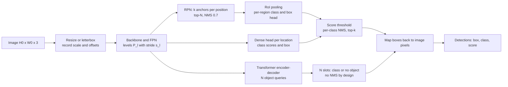

# Detection: Faster R-CNN, YOLO families and DETR

This is the method and comparison note for closed-set 2-D object detection. It
contrasts three designs, two-stage region-based detection (Faster R-CNN, usually
with FPN), dense one-stage detection (the YOLO family, RetinaNet, FCOS) and set
prediction (DETR and its variants), through the decisions they all make: how
candidate slots are laid out, which slot learns which annotated object, how boxes
are parameterized, how slots become a final set, and how the result is evaluated.
NMS mechanics are in [CV-NMS](81-nms.md), AP and the COCO protocol in
[CV-IOU-AP](../../130-evaluation-fiabilite/references/131-iou-ap-coco.md),
text-defined classes in [CV-OPENVOC](83-detection-open-vocabulary.md), and keypoints
and 3-D pose in [CV-POSE3D](84-detection-pose-3d.md).

## Problem and data contract

**Task.** From one image, output a set $\{(b_j,c_j,s_j)\}_{j=1}^{M}$ whose size $M$
is not known in advance: an axis-aligned box $b_j$, a class $c_j$ from a list of $K$
categories fixed at training time, and a score $s_j$ used to rank detections. COCO
2017 has 7 instances per image on average and up to 63 in one training image, small
and large ones in the same image [DETR, §4]. What is specific to detection is
assignment (which output learns which object), localization and post-processing,
not the generic deep-learning machinery.

**Coordinates and units.** Continuous image coordinates in pixels, origin at the
top-left corner, $x$ to the right and $y$ downward. Three box encodings coexist and
must be named at every interface: corners $(x_0,y_0,x_1,y_1)$ (torchvision), centre and size $(c_x,c_y,w,h)$ normalized to $[0,1]$ by the image
size [DETR, §3.1], and the COCO result format $(x,y,w,h)$ measured from the top-left
corner ([CV-IOU-AP](../../130-evaluation-fiabilite/references/131-iou-ap-coco.md)).
The width of a continuous box is $x_1-x_0$, without $+1$.

**Inputs.** An 8-bit $H_0\times W_0\times3$ image, converted by the model's
preprocessing. In torchvision 0.29, detection models take a list of float tensors of
shape $[C,H,W]$ in the $0$–$1$ range, possibly of different sizes, and normalize and
resize them internally (torchvision contracts, under Cost and implementation)
[faster_rcnn.py L47–L80]. Training targets are `boxes` (`FloatTensor[N, 4]` in corner
format with $0\le x_0<x_1\le W$ and $0\le y_0<y_1\le H$) and `labels` (`Int64Tensor[N]`); a box with a non-positive
width or height stops training with an error [generalized_rcnn.py L98–L112]. In the
R-CNN models, `num_classes` includes the background class [faster_rcnn.py L74].

**Outputs.** In inference mode, torchvision returns for each image `boxes` in the
original image's pixels, `labels` and `scores` [faster_rcnn.py L61–L67]. Scores rank
detections; they are not calibrated probabilities. YOLO defines the training target of its confidence as $\Pr(\text{Object})\cdot\text{IoU}$,
a product of presence and localization quality [YOLO, §2].

**Role in a pipeline.** Upstream, acquisition and the resize or letterbox fix how many
pixels each object occupies, and their geometry must be inverted exactly. Downstream,
NMS (unless the model is trained for set prediction), an operating threshold, a tracker
([CV-SORT](../../110-tracking-association/references/111-sort.md)), counting,
measurement or a robot pick consume the boxes. These consumers need boxes in sensor
coordinates, a score whose ranking is meaningful at the chosen threshold, a stable
class list and bounded latency
([CV-PIPELINE](../../140-ingenierie-systemes/references/141-contrats-profiling-video.md)).

### Multiple instances, multiple classes, multiple labels

The number of objects and the number of classes are two distinct dimensions.
Detecting three cars and two bicycles requires five instance locations in two
categories present in the image. A multiclass detector can therefore output several
objects of each class; it does not reduce to one label for the whole image or to one
box per class.

**Multi-label** classification concerns several valid labels for the same instance,
when the taxonomy provides for it. For example, one contract can keep both "vehicle"
and "car"; other datasets annotate only the most specific category. Two mutually
exclusive labels proposed for the same object are an ambiguity to resolve, not
automatically two objects. These cases and their annotation policy are project
examples.

YOLOv3 §2.2 illustrates the distinction: its independent logistic classifiers allow a
multi-label formulation, unlike a softmax that models exclusive classes, and the
authors motivate it with overlapping labels such as "Woman" and "Person". This does
not settle the final labels: supervision, thresholds, an optional choice of the best
class and post-processing must follow the contract. Do not attribute this choice to
every YOLO version. [YOLOv3 v1, §2.2](https://arxiv.org/html/1804.02767v1)

A softmax per region does not guarantee one label per output either. torchvision
0.29's Faster R-CNN turns every class whose softmax score exceeds `box_score_thresh`
into a separate detection before a per-class NMS [roi_heads.py L705–L728], so one
proposal can produce both a "car" box and a "truck" box.

For inference and evaluation, keep the triplet box, score and class for each
hypothesis, together with its source image. Then distinguish several hypotheses for
one instance, several instances of the same class, and overlapping objects of
different classes. The [NMS multi-class and multi-instance cases](81-nms.md#multiple-detections-classes-and-sizes-of-boxes)
show why overlap alone does not settle identity.

## Intuition

Every detector turns "find an unknown number of objects" into a fixed-size prediction
problem. It lays out slots (anchors, locations or queries), uses an assignment rule to
decide which slot learns which annotated object, and uses a post-processing rule to
turn slots into a set.

- **Two-stage (Faster R-CNN).** A region proposal network (RPN) slides over the shared
  feature map and scores, at each position, $k$ anchors of several scales and aspect
  ratios. A few hundred proposals survive; a second head pools the features inside
  each proposal, classifies it among $K+1$ classes (background included) and refines
  its box. The RPN "tells the Fast R-CNN module where to look" [Faster R-CNN, §III].
- **Dense one-stage (YOLO, RetinaNet, FCOS).** Every location of every pyramid level,
  and every anchor there if the design has anchors, predicts class scores and a box in
  a single pass. Most slots see background, which creates a strong class imbalance
  [RetinaNet, §3], and several neighbouring slots fire on the same object, which NMS
  then resolves.
- **Set prediction (DETR).** A fixed number $N$ of learned queries is decoded in
  parallel by a transformer that attends to the whole image. During training, a
  one-to-one Hungarian matching assigns each object to exactly one query and the
  others learn "no object" [DETR, §3]. A query that duplicates another is penalized,
  so NMS is unnecessary by design.

Two results organize the comparison. First, the assignment determines the
post-processing: one-to-many assignment, where one object supervises several slots,
needs NMS at inference, whereas one-to-one assignment can drop it. YOLOv10 applies
this to YOLO by training an additional one-to-one head [YOLOv10, §1, §3.1]. Second,
"anchor-free versus anchor-based" is mostly a question of which slots count as
positives: with the same positive and negative samples, RetinaNet with one anchor per
location and FCOS reach the same COCO AP, within 0.1 point, whether they regress from a
box or from a point [ATSS, §3.3].

*Illustration (constructed).* Three cartons stand side by side on a pallet. Faster
R-CNN proposes a few boxes around each carton, and after NMS its head keeps the best
one per carton. FCOS supervises every feature location inside a carton's box at the
pyramid level that matches its size, so dozens of locations predict that carton and
NMS keeps one. DETR uses 3 of its 100 queries and the 97 others answer "no object".
If two cartons overlap strongly in the image, NMS at IoU 0.5 can delete one of them
([CV-NMS](81-nms.md)); DETR can keep both but cannot output more objects than it has
queries.



*Diagram: data flow of the three families, a project synthesis of Faster R-CNN §III,
RetinaNet §4.1, FCOS §3 and DETR §3.2. Only the set-prediction branch skips NMS,
because only it is trained one-to-one.*

## Prerequisites and competencies

**Required prerequisites**: [CV-IOU-AP](../../130-evaluation-fiabilite/references/131-iou-ap-coco.md)
for IoU, AP and the COCO protocol; [CV-NMS](81-nms.md) for duplicate suppression.
Useful background, by mechanism:

- backbones and transfer: [CV-REPRESENTATIONS](../../70-reconnaissance-representations/references/71-representations-transfert.md);
- sampling, resolution and the number of pixels an object occupies: [CV-ACQUISITION](../../20-acquisition-images/references/21-exposition-bruit-echantillonnage.md);
- splits, annotation quality and score calibration: [CV-FIABILITE](../../130-evaluation-fiabilite/references/133-donnees-generalisation.md);
- latency measurement and deployment: [CV-PIPELINE](../../140-ingenierie-systemes/references/141-contrats-profiling-video.md), [CV-QUANT](../../140-ingenierie-systemes/references/142-quantification-runtimes.md).

Downstream notes: per-instance masks in
[CV-SEGMENTATION](../../90-segmentation/references/93-semantique-instances-panoptique.md),
classes named at run time in [CV-OPENVOC](83-detection-open-vocabulary.md), keypoints
and 3-D pose in [CV-POSE3D](84-detection-pose-3d.md), association across frames in
[CV-SORT](../../110-tracking-association/references/111-sort.md). **Target
competencies**: explain each family's slot layout, assignment and post-processing;
compare them under constraints; interpret a detection metric under its protocol;
diagnose a failure stage by stage. Not every variant mentioned is detailed.

## Assumptions, observability and degenerate cases

- **Closed label set and exhaustive annotation.** Anything outside the $K$ classes is
  background, and an unannotated real object turns a correct detection into a false
  positive. On COCO, TIDE traced 30 of the 100 most confident localization errors and
  50 of the 100 most confident background errors of Mask R-CNN to bad or missing
  annotations [TIDE, §3.4].
- **The box represents the object.** An axis-aligned box around a thin, rotated or
  articulated object is mostly background, and its IoU is very sensitive to a shift
  along the short axis ([box sizes](#box-sizes-aspect-ratios-and-accuracy)). Whether a
  box covers the visible part or the full extent of an occluded object is an
  annotation policy that the image does not reveal.
- **Scale coverage.** Each object must match slots at a resolution where it covers
  enough feature cells. Faster R-CNN with VGG-16 has a total stride of 16 pixels on
  images rescaled to a 600 px shorter side and uses anchors of $128^2$ to $512^2$ px²,
  adding $64^2$ on COCO for small objects [Faster R-CNN, §III-C, §IV-B]. FPN anchors
  span $32^2$ to $512^2$ over $P_2$–$P_6$ [FPN, §4.1], RetinaNet's 32 to 813 px over
  $P_3$–$P_7$ [RetinaNet, §4]. An object much smaller than the finest stride after
  resizing has no well-placed slot, whatever the loss.
- **Output capacity.** YOLO v1 predicts two boxes and one class per cell of a
  $7\times7$ grid, a constraint that "limits the number of nearby objects" and makes it
  struggle "with small objects that appear in groups, such as flocks of birds"
  [YOLO, §2.4]. DETR cannot output more than its $N=100$ queries; in a synthetic test
  it found every instance up to 50 per image, but only about 30 on average when 100
  were present [DETR, App. A.5]. torchvision's Faster R-CNN keeps at most 100
  detections per image, and COCO evaluates at most 100 per image.
- **Separable duplicates.** NMS assumes that two predictions of one object overlap
  more than predictions of two neighbouring objects; crowds violate this
  ([CV-NMS](81-nms.md)).
- **Train-deploy consistency.** Resize rule, padding position, normalization, color
  order and class list must be identical in training and deployment. A shift of
  sensor, viewpoint or size distribution is not measured by a held-out split of the
  training domain ([CV-FIABILITE](../../130-evaluation-fiabilite/references/133-donnees-generalisation.md)).

Degenerate cases: zero-area or inverted boxes, rejected by torchvision in training;
boxes crossing the image border (Faster R-CNN ignores cross-boundary anchors in
training, without which "training does not converge", and clips proposals at test
time [§III-C]); images without objects, which contribute only negatives; scenes with
more objects than queries or than the post-processing cap. Identity across frames is
not observable from one image: a detector outputs anonymous boxes.

## Procedure

### Two-stage: Faster R-CNN

```text
features = backbone(image)                    # computed once, shared by both stages
# stage 1: region proposal network
scores, deltas = rpn_head(features)           # per position: 2k objectness scores, 4k box deltas
proposals = clip(decode(anchors, deltas))
keep the best-scoring proposals, NMS at IoU 0.7, keep the top R    # R = 2000 train, 300 test
# stage 2: per-region head
for each proposal:
    pooled = RoIPool(features, proposal)      # fixed spatial size
    class_probs (K + 1, background included), class-specific deltas = head(pooled)
boxes = decode(proposals, deltas); score threshold; per-class NMS; keep the top detections
```

Purpose of the steps. *Sharing the backbone* is the point of the design: proposals
cost about 10 ms per image because they reuse the detector's convolutional features
[Faster R-CNN, §I, Table V]. *Anchors* act as "a pyramid of regression references":
$k=9$ anchors (3 scales × 3 aspect ratios) at each position let one fixed $3\times3$
window regress boxes of many shapes, each of the $k$ regressors being responsible for
one scale and one ratio [§III-A, §III-A1, §III-A2]. *RPN labelling*: an anchor is
positive if its IoU with a ground-truth box exceeds 0.7 or if it is the best anchor of
that box, negative if its IoU is below 0.3 for every box, and ignored otherwise; 256
anchors per image are sampled with up to half positives [§III-A2, §III-A3].
*Proposal NMS* at 0.7 leaves about 2000 proposals; in the authors' ablation, 6000
proposals without NMS gave a comparable mAP, "suggesting NMS does not harm the
detection mAP" [§III-C, §IV-A]. *Per-region head*: Fast R-CNN pools each proposal to a
fixed size and outputs class probabilities and class-specific box refinements. With
FPN, a region of size $w\times h$ is pooled from level
$k=\lfloor k_0+\log_2(\sqrt{wh}/224)\rfloor$ with $k_0=4$ [FPN, §4.2, eq. 1].

### Dense one-stage detectors: YOLO, RetinaNet, FCOS, ATSS

- **YOLO v1.** The input is resized to $448\times448$ and divided into an $S\times S$
  grid; the cell containing an object's centre is responsible for it. Each cell
  predicts $B$ boxes with a confidence and one set of $C$ conditional class
  probabilities, an $S\times S\times(5B+C)$ tensor: $7\times7\times30$ and 98 boxes on
  VOC. The loss is a sum of squared errors with $\lambda_{\text{coord}}=5$,
  $\lambda_{\text{noobj}}=0.5$ and square roots of width and height; NMS "adds 2-3% in
  mAP" [YOLO, §2, §2.2, §2.3].
- **YOLOv3** uses anchors obtained by k-means ("dimension clusters"), 9 clusters split
  over 3 scales, independent logistic class outputs, and a tensor
  $N\times N\times[3(4+1+80)]$ per scale on COCO [YOLOv3, §2.1–§2.3].
- **YOLOX** switches to anchor-free prediction with one prediction per location, a
  decoupled head and SimOTA assignment [YOLOX, §2.1]. **YOLOv10** adds a one-to-one
  assignment branch to remove NMS at inference [YOLOv10, §3.1]. The family name
  therefore fixes neither the box encoding, nor the assignment, nor the presence of NMS
  (card CV-DETECTEURS-002).
- **RetinaNet** places $A=9$ anchors per location on each level $P_3$–$P_7$
  (3 ratios × 3 octave scales). An anchor is positive at IoU 0.5 or more, negative
  below 0.4 and ignored in between. The focal loss is summed over all ~100k anchors of
  an image and normalized by the number of anchors assigned to a box. At inference,
  at most 1000 top-scoring predictions per level above 0.05 are decoded, merged and
  filtered by NMS at 0.5 [RetinaNet, §4, §4.1].
- **FCOS** replaces anchors by locations (next subsection).
- **ATSS** keeps a dense head but selects positives per object: the $k=9$ anchors
  whose centres are closest to the object's centre on each level are candidates, and
  those whose IoU reaches the mean plus the standard deviation of the candidates'
  IoUs, with their centre inside the box, become positives [ATSS, §4.1].

### Dense assignment: example FCOS

In FCOS [§§3.1–3.2], prediction locations replace anchors but must still receive
supervision. A location $(x,y)$ of a level with stride $s$ maps to the image point
$(\lfloor s/2\rfloor+xs,\ \lfloor s/2\rfloor+ys)$. It is a candidate for a box if this
point falls inside the box, and it stays positive on level $i$ only if the largest of
its four distances to the box edges lies in $[m_{i-1},m_i]$, with
$(m_2,\dots,m_7)=(0,64,128,256,512,\infty)$ for levels $P_3$–$P_7$ of strides 8 to 128.
Among several eligible boxes, the one with the smallest area is kept; without an
eligible box, the location is negative. The size constraint reduces ambiguity because
overlapping objects usually differ in size: on COCO minival, ambiguous positives
between different classes fell from 17.84% with $P_4$ alone to 3.75% with the pyramid
[FCOS, §4.1, Table 2]. This rule is neither NMS nor common to all anchor-free
detectors; centre-sampling variants restrict positives to a central region (worked
example B).

### Set prediction: DETR

```text
f = backbone(image)                       # C = 2048 channels at H0/32 x W0/32
z = conv1x1(f) to d channels, flattened to HW tokens, plus fixed positional encodings
memory = encoder(z)                       # self-attention over all HW tokens
slots = decoder(N learned object queries, memory)    # N = 100, decoded in parallel
each slot: softmax over K + 1 classes ("no object" included), box (c_x, c_y, w, h) in [0, 1]
training: sigma = Hungarian(cost(objects, slots)); losses on matched pairs, "no object" elsewhere
inference: rank or threshold the slots; no NMS
```

A 3-layer perceptron predicts the normalized box and a linear layer the class of each
slot; auxiliary Hungarian losses after every decoder layer help the model "output the
correct number of objects of each class" [DETR, §3.2]. Self-attention between queries
is what suppresses duplicates: NMS improves the output of the first decoder layer,
whose queries cannot yet compare themselves with each other, but slightly lowers AP
at the last layer by removing true positives [§4.2, Fig. 4]. To optimize AP, DETR
replaces the "no object" label of a slot by its second-best class at evaluation time,
which adds 2 AP [§4]: an AP-tuned output keeps low-confidence slots that an
application would threshold away. Deformable DETR attends to a few sampling points
(four per head and level by default) around a reference point instead of all pixels,
and reaches better accuracy, especially on small objects, with 10 times fewer training
epochs, 50 instead of 500 [Deformable DETR, abstract, §1, §5]. DINO adds contrastive
denoising and mixed query selection and reports 49.4 AP after 12 epochs on COCO with a
ResNet-50 and multi-scale features [DINO, abstract].

### Feature pyramid: FPN

The top-down path propagates semantically strong deep features to finer resolutions.
Each coarser map is upsampled by 2 with nearest-neighbour interpolation; a lateral
$1\times1$ convolution projects the backbone map of the same size to $d=256$ channels;
the two are added element-wise; and a $3\times3$ convolution on the sum reduces the
aliasing of upsampling [FPN, §3]. The pyramid built from one image helps detect several
scales, including small objects: FPN raised proposal average recall by 8.0 points and
COCO AP by 2.3 points over a single-scale Faster R-CNN baseline [FPN, §1]. Upsampling
the last feature map alone does not return the information of the finer levels, and no
pyramid recovers detail already removed from the input image.

## Mathematics, conventions and units

**Conventions.** Boxes are in input-image pixels unless marked as normalized; in this
section $(x,y,w,h)$ denotes the centre and size of a box, $K$ the number of object
classes, and IoU and GIoU are dimensionless. Every regression target below is defined
relative to a reference (anchor, location or image size), so a raw network output has
no meaning without the decoder of the exact variant.

### Box parameterizations

Faster R-CNN regresses from an anchor of centre $(x_a,y_a)$ and size $(w_a,h_a)$ as
follows [Faster R-CNN, §III-A2, eq. 2]:

$$
t_x=\frac{x-x_a}{w_a},\qquad t_y=\frac{y-y_a}{h_a},\qquad t_w=\log\frac{w}{w_a},\qquad t_h=\log\frac{h}{h_a},
$$

with the same form for the ground-truth targets $t^*$. Offsets are measured in anchor
sizes and sizes as log ratios, so a box and its anchor scaled together give the same
$t$: the loss treats relative errors alike at every scale. Decoding inverts the
mapping, $x=x_a+t_xw_a$ and $w=w_ae^{t_w}$. torchvision's `BoxCoder` multiplies the
targets by weights $(1,1,1,1)$ in the RPN and RetinaNet and $(10,10,5,5)$ in the R-CNN
head, divides the network output by the same weights before decoding, and clamps
$t_w,t_h$ at $\log(1000/16)$ after that division and before the exponential [_utils.py
L103–L116, L122–L137, L183–L213; rpn.py L164; retinanet.py L470; roi_heads.py
L542–L544]. Fast R-CNN normalizes its regression targets to zero mean and unit variance
[Fast R-CNN, §2.3]; the fixed weights $(10,10,5,5)$ divide the targets by 0.1, 0.1, 0.2
and 0.2 without mean subtraction. The weights are part of a trained head's output
contract. YOLOv3 decodes instead
$b_x=\sigma(t_x)+c_x$ and $b_w=p_we^{t_w}$ in grid units, where $(c_x,c_y)$ is the cell
offset and $(p_w,p_h)$ the prior size: the sigmoid keeps the centre inside the
responsible cell [YOLOv3, §2.1]. DETR predicts $(c_x,c_y,w,h)\in[0,1]^4$ directly,
without a reference box [DETR, §3.1].

**Worked example A** (constructed example, recomputed by
checks/82-detection-fasterrcnn-yolo-detr.py). Take a $128\times128$ anchor centred at
$(100,100)$, i.e. $(36,36,164,164)$, and a ground-truth box $(60,80,200,160)$ of centre
$(130,120)$ and size $140\times80$.

- The intersection is $104\times80=8320$ px² and the union $16384+11200-8320=19264$
  px², so IoU $=0.432$. The RPN labels this anchor neither positive ($>0.7$) nor
  negative ($<0.3$), and RetinaNet's rule ignores it too ($[0.4,0.5)$), unless it is
  the best anchor of this box. That exception is stated for the RPN [Faster R-CNN,
  §III-A2]; RetinaNet's §4 adapts the RPN rule with new thresholds without restating
  it, and torchvision enables it for both [rpn.py L169–L173, retinanet.py L462–L467].
- Eq. 2 gives $t=(0.234,\ 0.156,\ 0.090,\ -0.470)$; torchvision's R-CNN head regresses
  $(2.344,\ 1.563,\ 0.448,\ -2.350)$ for the same box.
- Each tensor decoded with its own weights returns the box exactly. Decoded with the
  other coder's weights, a correct network output becomes a wrong box.
- Second pair, where the two rules disagree (card CV-DETECTEURS-014, recomputed by
  checks/82-detection-fasterrcnn-yolo-detr.py of the 2026-11-15 pass): the same anchor
  and a ground truth $(36,60,196,156)$ of centre $(116,108)$ and size $160\times96$
  intersect over $128\times96=12288$ px² for a union of 19456 px², IoU $\approx0.632$.
  If another anchor overlaps this box more, the RPN ignores this one while RetinaNet
  makes it a positive. Eq. 2 gives $t=(0.125,\ 0.0625,\ \log1.25,\ \log0.75)$ and the
  R-CNN coder $(1.25,\ 0.625,\ 1.116,\ -1.438)$. Decoding the latter with $(1,1,1,1)$
  moves the centre by $(160,80)$ px and scales the sizes by $1.25^5$ and $0.75^5$, about
  $(64.7,164.8,455.3,195.2)$; decoding the former with $(10,10,5,5)$ leaves about
  $(34.7,40.4,168.5,161.2)$, close to the anchor. Both errors vanish when $t=0$, so they
  hide on proposals that already fit their objects.

### Distance targets: FCOS

For FCOS, use continuous coordinates in the input image: origin at the top left, $x$
to the right, $y$ downward, units in pixels. At the image point $(x,y)$ of a location
assigned to the box $(x_0,y_0,x_1,y_1)$, the targets are [FCOS, §3.1, eq. 1]

$$
(l,t,r,b)=(x-x_0,\;y-y_0,\;x_1-x,\;y_1-y).
$$

Decoding returns $(x-l,y-t,x+r,y+b)$. The feature-map location must first be mapped
back to image coordinates, and any normalization of the targets by the stride must be
inverted. Constructed example of the project: location $(40,30)$ and box
$(20,10,90,70)$ give $(20,20,50,40)$ pixels, and decoding returns the initial box
exactly. Continuous widths do not use a $+1$ term. The centre-ness target
$\sqrt{\frac{\min(l,r)}{\max(l,r)}\cdot\frac{\min(t,b)}{\max(t,b)}}$ is
$\sqrt{0.2}\approx0.447$ here; it is trained with binary cross-entropy and multiplied
with the class score at test time, so that boxes predicted far from an object's centre
rank lower before NMS [FCOS, §3.3, eq. 3].

**Worked example B** (constructed example, recomputed by
checks/82-detection-fasterrcnn-yolo-detr.py). Apply the level rule to the same
$70\times60$ box with the paper's conventions: location point at
$\lfloor s/2\rfloor+ks$, strictly inside the box, inclusive range bounds.

- On $P_3$ (stride 8), the 64 interior locations have a largest distance between 38
  and 64 px: all are positive.
- On $P_4$ (stride 16), only the 6 interior locations of the left and right columns,
  with a largest distance of 66 or 68 px, are positive; $P_5$ and above have none.
- One object is thus supervised on two levels, at different locations, because the
  rule uses each location's largest edge distance, not the box area.

torchvision 0.29 implements another rule: location points at $ks$ rather than
$\lfloor s/2\rfloor+ks$ [anchor_utils.py L101–L103], centre sampling within 1.5 strides
of the box centre, and open range bounds $(4s,8s)$ [fcos.py L455–L482]. The same box
then gets 9 positives, a $3\times3$ block on $P_3$. A location whose largest distance
is exactly 64 px is positive on both $P_3$ and $P_4$ under the paper's inclusive
reading and on neither under torchvision's strict bounds. The card's location
$(40,30)$, whose largest distance of 50 px falls in $P_3$'s range, lies on neither
lattice: it illustrates the formula, not an actual $P_3$ location.

### Set matching: DETR

With the ground-truth set $y$ padded with "no object" ($\varnothing$) to size $N$, DETR
searches the permutation [DETR, §3.1, eq. 1]

$$
\hat\sigma=\arg\min_{\sigma\in\mathfrak S_N}\sum_{i=1}^{N}\mathcal L_{\text{match}}(y_i,\hat y_{\sigma(i)}),\qquad
\mathcal L_{\text{match}}=-\mathbb 1_{\{c_i\neq\varnothing\}}\,\hat p_{\sigma(i)}(c_i)+\mathbb 1_{\{c_i\neq\varnothing\}}\,\mathcal L_{\text{box}}(b_i,\hat b_{\sigma(i)}),
$$

with the Hungarian algorithm, then minimizes the Hungarian loss [eq. 2]: the negative
log-probability of the matched class for every slot, down-weighted by a factor 10 for
$\varnothing$, plus
$\mathcal L_{\text{box}}=\lambda_{\text{iou}}\mathcal L_{\text{GIoU}}+\lambda_{\text{L1}}\lVert b_i-\hat b_{\hat\sigma(i)}\rVert_1$
for real objects, with $\lambda_{\text{L1}}=5$ and $\lambda_{\text{iou}}=2$ [§3.1,
App. A.4]. Here $c_i$ is a class, $b_i\in[0,1]^4$ a normalized box and
$\hat p_{\sigma(i)}(c_i)$ the probability that slot $\sigma(i)$ gives to $c_i$. The L1
term penalizes small and large boxes differently for the same relative error, which is
why the scale-invariant GIoU term is added [§3.1]. The matching cost uses
probabilities and the loss log-probabilities; the matching is discrete and only the
loss is differentiated (card CV-DETECTEURS-003).

**Worked example C** (constructed example, recomputed by
checks/82-detection-fasterrcnn-yolo-detr.py). Two objects and three slots have
matching costs $g_1:(0.20,0.30,0.90)$ and $g_2:(0.25,0.90,0.95)$ for $(q_1,q_2,q_3)$.
Taking each object's cheapest slot sends both objects to $q_1$, which would supervise
one slot twice. Greedy matching by increasing cost takes $g_1$–$q_1$, then $g_2$–$q_2$,
for a total of 1.10. The Hungarian optimum is $g_1$–$q_2$ and $g_2$–$q_1$, for a total
of 0.55, and $q_3$ learns $\varnothing$. One-to-one optimality is what removes duplicate
supervision; it is a training device that needs annotations and plays no role at
inference.

### Dense classification: focal loss

With $p_t$ the probability assigned to the correct binary label, the weighted form is
[RetinaNet, §3.2, eq. 5]

$$
\mathrm{FL}(p_t)=-\alpha_t(1-p_t)^\gamma\log p_t.
$$

$\alpha_t$ weights the class ($\alpha$ for foreground, $1-\alpha$ for background), and
$\gamma\geq0$ modulates each example's contribution according to its difficulty. For
$\gamma=0$, the loss is the weighted cross-entropy. For $\gamma>0$, well-classified
examples weigh less, which limits the accumulation of many easy negatives in dense
detection. At $\gamma=2$, the factor is $0.01$ for $p_t=0.9$ and $0.81$ for
$p_t=0.1$; it multiplies the loss, and the gradient also contains the derivative of
the factor (CV-DETECTEURS-008 appendix). The authors use $\gamma=2$ and $\alpha=0.25$,
state that $\alpha$ "should be decreased slightly as $\gamma$ is increased", and
initialize the classification bias at $b=-\log((1-\pi)/\pi)\approx-4.6$ for
$\pi=0.01$, so that the background does not destabilize the first iterations
[§3.3, §4.1]. The method does not remove negatives and is not designed to neutralize
erroneous annotations among hard cases.

**Worked example D** (constructed example, recomputed by
checks/82-detection-fasterrcnn-yolo-detr.py). Consider an image with 100,000 easy
negatives at $p_t=0.99$ and 100 uncertain positives at $p_t=0.5$, without $\alpha$.
With cross-entropy, the negatives contribute $100000\times0.01005\approx1005$ and the
positives $100\times0.693\approx69.3$: the background dominates by a factor 14.5. With
$\gamma=2$, the negatives contribute about $0.10$ and the positives $17.3$: the
positives now dominate by a factor 172. Two-stage detectors obtain a similar effect
by other means: proposals remove most easy negatives and the second-stage minibatches
are rebalanced by sampling [RetinaNet, §3.4].

### Localization without overlap: GIoU

For two axis-aligned rectangular boxes $A$ and $B$ of positive area, let $C$ be the
smallest axis-aligned rectangle that contains both. With $|\cdot|$ the area
[GIoU, §3, Algorithm 1],

$$
\operatorname{GIoU}(A,B)=\operatorname{IoU}(A,B)-\frac{|C\setminus(A\cup B)|}{|C|},\qquad L_{\mathrm{GIoU}}=1-\operatorname{GIoU}(A,B).
$$

While the boxes stay strictly disjoint, $1-\operatorname{IoU}$ stays at 1: this term
alone does not indicate how to bring them together. GIoU adds a geometric penalty on
the empty part of the enclosing rectangle. Constructed example in continuous
coordinates, recomputed by checks/82-detection-fasterrcnn-yolo-detr.py: $A=(0,0,2,2)$
and $B=(3,0,5,2)$ have a union of area 8 and an enclosing rectangle $C$ of area 10,
hence GIoU $=-0.2$ and a loss of $1.2$. Moving $B$ to $(2.5,0,4.5,2)$ reduces the loss
to $10/9$ while IoU stays zero. This illustrates the additional signal, without
guaranteeing convergence or a higher AP for any recipe.

### Candidate counts and output size

The number of slots sets the cost of heads, decoding and NMS, and the output capacity.
For a $640\times640$ input (constructed, recomputed by
checks/82-detection-fasterrcnn-yolo-detr.py), levels $P_3$–$P_7$ of strides 8 to 128
hold $6400+1600+400+100+25=8525$ locations, hence 76,725 RetinaNet anchors with $A=9$,
each with $K$ class scores and 4 offsets. FCOS has 8525 locations with one box each,
YOLO v1 emits 98 boxes, and DETR emits 100 slots while its encoder attends over
$20\times20=400$ tokens at stride 32. Doubling the input side multiplies the dense
slots and the encoder tokens by 4, and the encoder's pairwise attention term by 16:
this is the factor DETR reports for its dilated-C5 variant, whose stride is halved
[DETR, §4]. Faster R-CNN's "roughly 20000" anchors for a $1000\times600$ image is
$60\times40\times9$ [§III-C].

## Parameters and tuning

| Parameter | Values in the sources | Effect | Interactions and what to watch |
| --- | --- | --- | --- |
| Input size and resize rule | Faster R-CNN: shorter side 600 px [§III-C]; YOLO v1: $448\times448$ [§2]; DETR: shorter side 480–800 px in training, longer side at most 1333 [§4]; torchvision: 800 / 1333 | Pixels per object, number of slots, cost | Anchors and FCOS ranges are in input pixels: rescaling the input changes which level and anchor each object matches |
| Anchor scales and ratios | Faster R-CNN: $128^2,256^2,512^2$ × {1:1, 1:2, 2:1}, plus $64^2$ on COCO [§III-C, §IV-B]; FPN: one scale per level, 15 anchors [§4.1]; RetinaNet: 9 per level [§4]; YOLOv3: 9 k-means clusters [§2.3] | Which shapes have a nearby regression reference | On VOC 2007, one anchor per position lost 3–4 mAP points, and 3 scales with one ratio matched 3 × 3 anchors (69.8 vs 69.9%) [Faster R-CNN, §IV-A, Table VIII] |
| Assignment rule | RPN: 0.7 / 0.3 [§III-A2]; RetinaNet: 0.5 / 0.4 [§4]; FCOS ranges 0, 64, …, 512, $\infty$ [§3.2]; ATSS: adaptive with $k=9$ [§4.1]; YOLOv3: predictions of non-best priors ignored above 0.5 [§2.1] | Number and quality of positives per object | Too strict: small or elongated objects get no positive; too loose: low-quality positives |
| Sampling and class balance | RPN: 256 anchors, at most 1:1 [§III-A3]; torchvision R-CNN head: 512 regions, 25% positives; focal $\gamma=2$, $\alpha=0.25$, $\pi=0.01$ [RetinaNet, §4.1]; DETR: $\varnothing$ weight 0.1 [§3.1] | Keeps background from dominating the loss | Choose $\alpha$ and $\gamma$ together [RetinaNet, §4.1] |
| Loss weights | RPN: $\lambda=10$, results insensitive over a wide range [§III-A2, Table IX]; YOLO: $\lambda_{\text{coord}}=5$, $\lambda_{\text{noobj}}=0.5$ [§2.2]; DETR: $\lambda_{\text{L1}}=5$, $\lambda_{\text{iou}}=2$ [App. A.4] | Balance between classification and localization | In DETR the same weights enter the matching cost, so changing them changes which slot is supervised |
| Proposal counts | Paper: 2000 for training, 300 at test; with ZF and unshared features, 100 test proposals gave 55.1% mAP and 300 gave 56.8% [§III-C, §IV-A]; torchvision values under Cost and implementation | Second-stage recall versus region-wise cost | Report them with any timing (card CV-DETECTEURS-001) |
| Inference filters | Score threshold 0.05 (RetinaNet, torchvision R-CNN) or 0.2 (torchvision FCOS); NMS IoU 0.7 (RPN), 0.5 (R-CNN, RetinaNet) or 0.6 (torchvision FCOS); top 1000 per level; 100 or 300 detections per image | Recall, duplicates and post-processing time | AP rewards low thresholds; an operating point needs its own threshold |
| Number of queries $N$ | DETR: 100 [App. A.4] | Bound on the number of outputs | Decoder self-attention grows with $N^2$ [Deformable DETR, §3] |

Tuning approach (project method), on validation images from the deployment domain,
disjoint from the test set:

1. Measure each class's object sizes in input pixels after the deployed resize, and
   compare them with the finest stride, the smallest anchor or FCOS range, and the size
   strata used for reporting. Fix input size, tiling or pyramid levels first: no loss
   setting compensates for an object without a suitable slot.
2. Count positives per ground-truth box and per level on training images. FCOS calls
   the fraction of ground-truth boxes assigned to at least one sample the best possible
   recall [FCOS, §4.1]; a box without any positive is invisible to training.
3. With the model frozen, sweep score threshold, NMS IoU, per-level top-k and the
   detection cap, per class and size stratum, and measure the coverage of the same
   ground-truth boxes before and after each filter (analytical case below).
4. Only then retune loss weights, $\gamma$ and $\alpha$ jointly, or the assignment
   rule, with one change per run.
5. Repeat steps 1 to 3 after any change of resolution, resize rule or camera.

## Properties and limits of guarantees

- **Translation.** Faster R-CNN's anchors, and the functions that compute proposals
  from them, are translation-invariant, unlike MultiBox's k-means anchors
  [Faster R-CNN, §III-A1]: a shifted object gives the same proposal, shifted with it
  (equivariance), up to stride quantization and border effects.
- **Scale.** No detector is scale-invariant. Scale is handled by references (anchors as
  "a pyramid of regression references" [§III-A]), by feature levels (FPN) or by level
  ranges (FCOS). Log-size targets make relative errors comparable across sizes,
  whereas DETR's L1 on normalized coordinates does not, hence its GIoU term
  [DETR, §3.1].
- **Permutation.** DETR's loss is invariant to the order of predictions and
  annotations, and Hungarian matching guarantees that each target has a unique match
  [DETR, §2.1]. That every object is detected exactly once at inference is an
  empirical property of a trained model, not a guarantee (DETR's NMS experiment above).
- **Anchor-free is not an accuracy property.** With the same positive and negative
  samples, RetinaNet with one anchor per location and FCOS obtained 37.0 vs 36.9% and
  37.8 vs 37.8% AP on COCO minival with a ResNet-50 [ATSS, §3.3]; the earlier gap came
  from the sample definition and from improvements that both designs can use.
- **Scores.** Softmax, sigmoid and centre-weighted scores are not calibrated
  probabilities. AP depends only on their ranking within each class
  ([CV-IOU-AP](../../130-evaluation-fiabilite/references/131-iou-ap-coco.md)), so a high
  AP says nothing about calibration
  ([CV-FIABILITE](../../130-evaluation-fiabilite/references/133-donnees-generalisation.md)).
- **Error profiles differ.** On VOC 2007, localization errors were YOLO's largest
  error type, whereas 13.6% of Fast R-CNN's top detections were background false
  positives, almost 3 times YOLO's rate [YOLO, §4.2]. On COCO val with a ResNet-50,
  DETR matched a tuned Faster R-CNN-FPN at 42.0 AP, with a higher AP on large objects
  (61.1 vs 53.4) and a lower AP on small ones (20.5 vs 26.6) [DETR, §4.1, Table 1].
  These are empirical results under one protocol and one training schedule.
- **Training cost.** DETR needed 500 epochs, "around 10 to 20 times slower than Faster
  R-CNN", to converge [Deformable DETR, §1].

## Cost and implementation

Cost drivers, with input $H_0\times W_0$, levels $l$ of size $H_l\times W_l$, $A$
anchors per location, $K$ classes, $R$ proposals, $N$ queries and $d$ channels:

- **Backbone and pyramid**: proportional to $H_0W_0$, usually the largest single term.
- **RPN and dense heads**: $\sum_lH_lW_lA$ slots with $K+4$ outputs each ($2+4$ in the
  RPN). Decoding and NMS scale with the candidates that pass the score threshold and
  top-k, and NMS is quadratic in the worst case ([CV-NMS](81-nms.md)). Moving many raw
  predictions between devices, for instance from an NPU to a CPU, can itself become a
  latency bottleneck [YOLOX, §2.1].
- **Per-region head**: proportional to $R$. On a K40 GPU with VGG-16 and 300
  proposals, convolutions take 141 ms, proposals 10 ms and region-wise work (NMS,
  pooling, fully connected and softmax layers) 47 ms, 198 ms in total or 5 frames/s;
  with ZF, 59 ms or 17 frames/s [Faster R-CNN, §IV-A, Table V].
- **DETR**: encoder self-attention costs $O(d^2HW+d(HW)^2)$, quadratic in the number of
  feature tokens; decoder self-attention $O(d^2N+dN^2)$; cross-attention
  $O(d^2(N+HW)+dNHW)$ [DETR, App. A.3]. Deformable attention makes the encoder linear
  in $HW$ [Deformable DETR, §4.1]. DETR with a ResNet-50 has 86 GFLOPs and runs at 28
  frames/s, against 180 GFLOPs and 26 frames/s for Faster R-CNN-FPN, both measured
  with TorchScript models; the passage read does not state the hardware
  [DETR, §4.1, Table 1].
- **Real-time figures**: YOLO v1 at 45 frames/s and Fast YOLO at 155 frames/s on a
  Titan X without batching [YOLO, §1, §4.1].

These figures come from different hardware, input sizes and measurement scopes. They
show orders of magnitude, not a ranking (card CV-DETECTEURS-005).

### torchvision 0.29 contracts

Read in the v0.29.0 sources on GitHub; no code was executed for this note, and
Context7 was not available in this pass.

- **Pre- and post-processing.** `GeneralizedRCNNTransform`, shared by Faster R-CNN,
  RetinaNet and FCOS, normalizes, resizes with the single scale factor
  $\min(\text{min size}/\text{shorter side},\ \text{max size}/\text{longer side})$ and
  bilinear interpolation, and pads at the bottom and right. `postprocess` maps boxes
  back with a per-axis ratio and no offset [transform.py L42–L71, L237–L268,
  L306–L319]. A centred letterbox, as in the analytical case below, needs an offset
  subtraction that this code does not perform: mixing the two conventions shifts every
  box.
- **Faster R-CNN defaults** [faster_rcnn.py L36–L40, L172–L200]: anchor sizes 32 to
  512 px, one size per FPN level, ratios 0.5, 1 and 2; RPN with 2000 / 2000 proposals
  before / after NMS in training and 1000 / 1000 at test, NMS 0.7, IoU 0.7 / 0.3 (the
  matcher counts IoU $\ge0.7$ as positive where the paper says "higher than 0.7", and
  adds each box's highest-IoU anchors) [_utils.py L339–L345, L384–L416], 256
  anchors with 50% positives; head with IoU 0.5 / 0.5, 512 regions with 25% positives,
  score threshold 0.05, NMS 0.5 and 100 detections per image.
- **RPN differences from the paper**: the pre-NMS top-n is taken per level and NMS runs
  per level, with the post-NMS top-n applied per image [rpn.py L231–L240, L276–L292].
- **R-CNN post-processing**: softmax, clipping, one candidate per class and proposal,
  score threshold, removal of boxes with a side below 0.01 px, per-class NMS, then the
  top 100 [roi_heads.py L680–L735].
- **RetinaNet defaults**: score threshold 0.05, NMS 0.5, 300 detections per image
  (more than COCO's 100), IoU 0.5 / 0.4 with each box's highest-IoU anchors also
  positive, top 1000 per level, anchors of 3 octave scales and 3 ratios from 32 to
  512 px [retinanet.py L51–L53, L430–L435, L462–L467].
- **FCOS**: matching as in worked example B. The ranking score is
  $\sqrt{\sigma(\text{class})\,\sigma(\text{centre-ness})}$ instead of the paper's
  product; the square root preserves the ranking, so AP is unchanged, but the default
  threshold 0.2 corresponds to 0.04 on the product. NMS at 0.6 and 100 detections
  follow [fcos.py L370–L381, L455–L482, L516–L519].

## Evaluation and controlled variation

### Protocol and metrics

COCO's primary metric averages AP over the IoU thresholds 0.50:0.05:0.95; AP50 and
AP75 fix one threshold; $\text{AP}_S$, $\text{AP}_M$ and $\text{AP}_L$ split objects
at areas of $32^2$ and $96^2$ pixels measured on the segmentation mask, not on the
box; at most the 100
top-scoring detections per image are evaluated across all categories; and about 41% of
COCO objects are small [COCO detection evaluation]. The AP computation and the crowd
and ignore rules are in [CV-IOU-AP](../../130-evaluation-fiabilite/references/131-iou-ap-coco.md).
Faster R-CNN and YOLO v1 report PASCAL VOC mAP at IoU 0.5, which is not comparable
with COCO AP. For diagnosis, add the recall of the same ground-truth boxes at each
stage (candidates, after the score threshold, after NMS or set output), TIDE's error
decomposition (below) and latency under the product's load (card CV-DETECTEURS-005).

Published results are comparable only within one protocol. The DETR and Faster R-CNN
figures under Properties share COCO val 2017 and a ResNet-50 backbone, and the Faster
R-CNN baseline was retrained with a 9× schedule, GIoU and random crops to match
DETR's recipe [DETR, §4.1, Table 1].

### Proposed experiment: only vary the resolution

This project protocol is **to be executed**; no image results are available.

1. **Baseline**: choose a checkpoint and a backend that accept both sizes; freeze the
   weights, the classes and an annotated validation set separated from the training
   data by scene. Record versions and the annotation policy. Use a $1280\times1280$
   letterboxed input.
2. **Variation**: switch to $640\times640$ without retraining. Keep interpolation,
   normalization, padding policy, score threshold, any NMS and the detection caps
   identical. Only the resulting dimensions and coordinate transformations change.
   Archive decoded predictions before filtering, after the score threshold, and after
   NMS or the model-specific post-processing.
3. **Prediction to test**: small objects may lose detail or be less well localized,
   and network cost should drop with the input area (a quarter of the dense slots, see
   the candidate counts above). These are hypotheses: neither an AP drop nor a gain in
   total latency is guaranteed.
4. **Measurements**: map all boxes back to the original image. Compare AP50, AP75, AP
   per size stratum and recall at a fixed score and IoU threshold, with the same
   ignore, crowd and cap rules. Define the size strata once, from the original
   annotations and the chosen protocol (COCO uses the mask area); do not move an object
   to another stratum because the input was reduced. For each filtering step, measure
   the coverage of the same GT boxes, with the correct class and at the same IoU
   threshold, without counting duplicates as additional objects.
5. **Diagnosis and cost**: examine errors by class, size, density and stage, together
   with the corresponding images. Time decoding, resizing and transfers, network and
   post-processing on the same hardware, numeric precision and batch, with warm-up and
   documented repetitions; report full latency and its dispersion. A GT that is no
   longer covered after NMS separates a selection problem from the absence of a
   correct proposal.
6. **Bounded conclusion**: formulate a hypothesis from the cases, then test a single
   correction on validation. Freeze the choices before testing. A gain on this dataset
   and checkpoint does not rank Faster R-CNN, YOLO and DETR in general.

Confound: a localization error of one input pixel is a larger fraction of a box at
$640$ than at $1280$, so the same NMS and evaluation IoU thresholds act differently at
the two sizes. Logging the IoU between candidates of the same object at both sizes
separates this effect from a loss of features.

### Measurement limits

AP aggregates classes and thresholds and can hide rare classes and critical sizes;
size strata depend on the area convention; a ranking on one dataset and checkpoint
does not transfer to another domain; frame rates depend on hardware, batch, numeric
precision and on whether pre- and post-processing are included.

## Failure modes and diagnosis

| Symptom | Possible causes | Discriminating check | Conditional remedy |
| --- | --- | --- | --- |
| Small objects missed, recall already low before any filtering | Object only a few pixels wide after resizing; no slot at its scale; no positive assigned in training | Object size in input pixels per class; positives per GT and level on training images (worked example B) | Larger input or tiling; a finer level ($P_2$); anchors or ranges adapted to the size distribution; adaptive assignment (ATSS) |
| A correct candidate exists before NMS but not after | NMS threshold too low for overlapping objects; class-agnostic NMS across classes | Coverage of the same GT before and after NMS (analytical case below) | Per-class NMS, a higher threshold for that class, Soft-NMS ([CV-NMS](81-nms.md)) or a set-prediction model |
| Several boxes on one object | NMS threshold too high; per-class NMS keeping two labels; output of an early decoder layer of an NMS-free model | IoU and labels between the duplicates; which layer produced the output | Lower threshold; class-agnostic NMS for exclusive classes; use the last decoder layer |
| All boxes offset or scaled by the same amount | Wrong inverse of resize or letterbox; corners versus centre-size; normalized versus pixel units; location point at $ks$ versus $\lfloor s/2\rfloor+ks$; wrong box-coder weights | Round trip of a known box through encoding, decoding and inverse resizing (worked example A) | Fix the decoder or the inverse mapping, not the model |
| Good AP50, poor AP75 | Loose localization; coarse stride; annotation box convention | Localization errors by size (TIDE); IoU of true positives against object size | IoU-type loss, finer features or box refinement; check the annotation guidelines |
| Confident false positives on plausible objects | Missing annotations; crowd regions not flagged | Inspect the most confident false positives (annotation subsection) | Audit and version the annotations, then re-evaluate every model |
| Training diverges early or predicts only background | Extreme foreground-background imbalance; cross-boundary anchors kept in the loss | Per-term losses during the first iterations; fraction of positives per image | Prior initialization $\pi=0.01$, focal loss or sampling; ignore cross-boundary anchors |
| A DETR-type model misses objects in dense scenes | More objects than queries; small objects at stride 32; short schedule | Ground-truth count per image against $N$; $\text{AP}_S$ | More queries, multi-scale deformable attention, a longer schedule or another family |
| Latency spikes on crowded images | Candidate count before NMS or decoding grows with density | Log candidates and stage times per image | Cap top-k before NMS, raise the score threshold or use an NMS-free head, then measure the recall cost |
| Accuracy drops only after export or quantization | Decoding or NMS moved into the graph with other defaults; reduced precision of box outputs | Compare raw tensors and decoded boxes before and after export on the same images | Align the export contract ([CV-QUANT](../../140-ingenierie-systemes/references/142-quantification-runtimes.md)) |

### Reading errors beyond the global AP

TIDE §2.2 separates six error types. In simple cases without ignore or crowd regions,
the thresholds $t_b=0.1$ and $t_f=0.5$ serve here as an illustration, as in the paper;
they are not universal. The table avoids boundary equalities and conflicts between
several GT boxes, which require the tool's full rules.

| Type | Reading in a simple case | Check proposed by the project |
| --- | --- | --- |
| Classification | Correct localization, wrong class | Similar classes, label definitions and annotations |
| Localization | Correct class, intermediate overlap between $t_b$ and $t_f$ | Coordinate frame, targets, box accuracy and scale |
| Classification and localization | Wrong class and intermediate overlap | Examine image, label and box together |
| Duplicate | Correct class and sufficient overlap, GT already matched to a higher-scoring detection | Class, scores and post-processing; do not count two TPs |
| Background | Overlap below $t_b$ with every GT | False object or unannotated real object |
| Missed GT | GT not detected and not already explained by a classification or localization error | Coverage before and after filtering, scale, occlusion and data |

Three independent situations with a single GT "car": IoU $0.8$ and class "truck" give a
classification error; IoU $0.3$ and class "car", a localization error; a second "car"
box with IoU $0.8$, after a higher-scoring box has already been matched, a duplicate.
These labels rest on the stated assumptions; they are not causes deduced from an
aggregated score.

The raw number of errors does not measure their effect on AP: their rank by score
matters. TIDE estimates each type's effect with an oracle correction applied
separately to the same baseline, because computing errors progressively biases their
weights toward the types fixed last (§§2.2–2.3). These gains do not add up in general
(Appendix A.1) and do not predict the gain of an actual retraining. The checks proposed
above are leads, not causes established by the taxonomy.

### Annotation quality

A detection that is not matched to a GT and not ignored is counted as a false positive
by the protocol, even if an inspection confirms an omitted real object. A high score is
not enough: check the image, the expected class, partial objects, box conventions,
exclusions and the crowd or ignore processing. TIDE §3.4 and Appendix D show examples
of missing or ambiguous annotations, and Appendix E shows that the handling of ignored
detections changes the diagnosis.

Protocol proposed by the project: review a documented sample without favouring any
model, apply stable annotation rules, arbitrate ambiguous cases, then version the
corrections. Re-evaluate all compared models on the same version, keeping the previous
results. Do not selectively remove one model's false positives to improve its score.
An omitted object differs from an intentional exclusion by the dataset's policy.

### Box sizes, aspect ratios and accuracy

The same image can contain small and large boxes, square or elongated. A fixed input
size does not impose fixed box dimensions: coordinates are regressed, and feature
levels and, depending on the method, anchor shapes organize the predictions. YOLOv3,
for example, describes its box regression in §2.1 and its multi-scale predictions in
§2.3; FCOS uses the distances and ranges presented above.

Relative box size also matters **after** prediction. A box contained in another can
have a low IoU: see the [NMS calculation](81-nms.md#inclusion-and-boxes-of-very-different-sizes).
In evaluation, the same absolute error can penalize objects very differently.
Constructed analytical case, recomputed by checks/82-detection-fasterrcnn-yolo-detr.py:
axis-aligned rectangles, continuous pixel coordinates in one frame, and a predicted box
with the same width and height as its GT but translated:

| GT and prediction size | Translation $(\Delta x,\Delta y)$ | Intersection / union | IoU |
| --- | --- | --- | --- |
| $4\times4$ | $(2,0)$ pixels | $8/24$ | $1/3$ |
| $40\times40$ | $(2,0)$ pixels | $1520/1680$ | $19/21\approx0.905$ |
| $40\times4$ | $(2,0)$ pixels | $152/168$ | $19/21\approx0.905$ |
| $40\times4$ | $(0,2)$ pixels | $80/240$ | $1/3$ |

Two pixels of error are a different fraction of the dimension concerned, and an
elongated box is much more sensitive to a shift along its short axis. This does not
contradict the scale invariance of IoU when both boxes are scaled **together**: here
the error stays fixed at two pixels. The table follows from the definition of IoU
[GIoU v2, §3](https://arxiv.org/html/1902.09630v2); the calculations were verified
without running a detector.

In the proposed protocol, cross class, size, aspect ratio and density on the same
annotations, then inspect score distributions and the losses caused by
post-processing. Do not conclude from the average AP alone that a setting suits small
boxes, and do not change coordinate frame or area convention between sizes.

### Analytical case: resize, padding and NMS

An image of width 1920 and height 1080 resized without distortion into $640\times640$
has a scale factor of $1/3$. The useful image becomes $640\times360$, and the centred
padding adds 140 pixels at the top and bottom. With continuous coordinates and the
origin at the top left, $x'=x/3$ and $y'=y/3+140$; the inverse is $x=3x'$ and
$y=3(y'-140)$.

The GT box $(900,450,912,459)$, of size $12\times9$, becomes $G=(300,290,304,293)$, of
size $4\times3$. The round trip must return exactly the original box. With
torchvision's default transform instead, the same frame would be scaled by
$1333/1920\approx0.694$ and padded at the bottom and right: the object would measure
about $8.3\times6.2$ px and no offset would be subtracted. Both sizes remain "small"
for COCO. This geometry alone does not explain why a model fails: its outputs must be
examined at each stage.

Constructed example, recomputed by checks/82-detection-fasterrcnn-yolo-detr.py: one
GT, one class, no ignored region, two candidates only, score threshold $0.1$, hard NMS
for IoU $>0.4$, evaluation at IoU $0.5$:

| Candidate in the input frame | Score | IoU with $G$ | Before NMS | After NMS |
| --- | --- | --- | --- | --- |
| $P=(300,290,304,293)$ | $0.8$ | 1 | Covers the GT | Removed |
| $Q=(301.5,290,305.5,293)$ | $0.9$ | $5/11\approx0.455$ | Does not cover the GT at the evaluation threshold | Kept |

Both candidates pass the score threshold. Their mutual IoU is $5/11>0.4$, so $Q$, the
higher-scoring candidate, removes $P$. The recall of this GT drops from 1 to 0; here
the loss lies in post-processing, because a correct candidate existed at this
resolution. This does not show that every AP drop after resizing comes from NMS. If no
correct candidate exists before filtering, look instead at the effective size,
features, data and training assignment. Soft-NMS §4 documents the suppression
mechanism; the numbers are a project calculation, without network inference.

## Alternatives and applications

Conditional choices:

- **Prefer a two-stage detector (Faster R-CNN with FPN)** when localization quality
  across scales matters more than latency, when per-region heads will be extended to
  masks or keypoints
  ([CV-SEGMENTATION](../../90-segmentation/references/93-semantique-instances-panoptique.md),
  [CV-POSE3D](84-detection-pose-3d.md)), and when objects per image stay moderate,
  since region-wise cost grows with $R$.
- **Prefer a dense one-stage detector**, named by exact version, for real-time
  inference on a GPU or NPU with a fixed class list. Budget score threshold, top-k and
  NMS as part of the model, and check the version's decoding and assignment before
  transferring a recipe.
- **Prefer a DETR-family detector** when NMS is the limiting factor (crowded,
  overlapping objects that a fixed IoU threshold either merges or duplicates), when
  global context helps, as for large objects, and when the training budget allows.
  Prefer Deformable DETR or DINO-style variants for small objects and shorter
  schedules, and keep $N$ well above the largest object count.
- **Prefer changing the assignment (ATSS-style)** before changing the architecture when
  object sizes or aspect ratios differ from those that the anchors or ranges were set
  for.
- **Prefer another output contract** when a box is not the deliverable: masks
  ([CV-SEGMENTATION](../../90-segmentation/references/93-semantique-instances-panoptique.md)),
  keypoints or 6-DoF pose ([CV-POSE3D](84-detection-pose-3d.md)), categories named at
  run time ([CV-OPENVOC](83-detection-open-vocabulary.md)), or identities over time,
  with a detector followed by association
  ([CV-SORT](../../110-tracking-association/references/111-sort.md)).
- **A learned detector is not always needed**: for one rigid, textured part under
  controlled pose and lighting, feature matching with robust geometric verification
  ([CV-HOMOGRAPHIE](../../50-calibration-geometrie/references/51-ransac-homographie.md))
  can localize it without a training set (project reasoning).

Industrial uses (project reasoning, not published results):

- cartons or parts on a conveyor with a fixed camera and a few classes: a dense
  one-stage detector at a fixed input size, where the resize contract and the size of
  the smallest part are the main risks;
- shelf or pallet counting with dense, similar, overlapping instances: NMS deletions
  and the output cap dominate errors, which favours per-class thresholds, set
  prediction or an explicit capacity check;
- high-resolution inspection or aerial images with tiny objects: tiling or a larger
  input comes before the choice of architecture, since a $4\times3$ px object leaves
  little to detect;
- video analytics: a detector at a measured frame rate feeding a tracker, where
  per-frame recall and latency percentiles matter more than a single AP figure.

## Guided reasoning and proposed checks

These constructed cases develop architectural contracts, matching and error
decomposition. They explain or test reasoning; no image, video or hardware result is
claimed as measured. Method properties remain tied to the sources below.

### Case linked to CV-DETECTEURS-001

**Working question**: In Faster R-CNN, does processing regions require running the entire backbone again on each crop?

**Reference answer**: No: the RPN and the per-region head share the convolutional feature maps computed once by the backbone; each region's representation is pooled from those shared maps.

**How the computation is shared**: the backbone transforms the image into common feature maps. The proposal network and the detection head then use these representations, depending on the variant. Per-region processing adds a cost related to the number and size of the region representations, without repeating the whole feature extraction on the raw image for each region.

**Constructed comparison**: Two implementations can have the same backbone but different numbers of proposals, and therefore different latencies. Time feature extraction, proposals, per-region operations and postprocessing separately to locate the slowdown. The two-stage label describes how decisions are organized; it does not give a universal latency formula. Keep resolution, batch and thresholds in the protocol, and also compare quality on small objects and dense scenes. The product choice rests on this complete assessment rather than on the announced number of stages.

### Case linked to CV-DETECTEURS-013

**Working question**: A task requires localizing three cars and two bicycles, with one label per object. Is this necessarily multilabel classification per box? Distinguish the number of instances, classes present and labels per instance.

**Reference answer**: No: there are five instances, two classes present, but one label per instance in this contract. Detection can produce multiple instances of the same class. Multi-label means that multiple labels are valid for the same instance, depending on the taxonomy.

**Contract example**: Five distinct objects in two categories require five location and class decisions, without imposing multiple labels on each. A hierarchical taxonomy can add another rule, but it must then be defined in the annotations and expected outputs.

**Impact on the pipeline**: Close boxes can represent duplicates, competing categories, or separate objects. NMS does not know this semantics directly. Examine labels by instance and annotation coverage before turning a multiclass output into a deletion rule. This distinction links supervision, postprocessing and evaluation, instead of deducing the contract from the number of labels present in the image alone.

**Source consulted for this pass**: [DETR](https://arxiv.org/html/2005.12872v3), §3, set prediction and matching. The other developments are in the [flashcards](../82-detection-fasterrcnn-yolo-detr.md).

## Additional technical explanations — 2026-10-30

These explanations complement the mechanism associated with each question. Calculations are constructed cases under stated assumptions; protocols remain proposals until a test is recorded.

### CV-DETECTEURS-001

**Situation**: In Faster R-CNN, does processing regions require running the entire backbone again on each crop?

**Cost scaling**: If the backbone produces an $H'\times W'\times C$ feature map, this extraction is shared. A head then processes $R$ regions reduced to a fixed spatial representation; its work grows with the number of retained proposals, depending on the architecture. Increasing $R$ can improve coverage while adding work to the head and postprocessing, without changing the backbone's main cost. Measuring proposal recall before classification is therefore useful: a region that is never proposed cannot be recovered by a better head. A poor final score may come from RPN coverage or from the decision on regions that were already correct.

### CV-DETECTEURS-002

**Situation**: Why must a version be named when describing a YOLO model's anchors, losses or NMS?

**Versioned decoding**: Anchor offsets, edge distances and a distribution over distances do not describe the same regression tensor. Converting it to boxes requires the locations or anchors, strides, activations and conventions of the exact variant. An export can move this decoding into the graph and remove a Python step without making it unnecessary. For a given revision, encode a known box, decode it and map it back into the original image. This interface test separates a decoder error from a training difference, without claiming that a choice is shared by the entire YOLO family.

### CV-DETECTEURS-003

**Situation**: What is Hungarian matching used for during DETR training, and why is it different from NMS?

**Matching cost**: For targets $y_i$ and predictions $\hat y_j$, the matcher seeks an injective assignment $\sigma$ minimizing $\sum_i C(y_i,\hat y_{\sigma(i)})$, where the cost combines class compatibility and geometry according to the formulation. Permuting the order of the annotations does not change the optimization problem. Once the assignment is fixed, the losses supervise the selected pairs and the no-object class of the other queries. Discrete pair selection and differentiable loss computation are two separate operations. The number of queries also bounds the number of possible outputs; a scene denser than this capacity requires an explicit check of the constraint.

### CV-DETECTEURS-004

**Situation**: Track A — diagnosis: with checkpoint and images fixed, small-object AP falls when $1920\times1080$ images are resized to a $640\times640$ input with preserved aspect ratio and centered padding. Some objects originally measure $12\times9$ pixels. Which checks distinguish possible causes?

**Controllable transformation**: in this ideal letterbox, $x'=x/3$ and $y'=y/3+140$; the inverse is $x=3x'$ and $y=3(y'-140)$. A one-pixel error in the grid already corresponds to three pixels in the original, under this convention. For an object that has become $4\times3$, a displacement of one pixel represents a significant fraction of its width or height and can cause the IoU to drop sharply. Check the rounding actually applied by preprocessing rather than assuming this exact pattern for any image. Comparing candidates before filtering then makes it possible to distinguish between sensitive localization and the removal of an initially correct prediction.

### CV-DETECTEURS-005

**Situation**: Which information should accompany a speed comparison between two detectors?

**Measurement under load**: Record, for each image, its arrival, the start of service and the time the decision is available. Full latency includes queueing and service; maximum throughput does not account for this wait when arrivals are irregular. Dense scenes can increase decoding and NMS time while backbone time stays similar. Compare the distribution of candidate counts, then latency percentiles and the rate of late decisions. A large batch can amortize engine cost but must wait for several images before starting. The protocol must therefore reproduce the product's arrival rate and processing policy, in addition to the stated hardware.

### CV-DETECTEURS-006

**Situation**: In FCOS as described in paper §§3.1–3.2, how is a prediction location assigned its training target, including when several annotated boxes contain it?

**Site and level**: The four target distances verify $l=x-x_0$, $t=y-y_0$, $r=x_1-x$ and $b=y_1-y$. Eligibility by level applies to $\max(l,t,r,b)$ in the cited formulation, not just to the box area. Two sites in the same box can therefore have different maximum distances. The "smallest area" rule chooses among the boxes that are still eligible; it does not make an out-of-range box eligible. To audit the assignment, count and view positives by object and level, keeping the exact edge conventions of the implementation. This can reveal an object that is rarely or never supervised, without immediately blaming the loss.

### CV-DETECTEURS-007

**Situation**: In FCOS, image location $(x,y)=(40,30)$ is assigned to box $(x_0,y_0,x_1,y_1)=(20,10,90,70)$. Using continuous input-pixel coordinates with a top-left origin, what are its four targets $(l,t,r,b)$ to the left, top, right and bottom edges?

**Geometry of the site**: The given distances have sums $l+r=70$ and $t+b=60$, equal to the width and height of the box. The box centre is $(55,40)$, distinct from the site $(40,30)$. The center-ness target described by FCOS is $\sqrt{\min(l,r)/\max(l,r)\;\min(t,b)/\max(t,b)}$, here $\sqrt{(20/50)(20/40)}=\sqrt{0.2}\simeq0.447$. It expresses geometric centrality, not a guaranteed IoU of the predicted box. This reading links distance asymmetry, the auxiliary target and ranking, while keeping the computed target values separate from the outputs actually learned.

### CV-DETECTEURS-008

**Situation**: In dense detection, how does Focal Loss reduce the dominance of many easy negatives beyond simple class weighting?

**Contribution and gradient**: Comparing two examples of the same class with $p_t=0.99$ and $p_t=0.5$ gives, at $\gamma=2$, factors of $10^{-4}$ and $0.25$ respectively. The second thus has a much greater relative weight. The gradient is not that of a cross-entropy multiplied by a fixed constant: the factor itself depends on $p_t$, and its derivative takes part in the optimization. The number of positives, the assignment rules and the loss reduction over the batch still matter. To interpret a training run, review these conventions before attributing an improvement or an instability to the choice of $\gamma$ alone.

### CV-DETECTEURS-009

**Situation**: Two axis-aligned rectangular boxes $A$ and $B$ remain strictly disjoint during a small displacement. Why does loss $1-\operatorname{IoU}$ provide no guidance for this displacement, and which term does GIoU add?

**Information still limited**: For two disjoint boxes whose union and enclosing rectangle keep the same area, GIoU can remain constant in certain local directions. The additional term provides a signal in many cases without becoming a complete and perfectly conditioned measure of all movements. Edges where intersection or enclosing rectangle change also introduce regime changes in the derivative. A small perturbation test of each coordinate makes it possible to compare the variations of loss to the expected geometry. This analysis concerns the regression of valid boxes; it does not correct a bad target matching or a wrong class.

### CV-DETECTEURS-010

**Situation**: For small-object detection, what do FPN's lateral connections provide beyond simply upsampling the backbone's final feature map?

**Fusion recurrence**: Write $M_l=L_l(C_l)+\operatorname{Upsample}(M_{l+1})$ for the fused map of the top-down path, then $P_l=\operatorname{Conv}_{3\times3}(M_l)$ for the smoothed output of the level, where $C_l$ is the backbone feature at level $l$ and $L_l$ the lateral channel projection. Spatial sizes and alignment must be compatible for the addition. A misalignment can keep tensor shapes valid while harming localization. The map therefore merges observed lateral information with upsampled context; it does not create a high-resolution image. Relating the strides to the actual object sizes helps choose which outputs and levels to analyze.

### CV-DETECTEURS-011

**Situation**: Three independent cases each have one “car” GT instance, without ignore/crowd annotations. With TIDE thresholds $t_b=0.1$ and $t_f=0.5$, which error describes each FP: (a) “truck,” IoU $0.8$; (b) “car,” IoU $0.3$; (c) “car,” IoU $0.8$, with the GT already matched to a higher-score box?

**Counted error and cause**: In the duplicate case, removing the first correct prediction could turn the second into a TP without improving object recall. This shows that the categories also depend on score ranking and matching rules. Conversely, correcting a class can recover a GT and simultaneously remove an FP, depending on the protocol. The oracle gains of several types do not necessarily add up like independent error counts. For a real intervention, freeze the initial predictions, apply one precise correction and recompute the complete metric. The diagnosis names a type of observed error; the causal mechanism remains to be established.

### CV-DETECTEURS-012

**Situation**: A detector produces a highly confident box with no matched GT, although the image appears to contain an object of the target class. What should be checked before concluding that it confused the background with an object?

**Annotation audit**: Sample disagreements from several models and image regions, drawn independently of their scores. An audit limited to one system's most confident predictions may favor its own biases. For each case, keep the image, the inclusion rule, the old label, the arbitration and the new version of the dataset. A crowd or ignore region does not necessarily follow the same counting rule as an isolated object; apply the rules of the exact evaluator before calling a detection an FP. After correction, recompute all comparisons and keep the previous results as history, without mixing metrics produced on two different ground truths.

### CV-DETECTEURS-013

**Situation**: A task requires localizing three cars and two bicycles, with one label per object. Is this necessarily multilabel classification per box? Distinguish the number of instances, classes present and labels per instance.

**Probability and label contract**: A softmax per box makes the probabilities of the categories share a total mass, which corresponds to an exclusive choice within that set. This exclusivity applies to the scores, not necessarily to the output: torchvision 0.29's Faster R-CNN turns every class whose softmax score exceeds 0.05 into a separate detection before per-class NMS, so one proposal can still be output with two labels. Independent sigmoids can represent several labels at once, but they do not automatically make "vehicle", "car" and exclusive categories consistent. The annotation set and the decision rule must specify these relationships. At the image level, aggregating the presence of a category can lose the number of instances: three cars become a single presence indicator. Keeping instance identities and their boxes avoids confusing scene classification with object detection.

**Passages consulted for these developments**: [Carion et al., DETR](https://arxiv.org/html/2005.12872v3), §3.1, matching and supervision; project protocols and calculations; [Tian et al., FCOS](https://arxiv.org/html/1904.01355v5), §3.3, center-ness, equation 3; example calculated by the project; [Lin et al., Focal Loss](https://arxiv.org/html/1708.02002v2), §3, modulation of the loss; factors and gradient commentary deduced; [Rezatofighi et al., GIoU](https://arxiv.org/html/1902.09630v2), Algorithm 1 and §3.1; constructed sensitivity example; [Lin et al., FPN](https://arxiv.org/html/1612.03144v2), §3 and Figure 3, merged maps smoothed by a $3\times3$ convolution.

## Worked reasoning and boundary cases — 2026-11-08

The following are constructed project deductions and proposed checks, not
new empirical results. Each extends an existing recall objective; the concise
expected answer on its card remains the grading target.

### CV-DETECTEURS-001 — Shared features do not make proposal count free

After a shared backbone, increasing the retained proposal count still increases work in region pooling, per-region heads and downstream filtering. A project timing decomposition should therefore hold proposal limits fixed or report them explicitly when comparing two-stage detectors. Include crowded images where the retained population approaches its cap. A backbone-only benchmark misses the portion of cost that changes with the number of candidate regions.

### CV-DETECTEURS-002 — A checkpoint name needs an export contract

Record repository and revision, checkpoint, preprocessing, tensor layout, box decoding and postprocessing together. Two implementations carrying the same family name can expose decoded boxes or raw regression tensors and may include different filtering stages in exported graphs. A proposed parity check compares intermediate and final outputs on the same images before interpreting deployment differences as an architectural property of YOLO.

### CV-DETECTEURS-003 — Matching cost and optimized loss have different roles

The Hungarian cost chooses which prediction supervises each target; the subsequent loss updates the model using those assignments, including no-object supervision for unmatched queries. Changing cost weights can change assignment discontinuously even if prediction tensors are unchanged. This assignment operates with annotations during training. It is not an inference algorithm for identifying and suppressing duplicate boxes, and does not require ground truth at deployment.

### CV-DETECTEURS-004 — The effective object can be only a few pixels

With scale $640/1920=1/3$, a $12\times9$ px object becomes approximately $4\times3$ px before padding, and the resized image height is 360 px with 140 px padding above and below. A box-coordinate inversion can be tested independently of feature resolution. Even a correct inversion cannot restore details lost by sampling. Compare upstream candidate coverage on the same small-object subset before attributing the entire AP drop to NMS.

### CV-DETECTEURS-005 — Throughput and single-image latency are different measurements

A batch can increase completed images per second while making each arriving image wait for batch formation. GPU kernels can also complete asynchronously with respect to host timing. Use an explicit start/end contract and appropriate synchronization or device events for the quantity measured. Report warmup, queueing and latency quantiles under realistic arrival rates; dividing batch time by batch size is not a measurement of request-to-result latency.

### CV-DETECTEURS-006 — The training location is not an object center requirement

In the cited FCOS rule, an eligible location inside an assigned box predicts distances to its four edges; it need not coincide with the box center. Feature-pyramid range constraints and any center-sampling variant must be stated separately. A site inside two overlapping boxes can receive different targets after the tie-breaking rule. This makes annotation assignment a training policy, distinct from the decoder that reconstructs a box from distances.

### CV-DETECTEURS-007 — A site on the boundary has a zero distance

Constructed boundary case: moving the site to $(20,30)$ on the same box gives distances $(0,20,70,40)$ px. Algebraic decoding still recovers the box, while the geometric centerness target becomes zero. Whether this boundary site is eligible depends on strict versus non-strict containment in the training implementation and any center-sampling rule. Separate that assignment convention from the distance formula, and test sites just inside and outside rather than inferring eligibility from nonnegative decoded lengths.

### CV-DETECTEURS-008 — The logit gradient includes a second term

For binary cross entropy with $p_t=\operatorname{sigmoid}(z_t)$ and no alpha factor, $FL=-(1-p_t)^\gamma\log p_t$ has derivative $\partial FL/\partial z_t=(1-p_t)^\gamma[\gamma p_t\log p_t-(1-p_t)]$. This project derivation follows the product and chain rules. At $\gamma=0$ it becomes $p_t-1$. Detaching the modulator drops the logarithmic term, so it is a different optimization rule even when the forward values are identical. The sign of $z_t$ must encode the correct binary target.

### CV-DETECTEURS-009 — Enclosing geometry distinguishes some disjoint positions

Constructed example: two unit boxes separated horizontally by a one-unit gap have enclosing area three and union area two, giving GIoU $=-1/3$. Increasing that gap to two units makes the enclosing area four and GIoU $=-1/2$. The IoU loss remains one in both cases while the generalized term changes. This does not promise a nonzero gradient in every possible local movement direction.

### CV-DETECTEURS-010 — Upsampling adds locations, not recovered measurements

A coarse feature map interpolated to a finer grid still derives from the same coarse samples. Lateral features supply separately computed finer spatial evidence, which is why the fusion differs from interpolation alone. Test thin or small objects at matched input resolution and training protocol when assessing that contribution. No feature-pyramid mechanism can recover a physical defect that acquisition and input resizing have already removed.

### CV-DETECTEURS-011 — An error category is not a causal diagnosis

The same localization-type false positive can result from poor box regression, incorrect inverse resizing or an annotation convention mismatch. TIDE-style categories organize observed evaluation errors; identifying the cause requires intermediate outputs or controlled ablations. A duplicate category similarly depends on score ordering and prior matching. Keep the evaluator fixed when comparing interventions so changed category counts are not mistaken for proof of one internal failure mechanism.

### CV-DETECTEURS-013 — Multiple instances and multiple valid labels are separate axes

A single box can have several valid attributes such as car, red and damaged, while an image can contain many boxes each with one exclusive object class. The output schema should specify which labels describe an instance and which refer to the whole image. This determines loss and decision policy; the mere presence of two object categories does not force independent multilabel classification for every detection.

Consulted foundations: [DETR](https://arxiv.org/html/2005.12872v3): §3.1 bipartite assignment and set loss; [FCOS](https://arxiv.org/html/1904.01355v5): §§3.1–3.3 target distances, level assignment and centerness; [Focal Loss](https://arxiv.org/html/1708.02002v2): §3.2 modulating factor; [GIoU](https://arxiv.org/html/1902.09630v2): §3 enclosing geometry; [FPN](https://arxiv.org/html/1612.03144v2): §3 lateral/top-down fusion; [TIDE](https://arxiv.org/html/2008.08115v2): §2.2 error taxonomy and annotation limitations; [Faster R-CNN](https://arxiv.org/html/1506.01497v3): §3 shared convolutional features.

## Sources and flashcards

### Scientific sources

- [Ren et al., Faster R-CNN, arXiv HTML v3](https://arxiv.org/html/1506.01497v3): §I (10 ms marginal cost of proposals), §III, §III-A and §III-A1 (anchors, $k=9$, translation invariance, pyramid of regression references), §III-A2 (eqs. 1–2, $\lambda=10$, one regressor per anchor shape), §III-A3 (256 sampled anchors), §III-C (600 px scale, stride 16, anchor sizes, cross-boundary anchors, NMS 0.7), §IV-A (Table II ablations, Table V timing, Table VIII anchors, Table IX $\lambda$), §IV-B (added $64^2$ anchors on COCO).
- [Redmon et al., YOLO, arXiv HTML v5](https://arxiv.org/html/1506.02640v5): §1, §2 (grid, confidence, $7\times7\times30$ tensor), §2.2 (loss weights), §2.3 (98 boxes, NMS), §2.4 (limitations), §4.1, §4.2 (error analysis). Also at [CVF open access](https://openaccess.thecvf.com/content_cvpr_2016/html/Redmon_You_Only_Look_CVPR_2016_paper.html).
- [Redmon and Farhadi, YOLOv3, arXiv HTML v1](https://arxiv.org/html/1804.02767v1): §2.1 (box decoding, objectness assignment), §2.2 (independent logistic classifiers), §2.3 (three scales, nine clusters).
- [Ge et al., YOLOX, arXiv HTML v2](https://arxiv.org/html/2107.08430v2): §2.1, paragraphs "Decoupled head", "Anchor-free" and "SimOTA".
- [Wang et al., YOLOv10, arXiv HTML v2](https://arxiv.org/html/2405.14458v2): §1 (one-to-many assignment requires NMS), §3.1 (consistent dual assignments).
- [Lin et al., FPN, arXiv HTML v2](https://arxiv.org/html/1612.03144v2): §1 (AR and AP gains), §3 and Figure 3 (top-down path, lateral $1\times1$, nearest-neighbour upsampling, $3\times3$ smoothing, $d=256$), §4.1 (anchors per level), §4.2 (eq. 1, RoI level).
- [Girshick, Fast R-CNN, arXiv 1504.08083v2](https://arxiv.org/abs/1504.08083): §2.3, multi-task loss (regression targets normalized to zero mean and unit variance); PDF read on 2026-11-15.
- [Lin et al., Focal Loss, arXiv HTML v2](https://arxiv.org/html/1708.02002v2): §3.2 (eq. 5, modulating factor), §3.3 (prior initialization), §3.4 (two-stage sampling), §4 (anchors and assignment), §4.1 (inference, normalization, $\gamma$, $\alpha$, $\pi$).
- [Tian et al., FCOS, arXiv HTML v5](https://arxiv.org/html/1904.01355v5): §3.1 (location mapping, eq. 1, minimal-area rule), §3.2 (levels, $m_2$ to $m_7$), §3.3 (eq. 3, centre-ness), §4.1 (best possible recall, ambiguous samples, Tables 1–3).
- [Zhang et al., ATSS, arXiv HTML v4](https://arxiv.org/html/1912.02424v4): §3.3 (essential difference, Table 2), §4.1 (Algorithm 1).
- [Carion et al., DETR, arXiv HTML v3](https://arxiv.org/html/2005.12872v3): §2.1, §3.1 (eqs. 1–2, box loss), §3.2 (architecture, auxiliary losses), §4 (dataset statistics, second-best-class override, DC5 cost), §4.1 (Table 1), §4.2 (Figure 4, NMS), Appendix A.3 (complexity), A.4 ($N=100$, loss weights), A.5 (query saturation).
- [Zhu et al., Deformable DETR, arXiv HTML v4](https://arxiv.org/html/2010.04159v4): abstract, §1 (convergence, small objects), §3 (attention complexity), §4.1 (deformable attention complexity), §5 (implementation details, 50 epochs, four sampling points).
- [Zhang et al., DINO, arXiv abstract](https://arxiv.org/abs/2203.03605): abstract only.
- [Rezatofighi et al., GIoU, arXiv HTML v2](https://arxiv.org/html/1902.09630v2): §3 and Algorithms 1–2, §3.1.
- [Bolya et al., TIDE, arXiv HTML v2](https://arxiv.org/html/2008.08115v2): §2.1–§2.3 (thresholds, error types, oracles, progressive bias), §3.4 (mislabelled top errors), Appendices A.1, D and E.
- [Bodla et al., Soft-NMS](https://arxiv.org/html/1704.04503): §4, suppression mechanism; accessed on 2026-10-21, not re-read in this pass.
- [COCO detection evaluation](https://cocodataset.org/#detection-eval): AP definitions, area strata measured on the segmentation mask, 100 detections per image, share of small objects.

### Implementation sources

torchvision tag v0.29.0, read on GitHub:

- [`faster_rcnn.py`](https://github.com/pytorch/vision/blob/v0.29.0/torchvision/models/detection/faster_rcnn.py): default anchors (L36–L40), input and output contract (L47–L80), `num_classes` (L74), defaults (L172–L200).
- [`transform.py`](https://github.com/pytorch/vision/blob/v0.29.0/torchvision/models/detection/transform.py): scale factor and bilinear resize (L42–L71), batching and padding (L237–L255), `postprocess` (L257–L268), `resize_boxes` (L306–L319).
- [`generalized_rcnn.py`](https://github.com/pytorch/vision/blob/v0.29.0/torchvision/models/detection/generalized_rcnn.py): degenerate-box check (L98–L112).
- [`rpn.py`](https://github.com/pytorch/vision/blob/v0.29.0/torchvision/models/detection/rpn.py): box coder with weights $(1,1,1,1)$ and matcher with low-quality matches (L164–L173), anchor labels (L206–L225), per-level top-n (L231–L240), per-level NMS and post-NMS top-n (L276–L292).
- [`roi_heads.py`](https://github.com/pytorch/vision/blob/v0.29.0/torchvision/models/detection/roi_heads.py): box-coder weights (L542–L544), detection post-processing (L680–L735).
- [`_utils.py`](https://github.com/pytorch/vision/blob/v0.29.0/torchvision/models/detection/_utils.py): `encode_boxes` with weights (L103–L116), `BoxCoder` (L122–L137), decoding with division by the weights and clamp (L183–L224), `Matcher` thresholds and highest-IoU matches (L313–L416).
- [`retinanet.py`](https://github.com/pytorch/vision/blob/v0.29.0/torchvision/models/detection/retinanet.py): anchors (L51–L53), defaults (L430–L435), matcher with low-quality matches and box coder (L462–L470).
- [`fcos.py`](https://github.com/pytorch/vision/blob/v0.29.0/torchvision/models/detection/fcos.py): defaults (L370–L381), matching with centre sampling and scale ranges (L455–L482), ranking score (L516–L519).
- [`anchor_utils.py`](https://github.com/pytorch/vision/blob/v0.29.0/torchvision/models/detection/anchor_utils.py): anchor centres at $ks$ (L101–L103).
- [torchvision 0.29 `batched_nms`](https://docs.pytorch.org/vision/0.29/generated/torchvision.ops.batched_nms.html): per-category suppression (card CV-DETECTEURS-013).

### Related flashcards and references

- [Flashcards](../82-detection-fasterrcnn-yolo-detr.md): architecture and cost (CV-DETECTEURS-001, 002, 005), assignment and matching (003, 006, 007; 014, anchor labels, eq. 2 targets and box-coder weights), losses and features (008, 009, 010), diagnosis (004, 011, 012) and the instance, class and label contract (013).
- Related references: [CV-NMS](81-nms.md), [CV-IOU-AP](../../130-evaluation-fiabilite/references/131-iou-ap-coco.md), [CV-OPENVOC](83-detection-open-vocabulary.md), [CV-POSE3D](84-detection-pose-3d.md), [CV-SEGMENTATION](../../90-segmentation/references/93-semantique-instances-panoptique.md).

Drafted by agent, 2026-10-18; enriched on 2026-10-21 (cards CV-DETECTEURS-006 to 013, resolution protocol, size and aspect-ratio cases). Revision 11, 2026-11-14: body deepened and language corrected by Agent Claude Code (`revue-cartes`, self-review); see the [subject report](https://github.com/speillet/Knowledge_Computer_Vision/blob/main/docs/revues/2026-11-14-reference-depth/82-detection-fasterrcnn-yolo-detr.md).
Revision 12, 2026-11-15: CV-DETECTEURS-014 added after the learner accepted P-CV-DETECTEURS-01, and
worked example A, the box coder and the torchvision matcher contracts aligned with it, by Agent Claude Code (`revue-cartes`, self-review); see the [subject report](https://github.com/speillet/Knowledge_Computer_Vision/blob/main/docs/revues/2026-11-15-accepted-proposals/82-detection-fasterrcnn-yolo-detr.md).
