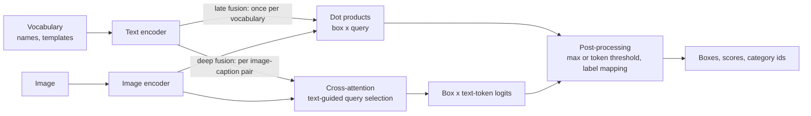

# Open-vocabulary detection and grounding

This note covers detectors whose category list is given as text at inference time:
region classifiers built on text embeddings (ViLD), an encoder-only detector with
independent text queries (OWL-ViT), and detectors that fuse image and text to ground
phrases (GLIP, Grounding DINO). Image-level text scoring is in
[CV-CLIP](../../70-reconnaissance-representations/references/72-clip-siglip.md),
closed-set detector mechanics in [CV-DETECTEURS](82-detection-fasterrcnn-yolo-detr.md),
and generative vision-language models in
[CV-VLM](../../120-generatif-multimodal/references/121-vlm-grounding.md).

## Problem and data contract

**Tasks.** Three outputs share the name "grounding" and must be told apart:

- *Open-vocabulary detection*: given an image and a list of category names chosen at
  test time, output every instance of every listed category as a box with a score.
  Some test categories had no box annotation in training: ViLD calls them *novel*
  and the others *base* [ViLD, §1, §4.1].
- *Phrase grounding and referring expressions*: given an image and a sentence, output
  a box for each noun phrase, or the single object a referring expression designates;
  Grounding DINO takes its highest-scoring output as the answer for a referring
  expression [Grounding DINO, §3].
- *Image-conditioned detection*: the query is the embedding of an example object,
  which helps for objects that are hard to describe in words [OWL-ViT, §3.1].

**Inputs.** An image and a vocabulary. OWL-ViT encodes each category name or
description separately, and the image never sees the text, so thousands of queries
per image are possible [OWL-ViT, §3.1]. GLIP and Grounding DINO concatenate the names
into one caption, for example "person. bicycle. car. … . toothbrush" [GLIP, §3.1;
Grounding DINO, §3], limited to 256 text tokens in Grounding DINO [Grounding DINO,
App. A]. Preprocessing is model-specific: the official Grounding DINO code resizes the
shorter side to 800 px (longer side at most 1333) with ImageNet normalization, and
transformers' OWL-ViT processor resizes to a $768\times768$ square with bicubic
interpolation and CLIP normalization (implementation contracts below).

**Outputs.** Boxes as normalized $(c_x,c_y,w,h)$ in $[0,1]$, mapped back to image
pixels per axis; a score per box and query (OWL-ViT) or per box and *text token*
(GLIP, Grounding DINO: 256 token logits per query); and a label obtained by a
post-processing rule, not by the network: the best query in transformers' OWL-ViT,
or the decoded tokens above a threshold in Grounding DINO. A label can therefore be a
partial phrase that matches no category of the application (worked example A).

**Role in a pipeline.** Pre-annotation of new categories, long-tail or frequently
changing catalogues, prompt-driven inspection, and box prompts for promptable
segmentation ([CV-SAM](../../90-segmentation/references/94-sam-sam2.md)). Downstream
code usually expects a fixed category identifier: the mapping from phrases to
identifiers, the thresholds and the vocabulary itself are part of the deployed model
and must be versioned with the checkpoint.

## Intuition

A closed-set detector classifies a region feature $o\in\mathbb R^{d}$ with a weight
matrix $W\in\mathbb R^{K\times d}$ learned for $K$ classes. Open-vocabulary detectors
replace the rows of $W$ by text embeddings of category names computed at inference:
ViLD-text replaces the classifier of a two-stage detector by fixed text embeddings plus
a learned background embedding [ViLD, §3.3]; OWL-ViT uses text embeddings "rather than
learned class embeddings" so that "each image therefore has its own discriminative
label space" [OWL-ViT, §3.1]; GLIP replaces the logits $OW^\top$ by region-word
alignment scores $OP^\top$ [GLIP, §3.1, eqs. 2–3]. Changing the vocabulary then means
changing rows, without retraining. Localization, however, is still learned from boxes
of annotated categories; ViLD found that a region proposal network trained on base
categories lost only about 2 points of average recall on novel LVIS categories
[ViLD, §4.2, Table 1].

The second axis is fusion. In *late fusion* (OWL-ViT, ViLD), image and text meet only
in the final dot product: text embeddings are computed once per vocabulary and the
scores of one query do not depend on the other queries. In *deep fusion* (GLIP,
Grounding DINO), text and image features attend to each other inside the encoder, and
in Grounding DINO the text also selects which image features become decoder queries
[GLIP, §3.2; Grounding DINO, §3.1–§3.3]. Deep fusion grounds attributes and relations
better, but the cost is paid per image–caption pair, and the names in one caption can
influence each other, which Grounding DINO limits with attention masks between
category names [§3.4].

*Illustration (constructed).* A warehouse camera is queried with "cardboard box.
pallet. forklift." A late-fusion model scores every image token against the three
embeddings, and each box keeps its best query. A fused model reads the caption with
the image: the token "box" can also respond to a crate if the image contains no
cardboard box, because the prompt asks it to find something. Adding "crate." to the
caption gives the crate a better match, which can change the label of a box that was
previously "cardboard box" without any change of weights.



*Diagram: two data flows, a project synthesis of OWL-ViT §3.1, GLIP §3.1–§3.2 and
Grounding DINO §3. The label is produced by post-processing in both cases.*

## Prerequisites and competencies

**Required prerequisites**: [CV-CLIP](../../70-reconnaissance-representations/references/72-clip-siglip.md)
for contrastive image-text embeddings and prompt sensitivity;
[CV-DETECTEURS](82-detection-fasterrcnn-yolo-detr.md) for proposals, set prediction,
Hungarian matching and focal loss. Useful: [CV-IOU-AP](../../130-evaluation-fiabilite/references/131-iou-ap-coco.md)
for AP, [CV-NMS](81-nms.md) for duplicates,
[CV-FIABILITE](../../130-evaluation-fiabilite/references/133-donnees-generalisation.md)
for splits and calibration, [CV-VLM](../../120-generatif-multimodal/references/121-vlm-grounding.md)
for generative outputs and hallucination. **Target competencies**: explain how a text
vocabulary replaces a classifier, compare late and deep fusion, interpret an
open-vocabulary benchmark, and diagnose a vocabulary or localization failure. Not every
variant mentioned is detailed.

## Assumptions, observability and degenerate cases

- **The concept is visually grounded in pre-training.** A name helps only if image-text
  pre-training associated it with visual evidence; part numbers, internal product codes
  or rare jargon may have no such association. GLIP's authors improved the AP50 of the
  novel category "stingray" from 4.6 to 9.7 by adding "flat and round" to the prompt
  [GLIP, §5.2], which shows both the lever and the dependence on wording.
- **The categories are visually distinguishable.** Two catalogue items that look the
  same in the available image cannot be separated by any prompt.
- **Localization transfers.** Boxes for novel objects come from a localization stage
  trained on other categories; the small recall loss measured by ViLD is an empirical
  result on LVIS, not a guarantee for industrial objects [ViLD, §4.2].
- **"Zero-shot" refers to box annotations.** OWL-ViT removes every box labelled with an
  LVIS rare category from its detection training data, so its rare-category AP measures
  zero-shot performance "in the sense that the model has not seen localized
  annotations" [OWL-ViT, §4.3]. Image-text pre-training may still contain the concept,
  and Grounding DINO's COCO "zero-shot" results use Objects365, which nearly covers the
  COCO categories [Grounding DINO, §4.2 and its footnote].
- **Scores are comparable across queries only by assumption.** Each query has its own
  score distribution, so one global threshold rarely suits all names; in fused models a
  score also depends on the rest of the caption.
- **Capacity.** OWL-ViT predicts one box per image token, at least 576 for ViT-B/32 at
  768 px [OWL-ViT, §3.1]; Grounding DINO decodes 900 queries, which its authors suspect
  limits rare categories [Grounding DINO, §4.2, App. A].

Degenerate cases: a prompted category absent from the image (the best-scoring box
still exists, so presence needs a calibrated threshold); a very generic prompt
("object", "part") that matches everything; a vocabulary longer than the caption limit
(worked example D); synonyms or hierarchical names that compete for the same object.

## Procedure

```text
vocab = versioned list of names, synonyms and prompt templates
text = encode(vocab)                  # once per vocabulary (late fusion)
for each image:
    boxes, logits = model(image, text)    # fused models re-encode text with each image
    score_b = aggregate(logits_b)         # max over queries, or max / mean over tokens
    keep boxes with score_b > box_threshold
    label_b = argmax query, or tokens with probability > text_threshold
    category_b = map(label_b)             # explicit, tested phrase-to-id rule
    optional NMS; map normalized boxes to image pixels
evaluate on held-out images: old and new categories, near negatives, absent targets
```

Purpose of the steps. *Versioning the vocabulary* matters because names, templates and
their order change the outputs as much as a checkpoint does. *Aggregation* decides what
a score means: OWL-ViT trains one sigmoid per query, GLIP averages token probabilities
into a phrase probability [GLIP, §3.1], and the official Grounding DINO code keeps a box
if its best token exceeds `box_threshold`. *Label extraction and mapping* turn tokens
into an application category; this step has no learned parameter and is a frequent
source of silent errors. *NMS* is not part of the default post-processing of either
DETR-like model.

Model-specific training recipes, at the level needed to read their outputs:

- **ViLD.** A two-stage detector trained on base categories; region embeddings are
  scored by cosine similarity against text embeddings and a learned background
  embedding, with a softmax at temperature $\tau$ [ViLD, §3.3, eq. 2]. ViLD-image also
  distils CLIP embeddings of cropped proposals ($1\times$ and $1.5\times$ crops) into
  the region embeddings, so that novel objects present in images, but not in labels,
  shape the embedding [§3.2, §3.3]. Prompt templates such as "a photo of {category} in
  the scene" and synonyms are ensembled [§3.2].
- **OWL-ViT.** A contrastively pre-trained ViT whose pooling is removed; each output
  token gets a box from a small MLP, biased towards the centre of its patch, and an
  embedding compared with the query embeddings [§3.1, §4.1]. Fine-tuning uses DETR's
  bipartite matching with a focal sigmoid loss, because federated datasets give each
  object possibly several labels; each image uses its positive and known-negative
  categories plus sampled pseudo-negatives, at least 50 [§3.2]. LVIS evaluation queries
  all 1203 names and ensembles seven prompt templates [§4.3].
- **GLIP.** Detection is rewritten as phrase grounding: alignment scores
  $S_{\text{ground}}=OP^\top$ between regions and prompt tokens replace class logits;
  deep fusion adds cross-attention between image and text in the last encoder layers
  [GLIP, §3.1, §3.2].
- **Grounding DINO.** A Swin image backbone and a BERT text backbone feed a feature
  enhancer (deformable self-attention for the image, self-attention for the text, and
  cross-attention both ways); a language-guided query selection keeps the 900 image
  tokens most similar to any text token as decoder queries; a cross-modality decoder
  adds a text cross-attention layer to each DINO decoder layer [Grounding DINO,
  §3.1–§3.3, Algorithm 1, App. A]. Classification is a contrastive focal loss between
  queries and text tokens, with L1 and GIoU box losses; matching costs are weighted
  2.0, 5.0 and 2.0 and the final losses 1.0, 5.0 and 2.0 [§3.5, App. A].

## Mathematics, conventions and units

**Region-text scores.** With a region embedding $e_r$, text embeddings $t_q$ and a
background embedding $e_{bg}$, ViLD-text computes
$z(r)=[\operatorname{sim}(e_r,e_{bg}),\operatorname{sim}(e_r,t_1),\dots]$ with
$\operatorname{sim}(a,b)=a^\top b/(\lVert a\rVert\lVert b\rVert)$ and trains
$\mathcal L_{\text{CE}}(\operatorname{softmax}(z(r)/\tau),y_r)$ over base categories
[ViLD, §3.3, eq. 2]. At inference the softmax runs over base and novel names, so adding
a name redistributes probability among all of them, as for CLIP classification
(card CV-CLIP-002). OWL-ViT and GLIP use per-query or per-token sigmoids instead, which
decouple queries in the loss but not in the post-processing (worked example B).

**Grounding scores.** GLIP writes $O=\operatorname{Enc}_I(\text{Img})\in\mathbb R^{N\times d}$
for $N$ region features, $P=\operatorname{Enc}_L(\text{Prompt})\in\mathbb R^{M\times d}$
for $M$ token features and $S_{\text{ground}}=OP^\top\in\mathbb R^{N\times M}$
[GLIP, §3.1, eq. 3]. Because $M$ exceeds the number of phrases $c$ (multi-word phrases,
sub-word tokens, separators, special tokens), the target matrix
$T\in\{0,1\}^{N\times c}$ is expanded to $T'\in\{0,1\}^{N\times M}$ by marking every
sub-word of a positive phrase positive, and the phrase probability at inference is the
mean of its token probabilities [§3.1]. Grounding DINO's query selection computes
image-token by text-token logits, takes the maximum over text tokens for each image
token, and keeps the top 900 image tokens [Grounding DINO, §3.2, Algorithm 1].

**Worked example A** (constructed example, recomputed by
checks/83-detection-open-vocabulary.py). Assume the prompt "traffic light. car." is
tokenized as traffic, light, ".", car, "." and that one box receives token
probabilities $(0.60,0.20,0.05,0.10,0.02)$.

- GLIP's phrase probability for "traffic light" is $(0.60+0.20)/2=0.40$.
- The official Grounding DINO code scores the box by its best token, $0.60>0.35$, and
  keeps it; only "traffic" exceeds `text_threshold` $=0.25$, so the label is the
  partial phrase "traffic".
- Its helper `phrases2classes` maps a phrase to the first class name that is a
  *substring* of it: "traffic" maps to no class, since "traffic light" is not a
  substring of "traffic"; and with classes ["car", "cart"] a box labelled "cart" is
  mapped to "car" because "car" comes first. The same box gets different categories
  depending on class order.

**Worked example B** (constructed example, recomputed by
checks/83-detection-open-vocabulary.py). transformers' OWL-ViT post-processing takes,
for each box, the query with the largest logit and applies a sigmoid to it. A box with
logits 2.0 for "bolt" and −1.0 for "nut" is reported as "bolt" with score 0.881. Adding
the query "anchor bolt" with logit 2.3 relabels the box "anchor bolt" with score
0.909, although the sigmoid for "bolt" is still 0.881: the vocabulary change acts
through the argmax, not through the network. This is the mechanism behind card
CV-OPENVOC-002's backward-compatibility check.

**Worked example C: federated evaluation** (constructed example, recomputed by
checks/83-detection-open-vocabulary.py). LVIS evaluates a category $c$ only on its
positive set $\mathcal P_c$ (all instances annotated) and its negative set
$\mathcal N_c$ (known absent); detections of $c$ on other images "are not evaluated",
and on positive images flagged as not exhaustively annotated, false positives are not
counted while recall still is [LVIS, §2.2, §2.3]. Seven "canoe" detections — one
matched and one unmatched on an exhaustive positive image, one matched and one
unmatched on a non-exhaustive positive image, one on a negative image and two on
unrelated images — count as 2 true positives, 2 false positives and 3 ignored
detections. An open-vocabulary detector that labels many unlisted objects is
therefore penalized only where the annotation protocol can prove it wrong. LVIS also
evaluates a detection against every positive category of its image, so a detector
should output the most specific correct category and its generalizations, such as
"canoe" and "boat" [§2.3, Hierarchy].

**Worked example D** (constructed, recomputed by checks/83-detection-open-vocabulary.py).
Capacity and text-length limits: ViT-B/32 at 768 px has $(768/32)^2=576$ tokens, hence
at most 576 boxes; ViT-L/14 at 840 px has 3600. The 1203 LVIS names need at least one
token each plus a separator, 2406 tokens, so a 256-token caption must be split into at
least 10 chunks, i.e. at least 10 passes of a fused model per image, whereas a
late-fusion model encodes the 1203 queries once.

## Parameters and tuning

| Parameter | Values in the sources | Effect | Interactions and what to watch |
| --- | --- | --- | --- |
| Vocabulary and prompt templates | OWL-ViT: 7 templates ensembled [§4.3]; ViLD: templates and synonyms [§3.2]; GLIP: "person. bicycle. …" works better than "Detect: person, …" with BERT [§3.1] | Which concepts can be found and how scores are distributed | Order, separators and synonyms change fused-model outputs; version them with the checkpoint |
| Box threshold | Official Grounding DINO demo: 0.35; transformers Grounding DINO: 0.25; transformers OWL-ViT: 0.1 | Recall versus false positives, including on absent categories | Per-query score distributions differ; tune per category or per group on validation |
| Text threshold | Official and transformers Grounding DINO: 0.25 | Which tokens form the label | Too high gives partial phrases (worked example A); too low merges neighbouring names |
| Number of queries | OWL-ViT: one per image token (576 for B/32 at 768 px) [§3.1]; Grounding DINO: 900 [App. A] | Maximum number of boxes | Grounding DINO's authors relate 900 queries to weaker rare-category AP [§4.2] |
| Caption length | Grounding DINO: 256 tokens [App. A] | Vocabulary size per pass | Long vocabularies need chunking (worked example D), which changes the context of each name |
| Input resolution | OWL-ViT: 768 or 840 px [§4.1, Table 1]; Grounding DINO official code: 800 / 1333 | Small-object recall, cost | Different resize contracts; boxes must be mapped back with the right sizes |
| Negatives in fine-tuning | OWL-ViT: known negatives plus at least 50 pseudo-negatives per image [§3.2] | Teaches absence | Without negatives, a fine-tuned vocabulary over-fires on near categories |

Tuning approach (project method), on held-out images from the deployment domain:

1. Fix the output contract: categories, their definitions, synonyms, the phrase-to-id
   rule and what counts as a correct box.
2. Build a validation set with old categories, new categories, near negatives
   (visually or semantically close items that must not be detected) and images where the
   target is absent.
3. With the checkpoint frozen, compare a few prompt variants per category; choose one
   and freeze it before testing.
4. Tune box and text thresholds per category or per group, measuring false positives
   on absent-target images as well as AP.
5. Re-run steps 3 and 4 whenever the vocabulary changes, and compare old-category
   metrics with the previous version.

## Properties and limits of guarantees

- **Vocabulary change without retraining** is a property of the interface, not of
  accuracy. Novel-category performance depends on pre-training data, wording and
  domain.
- **Empirical results under stated protocols.** On LVIS v1.0 val with rare-category
  boxes removed from training, OWL-ViT with a CLIP ViT-L/14 reached 34.6 AP and 31.2
  rare-category AP; GLIP-L, as reported in the same table, 26.9 and 17.1 [OWL-ViT,
  §4.3, Table 1]. Grounding DINO-L, trained on Objects365, OpenImages and GoldG
  without COCO images, reached 52.5 AP on COCO, and 26.1 mean AP on the ODinW
  zero-shot benchmark [Grounding DINO, abstract, §4.2, Table 2]. ViLD reached 16.1
  mask AP on rare LVIS categories with a ResNet-50 [ViLD, abstract, §1]. These numbers depend on training data that differs
  between methods.
- **Late fusion** makes each query's per-box sigmoid independent of the other queries;
  **deep fusion** does not, because text tokens attend to each other and to the image,
  even with sub-sentence masks between category names [Grounding DINO, §3.4].
- **Scores are not calibrated presence probabilities**: the best box for an absent
  category can still pass a threshold; per-query distributions differ.
- **Detection and grounding are equivalent formulations** for a fixed vocabulary:
  GLIP's authors report the same COCO performance for DyHead before and after
  rewriting it as grounding [GLIP, §3.1]. The open-vocabulary gain comes from the text
  encoder and the pre-training data, not from the rewriting itself.

## Cost and implementation

Cost drivers, with $Q$ queries, $N$ boxes and $M$ text tokens:

- **Late fusion**: one text encoding per vocabulary, then $N\times Q$ dot products per
  image; OWL-ViT can therefore use "thousands of queries per image" [OWL-ViT, §3.1].
  Its ViT-B/32 is comparable to a ResNet-50 in inference compute (139.6 vs 141.5
  GFLOPs) [§4.3, Table 1 caption].
- **Deep fusion**: image and text are encoded together for every image–caption pair,
  and a vocabulary longer than the caption limit multiplies the passes (worked example
  D). Grounding DINO-T has 172M parameters, 464 GFLOPs and runs at 8.37 frames/s
  against 232M, 488 GFLOPs and 6.11 frames/s for GLIP-T; the passage does not state the
  hardware [Grounding DINO, App. I, Table 14].

### Implementation contracts

Read in the sources; no model was executed for this note, and Context7 was not
available in this pass.

- **Official Grounding DINO**, commit `856dde2`: the caption is lowercased and ends
  with "." (`preprocess_caption`); images are resized to a shorter side of 800 px
  (longer side at most 1333) and normalized with ImageNet statistics; `predict` applies
  a sigmoid to the 256 token logits of each of the 900 queries, keeps a box if its
  largest token probability exceeds `box_threshold`, and labels it with the decoded
  tokens above `text_threshold`; no NMS is applied. `predict_with_caption` defaults to
  0.35 and 0.25, `predict_with_classes` joins class names with ". " and maps phrases to
  classes by substring [util/inference.py L22–L26, L37–L48, L53–L97, L152–L157,
  L219, L264–L273]. The README recommends separating category names with "." and warns
  that a word can be split into several tokens [README L99–L106].
- **transformers v5.23.0, Grounding DINO**: `post_process_grounded_object_detection`
  defaults to `threshold=0.25` and `text_threshold=0.25`, scores each box by its best
  token probability and returns text labels decoded from the tokens
  [processing_grounding_dino.py L130–L212]. Its default box threshold thus differs from
  the official demo's 0.35.
- **transformers v5.23.0, OWL-ViT**: the image processor resizes to $768\times768$
  without preserving the aspect ratio, with bicubic resampling and CLIP mean and
  standard deviation; `post_process_object_detection` keeps, for each box, the query
  with the largest logit, applies a sigmoid, thresholds at 0.1 and applies no NMS; NMS
  at 0.3 appears only in the image-guided variant [image_processing_owlvit.py
  L102–L114, L126–L177].

## Evaluation and controlled variation

### Protocols

| Protocol | Split and vocabulary | Metric | Caveat |
| --- | --- | --- | --- |
| LVIS v1 open-vocabulary [ViLD, §4.1] | 866 frequent and common categories as base, 337 rare as novel; inference with all 1203 names (generalized setting) | Rare-category AP ($\text{AP}_r$) | Federated annotation: only positive and negative sets are scored (worked example C) |
| LVIS zero-shot [OWL-ViT, §4.3] | Rare-category boxes removed from all detection training data; image-text pre-training unrestricted | $\text{AP}^{\text{LVIS}}$ and $\text{AP}^{\text{LVIS}}_{\text{rare}}$ | Deduplication of evaluation images from training sets is required [§4.2] |
| COCO open-vocabulary [ViLD, §4.1] | 48 base and 17 novel categories | Novel and base AP | Different split from COCO "zero-shot transfer" |
| COCO zero-shot transfer [Grounding DINO, §4.2] | No COCO images in training | COCO AP | Objects365 nearly covers COCO categories |
| Referring expressions [Grounding DINO, §4.3] | RefCOCO, RefCOCO+, RefCOCOg | Accuracy of the single returned box | Tests attributes and relations, not category coverage |

Results are comparable only within one protocol and one disclosure of training data.

### Proposed baseline and controlled variation (not executed)

- **Question**: does adding a category name to a deployed vocabulary change the
  detection of existing categories (card CV-OPENVOC-002)?
- **Data**: held-out images from the deployment domain with boxes for old categories,
  images with the new product, near negatives and images without any target.
- **Baseline**: a frozen open-vocabulary checkpoint with vocabulary V0, fixed prompt
  templates, fixed thresholds and a tested phrase-to-id rule; record per-category AP,
  recall at the operating threshold, false positives per absent-target image and
  unmapped labels.
- **Controlled variation**: V1 = V0 plus one new name, appended at the end of the
  caption; everything else identical.
- **Measurements**: change of each old category's AP and operating-point recall; the
  fraction of boxes whose label changes between V0 and V1 (worked example B); new
  false positives on near negatives; latency.
- **Expected effect (hypothesis)**: a late-fusion model changes old labels only
  through the post-processing argmax; a fused model can also change old scores.
- **Confounds**: caption order and length (repeat with the new name inserted at the
  start), chunking when the caption exceeds 256 tokens, and per-category thresholds
  tuned on V0.

**Measurement limits.** Novel-category AP depends on how many novel instances the test
set contains, on synonym handling and on annotation exhaustiveness; benchmark images
may overlap with web-scale pre-training data, which deduplication only partly controls
[OWL-ViT, §4.2]; a few demonstration images measure nothing.

## Failure modes and diagnosis

| Symptom | Possible causes | Discriminating check | Conditional remedy |
| --- | --- | --- | --- |
| Boxes on related objects outside the target category | Broad or ambiguous name; taxonomy not expressible in words | Is the box on a real object? Then is that object's category inside the business definition? (card CV-OPENVOC-003) | Narrower names, explicit negatives, per-category threshold, or a few annotated examples and fine-tuning |
| Confident box when the target is absent | Best-match behaviour; prompt invites a match | False-positive rate on absent-target images per prompt | Calibrate thresholds on absent-target images; add near-negative names as competitors |
| Labels that match no category, or the wrong one | Partial phrases below `text_threshold`; substring mapping; tokenization | Log raw tokens, decoded phrases and mapped ids (worked example A) | Exact phrase-to-id mapping on token spans; per-phrase scores |
| Old categories change after a vocabulary update | Argmax over a larger query set; caption context in fused models | Compare V0 and V1 outputs on the same images (controlled variation) | Freeze per-version thresholds; regression test on old categories before release |
| Missed small objects | Resolution of the processor; one box per image token | Object size in processed-image pixels; recall by size | Higher input resolution or tiling |
| Long vocabulary gives worse or slower results | Caption truncation or chunking | Token count per caption; results per chunk | Late-fusion model, grouping of names, or a closed-set detector for frequent classes |
| Good benchmark AP, poor field results | Domain shift; pre-training overlap with benchmark images | Field validation set; deduplication check | Domain-specific validation and targeted annotation |

## Alternatives and applications

Conditional choices:

- **Prefer a closed-set detector** ([CV-DETECTEURS](82-detection-fasterrcnn-yolo-detr.md))
  when categories are stable, annotations are affordable, the latency budget is tight
  and the operating point must be calibrated per class.
- **Prefer a late-fusion open-vocabulary detector (OWL-ViT style)** when the vocabulary
  is long or changes often and per-query scores should not depend on the other names;
  its image-conditioned mode helps for objects that are hard to name [OWL-ViT, §3.1].
- **Prefer a fused grounding model (GLIP, Grounding DINO)** when queries contain
  attributes or relations ("the open drawer on the left") or when one image is queried
  with short captions, and when per-pair cost is acceptable.
- **Prefer a hybrid**: a closed-set detector for frequent categories and an
  open-vocabulary model, with human verification, for new or rare ones; or an
  open-vocabulary model as a pre-annotation tool whose boxes are corrected and used to
  train a closed-set detector.
- **Prefer a generative VLM** only when the output is a description to be verified, not
  a measured detection ([CV-VLM](../../120-generatif-multimodal/references/121-vlm-grounding.md)).

Industrial uses (project reasoning, not published results): pre-annotating new
products in a retail or logistics catalogue; detecting rare event classes in fleet
video for later review; generating box prompts for promptable segmentation
([CV-SAM](../../90-segmentation/references/94-sam-sam2.md)) in annotation tools;
inspection queries on a few named defect types, provided that a validation set with
absent-defect images measures the false-alarm rate.

## Guided reasoning and proposed checks

These constructed cases develop variable vocabularies, protocols and localized outputs. They explain or test reasoning; no image, video or hardware result is claimed as measured. Method properties remain tied to the sources below.

### Case linked to CV-OPENVOC-001

**Working question**: Why can CLIP classification of an image not directly replace an open-vocabulary detector?

**Reference answer**: Image classification scores the whole image; detection must also locate instances, with a suitable output protocol.

**Decomposition of the output**: A global image–text similarity may indicate that the content is compatible with a description. A detector must also propose positions and distinguish several occurrences, with their classes or their relation to the text. A score on the entire image does not determine these boxes or their number.

**Constructed example**: A scene with two cups and a plate may well match the text "cup" without giving the location of each cup. The detection evaluation should check instances, coordinates and missed objects, including when the prompted object is absent from the image. Referring-expression grounding can require yet another output, such as "the cup to the left of the plate". Define annotations, negatives, thresholds and metrics according to this contract. Language widens the set of candidate labels; it does not remove the need to check spatial accuracy and domain confusions.

### Case linked to CV-OPENVOC-003

**Working question**: A broad prompt produces boxes on related objects outside the target category. What should be tested?

**Reference answer**: Class definition, formulations/negatives and region score on validation; inspect confusions and annotations.

**Why the text may be at issue**: A general description can correspond to several visual categories that an industrial taxonomy separates. A model can therefore return a region that is plausible in everyday language but wrong for the need. A single threshold does not necessarily resolve this ambiguity.

**Constructed investigation**: Record target and excluded classes, compare more precise formulations and close negatives on validation, then inspect regions and annotations. Separate localization failures from vocabulary confusion. Also assess the absence of a target, because choosing the best candidate does not prove its presence. A new formulation must be frozen before the final test. If the domain offers no visible discriminating cue, a better prompt may be insufficient; the interface must then allow rejection or verification rather than guaranteeing an exact category.

**Source consulted for this pass**: [Grounding DINO](https://arxiv.org/html/2303.05499v4), open-set method and protocol. The other developments are in the [flashcards](../83-detection-open-vocabulary.md).

## Additional technical explanations — 2026-10-30

These explanations complement the mechanism associated with each question. Calculations are constructed cases under stated assumptions; protocols remain proposals until a test is recorded.

### CV-OPENVOC-001

**Situation**: Why can CLIP classification of an image not directly replace an open-vocabulary detector?

**Where the text intervenes**: In Grounding DINO as described in the cited paper, text representations can guide the selection of queries and take part in decoding regions. The interface is therefore not limited to classifying a global vector after the fact. For each output, check what its score represents: a token, an expression or an aggregated category, depending on the implementation. Two occurrences of the same word in an image still require two distinct regions. A constructed test with one object, two objects and no object, with a fixed prompt, checks cardinality and localization without confusing the best linguistic match with a certain presence.

### CV-OPENVOC-002

**Situation**: Track A — design: a product catalogue changes every month. How should a retrained closed-set detector be compared with an open-vocabulary detector?

**Splitting the test over time**: Simulate several catalogue updates: fix an initial version, freeze the system, then introduce held-out products and close negatives. Measure the annotation and maintenance effort per cycle, as well as errors on old and new objects. The cost of a text-based method includes defining categories and validating prompts; that of the closed-set detector includes collection, training and new validation. If one product is visually indistinguishable from another in the available image, no formulation can guarantee the distinction. This protocol evaluates a capacity to evolve, rather than a single favourable snapshot of the catalogue.

### CV-OPENVOC-003

**Situation**: A broad prompt produces boxes on related objects outside the target category. What should be tested?

**Separate vocabulary from localization**: For each false positive, first compare the proposed region with the visible object, then the category of this object with the business definition. A correct box on a semantically neighbouring object is a different problem from a box placed across several objects. Adding more precise formulations can shift the whole score distribution: re-evaluate recall and rejection, without assuming a prompt-invariant threshold. Record the exact expressions, their tokenization if it affects how scores are read, and the rules that group tokens into labels. These elements are part of the decision model and must be versioned with the checkpoint.

**Passages consulted for these developments**: [Liu et al., Grounding DINO](https://arxiv.org/html/2303.05499v4), §3.2–3.3, text-guided query selection and decoding; project testing.

## Worked reasoning and boundary cases — 2026-11-08

The following are constructed project deductions and proposed checks, not
new empirical results. Each extends an existing recall objective; the concise
expected answer on its card remains the grading target.

### CV-OPENVOC-001 — Region grounding needs a localization evaluation

A global image embedding can identify that an image resembles a text description while giving no location or count of the matching objects. Cropping every possible region would add a proposal/search problem with its own cost and evaluation. Compare instance recall, localization and absent-category behavior when evaluating open-vocabulary detection, rather than transferring a global zero-shot classification accuracy directly to the detection task.

### CV-OPENVOC-002 — Vocabulary updates need backward-compatibility evidence

A new product description can compete with old descriptions and change old-category decisions even without retraining the image encoder. A proposed monthly protocol freezes a reference set of old products, adds new products and near negatives, then measures both acquisition cost and regression on the old set. Include threshold/prompt maintenance and inference cost. An unchanged checkpoint does not imply an unchanged end-to-end classifier or detector.

### CV-OPENVOC-003 — A broad phrase can be semantically correct but operationally wrong

If the requested target is a specific fastener and the prompt describes generic metal parts, boxes on related tools may match the language while violating the product category. Audit whether localization is correct before changing the text. Then compare narrower descriptions and controlled near negatives on validation. A higher text-region score alone cannot decide a category boundary that the task specification has not defined.

Consulted foundations: [OWL-ViT](https://arxiv.org/html/2205.06230v2): §3 localized image-text matching; [Grounding DINO](https://arxiv.org/html/2303.05499v4): §§3.2–3.3 language-guided queries and cross-modal decoding.

## Sources and flashcards

### Scientific sources

- [Minderer et al., OWL-ViT, arXiv HTML v2](https://arxiv.org/html/2205.06230v2): §3.1 (architecture, text queries, no fusion, image-conditioned queries), §3.2 (focal sigmoid loss, federated negatives, pseudo-negatives), §4.1 (box bias, image sizes), §4.2 (data and deduplication), §4.3 (LVIS protocol, Table 1).
- [Liu et al., Grounding DINO, arXiv HTML v4](https://arxiv.org/html/2303.05499v4): abstract, §3 (outputs, REC), §3.1–§3.3 and Algorithm 1, §3.4 (sub-sentence masks), §3.5 (loss), §4.2 (COCO, LVIS, Objects365 footnote), App. A (900 queries, 256 tokens, cost weights), App. I (Table 14).
- [Li et al., GLIP, arXiv HTML v2](https://arxiv.org/html/2112.03857v2): §3.1 (eqs. 1–3, token expansion, phrase probability, equivalence), §3.2 (deep fusion), §5.2 (manual prompt tuning).
- [Gu et al., ViLD, arXiv HTML v3](https://arxiv.org/html/2104.13921v3): §1, §3.2 (crops, prompt ensembling), §3.3 (eq. 2, background embedding, distillation), §4.1 (LVIS and COCO splits), §4.2 (proposal recall on novel categories).
- [Gupta et al., LVIS, arXiv HTML v2](https://arxiv.org/html/1908.03195v2): §2.2 (federated design, positive and negative sets), §2.3 (non-exhaustive flags, hierarchy).

### Implementation sources

- [IDEA-Research/GroundingDINO, commit 856dde2, `groundingdino/util/inference.py`](https://github.com/IDEA-Research/GroundingDINO/blob/856dde20aee659246248e20734ef9ba5214f5e44/groundingdino/util/inference.py): L22–L26, L37–L48, L53–L97, L152–L157, L219, L264–L273; [README](https://github.com/IDEA-Research/GroundingDINO/blob/856dde20aee659246248e20734ef9ba5214f5e44/README.md): L99–L106, L231–L232.
- [transformers v5.23.0, `models/grounding_dino/processing_grounding_dino.py`](https://github.com/huggingface/transformers/blob/v5.23.0/src/transformers/models/grounding_dino/processing_grounding_dino.py): L130–L212.
- [transformers v5.23.0, `models/owlvit/image_processing_owlvit.py`](https://github.com/huggingface/transformers/blob/v5.23.0/src/transformers/models/owlvit/image_processing_owlvit.py): L102–L114, L126–L177.

### Related flashcards and references

- [Flashcards](../83-detection-open-vocabulary.md): CV-OPENVOC-001 (image classification versus detection), CV-OPENVOC-002 (catalogue design and backward compatibility) and CV-OPENVOC-003 (broad prompt diagnosis).
- Related references: [CV-CLIP](../../70-reconnaissance-representations/references/72-clip-siglip.md), [CV-DETECTEURS](82-detection-fasterrcnn-yolo-detr.md), [CV-VLM](../../120-generatif-multimodal/references/121-vlm-grounding.md), [CV-SAM](../../90-segmentation/references/94-sam-sam2.md).

Drafted by agent, 2026-10-18. Revision 8, 2026-11-14: body deepened and language corrected by Agent Claude Code (`revue-cartes`, self-review); see the [subject report](https://github.com/speillet/Knowledge_Computer_Vision/blob/main/docs/revues/2026-11-14-reference-depth/83-detection-open-vocabulary.md).
