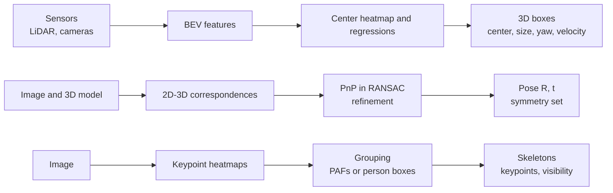

# 3D detection, object pose and articulated pose

This comparison note separates three outputs that are all called "pose": a 3D
bounding box of an object class (LiDAR or camera 3D detection), the rigid 6-DoF pose
of a known object model, and the keypoints of an articulated body. They differ in
unknowns, coordinate frames, annotations, matching rules and metrics, and their scores
cannot be compared. Point-cloud encoders such as PointPillars are described in
[CV-BEV](../../60-vision-3d/references/64-nuages-bev-occupation.md), the PnP solvers in
[CV-EPIPOLAIRE](../../50-calibration-geometrie/references/53-epipolaire-pnp-triangulation.md)
and rotation conventions in
[CV-SE3](../../10-mathematiques-estimation/references/12-rotations-se3.md).

## Problem and data contract

| Output | Typical input | Unknowns per instance | Frame and units | Matching and metric |
| --- | --- | --- | --- | --- |
| 3D box detection | LiDAR sweeps, cameras, radar | Class, center, size, yaw, often velocity and attributes | Metric frame (ego or global), m, rad, m/s | nuScenes: 2D center distance on the ground plane, mAP and NDS |
| Rigid 6-DoF object pose | RGB or RGB-D image and a 3D model of each object | $\mathbf P=[\mathbf R\mid\mathbf t]$ from model frame to camera frame, score | Camera frame, mm or m | BOP: VSD, MSSD, MSPD; ADD or ADD-S in older benchmarks |
| Articulated pose | RGB image (2D), images or 2D keypoints (3D) | $J$ keypoint positions, visibility, person grouping | Image pixels (2D); mm relative to a root joint (3D) | COCO: OKS-based AP; Human3.6M: mean per-joint error |

**3D boxes.** CenterPoint writes a box as $b=(u,v,d,w,l,h,\alpha)$: center relative to
the object's ground plane, size and yaw, in an egocentric frame with the sensor at the
origin [CenterPoint, §3]. A nuScenes result gives `translation` (center in m, global
frame), `size` (width, length, height in m), `rotation` (quaternion, global frame) and
`velocity` (m/s) for each 2 Hz keyframe, and may use at most about 0.5 s of past sensor
data [nuScenes README, "Results format", "Submission rules"]. The size order (width
first) and the frame (global, not ego) are the two conventions most often lost at an
interface.

**Rigid pose.** BOP defines the pose as a rigid transformation "from the 3D coordinate
system of the object model to the 3D coordinate system of the camera", given as a
$3\times3$ rotation, a $3\times1$ translation and a confidence. In the *localization*
task the method also receives the list of objects and their instance counts; in the
*detection* task it does not [BOP 2020, §2.1; BOP tasks page]. OpenCV's `solvePnP`
uses the same direction: `rvec` and `tvec` bring points "from the model coordinate
system to the camera coordinate system" [calib3d.hpp L1010–L1012, L1031–L1032].

**Articulated pose.** A COCO person annotation stores each keypoint as $(x,y,v)$ with
$v=0$ not labelled, $v=1$ labelled but not visible and $v=2$ visible, plus a scale $s$
equal to the square root of the segment area; persons smaller than $32^2$ px² carry no
keypoints [COCO keypoint evaluation]. 3D human pose on Human3.6M is reported in
millimetres after aligning the root (central hip) joint [Martinez et al., §4].

**Role in a pipeline.** 3D boxes feed tracking, prediction and collision checking in
the vehicle or robot frame ([CV-SORT](../../110-tracking-association/references/111-sort.md));
a 6-DoF pose feeds grasp planning, assembly or augmented reality; keypoints feed
action recognition, ergonomics or safety zones. Each consumer needs a different
quantity, which is why the evaluation must be chosen from the consumer, not from the
word "pose" (card CV-POSE3D-001).

## Intuition

- **3D boxes from LiDAR.** Points are binned into a bird's-eye-view (BEV) feature map
  ([CV-BEV](../../60-vision-3d/references/64-nuages-bev-occupation.md)); CenterPoint
  then treats each object as a point: a class heatmap peaks at object centers and the
  other attributes are read from regression maps at the peak [CenterPoint, §4].
  Representing an object by its center avoids fitting axis-aligned anchors to rotated
  boxes, which the authors identify as a difficulty of anchor-based 3D detectors
  [§3].
- **Rigid pose of a known model.** If 2D–3D correspondences between image points and
  model points are available, the pose follows from a Perspective-n-Point (PnP) solve
  with known intrinsics, usually inside RANSAC
  ([CV-EPIPOLAIRE](../../50-calibration-geometrie/references/53-epipolaire-pnp-triangulation.md));
  learned methods predict the correspondences or the pose directly. If the object is
  symmetric, several poses look identical, and the "correct" answer is a set.
- **Articulated pose.** Keypoints are detected as peaks of heatmaps and then grouped
  into persons, either bottom-up with part affinity fields that score candidate limbs
  (OpenPose) or top-down by running a single-person estimator in each person box
  (HRNet) [OpenPose, §I, §III; HRNet, §4.1].

*Illustration (constructed).* In a warehouse aisle, a forklift needs a 3D box in the
vehicle frame for collision checking, a pallet needs a 6-DoF pose so that the forks
enter its pockets, and a worker needs keypoints to detect a bent posture. A good
forklift box says nothing about the pallet pockets, and a good worker skeleton gives no
metric box for path planning.



*Diagram: three output pipelines, a project synthesis of CenterPoint §4, BOP 2020
§2.1, OpenPose §III and HRNet §4.1. They share no metric.*

## Prerequisites and competencies

**Required prerequisites**: [CV-SE3](../../10-mathematiques-estimation/references/12-rotations-se3.md)
for rotation parameterizations and frame composition;
[CV-BEV](../../60-vision-3d/references/64-nuages-bev-occupation.md) for point-cloud
encoders and BEV grids;
[CV-EPIPOLAIRE](../../50-calibration-geometrie/references/53-epipolaire-pnp-triangulation.md)
for PnP and projection. Useful:
[CV-DETECTEURS](82-detection-fasterrcnn-yolo-detr.md) for heatmaps, assignment and
NMS; [CV-IOU-AP](../../130-evaluation-fiabilite/references/131-iou-ap-coco.md) for AP;
[CV-MULTICALIB](../../50-calibration-geometrie/references/55-calibration-multicapteurs.md)
for extrinsics and timing; [CV-ICP](../../60-vision-3d/references/62-recalage-global-icp.md)
for depth-based pose refinement. **Target competencies**: name the unknowns and
frame of each output, check a box or pose convention, choose a metric from the
consumer, and diagnose symmetry and convention errors.

## Assumptions, observability and degenerate cases

- **Calibrated, synchronized sensors.** Boxes in a global frame require extrinsics and
  ego poses; aggregating several LiDAR sweeps requires motion compensation. nuScenes
  provides ego poses for every LiDAR frame but box annotations only every 0.5 s
  [CenterPoint, §5].
- **Gravity-aligned rigid cuboids.** A 3D box with yaw only assumes a flat ground and a
  rigid object; slopes, trailers and articulated vehicles violate it. A transform with
  roll or pitch between sensors produces a box that a single yaw cannot describe
  (CV-POSE3D-002 appendix).
- **Point density falls with range.** nuScenes evaluates each class only up to a range
  (50 m for cars, 40 m for pedestrians, 30 m for barriers and cones) and removes ground
  truth boxes that contain no LiDAR or radar point [nuScenes README, "Classes,
  attributes, and detection ranges", "Preprocessing"; detection_cvpr_2019.json].
- **Known model and visible texture for rigid pose.** The model must match the
  instance; global symmetries are part of the object, and texture can resolve some of
  them: BOP keeps only symmetries "that cannot be resolved by the model texture"
  [BOP 2020, §2.3].
- **Enough non-degenerate correspondences for PnP.** OpenCV 4.13 needs at least 4
  points in general and exactly 4 for its P3P variants; IPPE requires coplanar object
  points [calib3d.hpp L1012–L1014, L1057–L1060].
- **Fixed skeleton and visibility labels.** Keypoint definitions, left/right
  conventions and the treatment of occluded keypoints come from the annotation
  protocol; COCO's OKS ignores keypoints with $v=0$.

Observability: the rotation about the axis of a featureless cylinder is not
observable from the image (card CV-POSE3D-004); a monocular camera does not observe
metric depth without priors; a keypoint labelled but not visible ($v=1$) is a guess
by the annotator. Degenerate cases: square boxes, where length and width swaps are
invisible; objects at the range limit with a handful of points; crowds where limbs
of different persons overlap; planar objects for PnP methods that assume a general
3D configuration.

## Procedure

```text
3D boxes (CenterPoint-style)
    points (several sweeps, ego-motion compensated) -> voxels or pillars -> BEV map M
    heatmap per class (Gaussian targets at BEV centers) + regressions at each cell:
        sub-voxel offset, height above ground, log size, (sin yaw, cos yaw), velocity
    peaks -> boxes; optional second stage refines boxes and scores; NMS; track by velocity
Rigid pose (model-based)
    detect object -> 2D-3D correspondences (features or predicted keypoints)
    PnP inside RANSAC -> R, t ; refine (iterative PnP, or ICP with depth)
    report symmetric equivalents consistently with the evaluation's symmetry set
Articulated pose
    bottom-up: heatmaps + part affinity fields -> limb scores -> bipartite matching per limb
    top-down : person detector -> crop with fixed aspect ratio -> heatmaps -> peak per keypoint
```

Purpose of the steps. *Sweep aggregation and ego-motion compensation* densify the
cloud without smearing static objects. *Center heatmaps with enlarged Gaussians*
counter the sparsity of BEV targets: CenterPoint sets the radius to
$\sigma=\max(f(wl),\tau)$ with $\tau=2$ [CenterPoint, §4]. *Regressing
$(\sin\alpha,\cos\alpha)$* avoids the discontinuity of an angle at $\pm\pi$ [§4].
*Velocity* lets CenterPoint associate detections greedily by closest distance after
projecting centers back by the predicted velocity, keeping unmatched tracks for 3
frames [§4]. *RANSAC around PnP* removes wrong correspondences before refinement.
*Bipartite matching per limb* turns OpenPose's NP-hard multi-person parsing into
independent assignments on a spanning tree of the skeleton [OpenPose, §III-E].
*Top-down cropping* fixes the person scale: HRNet extends each person box to a
4:3 height-to-width ratio and resizes it to $256\times192$ or $384\times288$
[HRNet, §4.1].

## Mathematics, conventions and units

**3D box corners.** For a geometric center $\mathbf c$, length $l$ along the heading,
width $w$ and height $h$ in metres, and yaw $\alpha$ in radians about the vertical
axis, the eight corners are
$\mathbf c+\mathbf R_z(\alpha)\,(\pm l/2,\ \pm w/2,\ \pm h/2)^\top$. If the center is
defined on the bottom face, add $h/2$ to the vertical coordinate first. The order of
$(l,w,h)$, the sign and zero of the yaw, the vertical axis and the frame are all
conventions to record (card CV-POSE3D-002).

**CenterPoint scores.** The second stage is trained towards an IoU-guided target
$I=\min(1,\max(0,2\,\mathrm{IoU}_t-0.5))$ with binary cross-entropy, and the final
score is the geometric mean $\hat Q_t=\sqrt{\hat Y_t\,\hat I_t}$ of the first-stage
heatmap score and the second-stage score [CenterPoint, §4.1, eqs. 1–2].

**nuScenes detection metrics.** A prediction matches the ground truth of the same class
with the smallest 2D center distance on the ground plane, below a threshold
$d\in\{0.5,1,2,4\}$ m; AP integrates precision and recall above 0.1; mAP averages over
thresholds and classes. True-positive errors are computed at $d=2$ m: ATE (center
distance, m), ASE ($1-\mathrm{IoU}$ after aligning centers and orientation), AOE
(smallest yaw difference, rad; on 180° for barriers, ignored for cones), AVE (m/s) and
AAE ($1-$attribute accuracy). The nuScenes detection score converts each mean error to
$\max(1-\text{error},0)$ and averages them with weight 5 on mAP and 1 on each of the
five scores, i.e. $\mathrm{NDS}=\tfrac{1}{10}\big[5\,\mathrm{mAP}+\sum\max(1-\mathrm{mTP},0)\big]$
[nuScenes README, "Evaluation metrics"]. Center-distance matching ignores size and yaw;
those errors appear only in the TP terms.

**Worked example A** (constructed example, recomputed by
checks/84-detection-pose-3d.py). A ground-truth car of $l\times w\times h=4\times2\times1.5$
m and a prediction with the same center whose size was written in nuScenes order
$(w,l,h)$ but read as $(l,w,h)$:

- the prediction matches at every distance threshold and ATE $=0$;
- after aligning centers and orientation, the two boxes share $2\times2\times1.5=6$ m³
  of $12+12-6=18$ m³, so the 3D IoU is $1/3$ and ASE $=2/3$;
- if the pipeline also adds a 90° yaw offset, the footprint becomes identical to the
  ground truth, yet ASE stays $2/3$ and AOE becomes $\pi/2\approx1.571$ rad. A plausible
  overlay on a picture does not prove the convention.

**Rigid-pose errors.** With model vertices $V_M$, an estimated pose $\hat{\mathbf P}$,
the ground truth $\bar{\mathbf P}$ and a set $S_M$ of symmetry transformations, BOP
defines [BOP 2020, §2.2, eqs. 2–3]

$$
e_{\text{MSSD}}=\min_{\mathbf S\in S_M}\max_{\mathbf x\in V_M}\big\lVert\hat{\mathbf P}\mathbf x-\bar{\mathbf P}\mathbf S\mathbf x\big\rVert_2,\qquad
e_{\text{MSPD}}=\min_{\mathbf S\in S_M}\max_{\mathbf x\in V_M}\big\lVert\operatorname{proj}(\hat{\mathbf P}\mathbf x)-\operatorname{proj}(\bar{\mathbf P}\mathbf S\mathbf x)\big\rVert_2,
$$

in model units (usually mm) and pixels respectively. VSD compares rendered distance
maps only over visible pixels with a tolerance $\tau$, so poses indistinguishable in
shape count as equivalent [§2.2, eq. 1]. $S_M$ contains the transformations whose
Hausdorff deviation is below $\max(15\text{ mm},0.1d)$, with $d$ the model diameter,
minus those that texture resolves; continuous symmetries are discretized so that the
farthest vertex moves at most 1% of $d$ between steps [§2.3]. A pose is correct if
$e<\theta_e$; $\text{AR}_{\text{MSSD}}$ averages recall over $\theta$ from 5% to 50% of
$d$, $\text{AR}_{\text{MSPD}}$ over $5r$ to $50r$ px with $r=w/640$, and the dataset
score is the mean of the three ARs [§2.4]. The older ADD averages
$\lVert(\mathbf R\mathbf x+\mathbf T)-(\tilde{\mathbf R}\mathbf x+\tilde{\mathbf T})\rVert$
over model points and accepts a pose below 10% of the diameter; ADD-S uses the
closest point instead of the corresponding point for symmetric objects
[PoseCNN, §V-B]. BOP notes that this closest-point variant "can yield unintuitively
low errors even for poses that are distinguishable" [BOP 2020, App. A].

**Worked example C** (constructed example, recomputed by
checks/84-detection-pose-3d.py). A featureless cylinder of radius 20 mm and height
100 mm (diameter $d=107.7$ mm) is estimated with a 45° error about its axis. Every rim
vertex moves by the chord $2r\sin 22.5^\circ=15.31$ mm, so ADD $=15.31$ mm exceeds
$0.1d=10.77$ mm and the pose is rejected; with the axial symmetry in $S_M$, MSSD $=0$.
If a printed mark makes the angle observable, $S_M=\{\mathbf I\}$ and MSSD $=15.31$ mm,
which passes 8 of the 10 BOP thresholds (from 15% of $d$, 16.2 mm) and contributes 0.8
to $\text{AR}_{\text{MSSD}}$ for this instance.

**Keypoint heatmaps and limb scores.** OpenPose's target for part $j$ of person $k$ is
$\mathbf S^*_{j,k}(\mathbf p)=\exp(-\lVert\mathbf p-\mathbf x_{j,k}\rVert_2^2/\sigma^2)$,
merged across persons by a maximum [OpenPose, §III-C, eqs. 7–8]. For two candidate
parts $\mathbf d_{j_1},\mathbf d_{j_2}$, the association score is the line integral of
the predicted affinity field along the segment,
$E=\int_0^1\mathbf L_c(\mathbf p(u))\cdot\frac{\mathbf d_{j_2}-\mathbf d_{j_1}}{\lVert\mathbf d_{j_2}-\mathbf d_{j_1}\rVert_2}\,du$,
approximated by sampling, and each limb type is solved as a maximum-weight bipartite
matching with the Hungarian algorithm [§III-D, eq. 11; §III-E, eq. 13]. HRNet instead
regresses one heatmap per keypoint with a mean squared error towards a Gaussian of
standard deviation 1 pixel and refines the peak by a quarter offset towards the second
highest response [HRNet, §3, §4.1].

**Object keypoint similarity.** With $d_i$ the distance between predicted and
annotated keypoint $i$, $s$ the object scale and $\kappa_i=2\sigma_i$ a per-keypoint
constant, $\mathrm{OKS}=\sum_i\exp\!\big(-d_i^2/(2s^2\kappa_i^2)\big)\,\delta(v_i>0)\big/\sum_i\delta(v_i>0)$;
COCO's person values are $\sigma=0.026$ (nose), 0.025 (eyes), 0.035 (ears), 0.079
(shoulders), 0.072 (elbows), 0.062 (wrists), 0.107 (hips), 0.087 (knees) and 0.089
(ankles), and AP averages ten OKS thresholds from 0.50 to 0.95 [COCO keypoint
evaluation; HRNet, §4.1].

**Worked example B** (constructed example, recomputed by
checks/84-detection-pose-3d.py). For a person with a 10,000 px² segment ($s=100$ px), a
10 px error gives a similarity of 0.135 on an eye, 0.722 on a wrist and 0.897 on a hip.
For a person of 2,500 px² ($s=50$ px), the same 10 px give 0.0003 on an eye and 0.646
on a hip. A pixel error is meaningless without the keypoint type and the person's
scale.

**3D joint error and alignment.** The mean per-joint position error
$J^{-1}\sum_j\lVert\hat{\mathbf p}_j-\mathbf p_j\rVert$ is reported in mm after root
alignment (Human3.6M protocol #1) or after a further rigid alignment with the ground
truth (protocol #2) [Martinez et al., §4]. **Worked example D** (constructed, recomputed
by checks/84-detection-pose-3d.py): a prediction equal to the ground truth scaled by 1.1
about the root, on four joints at 0, 500, 300 and 400 mm from the root, has a
root-aligned error of 30 mm; a rigid alignment leaves 29.5 mm, and a similarity
alignment with scale leaves 0 mm, so the scale error vanishes from the metric.

## Parameters and tuning

| Parameter | Values in the sources | Effect | Interactions and what to watch |
| --- | --- | --- | --- |
| Detection range and grid | CenterPoint on nuScenes: $\pm51.2$ m in $x,y$, $[-5,3]$ m in $z$, voxels $0.1\times0.1\times0.2$ m or pillars $0.2\times0.2$ m [§5] | Resolution of small objects versus memory and time | Must cover the evaluation range of each class; see [CV-BEV](../../60-vision-3d/references/64-nuages-bev-occupation.md) for grid trade-offs |
| Heatmap radius | $\sigma=\max(f(wl),2)$ [CenterPoint, §4] | Density of positive supervision | Too small: sparse targets; too large: merged nearby objects |
| Second-stage sampling | 128 boxes, 1:1, positive at IoU ≥ 0.55; refine top 500 after NMS [CenterPoint, §5] | Score quality and runtime | Score fusion by geometric mean changes thresholds |
| Matching thresholds | nuScenes: 0.5, 1, 2, 4 m; TP errors at 2 m; max 500 boxes per sample [README; config] | What counts as a detection | Same threshold in metres for pedestrians and buses |
| Symmetry set and thresholds | BOP: $\varepsilon=\max(15\text{ mm},0.1d)$, $\theta$ from 5% to 50% of $d$ or $5r$ to $50r$ px [§2.3–§2.4] | Whether symmetric equivalents count as correct | Texture-resolved symmetries are excluded |
| PnP and RANSAC | OpenCV 4.13 `solvePnPRansac`: 100 iterations, 8.0 px reprojection error, confidence 0.99 by default [calib3d.hpp L1123–L1128] | Robustness to wrong correspondences | Threshold in pixels of the input image; rescale it with resolution |
| Keypoint input size and targets | HRNet: $256\times192$ or $384\times288$ crops, Gaussian $\sigma=1$ px, flip averaging [§3, §4.1]; OpenPose: $\sigma$ of confidence maps, limb width $\sigma_l$ [§III-C, §III-D] | Localization precision versus cost | Crop aspect ratio and flip pairs must match the skeleton definition |

Tuning approach (project method): fix conventions first with synthetic round trips
(worked example A); then tune the range, grid and heatmap radius on validation
sequences stratified by distance and class; for rigid pose, record the symmetry set and
tune RANSAC thresholds in pixels at the deployed resolution; for keypoints, tune crop
size and detector thresholds on persons of the deployed scale, measuring OKS per
keypoint type.

## Properties and limits of guarantees

- **Center-based 3D detection is orientation-agnostic in its assignment**: a point has
  no orientation, so the heatmap target does not depend on yaw [CenterPoint, §1, §4];
  the yaw is still regressed and can be wrong.
- **Metrics guarantee only what they measure.** Center-distance matching tolerates
  wrong sizes and yaws (worked example A); MSSD and MSPD penalize invisible surface
  parts, while VSD ignores them [BOP 2020, App. A]; OKS weights keypoints by
  annotator agreement; aligned joint errors remove global errors.
- **PnP is exact only for exact correspondences**: with noise and outliers, the pose is
  an estimate whose quality depends on the spread of the points and on RANSAC.
- **Bottom-up versus top-down runtime.** OpenPose's bottom-up parsing has a runtime
  largely independent of the number of people, whereas top-down methods run a
  single-person estimator per detection, so their cost grows with the person count
  [OpenPose, §I, §V-C].
- **Published results with protocol**: CenterPoint reported 58.0 mAP and 65.5 NDS on
  nuScenes test and 16 frames/s on nuScenes with a Titan RTX GPU and an Intel Core i7
  CPU [CenterPoint, §1, §5]; HRNet-W32 reached 73.4 AP on COCO val with $256\times192$
  inputs [HRNet, §4.1]. These figures are not comparable with each other.

## Cost and implementation

Cost drivers: number of points and sweeps, BEV grid size and backbone for 3D boxes;
number of correspondences and RANSAC iterations for PnP; image size, number of persons
(top-down) or of part candidates (bottom-up) for keypoints.

### OpenCV 4.13 PnP contract

Read in the 4.13.0 header `modules/calib3d/include/opencv2/calib3d.hpp`; no code was
executed for this note (docs.opencv.org returned HTTP 403 in this pass).

- `solvePnP(objectPoints, imagePoints, cameraMatrix, distCoeffs, rvec, tvec,
  useExtrinsicGuess=false, flags=SOLVEPNP_ITERATIVE)` returns a rotation vector and a
  translation that map model points to camera coordinates [L1010–L1012,
  L1031–L1032, L1073–L1077].
- Methods: `SOLVEPNP_ITERATIVE` (Levenberg–Marquardt; initial DLT for at least 6
  non-planar points or homography for at least 4 planar points), `SOLVEPNP_EPNP`,
  `SOLVEPNP_P3P` and `SOLVEPNP_AP3P` (exactly 4 points), `SOLVEPNP_IPPE` and
  `SOLVEPNP_IPPE_SQUARE` (coplanar points, square markers), `SOLVEPNP_SQPNP`;
  `SOLVEPNP_DLS` and `SOLVEPNP_UPNP` are documented as broken and fall back to EPnP
  [L563–L586, L1057–L1060].
- `solvePnPRansac` defaults to 100 iterations, a reprojection threshold of 8.0 px and a
  confidence of 0.99, and replaces P3P/AP3P by EPnP for the final estimate on inliers
  [L1118–L1128].

Symmetry handling, box conventions and keypoint grouping are not part of OpenCV's PnP
contract: they belong to the application and its evaluation.

## Evaluation and controlled variation

### Protocols

| Protocol | Task | Matching | Score | Caveat |
| --- | --- | --- | --- | --- |
| nuScenes detection [README] | 10 classes, 2 Hz keyframes, class ranges | Center distance 0.5–4 m | mAP, five TP errors, NDS | Size and yaw only in TP errors |
| Waymo Open Dataset [CenterPoint, §5] | Vehicles and pedestrians | 3D IoU 0.7 and 0.5 | mAP and heading-weighted mAPH, LEVEL_1 and LEVEL_2 | Not comparable with nuScenes |
| BOP 6D localization [BOP 2020, §2.1–§2.4; tasks page] | Known objects and instance counts | Per pose-error function | $\text{AR}=(\text{AR}_{\text{VSD}}+\text{AR}_{\text{MSSD}}+\text{AR}_{\text{MSPD}})/3$ | The detection variant uses AP over MSSD and MSPD without instance counts |
| COCO keypoints [evaluation page] | Persons of medium and large size | OKS | AP over OKS 0.50–0.95 | Per-keypoint $\kappa_i$; crowds use a lenient heuristic |
| Human3.6M [Martinez et al., §4] | Subjects 1, 5, 6, 7, 8 train; 9, 11 test | Per joint | MPJPE in mm, protocol #1 or #2 | Alignment removes global errors (worked example D) |

### Proposed baseline and controlled variation (not executed)

- **Question**: how does point density change 3D detection quality, beyond mAP?
- **Baseline**: a frozen LiDAR detector evaluated with the nuScenes protocol on a
  validation split, with results stratified by class and by range bins.
- **Controlled variation**: keep a random 50% of the points of each sweep, with the
  same seed for every frame; everything else, including thresholds and NMS, identical.
- **Measurements**: mAP, ATE, ASE, AOE and AVE per class and range bin; number of
  ground-truth boxes with fewer than 5 points; missed detections by range.
- **Expected effect (hypothesis)**: losses concentrate at long range and on small
  classes, with larger ASE and AOE before mAP drops.
- **Confound**: the protocol removes ground-truth boxes without points, so thinning the
  points must not change the set of evaluated boxes; keep the original filtering.

Occlusion of keypoints is a separate experiment (hide a fixed subset of joints and
report OKS per keypoint), not a second variable of this one.

**Measurement limits.** Benchmarks differ in frames, classes, ranges and matching;
symmetry sets and visibility rules are protocol choices; reported speeds depend on
hardware and on whether pre-processing is included.

## Failure modes and diagnosis

| Symptom | Possible causes | Discriminating check | Conditional remedy |
| --- | --- | --- | --- |
| Correct centers, yaw off by 90° | Length and width swapped; yaw zero or sign convention | Round trip of a non-square box with nonzero yaw (worked example A) | Fix the size order and yaw convention at the interface |
| Boxes shifted vertically by about half a height | Bottom-center versus geometric-center anchor | Compare $z$ of predictions and labels against the box height | Convert anchors explicitly |
| Boxes drift for moving objects or while turning | Sweep aggregation without ego-motion compensation; timestamp offset | Error versus ego yaw rate and object speed | Compensate per sweep; fix timing ([CV-MULTICALIB](../../50-calibration-geometrie/references/55-calibration-multicapteurs.md)) |
| Good mAP, poor NDS | Size, yaw or velocity errors hidden by center matching | Inspect mATE, mASE, mAOE, mAVE per class | Improve the weak attribute; report TP errors |
| Pose of a cylinder or bowl varies about its axis | Unobservable symmetric degree of freedom | Is the variation inside the symmetry set? Is any texture visible? | Report the set; add a mark or another sensor if the angle matters (card CV-POSE3D-004) |
| PnP pose flips or jumps | Few or coplanar correspondences with a general solver; outliers | Number and spread of inliers; planar test | IPPE for planar targets; more points; RANSAC threshold at the right resolution |
| Skeletons merge or swap limbs in crowds | Grouping errors (PAF scores, person boxes) | Per-person OKS in crowded images versus isolated persons | Top-down with a better person detector, or bottom-up with stronger association |
| Low OKS on small persons only | Scale-normalized tolerance with small $s$ (worked example B) | OKS by person size and keypoint type | Higher input resolution or larger crops |

## Alternatives and applications

Conditional choices:

- **Prefer a 3D box detector** when the consumer needs class, extent and motion of
  many objects in a metric frame (driving, mobile robots), and accept that fine shape
  and articulation are not represented; prefer an occupancy representation when the
  shape of unknown obstacles matters
  ([CV-BEV](../../60-vision-3d/references/64-nuages-bev-occupation.md)).
- **Prefer model-based 6-DoF pose with PnP** when a 3D model exists and reliable
  2D–3D correspondences can be found (textured parts, fiducial markers); prefer
  learned correspondences or depth-based refinement with ICP
  ([CV-ICP](../../60-vision-3d/references/62-recalage-global-icp.md)) for texture-less
  parts; choose the metric from the use: MSSD for grasping, MSPD for augmented reality,
  VSD when only visible alignment matters [BOP 2020, App. A].
- **Prefer bottom-up keypoints** for crowded scenes with a runtime budget independent
  of the person count, and **top-down** when persons are few and accuracy per person
  matters [OpenPose, §I; HRNet, §4.1].
- Keep the tasks separate: a 3D box does not give a grasp pose, and a skeleton does not
  give a collision volume.

Industrial uses (project reasoning, not published results): pallet and rack pose for
autonomous forklifts; bin picking of known parts with symmetry-aware evaluation;
worker posture monitoring with OKS measured at the camera's working distance;
roadside or yard perception with 3D boxes evaluated per range bin.

## Guided reasoning and proposed checks

These constructed cases develop the metric contract and pose and symmetry ambiguities. They explain or test reasoning; no image, video or hardware result is claimed as measured. Method properties remain tied to the sources below.

### Case linked to CV-POSE3D-001

**Working question**: Why should a 3D detection score not be compared directly with articulated-pose error?

**Reference answer**: Boxes/classes and joints are different outputs with different annotations, matches and metrics.

**Different unknowns**: A 3D detection usually provides location, dimensions, and box orientation with a class. An articulated pose describes joint positions and their relationships; a rigid object pose connects a model to an observation. These outputs do not code the same geometry.

**Constructed example**: A box surrounding a pedestrian does not say where the pedestrian's wrists are. A well-fitting skeleton does not necessarily provide a metric 3D box in the sensor coordinate frame. First define the information consumed by the downstream module, its units and the treatment of invisible points. Then choose the matches and alignment allowed in the evaluation. A comparison of heterogeneous scores can be misleading even when all papers use the word pose. A measure must be interpreted by its protocol, not by its title alone.

### Case linked to CV-POSE3D-004

**Working question**: A cylindrical object is localized correctly, but its rotation around the cylinder axis varies. What should be checked?

**Reference answer**: Visual symmetry and the definition of pose/evaluation: this component can be ambiguous with available observations.

**Identifiability intuition**: If several rotations of the object produce the same appearance under the available observations, vision cannot always choose a single orientation. The evaluation model must then specify how symmetries are handled and which parts of the pose remain observable.

**Constructed example**: A cylinder without a distinctive mark can be invariant to a rotation around its axis. Visible marking may break this ambiguity; better optimization alone does not make it appear. If an assembly step requires this angle, provide additional information and measure it. An oriented box or a low pose score is not enough to settle a symmetric degree of freedom. Reporting the convention and the uncertainty avoids arbitrarily penalizing visually equivalent solutions or, conversely, masking an observable error on a marked object.

**Source consulted for this pass**: [BOP, Tasks](https://bop.felk.cvut.cz/tasks/), task definition and pose metrics. The other developments are in the [flashcards](../84-detection-pose-3d.md).

## Additional technical explanations — 2026-10-30

These explanations complement the mechanism associated with each question. Calculations are constructed cases under stated assumptions; protocols remain proposals until a test is recorded.

### CV-POSE3D-001

**Situation**: Why should a 3D detection score not be compared directly with articulated-pose error?

**Define the compared quantity**: A mean 3D joint error can be written $J^{-1}\sum_j\|\hat p_j-p_j\|$ in a length unit, over visible joints or all joints depending on the protocol. Allowing a rigid or similarity alignment removes some errors and changes the question evaluated. A box AP, by contrast, depends on a matching threshold and on score ranking. A rigid object pose estimates $R,t$ of a known model, while a skeleton estimates several connected points. Specifying these unknowns and the allowed transformations avoids comparing two numbers, one of which has neutralized precisely the defect that the other measures.

### CV-POSE3D-002

**Situation**: What should be checked when 3D boxes have correct centers but inconsistent orientations or dimensions?

**Construction of corners**: for a geometric center $c$, dimensions $(l,w,h)$ and rotation $R$, the eight corners are $c+R(\pm l/2,\pm w/2,\pm h/2)^T$. If the center is anchored to the ground, the vertical component must be adjusted before using this formula. Transforming corners between sensors is more general than keeping a simple yaw: an extrinsic with roll or pitch can produce a box that is no longer described by a rotation around the single vertical axis of the target coordinate frame. A test with all distinct dimensions and non-zero rotation makes visible permutations, angle sign and loss of information when converting to a simplified box.

### CV-POSE3D-003

**Situation**: Why is nuScenes 3D AP not directly comparable with COCO bounding-box AP?

**Geometric counter-example**: A prediction may have the exact center but doubled dimensions and a wrong yaw. Center-distance matching can still accept it, depending on its threshold, while the volume overlap can be poor. The nuScenes protocol reports other errors to characterize size, orientation and motion; these must be read together with the AP. Conversely, the same metric offset represents a very different fraction of a pedestrian and of a large vehicle. Thresholds and classes therefore define what the measure favours. Check a few constructed boxes before interpreting a change of an aggregate score.

### CV-POSE3D-004

**Situation**: A cylindrical object is localized correctly, but its rotation around the cylinder axis varies. What should be checked?

**Equivalence of poses**: If $S$ belongs to the symmetry group of the model, the poses $T$ and $TS$ can represent the same observable object. A suitable error can minimize a geometric distance over these symmetries, instead of arbitrarily comparing two single matrices. The symmetry of the complete mesh and the indistinguishability of the visible surfaces alone are not exactly the same notion; the protocol must specify which one it uses. An observed marking may reduce the relevant symmetry group. The validation must then take this new information into account and not keep an equivalence tolerance that would hide an angle that has become observable.

**Passages consulted for these developments**: [BOP](https://bop.felk.cvut.cz/tasks/), model-based 6D localization, pose definition and VSD/MSSD/MSPD errors; constructed boxes and project examples.

## Worked reasoning and boundary cases — 2026-11-08

The following are constructed project deductions and proposed checks, not
new empirical results. Each extends an existing recall objective; the concise
expected answer on its card remains the grading target.

### CV-POSE3D-001 — Pose alignment changes the meaning of an error

Joint-position error after root alignment, rigid alignment or similarity alignment removes different parts of the prediction error. A similarity-aligned articulated pose can look accurate while having the wrong absolute scale or global orientation. State the alignment group and visibility policy alongside units. A 3D detection metric instead requires its own instance matching and box/class definitions; a shared word such as pose does not make the outputs comparable.

### CV-POSE3D-002 — Dimension swaps can pass a center-only check

Constructed example: a box with dimensions $(4,2,1)$ m and zero yaw occupies a different region from one with dimensions $(2,4,1)$ m, despite an identical center. A yaw convention change can partly hide that swap on selected examples. Compare all eight transformed corners against known axes and a non-square box. Include a nonzero yaw and explicit center-versus-bottom anchor so identity cases do not conceal interface errors.

### CV-POSE3D-003 — Localization matching leaves other box errors to other metrics

A prediction with the correct ground-plane center can pass a center-distance match while having poor dimensions, yaw or velocity. nuScenes reports additional true-positive error terms for such properties, so its AP should be interpreted within that full protocol. COCO box IoU incorporates extent overlap directly in matching. Neither score alone establishes suitability for collision geometry or fine pose control without a task-specific error tolerance.

Consulted foundations: [BOP tasks](https://bop.felk.cvut.cz/tasks/): 6D localization and symmetry-aware VSD/MSSD/MSPD task definitions; [nuScenes evaluation](https://github.com/nutonomy/nuscenes-devkit/blob/master/python-sdk/nuscenes/eval/detection/README.md): center-distance matching and separate true-positive error terms.

## Sources and flashcards

### Scientific sources

- [Yin, Zhou and Krähenbühl, CenterPoint, arXiv HTML v2](https://arxiv.org/html/2006.11275v2): §1 (results, speed), §3 (box parameterization, anchor difficulty), §4 (heatmap, regression heads, velocity and tracking), §4.1 (eqs. 1–2, score fusion), §5 (datasets, ranges, grids, sampling, hardware).
- [Hodaň et al., BOP Challenge 2020, arXiv HTML v2](https://arxiv.org/html/2009.07378v2): §2.1 (task, pose direction), §2.2 (eqs. 1–3), §2.3 (symmetries), §2.4 (AR), App. A (localization versus detection, ADD/ADI, relevance of each error).
- [BOP tasks page](https://bop.felk.cvut.cz/tasks/): model-based 6D localization and 6D detection definitions, accessed 2026-11-14.
- [Xiang et al., PoseCNN, arXiv HTML v3](https://arxiv.org/html/1711.00199v3): §V-B (ADD, ADD-S, 10% threshold).
- [Cao et al., OpenPose, arXiv HTML v2](https://arxiv.org/html/1812.08008v2): §I, §III-C (eqs. 7–8), §III-D (eq. 11), §III-E (eq. 13, relaxations), §V-C. The CVPR version cited by the cards is [arXiv 1611.08050](https://arxiv.org/abs/1611.08050).
- [Sun et al., HRNet, arXiv HTML v1](https://arxiv.org/html/1902.09212v1): §3 (heatmap loss, Gaussian of 1 pixel), §4.1 (OKS, crops, flip averaging, quarter offset, results).
- [Martinez et al., 3D human pose baseline, arXiv HTML v2](https://arxiv.org/html/1705.03098v2): §4 (Human3.6M protocols #1 and #2).
- [COCO keypoint evaluation](https://cocodataset.org/#keypoints-eval): keypoint format, OKS, $\kappa_i$ and $\sigma_i$ values, size rules.
- [Lang et al., PointPillars](https://arxiv.org/abs/1812.05784): encoder, developed in CV-BEV.

### Implementation sources

- [nuScenes devkit, commit b40adc4, detection README](https://github.com/nutonomy/nuscenes-devkit/blob/b40adc467b919192899405d9b77871afee8efa07/python-sdk/nuscenes/eval/detection/README.md): submission rules, results format, detection ranges, preprocessing, AP, TP metrics and NDS; [detection_cvpr_2019.json](https://github.com/nutonomy/nuscenes-devkit/blob/b40adc467b919192899405d9b77871afee8efa07/python-sdk/nuscenes/eval/detection/configs/detection_cvpr_2019.json): ranges, thresholds, 500 boxes per sample.
- [OpenCV 4.13.0, `modules/calib3d/include/opencv2/calib3d.hpp`](https://github.com/opencv/opencv/blob/4.13.0/modules/calib3d/include/opencv2/calib3d.hpp): `SolvePnPMethod` (L563–L586), `solvePnP` documentation and signature (L1010–L1077), `solvePnPRansac` (L1118–L1128).

### Related flashcards and references

- [Flashcards](../84-detection-pose-3d.md): CV-POSE3D-001 (comparing "pose" outputs), CV-POSE3D-002 (box conventions), CV-POSE3D-003 (nuScenes versus COCO AP) and CV-POSE3D-004 (symmetric degrees of freedom).
- Related references: [CV-BEV](../../60-vision-3d/references/64-nuages-bev-occupation.md), [CV-EPIPOLAIRE](../../50-calibration-geometrie/references/53-epipolaire-pnp-triangulation.md), [CV-SE3](../../10-mathematiques-estimation/references/12-rotations-se3.md), [CV-DETECTEURS](82-detection-fasterrcnn-yolo-detr.md).

Drafted by agent, 2026-10-18. Revision 8, 2026-11-14: body deepened and language corrected by Agent Claude Code (`revue-cartes`, self-review); see the [subject report](https://github.com/speillet/Knowledge_Computer_Vision/blob/main/docs/revues/2026-11-14-reference-depth/84-detection-pose-3d.md).
