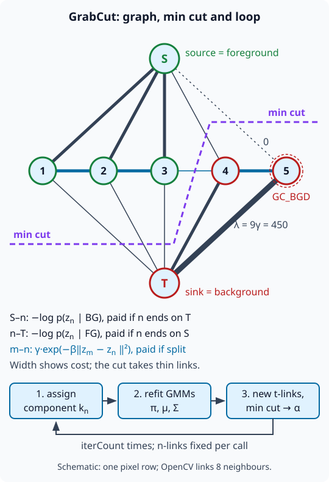

# Flashcards — GrabCut, regions and appearance models

reference note: [[90-segmentation/references/92-grabcut-regions|Complete reference]]. Source: Agent. Status: written, experimental export.

TARGET DECK: CV::Pilote::90-segmentation

## CV-GRABCUT-001

Objective: Explain the GrabCut alternation. Family: algorithm. Provenance: agent.

START
CV-Pilote
ID: CV-GRABCUT-001
Question: Which two main operations does GrabCut alternate?
Reponse: **Expected answer**: Estimate the background and foreground appearance models, then optimize the labels by graph cut on the defined energy.

**Reading the diagram**:  Each pixel is a node with a t-link to the source S (foreground side) and one to the sink T (background side), plus an n-link to each neighbour. The min cut severs the cheapest set of links that separates S from T: a pixel left on the T side pays its S-link $-\log p(z_n\mid\mathrm{BG})$, one on the S side pays $-\log p(z_n\mid\mathrm{FG})$, and each split neighbour pair pays $\gamma e^{-\beta\|z_m-z_n\|^2}$, which is small across a colour edge. Pixel 5 is definite background: its t-links 0 and $\lambda=9\gamma=450$ keep it on the T side.

**Further explanation**: The definite and probable labels of the initialization play different roles; the process is not a generic semantic classifier.

**Intuition of alternation**: Current labels give colour examples for background and foreground; the appearance models then set the cost of each assignment. Relations between neighbors add a spatial preference. The new partition is used for a new estimate, within the constraints of the initialization.

**Example of a limitation**: If a part of the target looks like the background, its appearance cost can favor the wrong label. A user indication can provide information that colour alone does not. The process does not name an object according to a taxonomy, and an energy minimum is not proof that the mask is correct for the application. Check the initialization and the definite labels before increasing iterations. To compare with a learned promptable method, also count interventions, failures and the full cost, not just the time of the last optimization.

**Energy and cut**: For a binary label $L_p$, a unary term can be set to $-\log p(I_p\mid L_p)$ under the corresponding colour mixture. A schematic neighbor term $w_{pq}\mathbf1[L_p\ne L_q]$ penalizes a boundary between similar pixels; high contrast reduces $w_{pq}$. With fixed appearance parameters and a graph-representable binary energy, the minimum cut solves this sub-problem exactly. Alternating with the estimation of the mixtures does not imply a joint global optimum over all the unknowns. Naming the sub-problem that is solved prevents confusing the solver's guarantee with the correctness of the object model used.

**What each step holds fixed**: Each step minimizes $E(\alpha,k,\theta,z)$ over one set of variables with the others fixed: the components $k_n$, then the mixture parameters $\theta$, then the probable labels by min cut; hence $E$ decreases monotonically to a local minimum [Rother et al., Fig. 3, §3.2]. OpenCV 4.13 computes $\beta$ and the n-links once per call, so only the t-links change between iterations [grabcut.cpp L582–L597]. Its step 1 ignores $\pi$ and its t-links use the whole mixture, $-\log\sum_k\pi_k\mathcal N(z_n;\mu_k,\Sigma_k)$, instead of the best component [L113–L152, L479–L496], so the monotonic argument covers the paper, not strictly the code.

**Constructed iteration** (recomputed in the check script of this pass): a rectangle holds a red mug (60 % of its pixels) and grey desk (40 %), and the desk is the only colour outside. If the grey components of both mixtures coincide, a grey pixel inside costs $-\log(0.4\,\mathcal N)$ as foreground and $-\log\mathcal N$ as background, so the background is cheaper by $\log(1/0.4)=0.92$ nats before any boundary term. The cut moves the grey pixels out and the refit drops grey from the foreground mixture. If grey were only 30 % of the outside sample, the foreground would win by $\log(0.4/0.3)=0.29$ nats and the refit would entrench the desk, a form of the paper's third failure case: background poorly represented outside the rectangle [§5].

**Blocking errors**: Describing only a fixed colour threshold. Claiming that the alternation reaches the global minimum over labels and colour models.
Source: [[90-segmentation/references/92-grabcut-regions|Full reference]] ; [Rother et al. 2004, §3.1–§3.2, eqs. 7–11 and Fig. 3; §5, failure case (iii)](https://www.microsoft.com/en-us/research/wp-content/uploads/2004/08/siggraph04-grabcut.pdf) ; [Boykov and Jolly 2001, §3 Theorem 1](https://www.csd.uwo.ca/~yboykov/Papers/iccv01.pdf) ; [OpenCV 4.13.0, grabcut.cpp L545–L598, loop and constants](https://github.com/opencv/opencv/blob/4.13.0/modules/imgproc/src/grabcut.cpp#L545-L598) ; [OpenCV 4.13.0, grabcut.cpp L113–L152, mixture density and component choice](https://github.com/opencv/opencv/blob/4.13.0/modules/imgproc/src/grabcut.cpp#L113-L152) ; [OpenCV 4.13.0, grabcut.cpp L479–L496, t-links](https://github.com/opencv/opencv/blob/4.13.0/modules/imgproc/src/grabcut.cpp#L479-L496). The graph figure and the constructed iteration are project constructions.
Tags: cv::pilote cv::d09 famille::algorithme cv_id::CV-GRABCUT-001 provenance::agent pole::A pole::E
END

## CV-GRABCUT-002

Objective: Check an initialization constraint. Family: diagnosis. Provenance: agent.

START
CV-Pilote
ID: CV-GRABCUT-002
Question: GrabCut consistently excludes part of an object despite more iterations. What should be checked first?
Reponse: **Expected answer**: The initial rectangle and the definite background labels: a needed part of the object can be made impossible by a hard constraint.

**Further explanation**: Test a manual correction of the labels on a copy, then observe the mask; distinguish a wrong initialization from an insufficient appearance model.

**Causal chain**: A pixel imposed as definite background is not among the labels that the optimization can switch to foreground. If the initial rectangle excludes a part of the target, the procedure can comply perfectly with its contract while producing a truncated mask.

**Constructed check**: Overlay the definite and probable labels on the image, then fix only the wrong area on a copy. Keep the other parameters and measure the effect. If this correction is not enough, compare the colour distributions and the boundary, because several defects can coexist. Repeating the same optimization does not replace correct initial information. Distinguishing a false constraint from an insufficient appearance model helps choose the useful intervention: changing the starting mask, adding a cue or considering another mechanism, rather than assuming a numerical failure.

**Hard constraint and preference**: A definite label forbids the other assignment, while a probable label lets the energy choose. If a real part of the object is assigned to definite background, changing the appearance settings does not make the correct solution admissible. In a constructed test, correct only this constraint, then compare iterations from the same saved initial state. An improvement locates a defect in the constraint; a persistent exclusion may still come from close colours or regularization. Keeping the four states of the mask until the final decision avoids losing interaction information by binarizing the labels too early.

**Why iterations cannot free a definite pixel** (worked example B of the reference): OpenCV gives a `GC_BGD` pixel the t-links 0 from the source and $\lambda=9\gamma=450$ to the sink [grabcut.cpp L486–L490, L582–L583]. Putting it on the foreground side would cut the 450 link, while its eight n-links can save at most $4\gamma+4\gamma/\sqrt2=341.4$ at zero contrast, so no minimum cut does it; the mask update rewrites only the probable states anyway [L526–L543]. Neither lock depends on `iterCount`.

**Constructed ceiling** (recomputed in the check script of this pass): an object of $100\times300$ px whose bottom 20 rows fall outside the rectangle has 2,000 of its 30,000 pixels fixed as background, so even a perfect cut elsewhere caps its IoU at $28{,}000/30{,}000=0.933$. On an annotated sample, a plateau at the ceiling computed from `GC_BGD` ∩ ground truth means that the constraint explains the whole loss; a plateau well below it points to the appearance or boundary terms too. The excluded pixels also train the background mixture, since each iteration learns it from every `GC_BGD` and `GC_PR_BGD` pixel [L435–L458]; similar object colours inside the rectangle can then drop out as well, so a loss that extends beyond the constrained area does not rule the constraint out (project deduction from the code).

**Blocking errors**: Assuming that convergence will undo any erroneous constraint.
Source: [[90-segmentation/references/92-grabcut-regions|Full reference]] ; [Rother et al. 2004, §3.3, firm background labels](https://www.microsoft.com/en-us/research/wp-content/uploads/2004/08/siggraph04-grabcut.pdf) ; [OpenCV 4.13.0, grabcut.cpp L352–L363 and L526–L543, rectangle init and probable-only update](https://github.com/opencv/opencv/blob/4.13.0/modules/imgproc/src/grabcut.cpp#L526-L543) ; [OpenCV 4.13.0, grabcut.cpp L435–L458 and L479–L496, background mixture learned from definite and probable background, t-links](https://github.com/opencv/opencv/blob/4.13.0/modules/imgproc/src/grabcut.cpp#L435-L496) ; [OpenCV 4.13.0, grabcut.cpp L582–L583, $\gamma=50$ and $\lambda=9\gamma$](https://github.com/opencv/opencv/blob/4.13.0/modules/imgproc/src/grabcut.cpp#L582-L583) ; [OpenCV 4.13.0, GrabCut tutorial source](https://github.com/opencv/opencv/blob/4.13.0/doc/py_tutorials/py_imgproc/py_grabcut/py_grabcut.markdown). Constructed checks and the IoU ceiling: project deduction.
Tags: cv::pilote cv::d09 famille::diagnostic cv_id::CV-GRABCUT-002 provenance::agent pole::A pole::E
END

## CV-GRABCUT-003

Objective: Choose an interaction. Family: comparison. Provenance: agent.

START
CV-Pilote
ID: CV-GRABCUT-003
Question: When extracting an object whose colors resemble the background, why compare interaction cost and assumptions rather than optimization time alone?
Reponse: **Expected answer**: Labels added by the user can provide the missing information; a method that is fast per call can still require many corrections.

**Further explanation**: Evaluate the mask, the number of corrections and robustness on held-out images; an energy optimum is not enough.

**Cost actually paid**: A fast algorithm can require several retouches if its colour model separates target and background poorly. A method that is more expensive per call can reduce interaction; the opposite is also possible. Times must include the whole procedure needed to reach a defined quality.

**Proposed protocol**: Fix held-out images, a reset rule and a correction budget, then measure mask quality, number of interventions, total time and failure rate. Separately, make the background closer to the target in colour to test the appearance assumption. Keep unresolved cases in the results. An energy optimum indicates that the procedure has satisfied its model; it does not say that this model has enough information to distinguish the object of interest. The comparison must therefore weigh the method's assumptions against human effort, without choosing on solver duration alone.

**Quality–interaction curve**: Set a common rule for placing the initial rectangle, then a budget of corrections or user time. Measure quality after zero, one and several interactions, and report the share of images that do not reach the target within the maximum budget. Clicks are comparable only if their policy and the information available to the clicker are stated; a correction chosen with the reference mask is a different oracle from a real operator. Also compare boundaries and small regions of interest. This protocol gives a usable trade-off curve instead of an isolated optimization time obtained after a particularly favorable initialization.

**Published evidence and its protocol**: Rother et al. report 0.9 s for the initial segmentation of a $450\times300$ rectangle and 0.12 s after each brush stroke on a 2.5 GHz CPU [§5]. A stroke is cheap because an edit reruns the min cut once and can reuse the previous flow [Fig. 3, §3.3]; the operator placing it costs more. Their comparisons count interactions: on 20 tasks GrabCut needed significantly fewer in 15 and performed comparably otherwise; on 50 images, GrabCut given one outer lasso reached an error rate of 2.13 ± 0.19 % against 1.36 ± 0.18 % for Graph Cut given outer and inner lassos [§5]. That second comparison gives the methods unequal information, so the lower error is not a property of the solver.

**Constructed budget** (recomputed in the check script of this pass): method A answers in 0.1 s per interaction but needs 6 strokes to reach the target quality; method B answers in 1.5 s and needs 2. With an assumed 4 s of operator time per stroke, A costs $6\times(4+0.1)=24.6$ s and B $2\times(4+1.5)=11$ s, although B is 15 times slower per call. The totals are equal at 0.6 s of operator time per stroke; above it, the method with fewer interactions wins.

**Blocking errors**: Presenting a low computation time as the complete performance of the process. Ranking methods by error rates obtained with different amounts of user input.
Source: [[90-segmentation/references/92-grabcut-regions|Full reference]] ; [Rother et al. 2004, §5, failure cases, timings and interaction comparisons; Fig. 3 and §3.3, edits rerun the cut once and reuse the flow](https://www.microsoft.com/en-us/research/wp-content/uploads/2004/08/siggraph04-grabcut.pdf) ; [OpenCV 4.13.0, GrabCut tutorial source](https://github.com/opencv/opencv/blob/4.13.0/doc/py_tutorials/py_imgproc/py_grabcut/py_grabcut.markdown). Protocols and the interaction budget: project constructions.
Tags: cv::pilote cv::d09 famille::comparaison cv_id::CV-GRABCUT-003 provenance::agent pole::A pole::E
END
