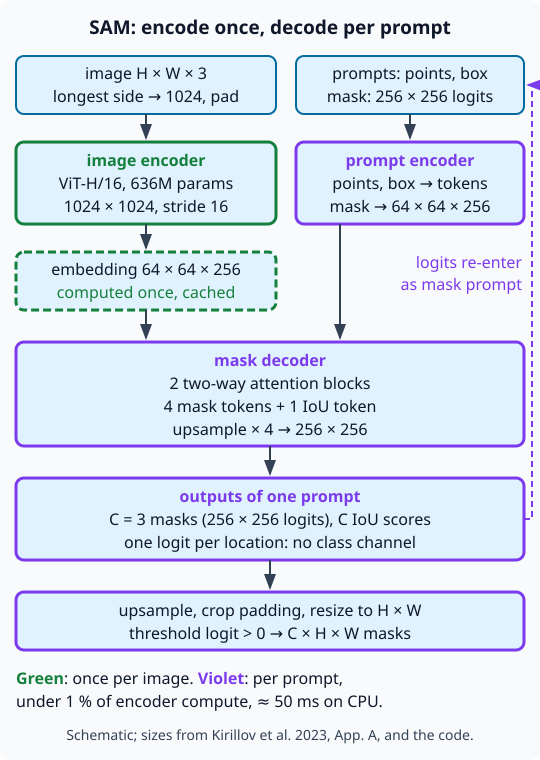

# Flashcards — SAM, SAM 2 and prompted video segmentation

reference note: [[90-segmentation/references/94-sam-sam2|Complete reference]]. Source: Agent. Status: written, experimental export.

TARGET DECK: CV::Pilote::90-segmentation

## CV-SAM-001

Objective: Define the SAM output. Family: understanding. Provenance: agent.

START
CV-Pilote
ID: CV-SAM-001
Question: Does SAM automatically assign a semantic class to every pixel?
Reponse: **Expected answer**: No: its central contract is the prompt-guided mask, not a complete semantic taxonomy.

**Reading the diagram**:  The heavy image encoder runs once per image and leaves a $64\times64\times256$ embedding that `SamPredictor` caches. Each click, box or previous mask then runs only the prompt encoder, the mask decoder and the post-processing, under 1 % of the encoder's compute and about 50 ms on CPU in a browser [Kirillov et al., §3, App. A]. Follow the outputs: $C$ masks, $C$ predicted IoU scores and low-resolution logits that can return as the next mask prompt; no arrow carries a class.

**Further explanation**: A class may come from another component or from an annotation; do not attribute the paper's text prototype to every standard checkpoint.

**Reading the condition**: A point, box or mask designates the region of interest. Segmentation responds to this conditioning; assigning a class name afterwards requires other information or another component. A very precise mask can therefore be useful for annotation without directly providing a complete taxonomy.

**Constructed example**: A user designates one part among several objects. The mask produced delineates a candidate region, but does not show that it is the right type of part or that no other object has been missed. Evaluate boundary quality, ambiguities and correction effort with comparable prompts. If a pipeline adds text or a detector, describe this new chain instead of attributing its outputs to SAM alone. The contract depends on the checkpoint and interface actually used; a possibility explored in a paper is not automatically an available function of every distributed model.

**Prompt ambiguity**: A point on a shirt may refer to the shirt, the person or a visible part of it. Several masks can be compatible with the same prompt; the choice depends on the task contract and on additional information. The predicted quality score ranks the proposals according to the model, without assigning an application category to the region. To compare two uses, fix the placement and number of prompts, the mask-selection policy and the corrections allowed. Choosing the best mask a posteriori with the ground truth measures an oracle selection, different from the procedure actually available to the product.

**Why no class can come out**: The decoder maps each mask token to a 32-value vector and takes its dot product with the upsampled embedding at every location [mask_decoder.py L134–L144]. The result is one logit per location, inside the prompted object or not: the head has no channel per category, whereas a semantic model outputs one logit per class at each pixel. The IoU head regresses each mask's overlap with its object under a mean-squared-error loss [App. A], so a score of 0.9 says that the mask probably fits its object, not that a category is 90 % likely. `multimask_output=True` returns three masks from tokens 1–3, and `False` one mask from token 0, the token trained for several prompts; the caller chooses [mask_decoder.py L101–L107; predictor.py L115–L120].

**Constructed check**: The automatic generator prompts a $32\times32$ grid, keeps masks whose predicted IoU exceeds 0.88 and stability score 0.95, then applies box NMS at 0.7 [App. B; automatic_mask_generator.py L39–L44]. Whole, part and subpart masks can overlap and some pixels stay uncovered, so a pixel belongs to zero, one or several masks, against exactly one class in a semantic map (project deduction).

**Blocking errors**: Confusing an object mask with an application class.
Source: [[90-segmentation/references/94-sam-sam2|Full reference]] ; [Kirillov et al. 2023, §2–§3, promptable task, ambiguity and quality score](https://arxiv.org/abs/2304.02643) ; [Kirillov et al. 2023, App. A, encoder sizes, mask decoder, IoU head, decoder under 1 % of encoder compute; App. B, automatic generation](https://arxiv.org/abs/2304.02643) ; [Kirillov et al. 2023, §7.5 and §8, text-to-mask as an exploratory proof of concept](https://arxiv.org/abs/2304.02643) ; [segment-anything at dca509f, predictor.py L92–L135, outputs without class](https://github.com/facebookresearch/segment-anything/blob/dca509fe793f601edb92606367a655c15ac00fdf/segment_anything/predictor.py#L92-L135) ; [segment-anything at dca509f, mask_decoder.py L101–L147, token selection and dot-product mask head](https://github.com/facebookresearch/segment-anything/blob/dca509fe793f601edb92606367a655c15ac00fdf/segment_anything/modeling/mask_decoder.py#L101-L147) ; [segment-anything at dca509f, automatic_mask_generator.py L39–L44, default filters](https://github.com/facebookresearch/segment-anything/blob/dca509fe793f601edb92606367a655c15ac00fdf/segment_anything/automatic_mask_generator.py#L39-L44). The data-flow figure and the coverage deduction are project constructions.
Tags: cv::pilote cv::d09 famille::comprehension cv_id::CV-SAM-001 provenance::agent pole::A pole::D
END

## CV-SAM-002

Objective: Situate SAM 2 for video. Family: comparison. Provenance: agent.

START
CV-Pilote
ID: CV-SAM-002
Question: What does SAM 2 add compared with independently segmenting each frame?
Reponse: **Expected answer**: Memory, and propagation of the prompted masks over time, according to the protocol.

**Further explanation**: Specify prompts, corrections, causality and version; on its own this does not provide an autonomous, classified multi-object tracking of all objects.

**The role of memory**: Treating each frame in isolation requires reinterpreting the target from the information of that frame and its prompt alone. A temporal memory can carry previous observations and interactions to produce a coherent mask sequence. This information can help, but it can also preserve a confusion.

**Example of diagnosis**: After two similar objects cross, a mask can remain well drawn on the wrong object. Identity, visibility, prompts and memory content must then be examined, not just contour quality. Compare propagation with independent per-frame segmentation under the same data and correction budget. The system does not automatically create classes or track births. Defining what the user initializes and what the model must discover is essential before comparing with an autonomous multi-object tracker or an interactive annotator.

**Temporal state**: A propagation from memory depends on the history, not only on the current image. Two sequences reaching the same frame with different initializations can therefore produce different outputs. To diagnose an identity confusion, record the initialization frame, the prompts, the corrections, the processing order and the times of memory updates. Comparing a recovery with reset memory against the original continuation is a proposed ablation, with a stated information budget. A reset in which a human designates the right target should not be counted as autonomous recovery. The quality of a contour and the persistence of identity remain two separate properties.

**What the memory holds**: Memory attention conditions each frame's embedding through $L=4$ blocks of self-attention, cross-attention to the memory bank and MLP. The bank keeps spatial memories of up to $N$ recent frames, 6 by default and with a temporal position encoding, and of up to $M$ prompted frames without one, plus object pointers taken from the decoder's mask tokens [Ravi et al., §4, App. A.2, App. D]. Per-frame SAM carries none of this: each frame starts again from its own prompt.

**Measured on annotation, not inference**: In SAM 2's controlled data-engine comparison (169 videos, 452 masklets), image SAM on every frame took 37.8 s per frame against 4.5 s with SAM 2 in the loop; edited frames fell from 100 % to 19.04 % and clicks per clicked frame from 4.80 to 2.68, while 89.1 % of the SAM 2 masks matched the per-frame masks at IoU above 0.75, and 72.8 % for small objects [§5.1, Table 1, App. E.2.2]. Constructed reading, recomputed in the check script of this pass: a 20-s clip at the 6 frames/s annotation rate has 120 frames, about 76 min of per-frame work against 9 min, with about 23 edited frames. These are human times with models retrained during collection, not the cost of one propagation.

**Blocking errors**: Equating masklet propagation with a complete object-tracking system. Reading the data engine's 8.4× speed-up as a model inference speed-up.
Source: [[90-segmentation/references/94-sam-sam2|Full reference]] ; [Ravi et al. 2024, §4, memory attention, memory bank and object pointers; App. A.2 and App. D, memory size, layers and pointers; §5.1, Table 1 and App. E.2.2, data-engine comparison; App. C, limitations](https://arxiv.org/abs/2408.00714). Diagnosis cases and the clip reading: project deduction.
Tags: cv::pilote cv::d09 famille::comparaison cv_id::CV-SAM-002 provenance::agent pole::A pole::D
END

## CV-SAM-003

Objective: Control access to future frames in evaluation. Family: evaluation. Provenance: agent.

START
CV-Pilote
ID: CV-SAM-003
Question: Why is interactive video annotation using corrections on future frames not directly comparable with a causal tracker?
Reponse: **Expected answer**: It has different information; interaction budget and time access change the task.

**Further explanation**: Report latency, frames viewed and final quality under the same contract before comparing.

**Difference of information**: Correcting a mask after seeing what follows can resolve an ambiguity that was real at the time of the frame. The final annotation then benefits from observations and interventions that are unavailable for an immediate decision. Final quality and on-time availability are two distinct properties.

**Proposed protocol**: Report the frames viewed, the number of clicks or corrections, the propagation allowed and the time when each output becomes available. Compare either at the same budget or as an explicitly different trade-off. Keep losses and ambiguities instead of erasing them with an uncounted reset. An interactive tool can be excellent at producing ground truth without being a deployable autonomous tracker with the same performance. This distinction protects the conclusions of the benchmark and ties human cost, time and quality to the actual use of the system.

**Two curves to report**: For each frame, measure the quality of the first available output and the quality obtained after all allowed corrections. Associate each output with the time it becomes available and a number of interactions. The difference between the curves describes what offline revision contributed; it should not be erased in a final average presented as causal. A mask corrected at $t+2$ s may be excellent for annotating a video and too late for a decision at $t$. A common protocol must therefore fix access to frames, the accepted deadlines and the rule for counting corrections.

**Causal inputs can still have delayed outputs**: A sliding-window model may use only frames observed up to time $t$ and still return its estimate after a long computation. Causality therefore restricts information access, while timeliness restricts availability; they are independent axes. A proposed comparison records the latest input timestamp, initial output timestamp and any later revision timestamp for each mask. Evaluate mask quality only at the deadline relevant to the application rather than treating a causal architecture as proof of an on-time response.

**Blocking errors**: Presenting an offline evaluation as real-time performance, without latency.
Source: [[90-segmentation/references/94-sam-sam2|Full reference]] ; [Ravi et al. 2024, §4, prompted frames from the future; §6.1, offline and online evaluation](https://arxiv.org/abs/2408.00714). Time and interaction protocols: project constructions.
Tags: cv::pilote cv::d09 famille::evaluation cv_id::CV-SAM-003 provenance::agent pole::A pole::D
END
