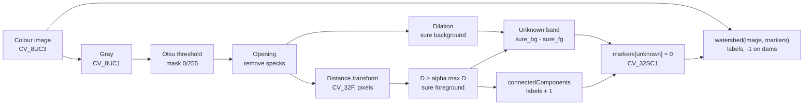

# Otsu, distance transforms and watershed

This is the pipeline note for separating touching objects with classical tools. A
global threshold chosen by Otsu's criterion gives a foreground mask; a distance
transform turns that mask into a relief whose peaks mark object interiors; a
marker-controlled watershed assigns the remaining uncertain pixels to markers and
draws boundaries between them. The three steps answer different questions and fail
for different reasons, so the note follows the data through each of them.
Morphological opening, closing and connected components belong to
[CV-MORPHO](../../30-traitement-image/references/33-morphologie-composantes.md);
interactive and learned alternatives have their own notes in this topic.

## Problem and data contract

**Task.** Given an image of objects that touch or slightly overlap on a contrasting
background (grains, pellets, coins, cells, small parts on a backlit table), produce
one label per object so that the objects can be counted and measured. Beucher and
Meyer describe the case that motivates the distance step: overlapping coffee grains
are easy to threshold, but "no contrast criterion can be used because there is
obviously no visible boundary between two overlapping grains"
[Beucher & Meyer, §VI.B].

**Data contract of the OpenCV 4.13 tutorial pipeline.** Every array shares the pixel
grid of the input, with the origin at the top-left corner, $x$ rightward and $y$
downward.

| Stage | Input | Output | Type and value range | Units |
| --- | --- | --- | --- | --- |
| Otsu threshold | gray image $I$ | binary mask and threshold $t^*$ | `CV_8UC1` or `CV_16UC1` in; mask in $\{0,\text{maxval}\}$; $t^*$ returned as a `double` | gray levels |
| Mask cleaning | mask | opened mask and sure background | `CV_8UC1` in $\{0,255\}$ | structuring element in pixels |
| Distance transform | opened mask, non-zero = foreground | distance map $D$ | `CV_32FC1`, $D=0$ on background, $D\ge1$ inside with the 5×5 or precise L2 mask | pixels (index units) |
| Markers | $D>\alpha\max D$ and the unknown band | marker map $M$ | `CV_32SC1`: 0 unknown, 1 background, 2 to $K+1$ objects | label identifiers |
| Watershed | 8-bit colour image and $M$ | $M$ modified in place | `CV_32SC1`: positive basin labels, $-1$ on boundaries | label identifiers |

Downstream, counting and measurement (areas, moments, size distributions) expect one
label per physical object, a stated rule for boundary pixels, and a pixel size in
millimetres from calibration when results are physical. Upstream must supply stable
contrast (often a backlight), a known polarity (objects darker or brighter than the
background) and a resolution at which the narrowest object and the contact zones are
several pixels wide.

**Role in a pipeline.** A deterministic, explainable counting or measurement stage
when objects are blob-like and annotated data is scarce; a baseline against which a
learned instance model must prove its value; a way to bootstrap instance annotations
that a human then corrects.

## Intuition

Each step answers one question.

1. **Which pixels belong to objects?** Otsu picks the gray level that makes the two
   resulting classes most distinct in their mean levels, weighted by their sizes. It
   sees only the histogram, never where the pixels are.
2. **Where are the object interiors?** Inside the mask, the distance to the nearest
   background pixel is large at the centre of a thick part and small at a neck where
   two objects touch. Keeping only high distances leaves one blob per object, as long
   as every object is thicker than the neck that joins it to a neighbor.
3. **Where exactly is the boundary?** Pierce a hole at each marker and immerse the
   relief: water from different sources meets along dams, and every uncertain pixel
   ends in exactly one marker's basin or on a dam [Beucher & Meyer, §III.A, §IV.B].

*Illustration (constructed).* Two coins of radius 20 px whose centres are 30 px apart
form one connected blob after thresholding. The distance is 20 px at each centre but
only about 13 px at the neck, so keeping $D>14$ px (0.7 of the maximum) leaves two
blobs, two markers and a dam through the neck. With centres 26 px apart, the neck
value rises to about 15 px, the blobs fuse and the pair is counted as one object
(worked example B).



*Diagram: data flow of the OpenCV 4.13.0 watershed tutorial. The colour image, not the
distance map, is the relief that `cv::watershed` floods; the distance map only creates
the markers.*

## Prerequisites and competencies

**Required prerequisites**: [CV-MORPHO](../../30-traitement-image/references/33-morphologie-composantes.md)
(opening, dilation, connected components). Useful background, by step:

- histogram formation, exposure and noise: [CV-ACQUISITION](../../20-acquisition-images/references/21-exposition-bruit-echantillonnage.md);
- smoothing before thresholding and gradient images used as a relief: [CV-FILTRES](../../30-traitement-image/references/31-filtrage-gradients.md);
- IoU and object matching: [CV-IOU-AP](../../130-evaluation-fiabilite/references/131-iou-ap-coco.md);
- segmentation and inspection metrics: [CV-METRIQUES-APPLIQUEES](../../130-evaluation-fiabilite/references/134-metriques-applications.md);
- instance outputs and panoptic quality: [CV-SEGMENTATION](93-semantique-instances-panoptique.md).

**Target competencies**: explain each step's mechanism, apply the pipeline with the
OpenCV contracts, compare marker rules and reliefs under constraints, evaluate a
counting pipeline at instance level and diagnose merges, splits and threshold drift.

## Assumptions, observability and degenerate cases

- **Globally separable intensities.** Otsu needs object and background to occupy
  distinguishable intensity ranges over the whole image. Its paper names the ideal
  case, "a deep and sharp valley between two peaks", and the hard ones: a valley that
  is "flat and broad, imbued with noise", or peaks "extremely unequal in height"
  [Otsu, §I]. The criterion still returns a threshold in those cases, but it separates
  intensity levels, not regions. Shading and vignetting break the assumption.
- **Known polarity.** Otsu returns a level; deciding which side is the object belongs
  to the user (`THRESH_BINARY` or `THRESH_BINARY_INV`). The distance transform measures
  the thickness of the non-zero pixels, so the wrong polarity measures the background.
- **Blob-like objects.** The distance step assumes that each object has one dominant
  interior maximum and that contact zones are thinner than the objects. Elongated,
  concave or ragged shapes create several maxima; deep overlaps leave a single one.
- **A meaningful relief.** The watershed puts dams where the relief is high between
  markers. With no visible boundary between touching objects, the dam position follows
  the flooding order on flat areas rather than image evidence.

**Observability.** A boundary that is visible neither in the intensities nor in the
shape of the mask cannot be recovered by any of these steps; only a shape prior or a
learned model can supply it. A histogram never observes spatial arrangement: permuting
pixels leaves Otsu's threshold unchanged (appendix of CV-WATERSHED-001).

**Degenerate cases.** For a constant image, every candidate threshold puts all pixels
in one class: Otsu's measure is zero only for constant images and reaches its upper
bound of one only for two-valued images [Otsu, §III-A]. OpenCV 4.13 skips thresholds
whose class weight is below `FLT_EPSILON` and then returns 0 [thresh.cpp, L1251–L1275].
An empty mask gives $D\equiv0$ and no seed; `cv::watershed` returns immediately when no
unknown pixel touches a positive marker [segmentation.cpp, L225–L233]. The distance
transform measures distances to zero pixels inside the image only [imgproc.hpp,
L3586–L3589], so an object cut by the image border appears thicker towards the border
and its maximum can sit on the border.

## Procedure

```text
gray      <- cvtColor(img, BGR2GRAY)                        # 8-bit, one channel
t, fg     <- threshold(gray, 0, 255, BINARY_INV + OTSU)     # t is computed; objects become 255
opened    <- morphologyEx(fg, OPEN, 3x3, iterations=2)      # remove specks before measuring distances
sure_bg   <- dilate(opened, 3x3, iterations=3)              # pixels outside are certain background
D         <- distanceTransform(opened, DIST_L2, 5)          # float32, pixels to the nearest zero pixel
sure_fg   <- D > alpha * max(D)                             # alpha = 0.7 in the tutorial
unknown   <- sure_bg - sure_fg                              # band left for the watershed to decide
n, cc     <- connectedComponents(uint8(sure_fg))            # 0 outside seeds, 1..n-1 seeds
markers   <- cc + 1                                         # background 1, seeds 2..n
markers[unknown] <- 0                                       # 0 means "to be decided"
watershed(img, markers)                                     # in place; -1 on dams and on the image frame
objects   <- labels >= 2                                    # label 1 is the background basin
```

Purpose of the steps. *Thresholding* fixes the foreground support from which
distances are measured. *Opening* removes isolated pixels that would otherwise create
tiny components and spurious maxima. *Dilation* defines what is certainly background,
so that the unknown band (three pixels outside the opened mask, plus the part of each
object below the distance threshold) is the only region whose assignment the
watershed decides. *Thresholding the distance* turns "thick interior"
into seeds; for a Euclidean distance, $\{D\ge r\}$ is the erosion of the mask by a disk
of radius $r$ [Beucher & Meyer, §II.B.3], which is why the tutorial notes that plain
erosion suffices when objects do not touch. *Shifting labels by one* keeps the sure
background positive, because 0 means unknown to the watershed [tutorial, "Marker
labelling"]. *Flooding* resolves the unknown band and places dams.

## Mathematics, conventions and units

### Otsu's discriminant criterion

Let a gray image have $L$ levels with $n_i$ pixels at level $i$ and $N$ pixels in
total, and let $p_i=n_i/N$ (Otsu indexes levels $1,\dots,L$; OpenCV uses $0$ to $255$ or
$65535$). A threshold $k$ splits the levels into $C_0=\{i\le k\}$ and $C_1=\{i>k\}$.
With the cumulative moments $\omega(k)=\sum_{i\le k}p_i$ and $\mu(k)=\sum_{i\le k}ip_i$,
and the total mean $\mu_T$, the class weights and means are $\omega_0=\omega(k)$,
$\omega_1=1-\omega(k)$, $\mu_0=\mu(k)/\omega(k)$ and $\mu_1=(\mu_T-\mu(k))/(1-\omega(k))$
[Otsu, eqs. 2–8]. The within-class, between-class and total variances satisfy

$$\sigma_W^2=\omega_0\sigma_0^2+\omega_1\sigma_1^2,\qquad \sigma_B^2=\omega_0\omega_1(\mu_1-\mu_0)^2,\qquad \sigma_T^2=\sigma_W^2+\sigma_B^2$$

[eqs. 13–16]. Because $\sigma_T^2$ does not depend on $k$, maximizing $\sigma_B^2$ is the
same as minimizing $\sigma_W^2$: the OpenCV tutorial describes the second form, the code
computes the first. Otsu selects

$$k^*=\arg\max_{0<\omega(k)<1}\ \sigma_B^2(k),\qquad \sigma_B^2(k)=\frac{[\mu_T\,\omega(k)-\mu(k)]^2}{\omega(k)\,[1-\omega(k)]},$$

which needs only the zeroth and first cumulative moments [eqs. 17–19]. Variances are in
squared gray levels. The separability $\eta^*=\sigma_B^2(k^*)/\sigma_T^2$ is
dimensionless, lies in $[0,1]$ and is invariant under affine changes of the gray scale
[eq. 12, §III-A].

Why small classes lose (project derivation). $\sigma_B^2$ is a balance term
$\omega_0\omega_1\le1/4$ times a squared gap of means. Isolating a class of weight $w$
whose mean is $\Delta$ gray levels from the rest scores $w(1-w)\Delta^2$, which grows
linearly with $w$ when $w$ is small. Splitting a broad dominant mode in two scores a
fixed fraction of that mode's variance: $W^2/16$, three quarters of the variance of a
uniform band of width $W$, and $(2/\pi)\sigma^2\approx0.64\,\sigma^2$ for a Gaussian mode
split at its mean. A small defect therefore wins only when $w\Delta^2$ exceeds that
score, and the defect's own pixels raise the score of the band split as well
(worked example A).

The criterion extends to several thresholds by maximizing $\sigma_B^2(k_1,k_2)$, but
Otsu warns that the thresholds "generally become less credible as the number of classes
to be separated increases" [§III-B]. He observed $\sigma_B^2(k)$ to be smooth and
unimodal without proving it [§III-D]; OpenCV searches every level, so its result does
not depend on that property.

### Distance transforms

For a binary image $B$, the distance transform is

$$D(p)=\min_{q\,:\,B(q)=0} d(p,q),$$

where $p,q$ are pixel centres in the image and $d$ is the L1 distance
$|\Delta x|+|\Delta y|$, the chessboard distance $\max(|\Delta x|,|\Delta y|)$ (`DIST_C`)
or the Euclidean distance (`DIST_L2`). $D$ is in pixels, that is, index units: it equals
a physical length only for square pixels of known size, and OpenCV's function has no
pixel-spacing argument. For a disk of radius $R$ px, $D$ at the centre is about $R$.

The exact Euclidean transform is separable. For a sampled function $f$, Felzenszwalb
and Huttenlocher write the squared transform as
$D_f(x,y)=\min_{x'}\big((x-x')^2+D_{f|x'}(y)\big)$, a 1-D transform along every column
followed by one along every row; each 1-D transform is the lower envelope of parabolas
and takes linear time [Felzenszwalb & Huttenlocher, §2.1–§2.2]. A binary image is the
case $f=0$ on background and $f=\infty$ elsewhere. Chamfer transforms instead sum basic
moves with costs $a$ (axial), $b$ (diagonal) and $c$ (knight's move), which approximates
the Euclidean distance with a direction-dependent error [imgproc.hpp, L3594–L3609].
Along straight lines, OpenCV's 3×3 weights err between −4.5% (axes) and +4.1%, and its
5×5 weights between −1.75% and +1.92% (constructed, recomputed by
checks/91-otsu-distance-watershed.py).

### Marker-controlled watershed

Flooding definition [Beucher & Meyer, §III.A]: view a function $f$ as a relief, pierce
each minimum and immerse it; where floods from different minima would merge, build a
dam. The dams are the watershed lines and each catchment basin contains one minimum.
Flooding every regional minimum oversegments real images, because noise and minor
structures create many minima [§IV.A]. Marker control pierces only chosen sources:
unmarked minima fill by overflow from a neighbor, dams separate only different labels,
and a marker may be any region, even several components sharing one label [§IV.B].
Beucher and Meyer implement this with an *ordered queue*, one FIFO queue per gray level:
the boundary pixels of the markers enter with priority $f$, and repeatedly the
highest-priority pixel is taken out, its unlabeled neighbors receive its label and enter
the queue with their own value of $f$ [§V.B.3]; as in their reconstruction algorithm,
each pixel is processed once [§V.B.2].

OpenCV 4.13 implements a variant of Meyer's algorithm [imgproc.hpp, L3474–L3498]. A
pixel $y$ reached from a labeled 4-neighbor $x$ enters queue

$$\delta(x,y)=\max_{c\in\{B,G,R\}}\,|I_c(x)-I_c(y)|\in\{0,\dots,255\},$$

and a pixel taken out of the queue whose labeled 4-neighbors carry two different labels
becomes $-1$ and does not propagate [segmentation.cpp, L151–L159, L265–L293]. Initially,
each unknown pixel that touches a marker enters with its smallest difference to an
adjacent marker pixel [L183–L223]; the lowest non-empty queue is always served first,
first in, first out within a level [L239–L259]; a newly labeled pixel pushes its
unlabeled 4-neighbors with their difference to it [L295–L323]. The image must be
`CV_8UC3` [L161]. The relief is therefore a local colour difference defined on pairs of
neighboring pixels, close to an edge strength, not the pixel values.

Consequences for the distance pipeline (project deduction from the code, recomputed in
worked example D). In the tutorial call `cv.watershed(img, markers)`, $D$ decides only
the markers, hence the number of objects; the dams inside the unknown band follow the
colour differences of `img`. An internal colour edge can attract a dam away from the
neck, and between touching objects of the same colour the priorities tie at 0, so the
FIFO arrival order places the dam. Beucher and Meyer turned to the distance function
because overlapping grains offer "no contrast criterion", and segmented them by the
thalweg lines, "the watershed lines of the inverted distance function" [§VI.B]; the
tutorial keeps markers from $D$ but floods a contrast criterion, and itself notes that
some touching coins are separated properly and some are not [tutorial, L132–L136].
Passing a scaled distance map as the image does not restore $-D$: OpenCV would flood the
differences of $D$ between neighbors, about constant along a straight slope but near 0
across the saddle between two maxima, so the neck becomes the cheapest crossing.
Flooding $-D$ needs an implementation that takes an arbitrary real-valued relief, such as
scikit-image's `watershed`, whose `image` holds the values "where the lowest value points
are labeled first" and whose docstring example calls `watershed(-distance, markers,
mask=image)` [_watershed.py, L99–L100, L183–L208].

### Worked example A: Otsu and a small dark defect

Constructed example, recomputed by checks/91-otsu-distance-watershed.py. The background
has 100 pixels at each level from 100 to 140 (4,100 pixels, mean 120, standard deviation
11.8 levels); a defect adds $n$ pixels at level 40.

| Defect pixels | Defect share | $\sigma_B^2$ isolating the defect ($k=40$) | Best band split | $k^*$ | $\eta^*$ |
| --- | --- | --- | --- | --- | --- |
| 50 | 1.2% | 76.2 | 123.5 at $k=118$ | 118 | 0.576 |
| 100 | 2.4% | 148.8 | 143.1 at $k=118$ | 40 | 0.521 |

With 50 defect pixels the threshold cuts the background band in half, so the dark class
holds the defect plus half the background; from 96 pixels (2.29%) on, it isolates the
defect. Three lessons follow. The threshold jumps discontinuously when the defect area
crosses a switching point, so defect size matters as much as contrast. The separability
$\eta^*$ is *higher* in the failing case, so it measures histogram separability, not
mask correctness. The remedy depends on the cause: a region of interest that excludes
most of the background, a threshold calibrated on reference images, or another method.

### Worked example B: when the 0.7 max rule separates two disks

Constructed continuous geometry, recomputed by checks/91-otsu-distance-watershed.py. Two
disks of radius $R$ whose centres are $d<2R$ apart have $D=R$ at each centre. Along the
segment joining them, $D$ falls to the distance from the midpoint to the two points
where the circles cross, $h=\sqrt{R^2-d^2/4}$. The sure-foreground set $D>\alpha R$
has two components if and only if $h\le\alpha R$, that is

$$d\ \ge\ 2R\sqrt{1-\alpha^2},$$

which is $1.43R$ for the tutorial's $\alpha=0.7$. For $R=20$ px, centres 30 px apart give
$h=13.2\le14$ px and two markers, while 26 px gives $h=15.2$ px and one marker. With
unequal objects the global rule compares every object with the largest one: a 10 px
disk next to a 15 px disk gets no seed at $\alpha=0.7$ ($10<10.5$), so its pixels are
flooded from a neighbor's seed or from the background. Lowering $\alpha$ to 0.6 keeps
that seed but then requires $d\ge1.6R$, 24 px for two 15 px disks. No single global
$\alpha$ serves both cases, which motivates a maxima rule adapted to the expected sizes.
On the pixel grid, $D$ values differ from this idealization by about one pixel and by
the chamfer error.

### Worked example D: the relief that `cv::watershed` floods

Constructed scene, recomputed by the check script of the 2026-11-15 pass on a line-by-line
Python port of `cv::watershed` 4.13.0 (CV-WATERSHED-006). Two grey coins (BGR 60) of
radius 20 and 14 px, centres 30 px apart, lie on a light background (BGR 230); markers
follow the tutorial, with $\alpha=0.7$ and the exact Euclidean $D$. The maxima are 20.02
and 14.04 px, so the small coin keeps a one-pixel seed (threshold 14.02), and the neck,
the saddle of $D$ on the centre line, is 9.0 px.

- Uniform coins: the port and a priority flood of $-D$ (lowest first, ties by entry
  time) put the dam at the neck; no pixel of the large coin changes label.
- A dark rim (BGR 0) 2 px wide at radius 15–17 px inside the large coin changes neither
  $D$ nor the markers. The small coin's label crosses the uniform contact at priority 0
  and runs round the large coin's outer ring before the large coin's marker crosses the
  rim at priority 60: 235 of the large coin's 1,216 own pixels (19%) receive the small
  coin's label. The $-D$ flood is unchanged.
- $D$ scaled to 0–255 and passed as the image: neighbor differences are 12–13 along the
  slopes and 0 across the saddle; 899 of the 1,216 pixels receive the small coin's label.

The scene, the colours and the rim are constructions. In the same pass, the installed
`cv2.watershed` of OpenCV 4.11.0, whose `watershed` function is identical to 4.13.0's,
returned exactly the port's labels in all three cases, `cv2.distanceTransform` with
`DIST_MASK_PRECISE` matched $D$ within $10^{-6}$ px, and scikit-image 0.25.2's
`watershed(-D, seeds, mask=fg)` returned exactly the $-D$ flood's labels (executed
cross-check recorded in the 2026-11-15 report).

## Parameters and tuning

| Parameter | Value in the sources | Effect | Interactions and what to watch |
| --- | --- | --- | --- |
| Polarity | `THRESH_BINARY_INV + THRESH_OTSU` in the tutorial | Which class becomes foreground | The distance transform measures non-zero pixels |
| Smoothing before Otsu | 5×5 Gaussian in the thresholding tutorial, "noise filtering improves the result" | Narrows histogram modes | Also blurs small defects and thin necks |
| Histogram support | Whole image; `thresholdWithMask` restricts it | Which pixels compete in the criterion | A tight region of interest removes fixtures and empty background (example A) |
| Opening | 3×3, 2 iterations | Removes specks and thin bridges | Too strong: small objects vanish and $D$ shrinks |
| Sure-background dilation | 3×3, 3 iterations | Width of the unknown band | Too narrow: the mask, not the watershed, decides the boundary |
| Distance type and mask | `DIST_L2`, mask 5 | Accuracy and isotropy of $D$ | `DIST_L1` and `DIST_C` give diamond and square level sets |
| Seed fraction $\alpha$ | $0.7\max D$ | Number of seeds | Merges against lost small objects (example B) |
| Seed connectivity | `connectedComponents` default 8 | How sure-foreground blobs group | Diagonal contact can join two seeds |
| Relief | Original colour image | Dam placement | OpenCV floods local colour differences, not $-D$ |

Tuning approach (project method), on annotated images disjoint from the test set:

1. Fix acquisition first (backlight, exposure), then log $t^*$, class weights and
   $\eta^*$ per image; a threshold that jumps between images of the same product may point
   to example A rather than to noise.
2. Sweep $\alpha$ (for example 0.4 to 0.8) and the opening size; count lost objects,
   merges and splits separately, stratified by object size and by contact depth $d/R$.
3. Before running the watershed, count seeds per annotated instance: zero means a lost
   object, two or more a split. This isolates the marker rule from the relief.
4. Only then compare reliefs (colour differences, gradient, $-D$) with a boundary metric.

## Properties and limits of guarantees

- **Otsu.** The threshold maximizes $\sigma_B^2$ over all levels; with an exhaustive
  search this optimum is exact, but it is optimal only for the criterion. The criterion
  is invariant to any spatial permutation of pixels, and $\eta^*$ to affine gray-level
  changes [§III-A]; a nonlinear tone curve such as a gamma change reshapes the histogram
  and can move $t^*$ relative to the objects (project deduction).
- **Distance transform.** L1 and chessboard distances are exact with the 3×3 mask, the
  Euclidean distance only with the precise algorithm [imgproc.hpp, L3594–L3609]. Exact
  transforms are equivariant to grid translations; the chamfer error depends on
  direction, so rotating an object changes its $D$ values slightly.
- **Watershed.** The result is a partition with closed contours by construction
  [Beucher & Meyer, §VIII]: each basin carries one marker label, and every unknown pixel
  ends in a basin or on a dam. OpenCV warns that two neighboring components are "not
  necessarily separated by a watershed boundary", for example when their markers already
  touch [imgproc.hpp, L3488–L3490]. Dams are one pixel wide and belong to no object, which
  biases areas measured from labels downwards (project deduction).
- **Ties and plateaus.** Within one priority level, pixels leave the queue in arrival
  order, so on a flat relief a dam falls roughly midway, in path length, between seeds.
  scikit-image documents that entry time "settles ties in favor of the closest marker"
  [_watershed.py, L145–L158]; OpenCV's per-level FIFO queues behave the same way
  (project reading of the code).
- **No confidence.** Every step is deterministic and returns no score: a label is never
  a probability that the object is real.

## Cost and implementation

Cost drivers, for $N$ pixels and $L$ gray levels:

- **Otsu**: one histogram pass, $O(N)$, plus a sweep over $O(L)$ levels;
  $L=256$ for 8-bit and 65,536 for 16-bit images.
- **Distance transform**: linear in $N$ for both the precise and the chamfer algorithms
  [imgproc.hpp, L3612].
- **Watershed**: each pixel enters the queue at most once (state `IN_QUEUE`), and the
  queue is 256 FIFO buckets indexed by integer priority, so the work is about linear in
  $N$ plus bucket scans (code reading of segmentation.cpp, L93–L107, L295–L323; the
  header states no complexity). Memory is dominated by the `int32` marker map, 4 bytes
  per pixel, and the queue nodes.

### OpenCV 4.13 contracts

Read in the 4.13.0 headers, sources and tutorial sources on GitHub, because
docs.opencv.org returned HTTP 403 during this pass. No code was executed for this note.

- `cv::threshold` with `THRESH_OTSU` accepts only `CV_8UC1` and `CV_16UC1` images,
  ignores the `thresh` argument and returns the computed threshold; `THRESH_TRIANGLE`
  is 8-bit only and `THRESH_DRYRUN` computes the threshold without thresholding
  [imgproc.hpp, L326–L334, L3108–L3134; thresh.cpp, L1630–L1640]. With `THRESH_BINARY`,
  pixels strictly above $t^*$ get `maxval`, so $C_0$ is "$\le t^*$". The code maximizes
  `q1*q2*(mu1-mu2)^2` with a strict comparison, keeping the first maximum
  [thresh.cpp, L1183–L1275].
- `cv::distanceTransform` takes an 8-bit single-channel image and returns the distance
  to the nearest zero pixel as `CV_32F` (or `CV_8U` for L1 in the simple variant).
  `DIST_MASK_PRECISE` with `DIST_L2` runs Felzenszwalb's algorithm; other cases use
  Borgefors' chamfer weights $a=0.955$, $b=1.3693$ (3×3) or $a=1$, $b=1.4$, $c=2.1969$
  (5×5); L1 and C force the 3×3 mask. The variant with labels returns a discrete Voronoi
  diagram but does not support the precise mask [imgproc.hpp, L3586–L3655].
- `cv::connectedComponents` defaults to 8-connectivity and `CV_32S` labels, with
  background 0 [imgproc.hpp, L4038–L4039].
- `cv::watershed(image, markers)` requires `CV_8UC3` and a `CV_32SC1` map of the same
  size [segmentation.cpp, L161–L162]; 0 means unknown and positive values are seeds; the
  output holds seed labels or $-1$ on boundaries [imgproc.hpp, L3474–L3498]. The code
  also writes $-1$ on the one-pixel image frame and resets other negative inputs to 0
  [segmentation.cpp, L179–L193], so $-1$ does not only mark dams between basins.
- scikit-image 0.25.2, `skimage.segmentation.watershed(image, markers, connectivity=1,
  offset, mask, compactness=0, watershed_line=False)`: floods the given array, restricts
  labeling to `mask`, offers the compact watershed of Neubert and Protzel through
  `compactness`, and by default draws no separating line [_watershed.py, L86–L130].

## Evaluation and controlled variation

**Protocol.** For counting, the output is a set of instances, so the evaluation must be
at instance level:

- signed and absolute count error per image;
- one-to-one matching of predicted and ground-truth instances at IoU strictly above 0.5,
  which is unique when predictions do not overlap [Kirillov et al., §4.1, Theorem 1];
  watershed labels never overlap, so greedy and optimal matching agree;
- true positives, false positives and false negatives, their F1 score (Kirillov et al.
  call it recognition quality) and the mean IoU of matched pairs [§4.2];
- merges and splits read from the full table of overlaps, because matching at 0.5 hides
  which ground-truth objects a merged region swallowed;
- foreground IoU only as a secondary check, and a boundary metric if dam placement
  matters (see [CV-SEGMENTATION](93-semantique-instances-panoptique.md)).

Data: annotated images stratified by object size, contact depth $d/R$, density and
illumination, including images without contacts as a reference stratum.

*Worked example C (constructed, recomputed by checks/91-otsu-distance-watershed.py).*
Two ground-truth objects predicted as one region equal to their union keep a foreground
IoU of 1. If the objects have equal areas, the merged region has IoU 0.5 with each, no
match exceeds 0.5, and the image scores TP 0, FP 1, FN 2 and F1 0. With areas 70/30, the
merged region matches the larger object at IoU 0.7: TP 1, FN 1, F1 2/3. Matching
penalizes a merge only partly, which is why merges must be counted explicitly.

### Proposed baseline and controlled variation (not executed)

- **Question**: does the global seed rule cause the remaining count errors?
- **Baseline**: the tutorial pipeline with Otsu, a 3×3 opening twice, three dilations,
  `DIST_L2` with mask 5, $\alpha=0.7$ and the colour image as relief.
- **Controlled variation**: $\alpha=0.5$, everything else identical.
- **Measurements**: lost objects, merges and splits per size and $d/R$ stratum; F1 at
  IoU above 0.5; signed and absolute count error; seeds per annotated instance.
- **Expected effect (hypothesis)**: fewer lost small objects, more merges of pairs with
  $d/R$ between 1.43 and 1.73, the band predicted by example B.
- **Confound**: a lower $\alpha$ enlarges the seeds and so narrows the unknown band;
  report the unknown area per object in both runs.

**Measurement limits.** Annotating the boundary between touching objects is ambiguous;
count errors over a few images are noisy and dominated by small objects; results depend
on the IoU threshold and on how partially visible objects at the image border are
treated.

## Failure modes and diagnosis

| Symptom | Possible causes | Discriminating check | Conditional remedy |
| --- | --- | --- | --- |
| Two touching objects get one label | One shared seed: neck thicker than $\alpha\max D$ | Seeds per annotated instance before the watershed; estimate $d/R$ for the pair (example B) | Lower $\alpha$ or size-adapted maxima; a shape prior or a learned model for deep overlaps |
| One object split into several | Several distance maxima on an elongated, concave or noisy mask | Seeds per instance; inspect the ridges of $D$ | Open or smooth the mask, require a minimum distance between maxima |
| Small objects missing | Global $\alpha\max D$ above their own maximum; opening removed them | Compare object radius with $\alpha\max D$; inspect the mask after opening | Per-size rule, smaller opening, separate pass for small objects |
| Mask includes background or misses objects in one image area | Illumination gradient; histogram not bimodal; wrong polarity | Histogram, $\eta^*$ and $t^*$ per image tile | Flat-field correction, adaptive threshold, region of interest, polarity fix |
| $t^*$ jumps between images of the same product | Class weights cross a switching point (example A) | Log $t^*$ and class weights per image | Region of interest, calibrated fixed threshold or another criterion |
| Counts right but boundaries misplaced | Flat relief between touching objects; FIFO tie-breaking; an internal colour edge attracting the dam (example D) | Compare dams from the colour image and from $-D$ with the same markers | Flood $-D$ or a gradient image, or a compact watershed |
| Labels wrong after saving or display | $-1$ cast to an unsigned type; image frame set to $-1$ | Check the dtype and count $-1$ pixels on the frame | Keep `int32` and map $-1$ explicitly |
| Seeds on the image border, merged border objects | Image border not treated as background by the distance transform | Plot $D$ along the border | Exclude border-touching objects from measurement |

## Alternatives and applications

Conditional choices:

- **Prefer connected components after opening**
  ([CV-MORPHO](../../30-traitement-image/references/33-morphologie-composantes.md)) when
  objects never touch; the watershed adds nothing there.
- **Prefer local thresholding or flat-field correction** when illumination varies across
  the field; Otsu's global histogram cannot represent it.
- **Prefer flooding $-D$ with a size-adapted maxima rule** when separation must follow
  shape and no contrast boundary exists, the coffee-grain case [Beucher & Meyer, §VI.B];
  prefer a gradient relief when touching objects show visible edges.
- **Prefer GrabCut** ([CV-GRABCUT](92-grabcut-regions.md)) for one object delimited by a
  user, with colour models rather than intensity levels.
- **Prefer a learned instance model** ([CV-SEGMENTATION](93-semantique-instances-panoptique.md))
  or a promptable model ([CV-SAM](94-sam-sam2.md)) when shapes are irregular, overlaps
  deep or appearance varied; keep this pipeline as a baseline or an annotation bootstrap.

Industrial uses (project reasoning, not published results): counting grains, pellets
or seeds on a backlit conveyor; counting colonies or cells; particle-size distributions,
where the area lost to one-pixel dams and to border objects must be corrected or
excluded; counting parts in a tray before picking.

## Guided reasoning and proposed checks

These constructed cases develop the histogram, the distance and the role of markers.
They explain or test reasoning; no image, video or hardware result is claimed as
measured. Method properties remain tied to the sources below.

### Case linked to CV-WATERSHED-001

**Working question**: Why can an Otsu threshold that is optimal for the intensity histogram be poor for defect segmentation?

**Reference answer**: The objective separates intensity levels by variance, not by application categories such as defect versus sound surface; lighting, class imbalance and noise can dominate it.

**Reading the objective**: Otsu chooses a cut from the weights and means of the two intensity groups. A cut that separates two brightness levels may mainly separate shadow from lit area, while the defect spans both. The optimum belongs to the chosen statistical criterion, not to any knowledge of the parts.

**Constructed example**: A very small, low-contrast defect weighs little in the global histogram of a large image. A cut suited to the majority background can therefore miss it. Compare the mask with defect annotations, stratified by size and lighting. Test an acquisition correction or local thresholding if it matches the observed failure, without assuming that any automatic threshold is robust to every scene. For counting, the objects must still be separated: a correct binary partition does not provide their instance identities.

### Case linked to CV-WATERSHED-005

**Working question**: Why can high binary IoU hide failure of a watershed counting pipeline?

**Reference answer**: Merging multiple objects can retain almost the entire foreground region but lose the number and identity of instances.

**Analytical example**: Two adjacent objects whose union is exactly predicted can give a perfect foreground mask. If the output has only one label for this union, the binary overlap equals one while the count of two objects fails. The metric does not contradict the failure: it measures another output.

**Proposed evaluation**: Define an association between predicted and ground-truth instances, then count found objects, merges, fragments and false objects. Keep the global mask as a complementary measure, stating thresholds and how contacts are handled. Check several densities and sizes, because separation errors can increase where the binary region remains good. The product contract, for example counting parts, must therefore guide annotations and measurements before the segmentation pipeline is chosen.

**Documentary reference for this pass**: [OpenCV 4.13, Watershed](https://docs.opencv.org/4.13.0/d3/db4/tutorial_py_watershed.html), markers, distance transform and boundaries. The other developments are in the [flashcards](../91-otsu-distance-watershed.md).

## Additional technical explanations — 2026-10-30

These explanations complement the mechanism associated with each question. Calculations are constructed cases under stated assumptions; protocols remain proposals until a test is recorded.

### CV-WATERSHED-001

**Situation**: Why can an Otsu threshold that is optimal for the intensity histogram be poor for defect segmentation?

**Computable criterion**: At threshold $t$, form the weights $\omega_0,\omega_1$ of the two groups and their means $\mu_0,\mu_1$; Otsu maximizes $\omega_0\omega_1(\mu_0-\mu_1)^2$. Two well-separated groups, one of which contains very few pixels, may score lower than a cut that explains more of the overall variance. The criterion ignores positions: spatially permuting pixels keeps the histogram and the threshold but can destroy every object. This constructed case shows why neither shape, connectivity nor application class is guaranteed. An evaluation by defect and size must therefore complement the reading of the histogram.

### CV-WATERSHED-002

**Situation**: How can a distance transform and watershed separate touching objects?

**Choice of topography**: For a binary mask with a positive distance inside, the centres of thick parts are maxima of $D$. A conceptual watershed on $-D$ turns them into minima; another variant floods a gradient image from fixed seeds. These constructions are not what the OpenCV API computes: `cv::watershed` (OpenCV 4.13) takes an 8-bit colour image and orders the flooding by the largest absolute channel difference between 4-neighbors, so in the tutorial pipeline the distance map only supplies the markers. The distance to a discrete background also depends on the chosen metric. On anisotropic pixels, a distance in index units is not a physical distance: include the pixel spacings if the shape or a threshold must be interpreted in millimetres rather than pixels.

### CV-WATERSHED-003

**Situation**: In the documented OpenCV watershed marker convention, why should known background and unknown regions not both be encoded as zero?

**Example of a label table**: Assign 1 to the sure background, 2 and 3 to the two object interiors, then 0 to the areas to be decided. After propagation, the positive labels designate the basins and $-1$ the boundaries, according to the cited contract. The number 1 is therefore not universally the "object" class: here it is an identifier chosen for the background. Keep a dictionary between labels and physical meaning before producing a binary mask. Replacing all positive labels with a single one destroys precisely the instance distinction that the initialization was meant to provide, even if the overall region is unchanged.

### CV-WATERSHED-004

**Situation**: Two objects remain in one basin despite a mask that covers them well. Which check distinguishes the cause?

**Global threshold and different sizes**: Selecting all pixels where $D>\alpha\max D$ can remove the seeds of small objects, because the global maximum belongs to the thickest object. Two well-masked objects can receive one seed and none, respectively. Comparing a global threshold with maxima detection adapted to the expected sizes is a discriminating variation, without assuming that a local rule solves every case. Smoothing and suppressing close maxima also change the number of seeds. Counting seeds per annotated instance before the watershed distinguishes a lost small object from a merge of neighboring markers.

### CV-WATERSHED-005

**Situation**: Why can high binary IoU hide failure of a watershed counting pipeline?

**Merges and fragmentation**: One ground-truth instance predicted as three fragments and three ground-truth instances predicted as one region have opposite counting errors but very similar foregrounds. A table of overlaps between ground-truth and predicted labels reveals one-to-many and many-to-one relations. One-to-one matching with a fixed threshold measures the objects found under a stated rule; it does not replace the analysis of merges. Report the per-image counting error with its sign and its absolute value, because a signed average can cancel large overcounts against large undercounts. The measure must keep these failure modes separate.

**Passages consulted for these developments**: [OpenCV 4.13.0, watershed](https://docs.opencv.org/4.13.0/d3/db4/tutorial_py_watershed.html), theory and distance-transform example; size and metric analyses are project constructions.

## Worked reasoning and boundary cases — 2026-11-08

The following are constructed project deductions and proposed checks, not
new empirical results. Each extends an existing recall objective; the concise
expected answer on its card remains the grading target.

### CV-WATERSHED-001 — A histogram has no knowledge of where defects lie

Two images with identical intensity histograms but different spatial arrangements receive the same Otsu objective. One can contain a coherent scratch and the other isolated speckles. This constructed permutation argument shows why histogram optimality cannot establish the desired spatial segmentation. Evaluate defect extent and connectivity after thresholding, and compare controlled illumination changes rather than selecting a threshold solely because its histogram classes look well separated.

### CV-WATERSHED-002 — Markers encode the intended number of basins

One marker per touching object supplies a separation hypothesis; two markers inside one physical object can instead split it. Distance maxima are only proxies for object centers and can multiply on elongated or irregular shapes. Inspect marker stability under small mask perturbations and object-size variation. A proposed protocol compares marker errors separately from boundary propagation, because a good foreground mask can still support the wrong instance partition.

### CV-WATERSHED-003 — Labels must retain signed integer semantics

The value $-1$ marks watershed boundaries in the documented output. Casting this map to an unsigned type before interpretation can turn that sentinel into a large positive number and make it look like an object label. Keep the signed label map separate from a display image and derive masks by explicit label rules. The background marker is a positive basin identifier; its number has no intrinsic semantic meaning outside the chosen contract. OpenCV 4.13 also writes $-1$ on the one-pixel image frame and resets other negative input values to 0, so $-1$ does not only mark dams between basins.

### CV-WATERSHED-004 — More markers can trade merges for splits

Lowering a peak-selection threshold may recover a missing center in a small object while introducing several centers in a large one. A proposed sweep records both merged ground-truth instances and fragmented single instances, stratified by size and shape. Do not choose the setting from the count alone: one merge and one split can cancel numerically while both object identities remain wrong. Retain the overlap relationships needed to diagnose them.

Consulted foundations: [OpenCV watershed](https://docs.opencv.org/4.13.0/d3/db4/tutorial_py_watershed.html): distance-transform markers, unknown regions and output boundaries; checked with Context7; [OpenCV Otsu](https://docs.opencv.org/4.13.0/d7/d4d/tutorial_py_thresholding.html): within-class variance criterion.

## Sources

### Scientific sources

- [Otsu 1979, "A Threshold Selection Method from Gray-Level Histograms", IEEE Trans. SMC 9(1)](https://doi.org/10.1109/TSMC.1979.4310076): §I (valley difficulties), §II eqs. 1–19 (cumulative moments, $\sigma_W^2$, $\sigma_B^2$, $\sigma_T^2$, criterion $\eta$, effective range), §III-A ($\eta^*$ bounds and affine invariance), §III-B (multithresholding), §III-D (unimodality not proven).
- [Beucher and Meyer 1993, "The Morphological Approach to Segmentation: The Watershed Transformation", ch. 12 of *Mathematical Morphology in Image Processing*](https://people.cmm.minesparis.psl.eu/users/beucher/publi/SB_watershed.pdf): §II.B.3 (distance function and its sections, p. 436–437), §III.A (flooding definition, p. 442–443), §IV.A and §IV.B.1 (oversegmentation and flooding from markers, p. 446–447), §V.B.1–3 (ordered queue and watershed algorithm, p. 454–461), §VI.B (overlapping coffee grains, p. 467–468), §VIII (closed contours, p. 479).
- [Felzenszwalb and Huttenlocher, "Distance Transforms of Sampled Functions", Cornell technical report version](https://www.cs.cornell.edu/~dph/papers/dt.pdf): abstract, §1, §2.1 (lower envelope of parabolas), §2.2 (separable 2-D transform, eqs. 3–4).
- [Kirillov et al. 2019, "Panoptic Segmentation"](https://arxiv.org/abs/1801.00868): §4.1 Theorem 1 (unique matching above IoU 0.5 for non-overlapping segments), §4.2 eqs. 1–2 (recognition quality as F1).
- Not re-read in this pass: Vincent and Soille 1991 (immersion algorithm; no accessible copy) and Borgefors 1986 (chamfer weights, cited through the OpenCV header).

### Implementation sources

- [OpenCV 4.13.0, `modules/imgproc/include/opencv2/imgproc.hpp`](https://github.com/opencv/opencv/blob/4.13.0/modules/imgproc/include/opencv2/imgproc.hpp): `DistanceTypes` and `ThresholdTypes` (L303–L334), `threshold` (L3108–L3134), `watershed` (L3474–L3498), `distanceTransform` (L3586–L3655), `connectedComponents` (L4038–L4039).
- [OpenCV 4.13.0, `modules/imgproc/src/segmentation.cpp`](https://github.com/opencv/opencv/blob/4.13.0/modules/imgproc/src/segmentation.cpp): `watershed` (L88–L326): queues and constants (L93–L107), colour difference (L151–L159), type checks (L161–L162), image frame and negative inputs (L179–L193), initial queue entries (L183–L223), no-marker exit (L225–L233), queue service (L239–L259), labeling and dams (L265–L293), propagation (L295–L323).
- [OpenCV 4.13.0, `modules/imgproc/src/thresh.cpp`](https://github.com/opencv/opencv/blob/4.13.0/modules/imgproc/src/thresh.cpp): `getThreshVal_Otsu` (L1183–L1275), Otsu type check and dispatch (L1630–L1640).
- [OpenCV 4.13.0, `modules/imgproc/src/distransform.cpp`](https://github.com/opencv/opencv/blob/4.13.0/modules/imgproc/src/distransform.cpp): border initialized as far, not as background, in the 3×3 chamfer pass (L74–L95).
- [OpenCV 4.13.0, watershed tutorial source](https://github.com/opencv/opencv/blob/4.13.0/doc/py_tutorials/py_imgproc/py_watershed/py_watershed.markdown) and [thresholding tutorial source](https://github.com/opencv/opencv/blob/4.13.0/doc/py_tutorials/py_imgproc/py_thresholding/py_thresholding.markdown): pipeline, $0.7\max D$ rule, label shift, Gaussian filtering before Otsu; in the watershed tutorial, the intensity-as-altitude theory (L14–L19) and the call on the colour image with its partial success (L132–L136). The rendered pages ([watershed](https://docs.opencv.org/4.13.0/d3/db4/tutorial_py_watershed.html), [thresholding](https://docs.opencv.org/4.13.0/d7/d4d/tutorial_py_thresholding.html)) returned HTTP 403 in this pass.
- [scikit-image 0.25.2, `skimage/segmentation/_watershed.py`](https://github.com/scikit-image/scikit-image/blob/v0.25.2/skimage/segmentation/_watershed.py): signature and parameters (L86–L130), `image` flooded lowest values first (L99–L100), queue order and markers from distance maxima (L145–L165), docstring example flooding `-distance` within a mask (L183–L208).

### Related flashcards and references

- [Flashcards](../91-otsu-distance-watershed.md): CV-WATERSHED-001 (Otsu objective), CV-WATERSHED-002 (marker pipeline), CV-WATERSHED-003 (background versus unknown), CV-WATERSHED-004 (diagnosing a merge), CV-WATERSHED-005 (instance-level evaluation), CV-WATERSHED-006 (the relief `cv::watershed` floods).
- Related references: [CV-MORPHO](../../30-traitement-image/references/33-morphologie-composantes.md), [CV-GRABCUT](92-grabcut-regions.md), [CV-SEGMENTATION](93-semantique-instances-panoptique.md), [CV-SAM](94-sam-sam2.md).

Drafted by agent, 2026-10-18. Revision 6, 2026-11-14: body deepened and language corrected by Agent Claude Code (`revue-cartes`, self-review); see the [subject report](https://github.com/speillet/Knowledge_Computer_Vision/blob/main/docs/revues/2026-11-14-reference-depth/91-otsu-distance-watershed.md).
Revision 7, 2026-11-15: CV-WATERSHED-006 added after the learner accepted P-CV-WATERSHED-01, the
OpenCV relief paragraph corrected and developed, and worked example D added, by Agent Claude Code (`revue-cartes`, self-review); see the [subject report](https://github.com/speillet/Knowledge_Computer_Vision/blob/main/docs/revues/2026-11-15-accepted-proposals/91-otsu-distance-watershed.md).
