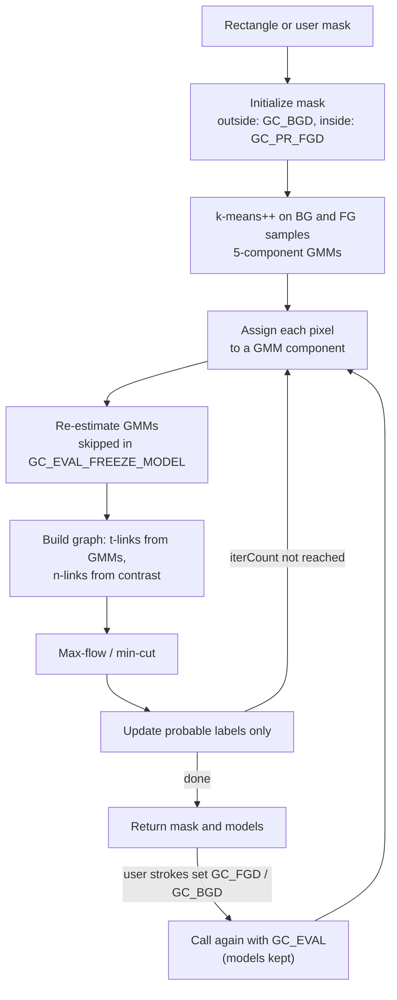

# GrabCut, regions and appearance models

This is the method note for GrabCut, the interactive foreground extraction of Rother,
Kolmogorov and Blake, and for the graph-cut segmentation of Boykov and Jolly on which
it is built. Both combine a per-pixel appearance model with a contrast-sensitive
boundary cost and solve a binary labeling by minimum cut. Unsupervised region methods
(graph-based merging, superpixels) appear in the alternatives, because they answer a
different question: partition the whole image without a user.

## Problem and data contract

**Task.** Separate one foreground object from the background of a single colour image,
given weak user input: a rectangle around the object, optionally followed by strokes
that mark pixels as definite foreground or background. In the paper, "the user drags a
rectangle loosely around an object" and the interaction can consist "simply of dragging a
rectangle around the desired object" [Rother et al., Fig. 1 caption, §1.2].

**Data contract (OpenCV 4.13 `cv::grabCut`).**

| Item | Type and shape | Values and meaning |
| --- | --- | --- |
| `img` | `CV_8UC3`, $H\times W$ | 8-bit colour, BGR order in OpenCV; the paper works in RGB |
| `mask` | `CV_8UC1`, $H\times W$, input and output | `GC_BGD`=0 definite background, `GC_FGD`=1 definite foreground, `GC_PR_BGD`=2 probable background, `GC_PR_FGD`=3 probable foreground |
| `rect` | `Rect(x, y, w, h)` in pixels, origin top-left | Used only with `GC_INIT_WITH_RECT`; clipped to the image; outside becomes `GC_BGD`, inside `GC_PR_FGD` |
| `bgdModel`, `fgdModel` | `CV_64FC1`, $1\times65$ | Five Gaussian components × (1 weight + 3 mean + 9 covariance); state kept between calls |
| `iterCount`, `mode` | `int` | Number of iterations; `GC_INIT_WITH_RECT`, `GC_INIT_WITH_MASK`, `GC_EVAL`, `GC_EVAL_FREEZE_MODEL` |

The output is the updated four-state mask; a binary mask is `mask ∈ {1, 3}`. Only the
probable states change during optimization [grabcut.cpp, L526–L543]. The result is a
*hard* segmentation, $\alpha_n\in\{0,1\}$: the paper adds border matting for soft
alpha values along the boundary [§1.2, §4], which `cv::grabCut` does not implement (its
source contains only the hard segmentation steps).

**Role in a pipeline.** Annotation tools that turn a box into a mask; product cut-out on
studio backgrounds; refinement of a detector's box into a mask for measurement;
bootstrapping masks that a learned model is later trained on. Downstream consumers
expect a binary mask aligned with the image grid and must know that boundaries are
pixel-accurate at best and that transparency is not represented.

## Intuition

The rectangle tells the algorithm one certain thing: everything outside is background.
From that, GrabCut learns what background colours look like and, provisionally, what
the inside looks like. Each pixel then "votes" for the label whose colour model explains
it better, while neighboring pixels pay a price for receiving different labels. That
price is high between similar colours and low across a strong edge, so the boundary
prefers to follow image edges. For fixed colour models, a minimum cut finds the best
labeling exactly; GrabCut then re-learns the colour models from the new labeling and
repeats [Rother et al., §2–§3.2].

*Illustration (constructed).* A red mug on a grey desk inside a loose rectangle: the
outside strip teaches "grey desk", the inside starts as "red and grey", and after one or
two iterations the grey pixels inside the rectangle are explained better by the
background model and drop out. If a grey reflection on the mug resembles the desk, it
drops out too; a foreground stroke on it is the missing information.



*Diagram: the loop of `cv::grabCut` in OpenCV 4.13.0 (grabcut.cpp L545–L598), with the
user-editing branch of Rother et al., Fig. 3.*

## Prerequisites and competencies

**Required prerequisites**: [vault conventions](../../01-Parcours/Pre-requis.md).
Useful background, by mechanism:

- colour spaces and noise, which shape the colour models: [CV-ACQUISITION](../../20-acquisition-images/references/21-exposition-bruit-echantillonnage.md);
- image gradients and contrast, which shape the boundary term: [CV-FILTRES](../../30-traitement-image/references/31-filtrage-gradients.md);
- marker-based classical segmentation: [CV-WATERSHED](91-otsu-distance-watershed.md);
- mask overlap metrics: [CV-IOU-AP](../../130-evaluation-fiabilite/references/131-iou-ap-coco.md), [CV-METRIQUES-APPLIQUEES](../../130-evaluation-fiabilite/references/134-metriques-applications.md);
- promptable learned segmentation, the main modern alternative: [CV-SAM](94-sam-sam2.md).

Familiarity with Gaussian mixtures, k-means and maximum likelihood is assumed. **Target
competencies**: explain the alternation and the role of hard and probable labels, apply
the OpenCV contract, compare GrabCut with seeded graph cut, watershed and promptable
models, evaluate an interactive method by quality against interaction, and diagnose
truncations, leaks and lost thin structures.

## Assumptions, observability and degenerate cases

- **Separable colour distributions.** Foreground and background must occupy different
  regions of colour space. The authors list "camouflage, in which the true foreground and
  background distributions overlap partially in colour space" as a failure case
  [Rother et al., §5].
- **Representative background sample.** Only the pixels outside the rectangle are
  certain background, so every background colour inside the rectangle must also appear
  outside. The paper's third failure case is background material inside the rectangle
  that is "not adequately represented in the background region" [§5].
- **Object inside the rectangle.** Pixels outside become definite background, so any part
  of the object outside the rectangle is lost for good (OpenCV tutorial, "everything
  outside this rectangle will be taken as sure background").
- **Boundaries at colour edges.** The contrast term lowers the cost of cutting across
  strong edges; transitions of "low contrast" are the first failure case [§5].
- **Compact objects.** Every cut neighbor pair costs something, so the energy prefers
  short boundaries. Thin structures with weak contrast are removed even when their colour
  is right (worked example C; the tutorial's own example loses the player's hair).
- **Opaque objects.** The labels are binary; transparency and mixed pixels other than a
  thin border band are "not dealt with" [§1.2].

**Observability.** GrabCut sees colour and contrast, not semantics: a region with the
background's colours is unobservable as foreground without a user stroke or another cue
(depth, infrared, a learned model).

**Degenerate cases.** OpenCV asserts that both the background and the foreground sample
sets are non-empty when it initializes the models [grabcut.cpp, L386], so a rectangle
covering the whole image fails. A colour component with near-zero spread has a singular
covariance: OpenCV adds 0.01 to the diagonal when the determinant is at most $10^{-6}$
[L199, L210–L216]. In a constant image $\beta$ is set to 0, so the boundary term becomes
a uniform Ising penalty [L270–L273; Rother et al., §2.1].

## Procedure

```text
mask <- rect_init(rect)            # outside GC_BGD, inside GC_PR_FGD (or a user mask)
gmm_bg, gmm_fg <- kmeans_pp(pixels labeled BG / FG, K=5)   # initial colour models
beta <- 1 / (2 * mean over 8-neighbour pairs of |z_m - z_n|^2)
w_mn <- gamma * exp(-beta * |z_m - z_n|^2) / dist(m, n)    # n-links, gamma = 50
repeat iterCount times:
    k_n <- best component of the GMM of pixel n's current label        # step 1
    gmm_bg, gmm_fg <- sample weights, means, covariances per component  # step 2
    t-links: probable pixel  -> -log p(z_n | BG), -log p(z_n | FG)
             definite pixel  -> 0 and lambda = 9 * gamma                # hard constraint
    cut <- max_flow(graph)                                              # step 3
    probable pixels <- PR_FGD if on the source side else PR_BGD
user edits: strokes set GC_FGD / GC_BGD; call again with GC_EVAL
```

Purpose of the steps. *Initialization* converts weak input into one certain set (outside
the rectangle) and one provisional set; the paper calls this "incomplete labelling", in
which "only the background labels $T_B$ are taken to be firm" [§3.3]. *Step 1* attaches
each pixel to one Gaussian of its current class, which keeps the model tractable without
soft EM responsibilities, judged of "negligible practical benefit" [§3.1, footnote 1].
*Step 2* refits each component from its pixels. *Step 3* solves the labeling exactly for
the current models. *Iterating* lets pixels that the cut moved to the background retrain
the background model. *User editing* adds hard labels and, in the paper, reruns step 3
once, with an optional full refinement [Fig. 3].

## Mathematics, conventions and units

### Energy

With colours $z_n\in[0,255]^3$, labels $\alpha_n\in\{0,1\}$ (0 background, 1 foreground),
component indices $k_n\in\{1,\dots,K\}$ and parameters
$\theta=\{\pi(\alpha,k),\mu(\alpha,k),\Sigma(\alpha,k)\}$ of two $K$-component
full-covariance Gaussian mixtures ($K=5$), GrabCut minimizes [Rother et al., eqs. 7–11]

$$E(\alpha,k,\theta,z)=\sum_n D(\alpha_n,k_n,\theta,z_n)+\gamma\sum_{(m,n)\in C}\frac{[\alpha_n\neq\alpha_m]}{\mathrm{dis}(m,n)}\,e^{-\beta\|z_m-z_n\|^2},$$

$$D(\alpha_n,k_n,\theta,z_n)=-\log\pi(\alpha_n,k_n)+\tfrac12\log\det\Sigma(\alpha_n,k_n)+\tfrac12\,[z_n-\mu]^\top\Sigma^{-1}[z_n-\mu],$$

up to a constant, where $C$ is the set of 8-connected neighbor pairs, $\mathrm{dis}$ their
Euclidean distance (1 or $\sqrt2$ px) and $[\cdot]$ the indicator. The contrast constant
is

$$\beta=\Big(2\,\big\langle\|z_m-z_n\|^2\big\rangle\Big)^{-1},$$

the inverse of twice the mean squared colour difference between neighbors [eq. 5], and
$\gamma=50$ "was obtained ... by optimizing performance against ground truth over a
training set of 15 images" [§2.1]. Units: $\|z_m-z_n\|^2$ in squared 8-bit levels,
$\beta$ in inverse squared levels; $D$ and $E$ are in nats; $\gamma$ is a cost in nats per
unit-distance neighbor pair. A constant added to both $D(0,\cdot)$ and $D(1,\cdot)$ of a
pixel does not change the minimizer, which is why the $\tfrac32\log2\pi$ term can be
dropped [Boykov & Jolly, footnote 2].

### Graph construction and exactness

Boykov and Jolly build a graph whose nodes are the pixels plus a source (object) and a
sink (background) terminal. Each pixel has two *t-links*, weighted by the data costs of
the two labels, and each neighbor pair one *n-link* weighted by the boundary cost. A
definite object seed gets t-links $(K,0)$ and a background seed $(0,K)$ with

$$K=1+\max_p\sum_{q:\{p,q\}\in N}B_{\{p,q\}},$$

larger than all n-links of any pixel, so a minimum cut never violates a seed. Their
Theorem 1 states that the labeling defined by the minimum cut "minimizes (1) among all
segmentations satisfying" the hard constraints, provided the boundary penalties are
non-negative [Boykov & Jolly, §3, Lemma 1, Theorem 1, footnote 2]. In GrabCut this
exactness holds for step 3 only, with $k$ and $\theta$ fixed.

### Alternation and convergence

Steps 1 to 3 each minimize $E$ with respect to $k$, $\theta$ and $\alpha$ in turn, so
"$E$ decreases monotonically" and the algorithm converges "at least to a local minimum"
[§3.2]; the llama example converges in 12 iterations [Fig. 4]. The joint problem is not
solved globally: the result depends on the initialization.

### Worked example A: contrast-normalized n-links

Constructed example, recomputed by checks/92-grabcut-regions.py. Write the squared colour
difference of a neighbor pair as $\rho$ times the image mean. Since
$\beta=1/(2\langle\|\Delta z\|^2\rangle)$, the axial n-link weight is
$\gamma e^{-\rho/2}$: 50 for identical colours, 30.3 at the mean difference ($\rho=1$),
18.4 at $\rho=2$ and 6.8 at $\rho=4$; diagonal links are divided by $\sqrt2$. Scaling every
colour by the same factor scales the mean difference too, so the weights do not change:
the boundary term responds to *relative* contrast in the image. The colour models also
scale consistently (every Gaussian density is multiplied by the same constant), so a
global gain change mostly cancels; 8-bit clipping and the fixed 0.01 covariance
regularizer break this invariance at the extremes (project deduction).

### Worked example B: are OpenCV's hard constraints hard?

Constructed example, recomputed by checks/92-grabcut-regions.py. OpenCV gives definite
pixels the t-link weight `lambda = 9*gamma` = 450 [grabcut.cpp, L489–L495, L582–L583]. At
zero contrast, a pixel's eight n-links sum to $4\gamma+4\gamma/\sqrt2=341.4$, so 450
exceeds Boykov and Jolly's $K=342.4$ and the cut cannot move a definite pixel. OpenCV
also updates only the probable states after the cut [L526–L543]. Note the naming trap:
OpenCV's `lambda` is this hard-constraint constant, whereas Boykov and Jolly's $\lambda$
weighs the region term against the boundary term [Boykov & Jolly, eq. 1].

### Worked example C: why thin structures disappear

Constructed example, recomputed by checks/92-grabcut-regions.py. A straight boundary cuts,
per pixel of length, one axial and two diagonal n-links, a cost
$c(\rho)=(1+\sqrt2)\gamma e^{-\rho/2}$: 120.7 nats at zero contrast and 16.3 at $\rho=4$.
A one-pixel-wide foreground strand has boundaries on both sides, $2c(\rho)$ per pixel.
Keeping it gains, per pixel, the log-likelihood ratio between the two colour models;
for two unit-variance colour clusters $4\sigma$ apart, that ratio is 8 nats at the
foreground mean. The strand survives only when $2c(\rho)<8$, that is when its squared
contrast with its surroundings exceeds $\rho\approx6.8$ times the image mean. Wires, hair
and thin legs usually fail this test, which is why the method needs foreground strokes or
border matting there (project derivation from eqs. 9 and 11).

## Parameters and tuning

| Parameter | Value in the sources | Effect | Interactions and what to watch |
| --- | --- | --- | --- |
| Rectangle | User input; paper: background strip outside it [§3.3] | Defines the only certain background | Too tight cuts the object for good; too loose lets unrepresented background inside |
| Strokes | `GC_FGD` / `GC_BGD` brushes [Fig. 3] | Hard constraints that inject missing information | A wrong stroke is never undone by iterations |
| Iterations | Tutorial: 5; paper: until $E$ stops decreasing, 12 for the llama [Fig. 4] | Refines the colour models | OpenCV runs exactly `iterCount` iterations, with no convergence test |
| Mode | `GC_INIT_WITH_MASK` re-runs k-means; `GC_EVAL` keeps the models; `GC_EVAL_FREEZE_MODEL` does one cut with fixed models | Whether user edits retrain the models | Re-initializing after edits discards the learned models |
| GMM components $K$ | 5 [§3.1]; fixed constant in OpenCV [L63] | Capacity of each colour model | Too few for textured objects, too many overfit small samples; not exposed in OpenCV |
| Smoothness $\gamma$ | 50 [§2.1]; fixed in OpenCV [L582] | Boundary length against colour evidence | Larger values remove thin parts (example C); not exposed in OpenCV |
| Contrast $\beta$ | $1/(2\langle\|\Delta z\|^2\rangle)$ over the whole image [eq. 5; L240–L276] | Normalizes edge strength | Cropping the image changes $\beta$ |
| Colour space | RGB in the paper; any 8-bit 3-channel input in OpenCV | Shape of clusters and of $\|\Delta z\|$ | A perceptual space such as Lab can separate clusters differently |

Tuning approach (project method), on held-out images with ground-truth masks:

1. Fix a rectangle rule (for example the ground-truth box enlarged by a fixed margin)
   and a simulated-user policy for strokes, written down before any comparison.
2. Sweep the margin and `iterCount` (1, 3, 5, 10); log $E$ when available, mask IoU and
   boundary quality after each call.
3. Compare colour spaces only with everything else fixed, and check that the background
   strip contains the colours of the background inside the rectangle.
4. Report quality after 0, 1, 2 and more corrections rather than a single number.

## Properties and limits of guarantees

- **Exact sub-problem.** For fixed colour models the labeling is a global minimum among
  labelings that respect the hard constraints [Boykov & Jolly, Theorem 1]; the joint
  problem reaches only a local minimum [Rother et al., §3.2].
- **Implementation deviation.** OpenCV assigns each pixel to the component with the
  highest Gaussian density *without* the mixture weight $\pi$ [grabcut.cpp, L121–L152],
  whereas the paper's step 1 minimizes $D$, which includes $-\log\pi$ [eq. 9, Fig. 3]. The
  paper's monotonic-decrease argument therefore does not strictly cover the
  implementation (project deduction).
- **Hard labels stay hard** in both the paper ("guaranteed not to be retracted") and
  OpenCV (example B).
- **Invariances.** Approximately invariant to a global colour gain (example A); not
  invariant to colour-space changes or to local illumination changes, which alter the
  colour clusters.
- **Boundary bias.** The pairwise term penalizes boundary length, so the method prefers
  compact regions and removes thin, weakly contrasted parts (example C).
- **Randomness.** The k-means++ seeding draws from OpenCV's global random generator
  [kmeans.cpp, L287, L339–L340], so two runs can differ unless the seed is fixed.

## Cost and implementation

Cost drivers, for $N=HW$ pixels and $K=5$ components per model:

- **Per iteration**: component assignment and refit, $O(NK)$ evaluations of $3\times3$
  quadratic forms; graph construction with $N$ nodes and $4N-3(H+W)+2$ undirected n-links
  [L463–L468]; one max-flow.
- **Max-flow**: OpenCV's `GCGraph::maxFlow` grows two search trees from the source and
  the sink and repairs orphans [gcgraph.hpp, L156–L200], the scheme of Boykov and
  Kolmogorov, whose worst case is $O(mn^2|C|)$ for $n$ nodes, $m$ edges and minimum-cut
  cost $|C|$, but which "significantly outperforms standard algorithms" on typical vision
  graphs [Boykov & Kolmogorov, §3]. Iterations and real-time behavior must be measured.
- **Whole-image graph.** OpenCV builds the graph and computes $\beta$ over every pixel,
  including definite background far from the rectangle [L240–L276, L463–L521]. Cropping
  to an enlarged rectangle cuts the cost roughly in proportion to the area, at the price
  of a different $\beta$ and a smaller background sample (project deduction).
- **Reported timing**: a $450\times300$ rectangle took 0.9 s for the initial segmentation
  and 0.12 s per brush stroke on a 2.5 GHz CPU with 512 MB RAM [Rother et al., §5]; a
  2004 measurement, not a current benchmark.

### OpenCV 4.13 contracts

Read in the 4.13.0 header and sources on GitHub, because docs.opencv.org returned HTTP 403
during this pass. No code was executed for this note.

- `cv::grabCut(img, mask, rect, bgdModel, fgdModel, iterCount, mode = GC_EVAL)`; the
  image must be `CV_8UC3` and the mask `CV_8UC1` with values 0 to 3, checked in
  `GC_INIT_WITH_MASK`, `GC_EVAL` and `GC_EVAL_FREEZE_MODEL` [imgproc.hpp, L351–L371,
  L3555–L3575; grabcut.cpp, L329–L347, L545–L580].
- `GC_INIT_WITH_RECT` sets the mask from the clipped rectangle; both init modes run
  k-means++ with 10 iterations on each class [L352–L413]. With `iterCount <= 0` the call
  returns after initialization; `GC_EVAL_FREEZE_MODEL` forces one iteration without
  re-learning the models [L573–L596].
- Fixed constants: $K=5$, $\gamma=50$, hard weight $9\gamma$, diagonal n-links
  $\gamma/\sqrt2$, 8-connectivity [L63, L282–L324, L582–L583].
- The Python tutorial binarizes with `np.where((mask==2)|(mask==0), 0, 1)` and reuses the
  model arrays of shape `(1, 65)` [GrabCut tutorial source].

## Evaluation and controlled variation

**Protocol.** An interactive method is evaluated by quality *as a function of user
effort*, not by one number:

- mask IoU (or the paper's error rate) after the rectangle alone and after each
  correction, under a written simulated-user policy;
- the number of corrections needed to reach a target quality, and the share of images
  that never reach it within a budget;
- a boundary measure, since a one-pixel-wide error band barely moves IoU on large
  objects (see [CV-SEGMENTATION](93-semantique-instances-panoptique.md) for Boundary IoU);
- wall-clock time per call on stated hardware.

Published results, with their protocol: on 20 tasks, GrabCut "needed significantly fewer
interactions" in 15 moderately difficult examples and performed comparably otherwise; on
a 50-image ground-truth database, GrabCut with a single outer lasso reached an error
rate of 2.13 ± 0.19% against 1.36 ± 0.18% for Graph Cut given two lassos, outer and inner
[Rother et al., §5]. The second result compares unequal inputs: less user information,
slightly higher error.

### Proposed baseline and controlled variation (not executed)

- **Question**: how much of the remaining error comes from an unrepresentative background
  sample?
- **Data**: held-out images with ground-truth masks, stratified by camouflage (overlap of
  foreground and background colour histograms) and by thin structures.
- **Baseline**: OpenCV 4.13 `grabCut` with `GC_INIT_WITH_RECT`, the ground-truth box
  enlarged by 5% of its size, 5 iterations, no strokes.
- **Controlled variation**: margin of 20%, everything else identical.
- **Measurements**: IoU, a boundary measure, failure rate below a target IoU, corrections
  needed under the fixed stroke policy, time per call.
- **Expected effect (hypothesis)**: fewer leaks of interior background where the wider
  strip adds missing background colours; more background clutter learned into the
  probable foreground where the margin admits distractors.
- **Confound**: a wider rectangle leaves OpenCV's $\beta$ unchanged (it is computed on the
  whole image) but changes both the number of definite background samples and the number
  of probable pixels; report both counts.

**Measurement limits.** Simulated users that choose strokes from the ground truth are an
oracle a real operator does not have; small datasets (15 images to tune $\gamma$, 50 to
test) give coarse comparisons; IoU on large objects hides boundary errors.

## Failure modes and diagnosis

| Symptom | Possible causes | Discriminating check | Conditional remedy |
| --- | --- | --- | --- |
| Part of the object missing, unchanged by more iterations | Rectangle or a background stroke imposes `GC_BGD` on it | Overlay definite labels on the image | Enlarge the rectangle, correct the stroke, use probable labels |
| Background patch inside the rectangle kept as foreground | Its colours are absent from the outside strip [§5 (iii)] | Compare the patch colours with the background model's likelihood | Wider margin, lasso, background stroke |
| Thin parts lost (hair, wires, legs) | Boundary cost exceeds colour evidence (example C) | Measure local contrast ratio along the structure | Foreground strokes, matting, another method |
| Leak into similar-coloured background | Camouflage, overlapping colour models [§5 (ii)] | Overlap of foreground and background likelihoods on the leak | Strokes, extra cues (depth, infrared), a learned model |
| Ragged or misplaced boundary | Low-contrast transition [§5 (i)] | Intensity profile across the true boundary | Strokes near the boundary, matting, edge-aware refinement |
| Error "image must have CV_8UC3 type" or an assertion | Wrong type; empty foreground or background sample | Check types and that both classes exist in the mask | Convert; shrink the rectangle inside the image |
| Different results on reruns | Randomized k-means++ seeding | Fix the random seed and compare | Seed control in tests |
| Edits ignored or models reset | Second call with `GC_INIT_WITH_MASK` re-runs k-means | Check the mode | `GC_EVAL` to resume, `GC_EVAL_FREEZE_MODEL` for one cut |
| Slow on large images | Graph and $\beta$ over the whole image | Time against image area | Crop to an enlarged rectangle or downscale, then re-check $\beta$ effects |

## Alternatives and applications

Conditional choices:

- **Prefer seeded graph cut** (Boykov and Jolly) when users mark both foreground and
  background and the seeds sample the colours well: one cut, exact for its energy, and
  the paper's own comparison shows lower error when both lassos are given.
- **Prefer marker-controlled watershed** ([CV-WATERSHED](91-otsu-distance-watershed.md))
  for many touching objects whose separation follows shape rather than colour models.
- **Prefer graph-based region merging** (Felzenszwalb and Huttenlocher) for an
  unsupervised over-segmentation: it merges components along a minimum spanning tree when
  the edge between them is below their internal difference plus $\tau(C)=k/|C|$, where a
  larger $k$ "causes a preference for larger components", in $O(m\log m)$ for $m$ edges
  [F&H 2004, eqs. 1–5, §4.1, §5].
- **Prefer superpixels** (SLIC) to shrink an interactive graph: SLIC runs k-means in
  $labxy$ space with each centre searching only a $2S\times2S$ window, which makes it
  $O(N)$ regardless of the number of superpixels, and $m\in[1,40]$ trades colour
  similarity against compactness [Achanta et al., Fig. 2, Algorithm 1, §III-B]. A graph
  cut on superpixels is a project option, not part of GrabCut.
- **Prefer a promptable learned model** ([CV-SAM](94-sam-sam2.md)) when appearance
  varies beyond two colour mixtures or the object is defined semantically; keep GrabCut
  as a training-free, CPU-only fallback whose failure modes are interpretable.
- **Prefer matting** when transparency, hair or motion blur must be preserved; GrabCut's
  border matting addresses only a narrow band around a hard boundary [§4].

Industrial uses (project reasoning, not published results): box-to-mask conversion in
annotation tools, with corrections logged as effort; cut-out of products photographed on
controlled backgrounds, where colour separability holds by design; mask refinement of a
detected part before measuring its area, valid only when the part contrasts with its
fixture.

## Guided reasoning and proposed checks

These constructed cases develop conditional optimization and the role of user
constraints. They explain or test reasoning; no image, video or hardware result is
claimed as measured. Method properties remain tied to the sources below.

### Case linked to CV-GRABCUT-001

**Working question**: Which two main operations does GrabCut alternate?

**Reference answer**: Estimate the background and foreground appearance models, then optimize the labels by graph cut on the defined energy.

**Intuition of alternation**: Current labels give colour examples for background and foreground; the appearance models then set the cost of each assignment. Relations between neighbors add a spatial preference. The new partition is used for a new estimate, within the constraints of the initialization.

**Example of a limitation**: If a part of the target looks like the background, its appearance cost can favor the wrong label. A user indication can provide information that colour alone does not. The process does not name an object according to a taxonomy, and an energy minimum is not proof that the mask is correct for the application. Check the initialization and the definite labels before increasing iterations. To compare with a learned promptable method, also count interventions, failures and the full cost, not just the time of the last optimization.

### Case linked to CV-GRABCUT-003

**Working question**: When extracting an object whose colors resemble the background, why compare interaction cost and assumptions rather than optimization time alone?

**Reference answer**: Labels added by the user can provide the missing information; a method that is fast per call can still require many corrections.

**Cost actually paid**: A fast algorithm can require several retouches if its colour model separates target and background poorly. A method that is more expensive per call can reduce interaction; the opposite is also possible. Times must include the whole procedure needed to reach a defined quality.

**Proposed protocol**: Fix held-out images, a reset rule and a correction budget, then measure mask quality, number of interventions, total time and failure rate. Separately, make the background closer to the target in colour to test the appearance assumption. Keep unresolved cases in the results. An energy optimum indicates that the procedure has satisfied its model; it does not say that this model has enough information to distinguish the object of interest. The comparison must therefore weigh the method's assumptions against human effort, without choosing on solver duration alone.

**Documentary reference for this pass**: [OpenCV 4.13, GrabCut](https://docs.opencv.org/4.13.0/d8/d83/tutorial_py_grabcut.html), model, graph cut and definite/probable labels. The other developments are in the [flashcards](../92-grabcut-regions.md).

## Additional technical explanations — 2026-10-30

These explanations complement the mechanism associated with each question. Calculations are constructed cases under stated assumptions; protocols remain proposals until a test is recorded.

### CV-GRABCUT-001

**Situation**: Which two main operations does GrabCut alternate?

**Energy and cut**: For a binary label $L_p$, a unary term can be set to $-\log p(I_p\mid L_p)$ under the corresponding colour mixture. A schematic neighbor term $w_{pq}\mathbf1[L_p\ne L_q]$ penalizes a boundary between similar pixels; high contrast reduces $w_{pq}$. With fixed appearance parameters and a graph-representable binary energy, the minimum cut solves this sub-problem exactly. Alternating with the estimation of the mixtures does not imply a joint global optimum over all the unknowns. Naming the sub-problem that is solved prevents confusing the solver's guarantee with the correctness of the object model used.

### CV-GRABCUT-002

**Situation**: GrabCut consistently excludes part of an object despite more iterations. What should be checked first?

**Hard constraint and preference**: A definite label forbids the other assignment, while a probable label lets the energy choose. If a real part of the object is assigned to definite background, changing the appearance settings does not make the correct solution admissible. In a constructed test, correct only this constraint, then compare iterations from the same saved initial state. An improvement locates a defect in the constraint; a persistent exclusion may still come from close colours or regularization. Keeping the four states of the mask until the final decision avoids losing interaction information by binarizing the labels too early.

### CV-GRABCUT-003

**Situation**: When extracting an object whose colors resemble the background, why compare interaction cost and assumptions rather than optimization time alone?

**Quality–interaction curve**: Set a common rule for placing the initial rectangle, then a budget of corrections or user time. Measure quality after zero, one and several interactions, and report the share of images that do not reach the target within the maximum budget. Clicks are comparable only if their policy and the information available to the clicker are stated; a correction chosen with the reference mask is a different oracle from a real operator. Also compare boundaries and small regions of interest. This protocol gives a usable trade-off curve instead of an isolated optimization time obtained after a particularly favorable initialization.

**Passages consulted for these developments**: [OpenCV 4.13.0, GrabCut](https://docs.opencv.org/4.13.0/d8/d83/tutorial_py_grabcut.html), theory, models and cut; the sub-problem distinction and the protocols are project constructions.

## Sources

### Scientific sources

- [Rother, Kolmogorov and Blake 2004, "GrabCut — Interactive Foreground Extraction using Iterated Graph Cuts", SIGGRAPH](https://www.microsoft.com/en-us/research/wp-content/uploads/2004/08/siggraph04-grabcut.pdf): Fig. 1, §1.2, §2.1 eqs. 2–6 ($\beta$, $\gamma=50$ from 15 images, 8-connectivity), §3.1 eqs. 7–11 and footnote 1, §3.2 and Fig. 3 (iterative minimization, monotonic decrease, local minimum), Fig. 4 (12 iterations), §3.3 (incomplete trimap, firm $T_B$), §4 (border matting), §5 (failure cases, timing, 20-task and 50-image comparisons).
- [Boykov and Jolly 2001, "Interactive Graph Cuts for Optimal Boundary & Region Segmentation of Objects in N-D Images", ICCV](https://www.csd.uwo.ca/~yboykov/Papers/iccv01.pdf): §2 eqs. 1–3, §3 edge-weight table, $K$, Lemma 1, Theorem 1, footnote 2, incremental seeds; §4 negative log-likelihood regional terms and $B_{\{p,q\}}$.
- [Boykov and Kolmogorov 2004, "An Experimental Comparison of Min-Cut/Max-Flow Algorithms for Energy Minimization in Vision", IEEE TPAMI](https://www.csd.uwo.ca/~yboykov/Papers/pami04.pdf): §3 (two search trees, orphans, $O(mn^2|C|)$, practical speed), §4.4 (segmentation experiments).
- [Felzenszwalb and Huttenlocher 2004, "Efficient Graph-Based Image Segmentation", IJCV](https://www.cs.cornell.edu/~dph/papers/seg-ijcv.pdf): §3 eqs. 1–5, §4.1 running time, §5 grid graphs and $k$.
- [Achanta et al. 2012, "SLIC Superpixels Compared to State-of-the-art Superpixel Methods", IEEE TPAMI (author preprint)](https://infoscience.epfl.ch/record/177415/files/Superpixel_PAMI2011-2.pdf): Fig. 2, Algorithm 1, §III-B.

### Implementation sources

- [OpenCV 4.13.0, `modules/imgproc/src/grabcut.cpp`](https://github.com/opencv/opencv/blob/4.13.0/modules/imgproc/src/grabcut.cpp): GMM with 5 components and 13 values each (L60–L99), component density and assignment without mixture weight (L121–L152), covariance regularization (L199, L210–L216), $\beta$ (L240–L276), n-links (L282–L324), mask check (L329–L347), rectangle init (L352–L363), k-means++ init and non-empty assertion (L368–L413), graph construction (L463–L521), probable-only update (L526–L543), `grabCut` loop and constants (L545–L598).
- [OpenCV 4.13.0, `modules/imgproc/include/opencv2/imgproc.hpp`](https://github.com/opencv/opencv/blob/4.13.0/modules/imgproc/include/opencv2/imgproc.hpp): `GrabCutClasses` and `GrabCutModes` (L351–L371), `grabCut` (L3555–L3575).
- [OpenCV 4.13.0, `modules/imgproc/include/opencv2/imgproc/detail/gcgraph.hpp`](https://github.com/opencv/opencv/blob/4.13.0/modules/imgproc/include/opencv2/imgproc/detail/gcgraph.hpp): `maxFlow` with search trees and orphans (L156–L200).
- [OpenCV 4.13.0, `modules/core/src/kmeans.cpp`](https://github.com/opencv/opencv/blob/4.13.0/modules/core/src/kmeans.cpp): global random generator and k-means++ seeding (L287, L339–L340).
- [OpenCV 4.13.0, GrabCut tutorial source](https://github.com/opencv/opencv/blob/4.13.0/doc/py_tutorials/py_imgproc/py_grabcut/py_grabcut.markdown): sure background outside the rectangle, `(1,65)` models, binarization, mask-mode touch-up and the lost-hair example. The rendered page ([GrabCut tutorial](https://docs.opencv.org/4.13.0/d8/d83/tutorial_py_grabcut.html)) returned HTTP 403 in this pass.

### Related flashcards and references

- [Flashcards](../92-grabcut-regions.md): CV-GRABCUT-001 (alternation), CV-GRABCUT-002 (hard constraint diagnosis), CV-GRABCUT-003 (interaction cost).
- Related references: [CV-WATERSHED](91-otsu-distance-watershed.md), [CV-SEGMENTATION](93-semantique-instances-panoptique.md), [CV-SAM](94-sam-sam2.md).

Drafted by agent, 2026-10-18. Revision 5, 2026-11-14: body deepened and language corrected by Agent Claude Code (`revue-cartes`, self-review); see the [subject report](https://github.com/speillet/Knowledge_Computer_Vision/blob/main/docs/revues/2026-11-14-reference-depth/92-grabcut-regions.md).
