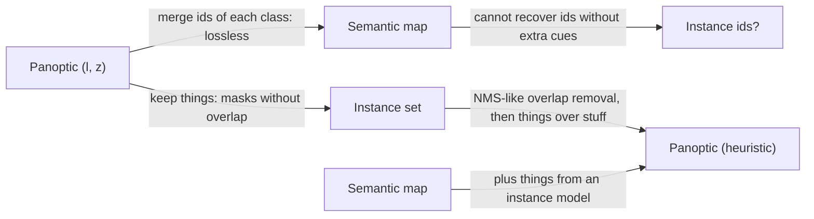

# Semantic, instance and panoptic segmentation

This is the comparison and protocol note for the three learned segmentation outputs. It
fixes what each output contains, how representative architectures produce it (FCN,
U-Net and DeepLabv3+ for semantic labels, Mask R-CNN for instances, Mask2Former for all
three), how the outputs convert into one another, and how their metrics (IoU, Dice, AP,
PQ, Boundary IoU) can disagree. Architecture details stay at the depth a choice needs;
inventory items APP-075 to APP-078 (U-Net, DeepLab, Mask R-CNN, nnU-Net) remain open for
dedicated notes.

## Problem and data contract

**Task.** Assign image pixels to categories, to object instances, or to both, as
required by the product that consumes the result. Kirillov et al. define the joint
format: each pixel $i$ receives a pair $(l_i,z_i)$ of semantic class and instance id;
for *stuff* classes the instance id "is irrelevant", for *thing* classes each
$(l_i,z_i)$ is one object, and which classes are stuff or things "is a design choice
left to the creator of the dataset" [Kirillov et al., §3].

| Output | Representation | Overlap | Confidence | Typical metric |
| --- | --- | --- | --- | --- |
| Semantic | Label map $H\times W$ of class indices, or logits $C\times H\times W$ | Impossible: one label per pixel | Not required | Per-class IoU, mIoU, Dice |
| Instance | Set of $(m_k, c_k, s_k)$: mask, class, score, things only | Allowed | Required for ranking | Mask AP |
| Panoptic | Two maps $H\times W$: class $l$ and instance id $z$ | Impossible "by construction" | Not required | PQ, SQ, RQ |

Conventions that must be stated with the data: the *void* or ignore label (Cityscapes
excludes void pixels from training and evaluation [Cordts et al., §2.2, §3.1]); group or
crowd regions; whether masks are amodal (the panoptic task segments visible regions only
[Kirillov et al., §2]); the coordinate frame of every mask, which is the input image after
any resizing; and the resampling rule for labels. Downstream, counting and picking need
instances, area coverage or free-space estimation needs semantic labels, and a
single owner per pixel (robotics, scene editing) needs a panoptic partition.

## Intuition

Semantic segmentation colours every pixel by class; it can say "these pixels are box"
but not how many boxes there are. Instance segmentation cuts out each countable object
with a score, and two cut-outs may overlap. Panoptic segmentation is one jigsaw puzzle in
which every pixel belongs to exactly one piece: things carry an id, stuff does not.

*Illustration (constructed).* Three touching cartons on a pallet over a concrete floor.
A semantic map shows one carton region and one floor region, so the count is lost. An
instance model returns three carton masks, possibly overlapping by a few pixels at the
contact lines, plus scores. A panoptic output has three carton segments and one floor
segment, each pixel exactly once.



*Diagram: conversions between outputs. The panoptic format is "a strict generalization"
of the semantic one [Kirillov et al., §3]; going from instances to a partition needs an
overlap-resolution rule [§7].*

## Prerequisites and competencies

**Required prerequisites**: [vault conventions](../../01-Parcours/Pre-requis.md).
Useful background:

- IoU, AP and matching: [CV-IOU-AP](../../130-evaluation-fiabilite/references/131-iou-ap-coco.md);
- detectors and set prediction behind Mask R-CNN and Mask2Former: [CV-DETECTEURS](../../80-detection-pose/references/82-detection-fasterrcnn-yolo-detr.md), [CV-NMS](../../80-detection-pose/references/81-nms.md);
- backbones and transfer: [CV-REPRESENTATIONS](../../70-reconnaissance-representations/references/71-representations-transfert.md);
- data splits and external validation: [CV-FIABILITE](../../130-evaluation-fiabilite/references/133-donnees-generalisation.md);
- application metrics (Dice, surface distances): [CV-METRIQUES-APPLIQUEES](../../130-evaluation-fiabilite/references/134-metriques-applications.md);
- classical and interactive alternatives: [CV-WATERSHED](91-otsu-distance-watershed.md), [CV-GRABCUT](92-grabcut-regions.md), [CV-SAM](94-sam-sam2.md).

**Target competencies**: choose the output that matches a deliverable, explain how each
family produces it, convert between outputs, compute and interpret IoU, Dice, PQ and
Boundary IoU under a stated protocol, and diagnose failures that come from the task
definition rather than from the network.

## Assumptions, observability and degenerate cases

- **A fixed taxonomy.** Classes, the stuff/thing split, void and group labels are dataset
  decisions; a product with different decisions needs different labels.
- **Visible separation.** Two touching instances of one class can be separated only if
  the image or the annotation carries a cue. A semantic label map holds none: two
  annotations with the same union of foreground pixels give a per-pixel loss the same
  targets (appendix of CV-SEGMENTATION-002). U-Net makes the cue explicit by inserting
  "separating background labels between touching cells" and weighting them in the loss
  [Ronneberger et al., §1, §3].
- **Resolution against structure size.** A structure must cover enough pixels at the
  network's output stride (example C below); otherwise it survives only through the
  decoder or upsampling.
- **Stationary annotation quality.** Boundary annotations are ambiguous by a few pixels;
  expert annotators of COCO and ADE20k reach a median Boundary IoU above 0.9 only when the
  band width $d$ is 2% of the image diagonal [Cheng et al. 2021, §5].

**Observability.** Occluded parts are unobservable in modal annotations; identity across
frames is not part of an image segmentation output (appendix of CV-SEGMENTATION-001).

**Degenerate cases.** A class absent from both prediction and ground truth in an image
gives $0/0$ for per-image IoU or Dice: the aggregation must say whether such images are
skipped or scored. Instance predictions overlap, so PQ cannot be computed before their
overlaps are resolved [Kirillov et al., §7]. A group (crowd) region is excluded from
matching, and an unmatched prediction with more than half of its pixels in a group region
of its own class is not a false positive [§4.2].

## Procedure

How each family produces its output (published designs):

1. **Fully convolutional semantic models.** A classification backbone made fully
   convolutional predicts class scores on a coarse grid (stride 32 in FCN), which is
   upsampled in the network and trained with a per-pixel loss; skip connections fuse
   finer layers (FCN-16s, FCN-8s) to refine boundaries [Long et al., §3.3, §4.1–§4.2].
   DeepLabv3+ keeps an output stride of 16 or 8 with atrous convolution, aggregates
   context with atrous spatial pyramid pooling, then upsamples by 4, fuses low-level
   features and upsamples by 4 again [Chen et al., §3.1]. U-Net uses a symmetric
   contracting and expanding path with skip concatenations and unpadded convolutions
   [Ronneberger et al., §2].
2. **Detect-then-segment instances.** Mask R-CNN adds to Faster R-CNN a branch that
   predicts, for each region of interest, $K$ binary masks of $m\times m$ (28×28 in the
   FPN head), keeps the one of the predicted class, resizes it to the box and thresholds
   it at 0.5; RoIAlign samples features by bilinear interpolation without quantizing the
   region [He et al., §3, Fig. 4, "Inference"].
3. **Mask classification.** Mask2Former predicts $N$ binary masks with $N$ class labels
   from $N$ object queries; its decoder restricts cross-attention to each query's
   predicted mask, and one post-processing step turns the same pairs into semantic,
   instance or panoptic outputs [Cheng et al. 2022, §3.1–§3.2, §4.1].
4. **Instance to panoptic.** Kirillov et al.'s baseline resolves overlaps greedily:

```text
segments <- instance predictions with score >= s_min, sorted by score (descending)
taken    <- empty pixel set
for seg in segments:
    free <- seg.mask minus taken
    if area(free) / area(seg.mask) >= f_min:     # enough of the segment survives
        emit (seg.class, new id, free); taken <- taken union free
    else:
        discard seg
stuff    <- semantic map on pixels not in taken  # overlaps resolved in favor of things
```

Thresholds $s_{min}$ and $f_{min}$ were chosen "by grid search to optimize PQ"
[Kirillov et al., §7]. The purpose of each step: sorting makes confident segments win
contested pixels; the surviving-fraction test removes segments that overlap mostly with
better ones; the stuff fill produces a complete partition.

## Mathematics, conventions and units

### Pixel metrics

Let $n_{ij}$ be the number of pixels of true class $i$ predicted as $j$, $n_{cl}$ the
number of classes and $t_i=\sum_j n_{ij}$. FCN reports pixel accuracy
$\sum_i n_{ii}/\sum_i t_i$, mean accuracy $(1/n_{cl})\sum_i n_{ii}/t_i$ and mean IU

$$\mathrm{mIoU}=\frac1{n_{cl}}\sum_i\frac{n_{ii}}{t_i+\sum_j n_{ji}-n_{ii}},$$

plus a frequency-weighted IU [Long et al., §5]. Per class this is
$\mathrm{TP}/(\mathrm{TP}+\mathrm{FP}+\mathrm{FN})$. *Where* the counts are summed matters:
Cityscapes accumulates TP, FP and FN "over the whole test set" and notes that this global
IoU "is biased toward object instances that cover a large image area"; its iIoU weights
each true-positive and false-negative pixel by the class's average instance size divided
by the size of its ground-truth instance [Cordts et al., §3.1]. The binary Dice score
$2\mathrm{TP}/(2\mathrm{TP}+\mathrm{FP}+\mathrm{FN})$ is a monotone function of IoU,
$\mathrm{Dice}=2\,\mathrm{IoU}/(1+\mathrm{IoU})$, so on a single mask the two rank
predictions identically; they differ once averaged over images or structures (project
derivation; example B).

### Panoptic quality

A predicted and a ground-truth segment of the same class match only if their IoU is
strictly greater than 0.5. Because panoptic segments do not overlap, each ground-truth
segment has at most one such match (Theorem 1: for disjoint $p_1,p_2$,
$\mathrm{IoU}(p_1,g)+\mathrm{IoU}(p_2,g)\le1$). Per class, with matched pairs TP,
unmatched predictions FP and unmatched ground truth FN [Kirillov et al., §4.1–§4.2],

$$\mathrm{PQ}=\frac{\sum_{(p,g)\in TP}\mathrm{IoU}(p,g)}{|TP|+\tfrac12|FP|+\tfrac12|FN|}=\underbrace{\frac{\sum_{TP}\mathrm{IoU}}{|TP|}}_{\mathrm{SQ}}\times\underbrace{\frac{|TP|}{|TP|+\tfrac12|FP|+\tfrac12|FN|}}_{\mathrm{RQ}},$$

where RQ "is the familiar F1 score"; PQ is averaged over classes, "insensitive to class
imbalance", and "all segments receive equal importance regardless of their area". Void
pixels of the ground truth are removed from predicted segments before matching, and an
unmatched prediction whose fraction of void pixels exceeds the matching threshold is not
a false positive [§4.2]. SQ and RQ "are not independent since SQ is measured only over matched
segments" [§4.2]. PQ is dimensionless in $[0,1]$.

The strict inequality is what the uniqueness proof needs: two disjoint predictions can
each reach exactly 0.5 with one segment, for example a 2-pixel segment split into two
1-pixel predictions, so a "$\ge0.5$" rule would no longer give a unique matching (project
derivation from the proof of Theorem 1, recomputed by the script cited in worked example A).

*Evaluator conventions.* The COCO panoptic evaluator, panopticapi `evaluation.py` at
commit `7bb4655`, implements these rules as follows. It builds the joint histogram of
ground-truth and predicted segment ids (L110–L116), skips crowd ground truth and pairs of
different categories, computes $\mathrm{IoU}=|p\cap g|/(|p|+|g|-|p\cap g|-|p\cap\mathrm{void}|)$
and counts every pair above 0.5 as a TP, with no assignment step, which Theorem 1 makes
safe (L121–L138). Unmatched non-crowd ground truth is an FN, and crowd segments are
ignored (L141–L149). An unmatched prediction is ignored when its void pixels plus its
pixels in the crowd segment of its own category exceed half its area: one sum where the
paper states two rules (L151–L163); the code keeps one crowd segment per category and
image (L147). IoU sums and counts are accumulated per category over all images (L78–L163,
L178–L180); PQ, SQ and
RQ are computed per category, categories without any TP, FP or FN are skipped, and each
of the three is averaged separately over all categories, things and stuff (L49–L73,
L221–L224). The averaged PQ is therefore not the product of the averaged SQ and RQ; the
paper reports class averages with "PQ=SQ×RQ per class" [§6, Table 1 caption].

### Boundary IoU

For masks $G$, $P$ and the sets $G_d$, $P_d$ of pixels within distance $d$ of their
contours [Cheng et al. 2021, eq. 1],

$$\mathrm{Boundary\ IoU}(G,P)=\frac{|(G_d\cap G)\cap(P_d\cap P)|}{|(G_d\cap G)\cup(P_d\cap P)|}.$$

Mask IoU under-weights boundaries of large objects because "the number of interior pixels
grows quadratically in object size", the number of boundary pixels only linearly [§1].
The paper sets $d$ to 2% of the image diagonal for COCO and ADE20k and 0.5% for
Cityscapes [§5, §6]; a large $d$ makes the measure equal to Mask IoU.

### Resolution and receptive field

DeepLab's atrous convolution $y[i]=\sum_k x[i+r\cdot k]\,w[k]$ enlarges the field of view
with the rate $r$ without reducing resolution; the output stride is the ratio of input
to output resolution, 32 for classification backbones and 16 or 8 for segmentation
[Chen et al., eq. 1, §3.1]. A structure $w$ pixels wide spans $w/s$ cells at stride $s$.

### Worked example A: panoptic quality

Constructed example, recomputed by checks/93-semantique-instances-panoptique.py. Class
*car*: two predictions match ground truth at IoU 0.9 and 0.6; one prediction overlaps a
third car at IoU 0.45, so neither is matched; one more prediction has no counterpart.
Then TP = 2, FP = 2, FN = 1, SQ = 0.75, RQ = 2/3.5 = 0.571 and PQ = 0.429. A *road*
segment matched at IoU 0.95 has PQ 0.95, and the class mean is 0.689: one stuff segment
weighs as much as every car together, and the 0.45-overlap car counts as one FP and one
FN, not as a partial success.

Card CV-SEGMENTATION-005 starts from pixel counts and adds the evaluator conventions
(constructed, recomputed by checks/93-semantique-instances-panoptique.py of the
2026-11-09 four-proposals pass). One image is the whole evaluation set. Car ground truth
$g_1,g_2,g_3$ covers 90, 60 and 60 px, car predictions $p_1$ to $p_4$ 90, 90, 60 and 30 px;
the overlaps are 80, 45 and 40 px, 30 px of $p_2$ are void and $p_4$ lies on road. The
IoUs are $80/100=0.8$, $45/75=0.6$ once the void pixels leave the union (0.43 if they
stay) and $40/80=0.5$, which does not match. Car: TP = 2, FP = 2, FN = 1, SQ = 0.7,
RQ = 4/7 = 0.571, PQ = 0.4. With road matched at IoU 0.9, the evaluator reports PQ 0.65,
SQ 0.8 and RQ 0.786; the product 0.629 of the last two is not PQ. Matching at
$\ge0.5$ would give car PQ 0.543, keeping void pixels 0.229, and pooling both categories
into one count 0.511. If $p_3$ reached IoU 0.55, car SQ would fall to 0.65 while PQ rose to
0.557; removing only the 30-pixel $p_4$ would raise car PQ to 0.467.

### Worked example B: aggregation and Dice

Constructed example, recomputed by checks/93-semantique-instances-panoptique.py. Image 1
contains a 10,000-pixel object segmented with 9,000 TP and 1,000 FN; image 2 a 100-pixel
object that is missed. Accumulated over the dataset, IoU = 9,000/10,100 = 0.891; averaged
per image, it is (0.9 + 0)/2 = 0.45. The same predictions are "good" or "poor" depending
only on the aggregation. Dice 0.9 corresponds to IoU 0.818 and IoU 0.5 to Dice 0.667, so a
Dice threshold is not an IoU threshold.

### Worked example C: a one-pixel boundary error

Constructed example, recomputed by checks/93-semantique-instances-panoptique.py. Predict a
disk of radius $R-1$ for a ground-truth disk of radius $R$. Mask IoU is $(R-1)^2/R^2$:
0.9025 for $R=20$ px and 0.980 for $R=100$ px. With concentric bands of width $d\le R-1$,
Boundary IoU simplifies to $(d-\delta)/(d+\delta)$ for an error of $\delta$ pixels, 0.875
for $d=15$ and $\delta=1$, whatever $R$. The same boundary error that Mask IoU forgives on
a large object keeps the same cost under Boundary IoU (project derivation from eq. 1).

## Parameters and tuning

| Parameter | Values in the sources | Effect | Interactions and what to watch |
| --- | --- | --- | --- |
| Output stride | FCN 32/16/8; DeepLabv3+ 16 or 8 | Spatial detail against cost | OS 8 at evaluation: 79.64 against 79.17 mIoU for 3.5× the multiply-adds [Chen et al., Table 5] |
| Decoder and skips | FCN-8s; DeepLabv3+ decoder; U-Net skips | Boundary quality | Decoder gains are largest in narrow bands around boundaries [Chen et al., §4.4] |
| Separation weight | U-Net $w(x)=w_c(x)+w_0\exp(-(d_1+d_2)^2/2\sigma^2)$, $w_0=10$, $\sigma\approx5$ px | Learns borders between touching instances | Needs instance annotations to compute $d_1$, $d_2$ |
| Mask resolution and threshold | Mask R-CNN $28\times28$, threshold 0.5 | Detail of instance masks | Large objects get coarse masks (one cell covers many pixels) |
| Queries | Mask2Former 100 (200 with Swin-L) | Maximum number of segments | Too few for crowded scenes |
| Overlap resolution | Score and surviving-fraction thresholds by grid search on PQ | Instance-to-panoptic conversion | Thresholds tuned on PQ do not transfer to AP |
| Tiling | U-Net overlap-tile with mirrored borders | Memory against context | Seams if tiles lack context |
| Evaluation choices | IoU > 0.5 matching; $d$ = 2% or 0.5% of diagonal; aggregation level | What the score rewards | State them with every number |

Tuning approach (project method): fix the evaluation protocol first (classes, void,
aggregation, matching, $d$) on held-out data stratified by object size; then sweep
resolution or output stride and inspect per-class IoU of thin classes and Boundary IoU,
not only mIoU; for instance and panoptic outputs, tune score and overlap thresholds on PQ
or AP according to the deliverable, never on the test split.

## Properties and limits of guarantees

- **Format relations.** Panoptic ⇒ semantic is lossless (merge ids); semantic ⇒ instance
  is underdetermined; instance ⇒ panoptic needs a rule that discards or trims segments
  [Kirillov et al., §3, §7].
- **Matching is unique above 0.5** for non-overlapping segments (Theorem 1), strictly
  above: at exactly 0.5 two disjoint predictions can tie; with overlapping instance
  predictions, as in AP evaluation, scores and a greedy rule decide.
- **What metrics reward.** Dataset-level IoU favors large regions [Cordts et al., §3.1];
  PQ gives every segment equal weight, so small hallucinated segments hurt it much more
  than IoU (G-RMI "hallucinates many small patches", which "only slightly affects IoU"
  but "severely degrades PQ") [Kirillov et al., §7]; Mask IoU under-weights boundaries of
  large objects [Cheng et al. 2021, §1].
- **Equivariance.** Fully convolutional models are translation-equivariant up to their
  stride; they are not scale-invariant, so the training resolution fixes which object
  sizes are well resolved.
- **Implementation choices are part of the result.** RoIAlign improved mask accuracy by
  "relative 10% to 50%" over a quantized RoIPool [He et al., §1], a reminder that
  resampling conventions alone move scores.

## Cost and implementation

Cost drivers, with their variables:

- **Dense logits**: $C\times H\times W$ values; 19 classes at $2048\times1024$ in float32
  take 159.4 MB per image before any feature map (constructed, recomputed by
  checks/93-semantique-instances-panoptique.py).
- **Output stride**: DeepLabv3+ with Xception goes from 68.00 B to 240.85 B multiply-adds
  when evaluated at OS 8 instead of 16 [Chen et al., Table 5].
- **Instance heads**: Mask R-CNN outputs $Km^2$ values per region and runs at about
  200 ms per frame on a GPU [He et al., §1, §3].
- **Mask classification**: Mask2Former with a ResNet-50 backbone, 100 queries: 226 GFLOPs
  and 8.6 frames/s on a V100, batch 1, post-processing included; Swin-L with 200 queries:
  868 GFLOPs and 4.0 frames/s [Cheng et al. 2022, Table 1, §4.1].
- **Tiling**: U-Net's unpadded convolutions shrink a $572\times572$ input tile to a
  $388\times388$ output, and the tile size must keep every $2\times2$ pooling on even sizes;
  border context is mirrored [Ronneberger et al., Fig. 1, §2].

These figures come from different hardware, input sizes and years; they order cost
drivers, they do not rank models.

### torchvision 0.24.0 contracts

Read in the v0.24.0 sources on GitHub; no code was executed for this note.

- `maskrcnn_resnet50_fpn` and `MaskRCNN` take a list of `[C, H, W]` float tensors in the
  0–1 range and return, per image, `boxes` (`FloatTensor[N, 4]`, $[x_1,y_1,x_2,y_2]$ with
  $0\le x_1<x_2\le W$), `labels`, `scores` and `masks` (`FloatTensor[N, 1, H, W]`, in the
  0–1 range, "generally" thresholded at `mask >= 0.5`); images are rescaled internally with
  `min_size=800`, `max_size=1333` [mask_rcnn.py, L26–L69, L170–L171]. The instance masks
  overlap; a panoptic product needs the conversion of the Procedure section.
- Semantic models (`deeplabv3_*`, `fcn_*`) return `result["out"]`, logits upsampled to the
  input size with `F.interpolate(..., mode="bilinear", align_corners=False)`
  [segmentation/_utils.py, L28–L35]. Resampling label maps for training is the user's job
  and must use nearest-neighbor interpolation for class indices (appendix of
  CV-SEGMENTATION-003).

## Evaluation and controlled variation

**Protocol by deliverable.**

| Deliverable | Primary measure | Complements |
| --- | --- | --- |
| Area or coverage per class | Per-class IoU accumulated over the dataset, mIoU | iIoU or per-image distribution; boundary band |
| Countable objects | Mask AP; count error | Boundary AP; merges and splits |
| One owner per pixel | PQ with SQ and RQ, PQ for things and stuff | Per-class PQ, Boundary PQ |
| Medical or metrological shape | Dice or IoU per structure with stated aggregation | Surface distances in millimetres, detection of small structures |

Published results, each tied to its protocol: FCN-8s, 62.7 mean IU on a subset of PASCAL
VOC 2011 validation [Long et al., Table 2]; DeepLabv3+, 89.0% and 82.1% on the PASCAL VOC
2012 and Cityscapes test sets [Chen et al., abstract]; Mask2Former, 57.8 PQ on COCO
panoptic, 50.1 AP on COCO instances and 57.7 mIoU on ADE20K [Cheng et al. 2022, abstract].
Mask2Former also reports $\mathrm{mIoU_{pan}}$ by "merging instance masks from the same
category" of its panoptic model [§4], an application of the panoptic-to-semantic
conversion.

### Proposed baseline and controlled variation (not executed)

- **Question**: how much do thin classes and boundaries gain from a finer output stride?
- **Data**: a held-out split with fine annotations, classes stratified by typical width.
- **Baseline**: one trained DeepLabv3+-style model evaluated at output stride 16,
  single scale, no flipping.
- **Controlled variation**: the same weights evaluated at output stride 8, everything
  else identical, as in the paper's inference-strategy table.
- **Measurements**: mIoU, per-class IoU for thin classes, IoU in boundary bands of
  increasing width, Boundary IoU, latency and memory on the target hardware.
- **Expected effect (hypothesis)**: small mIoU change concentrated in thin classes and
  near boundaries, about 3.5× compute (Table 5).
- **Confound**: the model was trained at stride 16; a stride mismatch at evaluation may
  shift feature statistics. A second run trained at stride 8 separates the two effects.

**Measurement limits.** Boundary annotations disagree by a few pixels; void handling,
aggregation level and class lists differ between benchmarks; class-averaged PQ is
sensitive to rare classes with few segments; results on a public benchmark do not
establish performance on another acquisition setup.

## Failure modes and diagnosis

| Symptom | Possible causes | Discriminating check | Conditional remedy |
| --- | --- | --- | --- |
| Good mIoU, wrong object counts | Semantic task or labels; no separation cue | Count connected components of the *ground-truth* semantic map against the true count | Instance or panoptic output; separation weights; watershed post-processing |
| Thin classes missing (poles, wires) | Output stride too coarse; class imbalance | Per-class IoU against structure width; evaluate at a finer stride | Decoder, higher resolution, class weights |
| Seams at tile borders | Missing context, padding, inconsistent stitching | Error map against tile grid | Overlap-tile with mirrored context; discard tile borders |
| Blobby masks on large instances | Coarse $28\times28$ masks resized to large boxes | Boundary IoU by object size | Higher-resolution mask prediction, mask-classification models |
| PQ low while AP is good | Unresolved overlaps; many small false segments | Count FP segments by area; check overlap handling | Tune score and surviving-fraction thresholds; remove tiny segments |
| Scores not comparable between reports | Aggregation, void, class list or matching differ | Recompute both with one protocol | State the protocol with every number |
| Labels shifted or invented after augmentation | Bilinear resampling of class indices; padding labeled as a class | Unique values and overlay on a synthetic grid | Nearest-neighbor for labels; ignore index for padding |
| Half-pixel misalignment | Mixed resize conventions (`align_corners`) | Overlay a synthetic checkerboard through the pipeline | One convention end to end |

## Alternatives and applications

Conditional choices:

- **Prefer semantic segmentation** when the deliverable is an area, a coverage or free
  space and objects need not be counted.
- **Prefer instance segmentation** when objects are counted, measured or picked and
  overlapping masks are acceptable; keep the scores for ranking and thresholding.
- **Prefer panoptic segmentation** when every pixel needs exactly one owner, for example
  scene understanding or robotic manipulation in clutter.
- **Prefer a universal mask-classification model** when one model must serve several of
  these outputs; Mask2Former reports state-of-the-art results on all three at publication.
- **Prefer a self-configuring medical framework** for biomedical semantic segmentation:
  nnU-Net "autonomously takes the key decisions required to transfer a basic architecture
  to different datasets" [Isensee et al., abstract].
- **Prefer classical pipelines** ([CV-WATERSHED](91-otsu-distance-watershed.md)) under
  controlled acquisition with blob-like objects and scarce labels, and **promptable
  models** ([CV-SAM](94-sam-sam2.md)) for interactive or novel objects without a fixed
  taxonomy.

Industrial uses (project reasoning, not published results): defect-area measurement on
inspected surfaces (semantic, with physical units); counting and picking of parts from a
bin (instance); warehouse or road scene parsing with free space plus objects (panoptic).
Algorithmic scores do not establish utility for the decision that consumes them.

## Guided reasoning and proposed checks

These constructed cases develop the output contract and the aggregation of segmentation
errors. They explain or test reasoning; no image, video or hardware result is claimed as
measured. Method properties remain tied to the sources below.

### Case linked to CV-SEGMENTATION-001

**Working question**: How do semantic, instance and panoptic segmentation differ?

**Reference answer**: Semantic: class by pixel; instances: separate countable objects; panoptic segmentation: partition without overlap, with class and instance for things, class for stuff.

**Example of contract**: Two people who touch each other share the semantic label person but must have different instance IDs if you want to count them. A sky region is stuff in the usual panoptic contract and does not require the same separation into countable objects.

**Consequences for data**: A class mask does not necessarily contain the boundary between two instances of the same class. A model trained on these labels alone therefore does not explicitly receive this information. Instance identifiers can be renumbered without changing the partition; their numeric value does not express a quantity to be interpolated. Also define ignored pixels and the overlap policy before evaluation. A per-class overlap score, an instance score and PQ test different aspects: choose the one that corresponds to the requested deliverable, with additional measures if several properties count.

### Case linked to CV-SEGMENTATION-004

**Working question**: Why is high mean Dice insufficient to establish the usefulness of medical segmentation?

**Reference answer**: It measures an overlap according to protocol; external validation, boundaries, rare cases, physical units and intended use provide further evidence.

**Why the overlap is partial**: A large region can retain a high Dice despite an error located on an important boundary. A small missed structure may also weigh little in some aggregations. The score must therefore be interpreted with its units, its level of aggregation and its conventions for empty masks.

**Proposed technical evaluation**: Separate patients and sites, measure boundaries in the appropriate physical geometry and retain rare or absent cases. Define the output actually used and an independent reference, then examine the failures individually. An improvement on an internal validation may depend on the acquisition and not transfer to another site. These controls describe the technical validity of the model; they do not constitute medical advice or evidence of clinical utility. Senior reasoning keeps segmentation performance, protocol reproducibility and consequences in the intended use distinct.

**Documentary reference for this pass**: [Kirillov et al., Panoptic Segmentation](https://arxiv.org/html/1801.00868v3), task definition and Panoptic Quality. The other developments are in the [flashcards](../93-semantique-instances-panoptique.md).

## Additional technical explanations — 2026-10-30

These explanations complement the mechanism associated with each question. Calculations are constructed cases under stated assumptions; protocols remain proposals until a test is recorded.

### CV-SEGMENTATION-001

**Situation**: How do semantic, instance and panoptic segmentation differ?

**Lost information**: From a partition of classified instances, the IDs of each class can be merged to produce a semantic map. The reverse is not determined: several instance partitions can have exactly the same class map. IDs are arbitrary, but the relation "these pixels belong to the same object" is not. In panoptic segmentation, each valid pixel belongs to one segment according to the contract, which requires a rule to resolve possible overlaps of predicted masks. Evaluating only classes after merging can therefore hide a major error in the identity or number of segments.

### CV-SEGMENTATION-002

**Situation**: A semantic model segments a pile of parts well but does not enable counting them. Is this necessarily a network failure?

**Information test**: Compare two annotations with the same foreground union: a single region and two separate instances. A per-pixel semantic loss receives the same classes in both cases and cannot distinguish these solutions from this supervision alone. A boundary cue, a distance field or an instance head can add a different target, if the data allows it to be annotated. For a classical baseline, markers provide a separation hypothesis to be validated. Before choosing, check whether occlusion makes some objects invisible: an exhaustive count may then require another view or another sensor.

### CV-SEGMENTATION-003

**Situation**: Why must geometric image augmentation be applied differently, but consistently, to the class mask?

**Transforming the appropriate representation**: For a geometric transformation $W$, image and annotation must use the same spatial correspondence, but the resampling of discrete labels must preserve the categorical contract. Interpolating real-valued logits and then taking an argmax is another operation, and it generally does not commute with taking the argmax and then interpolating labels. At crop borders, explicitly define the class or the ignore value of the padding. For an augmentation that destroys a region of the image, do not silently keep an annotation as if its content remained visible. A synthetic two-class mask with a void zone is a simple test case for these invariants.

### CV-SEGMENTATION-004

**Situation**: Why is high mean Dice insufficient to establish the usefulness of medical segmentation?

**Physical scale of the defect**: The same one-voxel boundary error represents 0.5 mm on one axis and 3 mm on another if the spacings differ. Surface distances must therefore be computed in the relevant physical geometry. An average per volume and an average per patient do not give the same weight to cases; also report cases where the structure is absent. A constructed test with a large region and a small structure shows how an aggregated Dice can favor the first. This analysis concerns the technical metric and its assumptions, without inferring clinical utility from an overlap value.

**Passages consulted for these developments**: [Cheng et al., Mask2Former](https://arxiv.org/html/2112.01527v3), Introduction, distinction of tasks and annotations; the representation arguments and the metric constructions are project deductions.

## Worked reasoning and boundary cases — 2026-11-08

The following are constructed project deductions and proposed checks, not
new empirical results. Each extends an existing recall objective; the concise
expected answer on its card remains the grading target.

### CV-SEGMENTATION-001 — Instance IDs are local identities unless stated otherwise

Two masks with identical geometry and class but permuted instance numbers represent the same per-image instance partition. Across video frames, however, stable identity is an additional tracking requirement. A panoptic image output therefore does not automatically establish temporally consistent IDs. State whether the evaluation concerns per-frame segmentation, video panoptic identity or object trajectories before interpreting label continuity as a property of the segmentation model.

### CV-SEGMENTATION-003 — Padding requires an explicit ignored-label policy

A geometric augmentation can create output pixels with no source annotation. Assigning them an ordinary background class may teach a false label if the intended contract uses ignore regions. Transform image and mask with the same geometry while handling categorical interpolation, padding and ignore values explicitly. A constructed small labeled grid with a translation or rotation is a useful alignment check; smooth-looking overlays can conceal a one-pixel systematic shift.

### CV-SEGMENTATION-004 — A small structure can vanish inside a favorable average

Constructed example: deleting a tiny lesion has little influence on an overlap score dominated by a large organ, yet it can fail a lesion-detection requirement. Report the relevant structure-level sensitivity and physical boundary errors, with aggregation and empty-mask policy declared. Use patient or acquisition groups for external validation as appropriate. A score establishes performance only for the annotated output and sampled setting; it cannot independently establish usefulness for a different clinical decision.

Consulted foundations: [Panoptic Segmentation](https://arxiv.org/html/1801.00868v3): §3 task format and §4 segment matching/PQ.

## Sources

### Scientific sources

- [Kirillov et al. 2019, "Panoptic Segmentation"](https://arxiv.org/abs/1801.00868): §2 (amodal task excluded), §3 (format, stuff and things, relation to semantic and instance segmentation, confidence scores), §4.1 Theorem 1, §4.2 eqs. 1–2 (PQ, SQ, RQ, void and group labels), §5 (datasets), §6 Table 1 caption (class averages, PQ = SQ × RQ per class), §7 (NMS-like overlap resolution, things over stuff, G-RMI example).
- [Long, Shelhamer and Darrell 2015, "Fully Convolutional Networks for Semantic Segmentation"](https://arxiv.org/abs/1411.4038): §3.3 (in-network upsampling), §4.1–§4.2 (FCN-32s, -16s, -8s; Table 2), §5 "Metrics".
- [Ronneberger, Fischer and Brox 2015, "U-Net"](https://arxiv.org/abs/1505.04597): §1 (overlap-tile, mirroring, weighted loss for touching cells), §2 (architecture, unpadded convolutions, tile sizes), §3 eqs. 1–2 ($w_0=10$, $\sigma\approx5$ px), Figs. 1–3.
- [Chen et al. 2018, "Encoder-Decoder with Atrous Separable Convolution" (DeepLabv3+)](https://arxiv.org/abs/1802.02611): abstract, §3.1 eq. 1, output stride, decoder; §4.4 trimap experiment; Table 5.
- [He et al. 2017, "Mask R-CNN"](https://arxiv.org/abs/1703.06870): §1 (RoIAlign gain, speed), §3 ($L_{mask}$, per-class sigmoid masks, RoIAlign), Fig. 4, "Inference" (resize and 0.5 threshold).
- [Cheng et al. 2022, "Masked-attention Mask Transformer for Universal Image Segmentation" (Mask2Former)](https://arxiv.org/abs/2112.01527): abstract, §3.1–§3.2 eq. 2, §4 (evaluation metrics, post-processing, FLOPs and fps conditions), Table 1.
- [Cheng et al. 2021, "Boundary IoU"](https://arxiv.org/abs/2103.16562): §1, §4.1, §5 eq. 1 and choice of $d$, §6.
- [Cordts et al. 2016, "The Cityscapes Dataset"](https://arxiv.org/abs/1604.01685): §2.2 (void), §3.1 (dataset-level IoU, iIoU).
- [Isensee et al. 2021, "nnU-Net"](https://arxiv.org/abs/1904.08128) ([journal DOI](https://doi.org/10.1038/s41592-020-01008-z)): abstract.
- [Reinke et al. 2024, "Understanding metric-related pitfalls"](https://www.nature.com/articles/s41592-023-02150-0): P1–P3 as cited by the cards; not re-read in this pass.

### Implementation sources

- [torchvision v0.24.0, `torchvision/models/detection/mask_rcnn.py`](https://github.com/pytorch/vision/blob/v0.24.0/torchvision/models/detection/mask_rcnn.py): input and output contract (L26–L69), resize defaults (L170–L171).
- [torchvision v0.24.0, `torchvision/models/segmentation/_utils.py`](https://github.com/pytorch/vision/blob/v0.24.0/torchvision/models/segmentation/_utils.py): bilinear upsampling of `out` and `aux` logits (L28–L35).
- [panopticapi `panopticapi/evaluation.py` at `7bb4655`](https://github.com/cocodataset/panopticapi/blob/7bb4655548f98f3fedc07bf37e9040a992b054b0/panopticapi/evaluation.py): per-category PQ, SQ, RQ and their separate averages (L49–L73), joint histogram (L110–L116), matching with void removed from the union and crowd skipped (L121–L138), FN (L141–L149), void and crowd rule for unmatched predictions (L151–L163), All, Things and Stuff averages (L221–L224). Read on 2026-11-16.

### Related flashcards and references

- [Flashcards](../93-semantique-instances-panoptique.md): CV-SEGMENTATION-001 (output contracts), CV-SEGMENTATION-002 (counting failure from the task definition), CV-SEGMENTATION-003 (label-preserving augmentation), CV-SEGMENTATION-004 (limits of Dice); CV-SEGMENTATION-005 (PQ from segment matching, void handling and the SQ/RQ decomposition).
- Constructed examples A–C and the cost figures are recomputed by checks/93-semantique-instances-panoptique.py in the review directory of 2026-11-14; the pixel-count version of example A by the script of the same name in the 2026-11-09 four-proposals directory.
- Related references: [CV-WATERSHED](91-otsu-distance-watershed.md), [CV-GRABCUT](92-grabcut-regions.md), [CV-SAM](94-sam-sam2.md), [CV-IOU-AP](../../130-evaluation-fiabilite/references/131-iou-ap-coco.md), [CV-METRIQUES-APPLIQUEES](../../130-evaluation-fiabilite/references/134-metriques-applications.md).

Drafted by agent, 2026-10-18. Revision 8, 2026-11-14: body deepened and language corrected by Agent Claude Code (`revue-cartes`, self-review); see the [subject report](https://github.com/speillet/Knowledge_Computer_Vision/blob/main/docs/revues/2026-11-14-reference-depth/93-semantique-instances-panoptique.md).
Revision 9, 2026-11-16: CV-SEGMENTATION-005 added after the learner accepted P-CV-SEGMENTATION-01, and the panoptic quality
section extended with the panopticapi conventions, the strict-threshold tie and the card's worked example, by Agent Claude Code (`revue-cartes`, self-review); see the [subject report](https://github.com/speillet/Knowledge_Computer_Vision/blob/main/docs/revues/2026-11-09-four-proposals/93-semantique-instances-panoptique.md).
