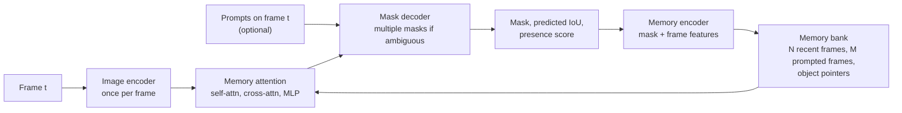

# SAM, SAM 2 and prompted video segmentation

This is the method note for promptable segmentation: the Segment Anything Model (SAM),
which returns masks for points, boxes or masks given on one image, and SAM 2, which
extends the same task to video with a memory of past frames and prompts. It fixes the
input and output contracts, the mechanisms that handle ambiguity and time, and the
evaluation protocols that make interactive and causal results comparable. Inventory
item APP-082 (SAM 2 video memory) is treated here at method depth.

## Problem and data contract

**Task.** SAM's *promptable segmentation* task is "to return a valid segmentation mask
given any prompt", where a valid mask, for an ambiguous prompt, is "a reasonable mask for
at least one" of the objects it could refer to [Kirillov et al. 2023, §2]. SAM 2's
*promptable visual segmentation* accepts clicks, boxes or masks "on any frame of a video",
responds immediately on the prompted frame and propagates the object to a *masklet*, its
mask sequence over the video [Ravi et al. 2024, §3].

**Data contract (official code, not executed).**

| Item | SAM (`SamPredictor`, segment-anything at commit `dca509f`) | SAM 2 (`SAM2VideoPredictor`, sam2 at commit `2b90b9f`) |
| --- | --- | --- |
| Image or video | `HWC` `uint8` in $[0,255]$, RGB by default, BGR accepted | A video loaded by `init_state(video_path)` |
| Points | $N\times2$ array of $(x,y)$ in original pixels; labels 1 foreground, 0 background | Per object id and frame; pixel coordinates normalized by the video width and height when `normalize_coords=True` |
| Box | Length-4 array, `XYXY` | Encoded as two corner points with labels 2 and 3 |
| Mask prompt | $1\times256\times256$ low-resolution logits from a previous call | Per object id and frame (`add_new_mask`) |
| Output | $C\times H\times W$ masks at the original size ($C=3$ with `multimask_output`), $C$ predicted quality scores, $C\times256\times256$ logits | For each frame, the object ids and their masks at video resolution; an object-presence logit internally |

Sources: predictor.py L34–L60, L92–L135; sam2_video_predictor.py L22–L52, L118–L150,
L161–L215, L546–L630. Neither output carries a class label: a mask is "an object" only in
the sense of the prompt. Downstream components (a detector supplying boxes, an annotation
tool, a tracker consuming masks) must supply the category and, in video, the decision of
which objects exist.

**Role in a pipeline.** Box-to-mask conversion behind a detector (the paper's zero-shot
instance segmentation prompts SAM with ViTDet boxes [Kirillov et al. 2023, §7.4]);
click-based annotation tools (SA-1B and SA-V were built this way [§4; Ravi et al., §5]);
video annotation and object-level video segmentation from a user-defined target.

## Intuition

A heavy image encoder runs once per image; a light prompt encoder and mask decoder then
answer each prompt in about 50 ms "in a web browser, on CPU" [Kirillov et al. 2023, §3].
A single click is ambiguous (whole object, part or subpart), so SAM returns three nested
masks with a predicted IoU for each instead of averaging them [§3, App. A]. SAM 2 keeps
the same decoder but feeds it frame features conditioned on a *memory bank*: compact
memories of recent frames, of every prompted frame and of "object pointers" that summarize
the target [Ravi et al., §4]. A correction on any frame enters that memory, which is why
one click can repair a lost object without restarting [Fig. 2].

*Illustration (from the SAM 2 paper, §D.1).* A click on a bicycle tire may mean the tire
or the whole bicycle; the ambiguity can persist over frames until more of the bicycle
becomes visible, so SAM 2 predicts several masks per frame and, without a follow-up
prompt, propagates the one with the highest predicted IoU [§4].



*Diagram: one SAM 2 step for one object, after Ravi et al., §4 and Fig. 3. With no memory
and one frame, the path reduces to SAM.*

## Prerequisites and competencies

**Required prerequisites**: [CV-SEGMENTATION](93-semantique-instances-panoptique.md)
(output contracts, IoU and boundary metrics). Useful background:

- interactive classical segmentation: [CV-GRABCUT](92-grabcut-regions.md);
- the distance transform used to place evaluation clicks: [CV-WATERSHED](91-otsu-distance-watershed.md);
- single-object tracking, drift and causal protocols: [CV-SOT](../../110-tracking-association/references/113-tracking-monoobjet.md);
- multi-object tracking and identity metrics: [CV-SORT](../../110-tracking-association/references/111-sort.md), [CV-METRIQUES-TEMPS](../../130-evaluation-fiabilite/references/132-tracking-trajectoires.md);
- detectors that provide box prompts, including text-conditioned ones: [CV-DETECTEURS](../../80-detection-pose/references/82-detection-fasterrcnn-yolo-detr.md), [CV-OPENVOC](../../80-detection-pose/references/83-detection-open-vocabulary.md).

Transformer attention is assumed. **Target competencies**: explain the prompt, ambiguity
and memory mechanisms, apply the predictor contracts, compare SAM 2 with per-frame
segmentation and trackers, evaluate under a stated interaction and time protocol, and
diagnose wrong-part masks, identity switches and lost objects.

## Assumptions, observability and degenerate cases

- **A prompt defines the target.** SAM segments what the prompt indicates; it does not
  enumerate or name objects. Its automatic mask generation prompts a regular grid of
  points (32×32 on the full image, plus crops) [App. B], which still yields unnamed masks.
  The released generator keeps masks whose predicted IoU exceeds 0.88 and whose stability
  score exceeds 0.95, then applies box NMS at 0.7 [automatic_mask_generator.py, L39–L44];
  nested whole, part and subpart masks can all survive, and pixels covered by no surviving
  mask stay unlabeled. A pixel can therefore belong to zero, one or several masks, where a
  semantic map gives it exactly one class (project deduction).
- **Objects with visible boundaries.** SAM 2 focuses on "valid objects which have a
  clearly defined boundary" and does "not consider regions without visual boundaries"
  [Ravi et al., App. B].
- **Domain coverage.** Zero-shot quality varies by dataset: SAM is compared on 23
  datasets and underperforms the interactive segmenter RITM on some of them by automatic
  metrics [Kirillov et al. 2023, §7.1, Fig. 9].
- **Fine detail.** SAM "can miss fine structures, hallucinates small disconnected
  components at times, and does not produce boundaries as crisply" as methods that zoom
  in [§8]; masks are decoded at a quarter of the input resolution (worked example A).
- **Video continuity.** SAM 2 "may fail to segment objects across shot changes and can
  lose track of or confuse objects in crowded scenes, after long occlusions or in extended
  videos", struggles with thin fast-moving objects and with nearby similar objects, and
  processes each object separately "without inter-object communication" [Ravi et al., App. C].

**Observability.** After a long occlusion among look-alike objects, identity is not
observable from appearance alone; SAM 2 has no explicit motion model [App. C]. A prompt
placed on a later frame makes every earlier output depend on the future: SAM 2 allows
prompted frames to "come from the future" relative to the current frame [§4].

**Degenerate cases.** A target may be absent on some frames; SAM 2 adds a head that
"predicts whether the object of interest is present" [§4], and the implementation fills
missing objects with a large negative score [sam2_video_predictor.py, L436–L460]. The
released video predictor refuses new object ids once tracking has started and asks for
`reset_state` [L145–L150]. With several prompts, SAM returns a single mask from a fourth
output token, because ambiguity is "much rarer with multiple prompts" [Kirillov et al.
2023, App. A].

## Procedure

```text
SAM, one image, interactive:
emb <- image_encoder(pad(resize_longest_side(img, 1024)))      # once per image, 64x64x256
loop over user or system prompts P:
    masks[3], iou[3], lowres <- decoder(emb, prompt_encoder(P), lowres_prev)
    keep argmax(iou) for a single click; the single output for several prompts
SAM 2, one object in a video:
for t in frames (streaming order; reverse pass optional offline):
    f_t <- image_encoder(frame_t)                                # once per frame
    c_t <- memory_attention(f_t, bank)                           # recent, prompted, pointers
    masks, iou, present <- decoder(c_t, prompts at t, if any)
    mask_t <- highest-iou mask unless prompts resolve the ambiguity
    bank.recent.push(memory_encoder(mask_t, f_t))                # FIFO of N frames
    if prompts at t: bank.prompted.push(...)                     # FIFO of M frames
```

Purpose of the steps. *Encoding once* amortizes the heavy computation over many prompts
[Kirillov et al. 2023, §3]. *Multiple outputs* represent ambiguity, and the predicted IoU
ranks them [§3]. *Memory attention* replaces re-segmentation from scratch: a frame is
interpreted with the target's recent appearance and the user's corrections [Ravi et al.,
§4]. *The presence head* lets the model say "absent" instead of always drawing a mask.
*The FIFO queues* bound memory and computation, at the cost of forgetting. Memory attention
stacks $L=4$ blocks of self-attention, cross-attention to the bank and MLP [§4, App. D];
recent-frame memories carry a temporal position encoding and prompted-frame memories do
not [§4]; memories are projected to 64 channels and each 256-dimensional object pointer,
taken from the decoder's output mask token, is split into four 64-dimensional tokens
[App. D].

## Mathematics, conventions and units

SAM and SAM 2 are trained networks without closed-form models; the quantities a user
must read correctly are the outputs, the training targets of the scores and the metrics.

- **Ambiguity-aware loss.** For a single prompt SAM predicts three masks, computes the
  loss of each against the ground truth and "only backpropagate[s] from the lowest loss";
  the mask loss is focal plus Dice in a 20:1 ratio [Kirillov et al. 2023, App. A].
- **Quality score.** A small head predicts each mask's IoU with the object; it is trained
  with a mean-squared error against the actual IoU [App. A]. It is therefore an
  *estimated IoU*, a ranking signal, not a class probability and not a calibrated
  confidence that the prompted object is the intended one.
- **Masks.** The decoder outputs logits on a $256\times256$ grid for the
  $1024\times1024$ padded input; the code upsamples them bilinearly to $1024\times1024$,
  crops the padding, resizes to the original size and thresholds at logit 0
  (`mask_threshold = 0.0`) [sam.py, L19, L133–L162].
- **Mask head.** After two two-way attention blocks, two transposed convolutions upsample
  the $64\times64$ embedding by 4 to 32 channels; an MLP maps each of the four mask tokens
  to a 32-value vector whose dot product with the upsampled embedding at every location
  gives one logit per location, a "dynamic linear classifier" [App. A; mask_decoder.py,
  L49–L69, L134–L147]. No output channel stands for a category. `multimask_output=True`
  returns tokens 1–3 and `False` returns token 0 [L101–L107], the token trained for
  multi-prompt inputs [App. A]; the released predictor leaves the choice to the caller and
  advises `False` for unambiguous prompts [predictor.py, L115–L120].
- **Video metric.** $\mathcal J$ is the region IoU of a frame's mask; $\mathcal F$ the
  F-measure of a bipartite matching between boundary pixels; $\mathcal J\&\mathcal F$
  averages the two, and DAVIS 2017 averages over object instances rather than sequences
  [Pont-Tuset et al. 2017, §3]. SAM 2 reports $\mathcal J\&\mathcal F$ for video and
  mIoU for images [Ravi et al., §6].


*Figure (project construction), schematic:* green boxes run once per image, violet boxes
per prompt; sizes from Kirillov et al. 2023, App. A, and segment-anything at `dca509f`
(build_sam.py L62–L65, prompt_encoder.py L50–L59, mask_decoder.py L49–L69). The
per-prompt part needs less than 1% of the image encoder's compute [App. A, training
algorithm] (CV-SAM-001).

### Worked example A: what one click becomes

Constructed example, recomputed by checks/94-sam-sam2.py. For a $1920\times1080$ frame,
the longest side is resized to 1024, giving $1024\times576$, and 448 rows of padding are
added at the bottom. A click at $(960,540)$ becomes $(512,288)$ in the resized input. The
$64\times64$ embedding has a stride of 16 input pixels and the $256\times256$ logits a
stride of 4, so one logit cell spans $4/(1024/1920)=7.5$ original pixels, and only 144 of
the 256 logit rows cover the image. A 3-pixel cable occupies 0.4 of a logit cell: its
mask exists only through bilinear interpolation of neighboring logits, consistent with
the reported loss of fine structures (project deduction). Running SAM on a crop around
the structure raises the effective resolution.

### Worked example B: how long SAM 2 remembers

Constructed example, recomputed by checks/94-sam-sam2.py. SAM 2's default memory keeps 6
recent frames [Ravi et al., App. A.2, Table 9c], 0.2 s at 30 frames/s and 0.4 s at 15
frames/s. During a 1-s occlusion at 30 frames/s, all recent memories are rewritten from
frames where the target is absent (with a learned occlusion embedding [App. D.1]); on
reappearance, the prompted-frame memories and the object pointers carry the target's
appearance (project deduction from §4). Frame rate therefore changes the memory span in
seconds, as it changes a tracker's update time constant.

## Parameters and tuning

| Parameter | Values in the sources | Effect | Interactions and what to watch |
| --- | --- | --- | --- |
| Prompt type and count | Points, boxes, masks; evaluation with 1, 3 or 5 clicks, box or mask [Ravi et al., Table 4] | Specificity of the target | One click is ambiguous; a box or several clicks reduce it |
| `multimask_output` | True: 3 masks for ambiguous prompts; False: one mask, better for unambiguous prompts [predictor.py L115–L120] | Ambiguity handling | Selecting by predicted IoU is not selecting by ground truth (oracle) |
| Image encoder | SAM ViT-B/L/H (91M, 308M, 636M parameters) [Kirillov et al. 2023, Fig. 13]; SAM 2 Hiera S, B+, L [Ravi et al., Table 9f] | Accuracy against speed | ViT-H has "only marginal gains" over ViT-L [§7, Fig. 13]; Hiera-L runs at 0.60× the speed of B+ |
| Input resolution | 1024 default; ablation 512/768/1024 [Table 9a] | Detail | 1024 runs at 0.22× the speed of 512 in the ablation model |
| Memories $N$ | 6 recent frames by default [App. A.2] | Temporal context | More memories "generally" help, with variance [Table 9c] |
| Correction policy | `add_all_frames_to_correct_as_cond`, `clear_non_cond_mem_around_input` (default False) | What a correction rewrites | Changes results for the same clicks; record it |
| Mask overlap | `non_overlap_masks=False` by default | Whether objects may share pixels | Enable or resolve overlaps for a partition output |

Tuning approach (project method): fix the protocol first (prompt type, click policy,
online or offline, frames allowed); then choose the encoder size on latency measured on
the target hardware; sweep prompt policies on held-out sequences with occlusions and
look-alike objects, and log the predicted IoU and presence score per frame to set
thresholds for automatic re-prompting.

## Properties and limits of guarantees

- **No semantics.** Outputs are class-agnostic masks. The paper's text-to-mask result is
  a "proof-of-concept" obtained by modifying training, described as "exploratory and not
  entirely robust" [Kirillov et al. 2023, §7.5, §8]; it is not a property of the standard
  predictor.
- **Ambiguity is represented, not resolved.** Three masks and their scores leave the
  choice to the caller; picking the best of three against ground truth is an oracle that
  the paper reports separately ("SAM (oracle)") [§7.1].
- **Speed is amortized.** Prompting is real-time, but "SAM's overall performance is not
  real-time when using a heavy image encoder" [§8].
- **Memory carries errors.** The same mechanism that recovers an object from one click
  can carry a confusion forward; SAM 2's own limitations list confusion in crowded scenes
  and among similar objects [Ravi et al., App. C].
- **Causality is a protocol property.** The model runs in streaming order, but the
  released predictor works on a stored video, can propagate in reverse, and accepts
  prompts on any frame [§4; sam2_video_predictor.py, L42–L52, L546–L551]. Whether a
  result is causal depends on which prompts and passes were allowed.
- **Paper version.** All SAM 2 results in the arXiv v2 paper use the improved release
  "SAM 2.1" [Ravi et al., footnote 1]; earlier checkpoints may behave differently.

## Cost and implementation

Cost drivers:

- **SAM**: one image-encoder pass per image at $1024\times1024$, then about 50 ms per
  prompt for prompt encoder and decoder on CPU [Kirillov et al. 2023, §3]. The image
  encoder dominates (636M parameters for the ViT-H model [Fig. 13]); the mask decoder
  "requires less than 1% of the image encoder's compute" [App. A, training algorithm].
- **SAM 2**: one encoder pass per frame plus memory attention and decoding per object;
  objects share only the per-frame embedding [Ravi et al., App. C], so cost grows with
  the number of tracked objects (project deduction). Reported speed on the
  semi-supervised VOS protocol: 43.8 and 30.2 frames/s for Hiera-B+ and Hiera-L on one
  A100 with batch 1 [§7], measured with PyTorch 2.3.1, CUDA 12.1, bfloat16 and a compiled
  image encoder [App. D.3]. On images, SAM 2 is "6× faster" than SAM with 58.9 against
  58.1 one-click mIoU on the 23-dataset suite [§6.3].
- **Memory**: memory features are projected to 64 channels, which makes storage "4×
  smaller" than 256 with little loss [App. A.2, Table 9d].

These speeds hold for their hardware, precision and batch settings; per-object and
per-prompt costs must be measured on the target device.

### Implementation contracts

Read in the official repositories at the commits named above; no code was executed.

- `SamPredictor.set_image(image, image_format="RGB")` computes the embedding;
  `predict(point_coords, point_labels, box, mask_input, multimask_output=True,
  return_logits=False)` returns masks, quality scores and low-resolution logits
  [predictor.py, L34–L60, L92–L166]. Resizing uses the longest side with rounding and
  bottom-right padding [transforms.py, L33–L45, L94–L102; sam.py, L164–L174].
- `SAM2VideoPredictor`: `init_state(video_path)` loads the frames;
  `add_new_points_or_box(inference_state, frame_idx, obj_id, ...)` and `add_new_mask`
  add prompts; `propagate_in_video(inference_state, start_frame_idx,
  max_frame_num_to_track, reverse=False)` yields `(frame_idx, obj_ids, video_res_masks)`
  [sam2_video_predictor.py, L42–L52, L161–L215, L300, L546–L630].

## Evaluation and controlled variation

**Protocols in the papers.**

| Setting | Prompt protocol | Metric | Source |
| --- | --- | --- | --- |
| SAM single point | One point at the "center" of the ground-truth mask, the maximum of its interior distance transform; most confident mask | mIoU over 23 datasets; human rating 1–10 | Kirillov et al. 2023, §7.1 |
| SAM 2 interactive, offline | Several passes; frames to interact with chosen by largest model error; 3 clicks per frame | $\mathcal J\&\mathcal F$ against the number of interacted frames, 9 datasets | Ravi et al., §6.1 |
| SAM 2 interactive, online | One forward pass; 3 clicks per interacted frame | Same | §6.1 |
| Semi-supervised VOS | 1, 3 or 5 clicks, a box or a mask on the first frame only | $\mathcal J\&\mathcal F$ over 17 datasets | §6.2, Table 4 |

Published results, each with its protocol: SAM 2 reaches "better segmentation accuracy,
with >3× fewer interactions" than SAM combined with XMem++ or Cutie in the interactive
settings [§6.1]; in semi-supervised VOS it scores 64.7, 75.3 and 77.6 $\mathcal J\&\mathcal F$
with 1, 3 and 5 first-frame clicks, 74.4 with a box and 79.3 with a mask [Table 4]. The
first-frame prompt alone moves the result by about 15 points.

Data-engine comparison with per-frame segmentation [Ravi et al., §5.1, Table 1, App. E.2.2]:
in a controlled experiment, three groups of annotators labelled the same 452 masklets in
169 videos with each phase's protocol. With image SAM on every frame (Phase 1),
annotation took 37.8 s per frame, every frame was edited and a clicked frame took 4.80
clicks; with SAM 2 in the loop (Phase 3), 4.5 s, 19.04% and 2.68, and 89.1% of the masks
matched the Phase 1 masks at IoU above 0.75 (72.8% for small objects, 100.0% for large).
These are human annotation times with models retrained during collection, not inference
costs.

*Worked example C (constructed, recomputed by the 2026-11-16 check script).* A 20-s clip
annotated at the engine's 6 frames/s has 120 frames: about $120\times37.8\ \mathrm s=75.6$ min
per object with Phase 1 against $120\times4.5\ \mathrm s=9$ min with Phase 3, of which about
23 frames are edited (CV-SAM-002).

### Proposed baseline and controlled variation (not executed)

- **Question**: how much of SAM 2's quality on our videos depends on access to future
  frames and later corrections?
- **Data**: held-out videos from the deployment domain with per-frame masks, absence
  labels, occlusions and look-alike objects.
- **Baseline**: online protocol: one forward pass, prompts only on the first frame
  (3 clicks from a fixed simulated policy), outputs recorded when produced.
- **Controlled variation**: offline protocol: same model, same first-frame prompts and
  same total click budget, but corrections may be placed on later frames and propagated
  in both directions.
- **Measurements**: per-frame $\mathcal J\&\mathcal F$ of the first available output and
  of the final output; frames with a mask while the target is absent; identity switches
  after crossings; time at which each frame's mask becomes available.
- **Expected effect (hypothesis)**: offline results are higher, mostly after occlusions
  and crossings; the gap measures what a causal deployment cannot have.
- **Confound**: the simulated corrective clicks are chosen with ground truth; report the
  click policy and treat it as an oracle bound.

**Measurement limits.** Ground truth enumerates one valid mask per prompt while several
may be valid, which "can make automatic metrics unreliable" [Kirillov et al. 2023, §7.1];
simulated clicks differ from real users; video benchmarks average over objects, hiding
rare long-term failures.

## Failure modes and diagnosis

| Symptom | Possible causes | Discriminating check | Conditional remedy |
| --- | --- | --- | --- |
| Mask covers a part instead of the object, or the reverse | Single-click ambiguity; selection by predicted IoU | Inspect the three masks and their scores | Add a point or a box; select by an explicit size or containment rule |
| Thin parts missing, ragged boundary | Quarter-resolution logits (example A); known fine-structure limit | Structure width in logit cells | Prompt on a crop; boundary refinement; another method for thin objects |
| Small stray blobs | Hallucinated disconnected components [§8] | Count connected components of the mask | Keep the component containing the prompt; fill or remove small regions |
| Mask moves to a similar object after a crossing | Appearance confusion, no motion model [App. C] | Frame of the switch; scores and presence along time | Corrective click (offline); motion gating or an external tracker |
| Object lost after a long occlusion or a cut | Recent memory overwritten (example B); shot change | Presence score timeline around the event | Re-prompt; detector-based re-initialization |
| Mask drawn while the object is absent | Presence threshold; distractor accepted | Presence scores on frames labelled absent | Calibrate the presence threshold on such frames |
| Cannot add an object mid-video | Implementation contract (`reset_state` required) | Error message | Declare objects before propagation or run separate states |
| Two objects share pixels | Objects processed separately; `non_overlap_masks=False` | Overlap between object masks | Enable the constraint or resolve by score |
| Prompts land in the wrong place | BGR/RGB, `XYXY` against `XYWH`, coordinate normalization | Overlay prompts on the input | Fix conventions at the interface |
| Benchmark result not reproduced in deployment | Offline corrections or oracle mask selection counted as causal | Re-run the online protocol | Report both protocols |

## Alternatives and applications

Conditional choices:

- **Prefer a dedicated interactive segmenter** when many clicks are acceptable and IoU
  must be maximal: the SAM authors "expect dedicated interactive segmentation methods to
  outperform SAM when many points are provided" [Kirillov et al. 2023, §8].
- **Prefer a closed-set instance or panoptic model** ([CV-SEGMENTATION](93-semantique-instances-panoptique.md))
  when classes are fixed and every object must be found and named without prompts.
- **Prefer detector boxes as prompts** when a detector already names objects and masks
  are needed, as in SAM's zero-shot instance segmentation [§7.4]; for text queries, an
  open-vocabulary detector ([CV-OPENVOC](../../80-detection-pose/references/83-detection-open-vocabulary.md))
  supplying boxes is a documented route, unlike the exploratory text prompt.
- **Prefer a box tracker** ([CV-SOT](../../110-tracking-association/references/113-tracking-monoobjet.md))
  when a box per frame suffices and compute is tight; **prefer tracking by detection**
  ([CV-SORT](../../110-tracking-association/references/111-sort.md)) when objects enter
  and leave and identities must be created automatically.
- **Prefer GrabCut** ([CV-GRABCUT](92-grabcut-regions.md)) on CPU-only systems with
  colour-separable targets and no model to deploy.

Industrial uses (project reasoning, not published results): box-to-mask conversion to
speed up annotation, with the reviewer's corrections logged; video annotation of parts
or tools with corrections on later frames, evaluated offline; grasp masks from detector
boxes in robotics, where the box detector carries the class and SAM only the shape.

## Guided reasoning and proposed checks

These constructed cases develop the prompt, mask ambiguity and temporal memory. They
explain or test reasoning; no image, video or hardware result is claimed as measured.
Method properties remain tied to the sources below.

### Case linked to CV-SAM-001

**Working question**: Does SAM automatically assign a semantic class to every pixel?

**Reference answer**: No: its central contract is the prompt-guided mask, not a complete semantic taxonomy.

**Reading the condition**: A point, box or mask designates the region of interest. Segmentation responds to this conditioning; assigning a class name afterwards requires other information or another component. A very precise mask can therefore be useful for annotation without directly providing a complete taxonomy.

**Constructed example**: A user designates one part among several objects. The mask produced delineates a candidate region, but does not show that it is the right type of part or that no other object has been missed. Evaluate boundary quality, ambiguities and correction effort with comparable prompts. If a pipeline adds text or a detector, describe this new chain instead of attributing its outputs to SAM alone. The contract depends on the checkpoint and interface actually used; a possibility explored in a paper is not automatically an available function of every distributed model.

### Case linked to CV-SAM-003

**Working question**: Why is interactive video annotation using corrections on future frames not directly comparable with a causal tracker?

**Reference answer**: It has different information; interaction budget and time access change the task.

**Difference of information**: Correcting a mask after seeing what follows can resolve an ambiguity that was real at the time of the frame. The final annotation then benefits from observations and interventions that are unavailable for an immediate decision. Final quality and on-time availability are two distinct properties.

**Proposed protocol**: Report the frames viewed, the number of clicks or corrections, the propagation allowed and the time when each output becomes available. Compare either at the same budget or as an explicitly different trade-off. Keep losses and ambiguities instead of erasing them with an uncounted reset. An interactive tool can be excellent at producing ground truth without being a deployable autonomous tracker with the same performance. This distinction protects the conclusions of the benchmark and ties human cost, time and quality to the actual use of the system.

**Documentary reference for this pass**: [SAM 2](https://arxiv.org/html/2408.00714v2), architecture, masklets, prompts and memory. The other developments are in the [flashcards](../94-sam-sam2.md).

## Additional technical explanations — 2026-10-30

These explanations complement the mechanism associated with each question. Calculations are constructed cases under stated assumptions; protocols remain proposals until a test is recorded.

### CV-SAM-001

**Situation**: Does SAM automatically assign a semantic class to every pixel?

**Prompt ambiguity**: A point on a shirt may refer to the shirt, the person or a visible part of it. Several masks can be compatible with the same prompt; the choice depends on the task contract and on additional information. The predicted quality score ranks the proposals according to the model, without assigning an application category to the region. To compare two uses, fix the placement and number of prompts, the mask-selection policy and the corrections allowed. Choosing the best mask a posteriori with the ground truth measures an oracle selection, different from the procedure actually available to the product.

### CV-SAM-002

**Situation**: What does SAM 2 add compared with independently segmenting each frame?

**Temporal state**: A propagation from memory depends on the history, not only on the current image. Two sequences reaching the same frame with different initializations can therefore produce different outputs. To diagnose an identity confusion, record the initialization frame, the prompts, the corrections, the processing order and the times of memory updates. Comparing a recovery with reset memory against the original continuation is a proposed ablation, with a stated information budget. A reset in which a human designates the right target should not be counted as autonomous recovery. The quality of a contour and the persistence of identity remain two separate properties.

### CV-SAM-003

**Situation**: Why is interactive video annotation using corrections on future frames not directly comparable with a causal tracker?

**Two curves to report**: For each frame, measure the quality of the first available output and the quality obtained after all allowed corrections. Associate each output with the time it becomes available and a number of interactions. The difference between the curves describes what offline revision contributed; it should not be erased in a final average presented as causal. A mask corrected at $t+2$ s may be excellent for annotating a video and too late for a decision at $t$. A common protocol must therefore fix access to frames, the accepted deadlines and the rule for counting corrections.

**Passages consulted for these developments**: [Kirillov et al., SAM](https://arxiv.org/html/2304.02643v1), §2, ambiguity and conditioned task; §3, model; the time protocols are project constructions, made without running SAM 2.

## Worked reasoning and boundary cases — 2026-11-08

The following are constructed project deductions and proposed checks, not
new empirical results. Each extends an existing recall objective; the concise
expected answer on its card remains the grading target.

### CV-SAM-003 — Causal inputs can still have delayed outputs

A sliding-window model may use only frames observed up to time $t$ and still return its estimate after a long computation. Causality therefore restricts information access, while timeliness restricts availability; they are independent axes. A proposed comparison records the latest input timestamp, initial output timestamp and any later revision timestamp for each mask. Evaluate mask quality only at the deadline relevant to the application rather than treating a causal architecture as proof of an on-time response.

Consulted foundations: [SAM](https://arxiv.org/html/2304.02643v1): §§2–3 promptable masks, ambiguity and mask-quality prediction; [SAM 2](https://arxiv.org/html/2408.00714v2): §§3–4 promptable video segmentation and memory.

## Sources

### Scientific sources

- [Kirillov et al. 2023, "Segment Anything" (arXiv v1)](https://arxiv.org/abs/2304.02643): §2 (promptable task, valid mask, composition with a detector), §3 (encoders, decoder, ambiguity, ~50 ms decoding, losses, 11 simulated rounds), §4 (data engine), §7.1 (single-point protocol, 23 datasets, oracle), §7.4 (boxes from ViTDet), §7.5 (text-to-mask proof of concept), §8 (limitations), App. A (1024 input, 64×64×256 embedding, minimum-loss training, fourth token, IoU head, 20:1 focal:Dice), App. B, Fig. 13.
- [Ravi et al. 2024, "SAM 2: Segment Anything in Images and Videos" (arXiv v2)](https://arxiv.org/abs/2408.00714): footnote 1 (SAM 2.1), §3 (PVS task, Fig. 2), §4 (streaming encoder, memory attention, multiple masks, presence head, memory encoder and bank, object pointers, training prompts), §6.1–§6.3, Table 4, §7 (speed), App. A.2 (Table 9), App. B, App. C, App. D.1, App. D.3.
- [Pont-Tuset et al. 2017, "The 2017 DAVIS Challenge on Video Object Segmentation"](https://arxiv.org/abs/1704.00675): §3, region and boundary measures and averaging over objects.

### Implementation sources

- [segment-anything at `dca509f`, `segment_anything/predictor.py`](https://github.com/facebookresearch/segment-anything/blob/dca509fe793f601edb92606367a655c15ac00fdf/segment_anything/predictor.py): `set_image` (L34–L60), `predict` (L92–L166).
- [segment-anything at `dca509f`, `segment_anything/utils/transforms.py`](https://github.com/facebookresearch/segment-anything/blob/dca509fe793f601edb92606367a655c15ac00fdf/segment_anything/utils/transforms.py): coordinate scaling (L33–L45), longest-side resize (L94–L102).
- [segment-anything at `dca509f`, `segment_anything/modeling/sam.py`](https://github.com/facebookresearch/segment-anything/blob/dca509fe793f601edb92606367a655c15ac00fdf/segment_anything/modeling/sam.py): `mask_threshold` (L19), mask post-processing (L133–L162), normalization and padding (L164–L174).
- [sam2 at `2b90b9f`, `sam2/sam2_video_predictor.py`](https://github.com/facebookresearch/sam2/blob/2b90b9f5ceec907a1c18123530e92e794ad901a4/sam2/sam2_video_predictor.py): options (L22–L39), `init_state` (L42–L52), object ids (L118–L150), prompts (L161–L215, L300), missing objects (L436–L460), `propagate_in_video` (L546–L630).

### Related flashcards and references

- [Flashcards](../94-sam-sam2.md): CV-SAM-001 (output contract), CV-SAM-002 (what memory adds), CV-SAM-003 (interactive versus causal evaluation).
- Related references: [CV-SEGMENTATION](93-semantique-instances-panoptique.md), [CV-GRABCUT](92-grabcut-regions.md), [CV-SOT](../../110-tracking-association/references/113-tracking-monoobjet.md).

Drafted by agent, 2026-10-18. Revision 8, 2026-11-14: body deepened and language corrected by Agent Claude Code (`revue-cartes`, self-review); see the [subject report](https://github.com/speillet/Knowledge_Computer_Vision/blob/main/docs/revues/2026-11-14-reference-depth/94-sam-sam2.md).
Revision 9, 2026-11-16: data-flow figure, mask head and token selection, automatic-generator filters, memory-attention details, the data-engine comparison and worked example C added while deepening CV-SAM-001 and CV-SAM-002, by Agent Claude Code (`revue-cartes`, self-review); see the [subject report](https://github.com/speillet/Knowledge_Computer_Vision/blob/main/docs/revues/2026-11-16-card-depth/94-sam-sam2.md).
